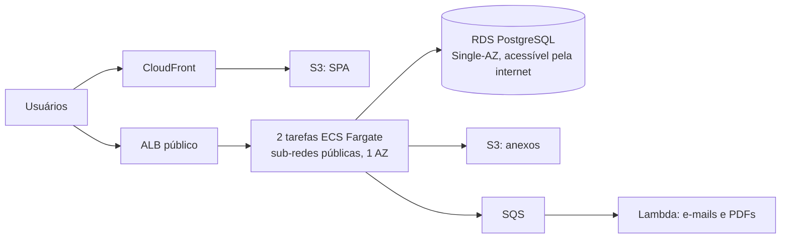

---
aliases:
  - Aula 26.1
modulo: 26
aula: 1
parte: "VIII Custo, projeto e prova"
dominios:
  - 1
  - 2
  - 3
  - 4
lida: false
tags:
  - aula
  - saa-c03
  - modulo-26
---

# Aula 26.1: O projeto PropDesk e os requisitos

[[26 - Projeto Pratico - Arquitetura de Referencia|Voltar ao módulo]]

> [!question] Pergunta que esta aula responde
> Como transformar um briefing de negócio em requisitos que decidem arquitetura, e por que o projeto começa de propósito por uma versão ingênua (a "v0") que será melhorada uma iteração por vez, uma por domínio da prova?

## Por que um projeto, e por que em iterações

Até aqui o curso ensinou serviço por serviço, e cada questão de prova parece pedir um serviço. Mas a prova SAA-C03 mede outra coisa: dado um **cenário com várias restrições ao mesmo tempo**, escolher uma combinação coerente. O [[02 - Well-Architected e o Formato da Prova|Módulo 2]] mostrou que as respostas certas seguem princípios (gerenciado, [[Desacoplamento|desacoplado]], [[Menor Privilegio|menor privilégio]], pagar pelo uso). Este módulo põe esses princípios para trabalhar em um sistema inteiro, do jeito que um arquiteto trabalha: **de um requisito para uma decisão, e de uma decisão para um custo**.

O método é o das revisões do [[Well-Architected Framework]]: nunca se projeta "a arquitetura perfeita" de uma vez. Projeta-se uma versão que funciona, e depois se passa por ela com uma lente de cada vez (segurança, resiliência, desempenho, custo). Cada passada encontra defeitos que a anterior não via e cria tensões novas: o que torna o sistema mais seguro pode encarecê-lo, o que o torna mais resiliente costuma custar dinheiro. Aprender a **nomear a tensão e decidir** é o que a prova cobra quando escreve "MOST cost-effective" ou "MOST secure" no fim do enunciado.

> [!info] Ligando os pontos
> Você opera algo parecido com isso no dia a dia: front-end Angular, API NestJS em [[ECS]] [[Fargate]], PostgreSQL no [[RDS]], filas [[SQS]], [[Cognito]], [[WAF]], [[KMS]] e [[Secrets Manager]]. O projeto usa uma plataforma **inventada** (nenhum dado, cliente ou número de empresa real) com a mesma forma, para você enxergar as decisões que normalmente já vêm prontas.

## O produto: PropDesk

**PropDesk** é um SaaS fictício B2B para administradoras de imóveis. Cada empresa cliente (um **[[Tenant|tenant]]**) abre chamados de manutenção dos imóveis que administra, cota e contrata prestadores, anexa fotos e recebe relatórios mensais em PDF. Funcionalidades que viram componentes de arquitetura:

| Funcionalidade | Componente que ela exige |
|---|---|
| Aplicação web de uma página (SPA) | Arquivos estáticos servidos ao mundo todo |
| Login de gestores e prestadores | Serviço de identidade com [[MFA]] e tokens [[JWT]] |
| API de chamados, orçamentos e usuários | Camada de aplicação sem estado, atrás de um balanceador |
| Dados transacionais (chamados, contratos) | Banco relacional PostgreSQL |
| Upload de fotos e documentos | [[Armazenamento de Objetos\|Armazenamento de objetos]], upload direto do navegador |
| E-mails, notificações push e importações em [[Processamento em Lote\|lote]] | Processamento assíncrono em filas e funções |
| Relatório mensal em PDF por [[Tenant\|tenant]] | Job agendado que roda por minutos e grava no armazenamento |
| Trilha de auditoria exigida pelos clientes | Logs imutáveis e consultáveis |

## Requisitos não funcionais: os números que decidem

Requisitos funcionais dizem **o que** o sistema faz; os **não funcionais** dizem **o quão bem**, e são eles que escolhem serviços. Estes são os de PropDesk (valores fictícios do exercício):

| Requisito | Valor | O que decide |
|---|---|---|
| [[Tenant\|Tenants]] | 1.500 empresas, 30.000 usuários ativos por mês | Modelo de isolamento e custo por tenant |
| Tráfego | Média de 80 requisições por segundo; pico diário de 300 entre 8h e 10h no horário comercial dos clientes | Auto scaling, cache, capacidade do banco |
| Dados | 400 GB no banco; 20 TB de anexos, crescendo cerca de 1 TB por mês, 90% nunca lidos depois de 60 dias | Classe de armazenamento e ciclo de vida |
| [[Disponibilidade]] | 99,9% por mês (cerca de 43 minutos de indisponibilidade permitida em 30 dias) | [[Multi-AZ]] obrigatório; multi-Region é opcional |
| [[Recuperacao de Desastres\|Recuperação de desastre]] | [[RPO]] de 15 minutos e [[RTO]] de 1 hora para API e banco | Estratégia de DR (aula 26.7) |
| Dados | Contêm [[PII\|dados pessoais]] de moradores e prestadores | Criptografia, segregação, retenção |
| Auditoria | Trilha de acesso e de mudança de configuração guardada por 7 anos | Contas de log separadas, retenção barata |
| Custo | Teto de US$ 8.000 por mês em infraestrutura (valor fictício) | Todo o Domínio 4 |

Duas contas simples já eliminam arquiteturas. **99,9% ao mês** vale `0,001 x 30 dias x 24 h x 60 min = 43,2 minutos`. Uma única [[Zona de Disponibilidade|AZ]] não sustenta isso, porque uma manutenção ou falha de AZ passa disso com facilidade. **Pico de 300 contra média de 80** diz que provisionar para o pico o tempo todo desperdiça cerca de 73% da capacidade (`1 - 80/300`), então a camada de aplicação precisa de escala automática.

> [!example] Lendo um requisito como a prova lê
> "Clientes da União Europeia exigem que os dados fiquem na UE." Isso não é um adjetivo: é um **requisito de [[Residencia de Dados|residência de dados]]** que elimina qualquer Região fora da UE, qualquer réplica entre continentes e qualquer cache que guarde dado pessoal fora dali. Um requisito de uma linha pode descartar metade das alternativas de uma questão. Treine a leitura: cada frase do cenário ou **cria** uma restrição ou **dá um número**.

## O modelo de tenancy: a primeira decisão que muda tudo

Em um SaaS, a decisão mais cara de reverter é como os [[Tenant|tenants]] compartilham a infraestrutura. A documentação do [[Well-Architected Framework]] (o SaaS Lens) descreve três modelos de [[Particao de Dados|particionamento]]:

- **Silo:** cada [[Tenant|tenant]] tem recursos dedicados (por exemplo, um banco por tenant). Isolamento forte, adequado a exigências de conformidade e a ajuste fino por tenant, mas custo e complexidade de operação maiores.
- **Pool:** todos os [[Tenant|tenants]] compartilham os mesmos recursos (um banco, uma camada de aplicação). Barato e fácil de operar, com o risco de um tenant afetar os outros ([[Vizinho Barulhento|vizinho barulhento]]) e com isolamento que depende de código.
- **Bridge:** mistura os dois, usando recursos dedicados onde a regulação ou o custo pedem e compartilhados no resto.

Para PropDesk, a decisão registrada é **bridge**: os 1.500 [[Tenant|tenants]] vivem em um **pool** (um cluster PostgreSQL, uma coluna `tenant_id` em toda tabela, mais [[Row-Level Security|row-level security]] do PostgreSQL como segunda trava, e anexos no [[S3]] sob um prefixo por tenant), e os poucos clientes enterprise que exigirem isolamento físico ganham um **silo** (banco dedicado, potencialmente em outra Região). O motivo é econômico e operacional: com 1.500 tenants, um banco por tenant multiplicaria instâncias, backups e migrações por mil.

> [!example] Por que isolamento por código não basta sozinho
> Um bug que esquece o filtro `WHERE tenant_id = ...` vazaria dados entre clientes. A [[Defesa em Profundidade|defesa em profundidade]] do [[19 - Seguranca de Aplicacoes e Deteccao de Ameacas|Módulo 19]] vale aqui: o código filtra, o banco **também** filtra por política de linha, e o identificador do [[Tenant|tenant]] vem **dentro do [[JWT|token JWT]]** assinado pelo [[Cognito]], nunca de um parâmetro que o cliente possa trocar.

## As iterações e o mapa do módulo

Cada aula seguinte pega a arquitetura anterior e aplica **uma lente**. A tabela é o mapa do módulo e, ao mesmo tempo, do que a prova cobra em cada domínio.

| Iteração | Lente (domínio da prova) | Pergunta que ela responde | Aula |
|---|---|---|---|
| v0 | nenhuma | O que funciona, e o que está errado? | esta aula |
| 1 | Segurança (Domínio 1, 30%) | Quem acessa o quê, e o que um invasor alcança? | [[26.02 - Iteracao 1 Seguranca em Camadas\|26.2]] |
| 2 | Resiliência (Domínio 2, 26%) | O que acontece quando uma peça falha? | [[26.03 - Iteracao 2 Resiliencia e Desacoplamento\|26.3]] |
| 3 | Desempenho (Domínio 3, 24%) | Onde está o gargalo no pico? | [[26.04 - Iteracao 3 Desempenho e Elasticidade\|26.4]] |
| 4 | Custo (Domínio 4, 20%) | Onde estamos pagando sem precisar? | [[26.05 - Iteracao 4 Custo Otimizado\|26.5]] |
| Escala | Multiconta e governança | Como vários times e ambientes convivem com segurança? | [[26.06 - Multiconta Governanca e Auditoria\|26.6]] |
| DR | Resiliência entre [[Regiao AWS\|Regiões]] e custo | Como sobreviver à perda de uma Região, e quanto custa o sistema inteiro? | [[26.07 - Plano de DR e Estimativa de Custo\|26.7]] |
| Revisão | Os seis pilares | O que ainda está fraco? | [[26.08 - Revisao Well-Architected e Trade-offs\|26.8]] |
| Mudanças | Exercícios no estilo da prova | O que muda quando o requisito muda? | [[26.09 - Mudancas de Requisito no Estilo da Prova\|26.9]] |

Em cada iteração o formato é o mesmo: **requisito, decisão, alternativa descartada, tensão criada**. Esse registro curto é um **[[ADR]]** (*architecture decision record*), prática de equipes reais que também funciona como método de estudo: se você consegue dizer por que descartou a alternativa, domina o par de serviços que a prova usa como [[Distrator|distrator]].

## A v0: a arquitetura que "funciona"

Antes de melhorar, desenhe o que um time apressado faria. A v0 de PropDesk entrega as funcionalidades, e só isso:

Essa figura tem pelo menos dez defeitos, e cada um é uma pergunta de prova disfarçada:

1. Tarefas e banco em [[Sub-rede Publica|sub-redes públicas]] (rede, [[06 - VPC a Fundo|Módulo 6]]).
2. Senha do banco em variável de ambiente no código (segredos, [[08 - Criptografia e Protecao de Dados|Módulo 8]]).
3. Uma única [[Zona de Disponibilidade|AZ]] para API e banco: não sustenta 99,9% (resiliência).
4. Sem [[WAF]] e sem proteção contra [[DDoS]] na borda ([[19 - Seguranca de Aplicacoes e Deteccao de Ameacas|Módulo 19]]).
5. A role das tarefas tem permissões amplas (`s3:*` em tudo) ([[04 - IAM Identidade e Acesso|Módulo 4]]).
6. Sem criptografia gerenciada com chave própria e sem [[Key Policy|política de chave]] ([[KMS]]).
7. Backup só o automático padrão, sem cópia para outra conta ou Região ([[20 - Alta Disponibilidade e Recuperacao de Desastres|Módulo 20]]).
8. Um pico de 300 requisições por segundo dependeria de adivinhar a capacidade (desempenho).
9. Anexos em [[S3]] Standard para sempre e tráfego de saída por [[NAT]] sem endpoint (custo).
10. Tudo em uma conta, com desenvolvedores e produção misturados (governança).

> [!tip] Hábito de prova
> Diante de um diagrama ou de uma descrição, procure primeiro os **[[Ponto Unico de Falha|pontos únicos de falha]]**, as **portas abertas** e os **segredos expostos**. A maioria das questões do Domínio 1 e do Domínio 2 pede só para consertar um desses.

## Premissas e o que fica de fora

Um projeto honesto declara o que **assume**. PropDesk assume: carga sem estado na API; um idioma de aplicação (TypeScript) sem requisito de licença comercial; usuários majoritariamente em uma Região geográfica no início (a Europa entra na [[26.09 - Mudancas de Requisito no Estilo da Prova|aula 26.9]]); e **nenhuma funcionalidade de IA** (os serviços de [[24 - Servicos de IA Gerenciados|Módulo 24]] entram só se um requisito os pedir). O projeto também **não** usa [[EC2]] puro, [[EKS]] ou [[API Gateway]] na base: a API roda em [[Fargate]] atrás de um [[Application Load Balancer]] porque, para uma equipe pequena que já opera [[ECS]], é a opção de menor [[Overhead Operacional]] que atende aos números (a comparação completa está na [[17.08 - Escolhendo a Computacao Tabela de Decisao|aula 17.8]]).

## Como isso cai na prova

> [!info] Task statements
> Esta aula não ensina um serviço novo: ela treina a leitura que serve a **todos** os task statements (de 1.1 a 4.4). O treino é extrair requisitos de um cenário e separar restrição de preferência.

**Palavras-chave em inglês que viram restrição:** *[[Multi-Tenant|multi-tenant]]*, *[[Isolamento de Tenant|tenant isolation]]*, *[[Residencia de Dados|data residency]]*, *compliance*, *least [[Overhead Operacional|operational overhead]]*, *[[Alta Disponibilidade|highly available]]*, *spiky traffic*, *unpredictable*, *[[RPO]] of X minutes*, *[[RTO]] of X hours*, *must not change the application*.

**Armadilhas frequentes:**

- Tratar a alternativa mais completa como a melhor. A prova pede a que atende **todos** os requisitos com o **[[Qualificador|qualificador]]** pedido (menor custo, menor overhead, mais seguro).
- Ignorar um número do enunciado. "[[RPO]] de 15 minutos" elimina backup noturno; "99,9%" elimina [[Zona de Disponibilidade|AZ]] única.
- Confundir **isolamento de dados** ([[Tenant|tenant]] não vê dado de outro) com **isolamento de falha** (um tenant não derruba os outros). São problemas diferentes com soluções diferentes.
- Escolher silo para tudo "por segurança", ignorando que o requisito era custo baixo para centenas de [[Tenant|tenants]] pequenos.

| Requisito no enunciado | Resposta provável | Por quê |
|---|---|---|
| Centenas de clientes pequenos, custo baixo, poucos exigem isolamento físico | [[Modelo Bridge\|Modelo bridge]] (pool para a maioria, silo para os exigentes) | Equilibra custo e conformidade |
| Cada cliente precisa de banco e chaves dedicados por contrato | Modelo silo | Isolamento forte, ajuste por [[Tenant\|tenant]] |
| "Pico previsível de 4x em horário comercial" | Auto scaling por política de acompanhamento de alvo ou agendada | Capacidade segue a demanda |
| "Menor [[Overhead Operacional\|overhead operacional]]" para uma API em [[Container\|containers]] | [[Fargate]] | Sem gerenciar instâncias |
| Dado pessoal precisa ficar na UE | Região da UE, sem réplica fora dela | [[Residencia de Dados\|Residência de dados]] |
| 99,9% de [[Disponibilidade\|disponibilidade]] mensal | Pelo menos duas [[Zona de Disponibilidade\|AZs]] | Uma AZ não sustenta 43 minutos de falha ao mês |

## Resumo

> [!abstract] A aula em uma frase
> Um projeto de arquitetura começa nos **requisitos não funcionais com números**, escolhe o modelo de tenancy como primeira decisão estrutural e melhora uma v0 funcional por iterações, uma lente de cada vez, registrando para cada decisão a alternativa descartada e a tensão criada.

**A lógica, em 5 passos**

1. O briefing vira requisitos funcionais (o que faz) e não funcionais (o quão bem, com números).
2. Os números eliminam alternativas: 99,9% exige [[Multi-AZ]], pico de 300 contra média de 80 exige escala automática.
3. O modelo de tenancy (silo, pool ou bridge) é a decisão estrutural mais cara de reverter.
4. A v0 entrega funcionalidades e carrega defeitos conhecidos, que as iterações corrigem por domínio.
5. Cada decisão deixa um [[ADR]] curto: requisito, decisão, alternativa descartada, tensão.

**Números para lembrar**

| O quê | Valor | Por que importa |
|---|---|---|
| 99,9% em 30 dias | 43,2 minutos de indisponibilidade | Exclui [[Zona de Disponibilidade\|AZ]] única |
| Pico 300, média 80 | 73% de capacidade ociosa se provisionar para o pico | Justifica auto scaling |
| Pesos dos domínios | 30, 26, 24, 20 | Ordem e tempo das iterações |

**Tabela-síntese: modelos de tenancy**

| Modelo | Recursos | Isola | Custo | Quando |
|---|---|---|---|---|
| Silo | Dedicados por [[Tenant\|tenant]] | Dados e falhas | Alto | Conformidade, contratos |
| Pool | Compartilhados | Só por código e políticas | Baixo | Muitos [[Tenant\|tenants]] pequenos |
| Bridge | Mistos | Conforme a necessidade | Médio | O caso real mais comum |

**Na prática, isso significa**

- Leia o cenário duas vezes: uma para os números, outra para as restrições escondidas em adjetivos.
- Registre decisões com a alternativa descartada: é assim que você memoriza os [[Distrator|distratores]].
- Procure [[Ponto Unico de Falha|ponto único de falha]], porta aberta e segredo exposto antes de qualquer outra coisa.

> [!tip] Liga com
> Vem do método de [[02.01 - Por que um Framework e Como Revisar uma Arquitetura|revisão do Well-Architected]] e do mapa de domínios da [[02.06 - Dominios Pesos e o Mapa para os Pilares|aula 2.6]]. Segue para a [[26.02 - Iteracao 1 Seguranca em Camadas|iteração de segurança]].

## Erros comuns

- **Começar pelos serviços em vez de pelos requisitos.** Escolher "[[ECS]], [[Aurora]] e [[CloudFront]]" antes de saber [[RPO]], pico e orçamento é decorar uma pilha, não projetar.
- **Confundir pool com "inseguro".** Pool bem feito (token com [[Tenant|tenant]], filtro no código e [[Row-Level Security|row-level security]] no banco) é seguro e barato; o risco está em depender de uma única camada.
- **Achar que silo resolve tudo.** Silo isola dados e falhas, mas multiplica operação, custo e tempo de entrega de cada mudança.
- **Tratar "sem estado" como detalhe.** Sem estado na API é o que permite [[Escalabilidade Horizontal|escalar horizontalmente]] e trocar tarefas sem perder sessão (aula [[12.01 - Escalar Horizontalmente e Aplicacao Stateless|12.1]]).
- **Dar a v0 como "errada" e jogá-la fora.** A v0 mostra o que já atende aos requisitos funcionais; as iterações **preservam** esse comportamento e corrigem as qualidades.

## Pratique

**1.** Uma plataforma SaaS tem 1.200 clientes pequenos sensíveis a preço e 5 clientes grandes que exigem por contrato banco e chaves dedicados. Qual modelo de tenancy atende ao conjunto com melhor equilíbrio entre custo e conformidade?

- [ ] a) Silo para todos os clientes, com um banco dedicado por tenant
- [ ] b) Pool para todos os clientes, com o filtro por tenant apenas no código da aplicação
- [ ] c) Bridge, com pool para os clientes pequenos e silo para os cinco exigentes
- [ ] d) Uma conta AWS separada para cada um dos 1.205 clientes

**2.** Um requisito de [[Disponibilidade|disponibilidade]] de 99,9% por mês permite aproximadamente quanto tempo de indisponibilidade em um mês de 30 dias?

- [ ] a) Cerca de 43 minutos
- [ ] b) Cerca de 4,3 minutos
- [ ] c) Cerca de 7,2 horas
- [ ] d) Cerca de 26 segundos

**3.** Uma API recebe em média 100 requisições por segundo, com um pico previsível de 400 durante duas horas por dia, e a empresa quer pagar só pela capacidade que usa. Qual abordagem de capacidade atende ao requisito?

- [ ] a) Provisionar fixo para 400 requisições por segundo o dia inteiro, para nunca haver lentidão
- [ ] b) Provisionar fixo para 100 requisições por segundo e aceitar a degradação no pico
- [ ] c) Migrar a API para uma única instância grande e reiniciá-la quando houver lentidão
- [ ] d) Escalar horizontalmente a camada sem estado com escala automática por demanda real

**4.** Em uma plataforma [[Multi-Tenant|multi-tenant]] em pool, um desenvolvedor esqueceu o filtro por [[Tenant|tenant]] em uma consulta. Qual medida em camadas impede o vazamento de dados mesmo com esse erro de código?

- [ ] a) Aumentar o tamanho do banco para que consultas lentas não exponham mais linhas
- [ ] b) Políticas de segurança em nível de linha no banco, além do filtro no código
- [ ] c) Criptografar o disco do banco com uma chave gerenciada pelo cliente
- [ ] d) Colocar o banco em uma sub-rede privada e remover o acesso pela internet

**5.** (Escolha DUAS.) Uma empresa descreve o requisito "os [[PII|dados pessoais]] dos clientes europeus não podem sair da União Europeia". Quais decisões de projeto esse requisito impõe?

- [ ] a) Escolher uma Região da União Europeia para banco e armazenamento
- [ ] b) Replicar o bucket de anexos para uma Região fora da UE como cópia de segurança
- [ ] c) Aplicar uma SCP que negue o uso de Regiões fora do conjunto aprovado
- [ ] d) Usar Transfer Acceleration para enviar os anexos por uma Região dos Estados Unidos
- [ ] e) Manter o banco em uma sub-rede pública para simplificar a auditoria

**6.** Uma equipe pequena já opera [[ECS]] e precisa expor uma API em [[Container|containers]] sem estado com o menor [[Overhead Operacional|overhead operacional]] possível. Qual combinação atende ao requisito?

- [ ] a) Instâncias EC2 em um grupo de Auto Scaling com o Docker instalado manualmente
- [ ] b) ECS com Fargate atrás de um Application Load Balancer, sem gerenciar servidores
- [ ] c) Um cluster EKS com nós autogerenciados e um Ingress Controller
- [ ] d) Uma única instância EC2 grande executando todos os containers

**7.** A arquitetura inicial de um projeto tem uma única [[Zona de Disponibilidade|AZ]] para API e banco, senha do banco em variável de ambiente e tarefas em [[Sub-rede Publica|sub-redes públicas]]. Qual é a melhor forma de usar essa versão inicial no processo de projeto?

- [ ] a) Descartá-la por completo e desenhar a versão final sem passar por iterações
- [ ] b) Considerá-la aceitável até o primeiro incidente de segurança em produção
- [ ] c) Corrigir apenas o custo, porque os defeitos de segurança só importam em empresas grandes
- [ ] d) Mantê-la como base funcional e corrigir os defeitos por iterações, uma lente de cada vez

**8.** Um enunciado diz: "A empresa precisa de [[RPO]] de 15 minutos e [[RTO]] de 1 hora para o banco de produção". Qual conclusão esse requisito permite tirar de imediato?

- [ ] a) Um backup noturno copiado para outra Região sozinho não atende ao RPO
- [ ] b) Basta o backup automático padrão com retenção de um dia, pois ele já garante um RPO baixo
- [ ] c) É obrigatório operar duas Regiões atendendo tráfego ao mesmo tempo
- [ ] d) O RTO de 1 hora torna desnecessário medir a perda de dados

**9.** Uma questão pede a solução "MOST cost-effective" para guardar anexos de 20 TB, dos quais 90% nunca são lidos depois de 60 dias, mantendo a [[Durabilidade|durabilidade]]. Qual informação do cenário é decisiva?

- [ ] a) O padrão de acesso: 90% dos objetos ficam frios e pedem uma classe mais barata
- [ ] b) O tamanho total de 20 TB, que obriga o uso de um sistema de arquivos compartilhado
- [ ] c) O fato de serem anexos, o que exige armazenamento em bloco para baixa latência
- [ ] d) A necessidade de nomes de arquivo em formato hierárquico, que só o EFS oferece

**10.** (Escolha DUAS.) Quais afirmações sobre isolamento em uma plataforma SaaS [[Multi-Tenant|multi-tenant]] estão corretas?

- [ ] a) O isolamento de dados e o isolamento de falhas são problemas distintos
- [ ] b) O identificador do tenant deve vir de um parâmetro de URL que o cliente escolhe
- [ ] c) No modelo pool, o isolamento depende de código e de políticas bem aplicadas
- [ ] d) O modelo silo elimina a necessidade de qualquer controle de acesso
- [ ] e) No modelo pool, todos os tenants sempre têm o mesmo desempenho garantido

> [!success]- Gabarito
> **1. c)** o bridge usa pool para os clientes baratos e silo para quem exige isolamento por contrato; a) silo para todos encarece e multiplica a operação; b) pool para todos não cumpre o contrato dos cinco; d) uma conta por cliente é silo extremo e inviável em gestão e custo.
> **2. a)** `0,001 x 43.200 min = 43,2 min`; b) seria 99,99%; c) seria 99%, cerca de 7,2 horas; d) seria quase 99,999%.
> **3. d)** a camada sem estado escala horizontalmente com a demanda e paga só o usado; a) paga o pico o dia inteiro; b) degrada no pico e viola o requisito; c) uma instância é [[Ponto Unico de Falha|ponto único de falha]] e escala só na vertical.
> **4. b)** a política em nível de linha do banco filtra mesmo se o código esquecer o filtro; a) tamanho não é controle de acesso; c) a criptografia protege o disco, não impede um usuário autenticado de ler linhas de outro [[Tenant|tenant]]; d) [[Sub-rede Privada|sub-rede privada]] trata o acesso de rede, não o vazamento lógico entre tenants.
> **5. a), c)** a Região da UE e a [[SCP]] que nega [[Regiao AWS|Regiões]] fora do conjunto são as decisões que garantem a residência (a SCP é o [[Controle Preventivo|controle preventivo]]; sem ela, alguém ainda poderia criar recursos fora da UE); b) replicar para fora da UE viola o requisito; d) o [[Transfer Acceleration]] roteia por borda e Região de fora; e) banco em [[Sub-rede Publica|sub-rede pública]] não ajuda a auditoria e amplia a exposição.
> **6. b)** [[Fargate]] com [[Application Load Balancer|ALB]] não exige gerenciar instâncias; a) exige gerenciar sistema, patches e [[Docker]]; c) o [[EKS]] com nós autogerenciados tem o maior overhead; d) uma instância única é [[Ponto Unico de Falha|ponto único de falha]] e gerenciamento manual.
> **7. d)** manter a versão funcional e corrigir por iterações é o método do [[Well-Architected Framework|Well-Architected]]; a) descartar e redesenhar de uma vez perde a rastreabilidade das decisões; b) esperar um incidente é o oposto de projetar; c) segurança importa em qualquer porte.
> **8. a)** um backup noturno deixa até 24 horas de perda, bem acima de 15 minutos; b) um dia de retenção não define o [[Recovery Point|ponto de recuperação]] em minutos; c) [[Multi-Site Active-Active|ativo-ativo]] não é obrigatório para [[RPO]] de 15 minutos, replicação contínua resolve; d) o RPO continua um requisito independente do [[RTO]].
> **9. a)** o padrão de acesso frio define o custo e leva a ciclo de vida ou [[S3 Intelligent-Tiering|Intelligent-Tiering]]; b) objetos não exigem sistema de arquivos; c) bloco é para volumes de instância, não para anexos; d) o [[S3]] já organiza chaves com prefixos, e o [[EFS]] não é o único com hierarquia.
> **10. a), c)** dados e falhas são problemas diferentes, e no pool o isolamento depende de código e políticas; b) o [[Tenant|tenant]] deve vir do token assinado, não de parâmetro que o cliente controle; d) o silo ainda precisa de controle de acesso; e) no pool existe o [[Vizinho Barulhento|vizinho barulhento]], sem garantia igual de desempenho.

## Para aprofundar

- [ ] [SaaS Lens: Silo, Pool and Bridge Models](https://docs.aws.amazon.com/wellarchitected/latest/saas-lens/definitions.html) (AWS Documentation): definição oficial dos três modelos de [[Particao de Dados|particionamento]] usados nesta aula.
- [ ] [SaaS Lens: the bridge model](https://docs.aws.amazon.com/wellarchitected/latest/saas-lens/bridge-model.html) (AWS Documentation, [[Well-Architected Framework|Well-Architected]] SaaS Lens): como combinar silo e pool em uma mesma solução, com prós e contras.
- [ ] [AWS Well-Architected Framework: pillars](https://docs.aws.amazon.com/wellarchitected/latest/framework/definitions.html) (AWS Documentation): os seis pilares que as iterações do módulo percorrem.

Próxima aula: [[26.02 - Iteracao 1 Seguranca em Camadas|Aula 26.2: Iteração 1, segurança em camadas]].
