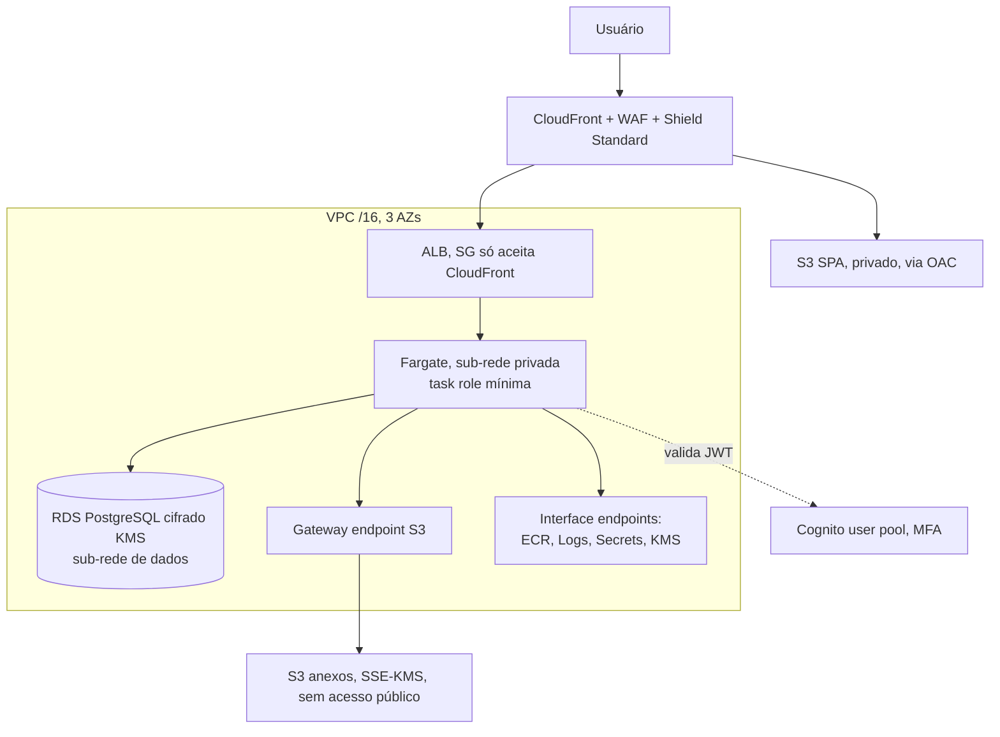

---
aliases:
  - Aula 26.2
modulo: 26
aula: 2
parte: "VIII Custo, projeto e prova"
dominios:
  - 1
lida: false
tags:
  - aula
  - saa-c03
  - modulo-26
---

# Aula 26.2: Iteração 1, segurança em camadas

[[26 - Projeto Pratico - Arquitetura de Referencia|Voltar ao módulo]]

> [!question] Pergunta que esta aula responde
> Passando a v0 do PropDesk pela lente do Domínio 1, quais camadas (identidade, borda, rede, aplicação, dados) fecham cada defeito, e que custo ou complexidade cada controle traz?

## O método: perguntar quem alcança o quê

Segurança em arquitetura começa por uma pergunta simples, repetida em cada camada: **se esta peça for comprometida, o que o invasor alcança?** A resposta é o **raio de impacto** ([[Raio de Impacto]]). O objetivo da iteração não é "adicionar serviços de segurança", é encolher esse raio com camadas independentes, de modo que uma falha em uma não abra todas ([[Defesa em Profundidade]]). A v0 da [[26.01 - O Projeto PropDesk e os Requisitos|aula 26.1]] tem raio máximo: banco na internet, senha no código, role com `s3:*`, nenhuma barreira na borda.

Percorra o caminho de um pedido do navegador até o dado e pare em cada fronteira. São cinco camadas, e cada uma tem um serviço dono nos módulos anteriores.

| Camada | Pergunta | Decisão no PropDesk | Módulo |
|---|---|---|---|
| Borda | Quem consegue chegar à aplicação? | [[CloudFront]] + [[WAF]] + Shield Standard, [[Application Load Balancer\|ALB]] só aceita a CloudFront | 18, 19 |
| Rede | Por onde o tráfego anda? | [[VPC]] em 3 camadas, [[Sub-rede Privada\|sub-redes privadas]], [[Security Group\|security groups]] encadeados, endpoints | 6 |
| Identidade | Quem é a pessoa, e quem é o serviço? | [[Cognito]] (usuários), roles de tarefa e de função (serviços), [[IAM Identity Center\|Identity Center]] (humanos) | 4, 5, 19 |
| Aplicação | A aplicação confia em quê? | [[JWT]] validado, [[Tenant\|tenant]] vindo do token, segredos no [[Secrets Manager]] | 8, 19 |
| Dados | Se alguém ler o disco ou o [[Bucket\|bucket]]? | [[KMS]] com chave do cliente, [[TLS]] em trânsito, bucket sem acesso público | 8, 11 |

## Rede: três camadas, três AZs, nada de banco público

O requisito de [[Disponibilidade|disponibilidade]] da [[26.03 - Iteracao 2 Resiliencia e Desacoplamento|próxima iteração]] vai exigir três [[Zona de Disponibilidade|AZs]], então a rede já nasce assim. A [[VPC]] usa um [[CIDR]] `/16` (65.536 endereços) que não sobrepõe o da rede do escritório nem o de futuras VPCs (a razão está na [[03.02 - IPv4 CIDR e Mascaras de Rede|aula 3.2]]): sobreposição impede peering e roteamento híbrido. Em cada AZ, três [[Sub-rede|sub-redes]] `/20` (4.096 endereços, dos quais a AWS reserva 5 por sub-rede):

| Camada | [[Sub-rede\|Sub-redes]] | O que vive ali | Rota para a internet |
|---|---|---|---|
| Pública | 3 (uma por [[Zona de Disponibilidade\|AZ]]) | [[Application Load Balancer\|ALB]] e [[NAT Gateway\|NAT Gateways]] | Rota `0.0.0.0/0` para o [[Internet Gateway]] |
| Aplicação (privada) | 3 | Tarefas [[Fargate]] e Lambdas em [[VPC]] | `0.0.0.0/0` para o [[NAT Gateway]] da própria [[Zona de Disponibilidade\|AZ]] |
| Dados (privada) | 3 | [[RDS]], [[ElastiCache]] | Nenhuma rota de saída |

Nove [[Sub-rede|sub-redes]] de 4.096 endereços usam `9 x 4.096 = 36.864` do `/16`, sobrando espaço para outras redes e para crescer. O que torna uma sub-rede "pública" é só a rota para o [[Internet Gateway]] ([[Sub-rede Publica]] contra [[Sub-rede Privada]]), e a camada de dados **nem sai** para a internet: não precisa, e uma rota a menos é um caminho a menos.

Os [[Security Group|security groups]] formam uma corrente, cada elo referenciando o anterior em vez de faixas de IP:

1. **SG do [[Application Load Balancer|ALB]]:** entrada 443 apenas da **[[Managed Prefix List|lista de prefixos]] gerenciada do [[CloudFront]]** (`com.amazonaws.global.cloudfront.origin-facing`), assim só entra tráfego **vindo do CloudFront**. Atenção: a lista cobre os IPs de **todas** as [[CloudFront Distribution|distribuições do CloudFront]], de **qualquer** conta, então um atacante com a própria distribuição apontada para o seu ALB ainda passa pelo [[Security Group|security group]]. Por isso a AWS recomenda somar um **cabeçalho secreto**: a distribuição do PropDesk o envia em toda requisição à origem e uma regra do [[Listener|listener]] do ALB só encaminha quando o valor confere (o cabeçalho identifica a **sua** distribuição). Uma alternativa mais nova é colocar o ALB em [[Sub-rede Privada|sub-rede privada]] e usar **origens [[VPC]]** do CloudFront (verificado em novembro de 2026; a [[18.03 - Origens OAC Failover e Origin Shield|aula 18.3]] trata das origens).
2. **SG das tarefas:** entrada na porta da aplicação apenas **do SG do [[Application Load Balancer|ALB]]**.
3. **SG do banco:** entrada na porta 5432 apenas **do SG das tarefas** e do SG das funções que tocam o banco.

Os [[Network ACL|network ACLs]] ficam no padrão (permitem tudo) como segunda camada deliberadamente simples: eles são **[[Stateless|stateless]]** e exigem regras de [[Porta Efemera|portas efêmeras]], então só valem a complexidade para bloquear um IP ou faixa específica. Em prova, "bloquear um endereço IP malicioso" aponta para NACL (que tem *deny*) ou [[WAF]] (na borda), nunca para [[Security Group|security group]] (que só tem *allow*).

> [!example] Substituindo o bastion host
> O time de suporte precisava abrir um shell no [[Container|container]] e consultar o banco. A v0 tinha uma porta SSH aberta. Na iteração 1 não existe porta de administração: o acesso interativo usa o **[[Session Manager]]** do [[Systems Manager]] (ou o [[ECS Exec]] para containers), autenticado pelo [[IAM]], com cada sessão registrada. A porta 22 deixa de existir no desenho.

### Endpoints: tráfego privado também é segurança

As tarefas em [[Sub-rede Privada|sub-rede privada]] alcançam serviços da AWS por dois caminhos: via [[NAT]] para a internet, ou por [[VPC Endpoint|endpoints]] que mantêm o tráfego na rede da AWS. Dois tipos, com custos opostos (aula [[06.08 - Gateway Endpoints para S3 e DynamoDB|6.8]] e [[06.09 - Interface Endpoints PrivateLink e Endpoint Policies|6.9]]):

- **[[Gateway Endpoint]]** para [[S3]] e [[DynamoDB]]: entrada na [[Route Table|route table]], sem custo adicional. O acesso aos anexos nunca passa pela internet. Entra de graça e sempre.
- **[[Interface Endpoint]]** ([[PrivateLink]]) para o resto: uma [[ENI]] por [[Zona de Disponibilidade|AZ]], cobrada por hora e por GB. Candidatos para as tarefas: [[ECR]] (duas entradas, API e [[Docker]], mais o gateway do [[S3]] que as camadas de imagem usam), [[CloudWatch Logs]], [[Secrets Manager]] e [[KMS]]. Eles tiram esse tráfego do [[NAT]] e permitem restringir por **[[Endpoint Policy|endpoint policy]]** (por exemplo, "só o meu [[Bucket|bucket]]"), mas têm um custo fixo por AZ.

Essa é a primeira **tensão** do projeto: cada [[Interface Endpoint|interface endpoint]] melhora a postura e substitui custo variável do [[NAT]] por fixo. A aula [[26.05 - Iteracao 4 Custo Otimizado|26.5]] fecha a conta.

## Identidade: ninguém tem chave de longo prazo

O princípio é [[Menor Privilegio]], e a regra prática é simples: **nenhum humano ou serviço usa [[Access Key|access key]] permanente**.

- **Humanos:** [[IAM Identity Center]] com o [[Identity Provider|provedor de identidade]] da empresa, [[Permission Set|permission sets]] e [[MFA]]; o usuário [[Usuario Root]] da conta fica trancado com MFA e fora do dia a dia.
- **Tarefas [[ECS]]:** duas roles distintas. A **[[Task Execution Role|task execution role]]** é do agente do ECS (puxa imagem do [[ECR]], escreve logs, lê o segredo para injetá-lo); a **[[Task Role]]** é da aplicação (acessa [[S3]], [[SQS]]). Confundir as duas é pegadinha clássica da [[17.03 - ECS Cluster Task Definition e Service|aula 17.3]]. A task role do PropDesk permite `s3:GetObject` e `s3:PutObject` **apenas** no prefixo de anexos e `sqs:SendMessage` apenas na fila de trabalho.
- **Funções Lambda:** uma execution role por função, só com o que ela usa.
- **Desenvolvedores criando roles:** [[Permissions Boundary]] limita o teto de permissões que eles conseguem conceder, para que ninguém escale privilégio criando uma role mais poderosa que a própria.

Para o acesso dos **usuários finais** (gestores e prestadores), o [[Cognito]] [[User Pool|user pool]] autentica, aplica [[MFA]] e emite tokens [[JWT]]. A API valida a assinatura e lê o `tenant_id` de um claim do token. Já o [[Identity Pool]] só entra se o navegador precisar de credenciais AWS temporárias (por exemplo, para falar direto com o [[S3]]). No PropDesk não precisa: o upload usa **[[Presigned URL|presigned URL]]**.

> [!example] Upload sem dar credencial ao navegador
> O gestor escolhe uma foto. O navegador pede à API uma [[Presigned URL]]; a API (que tem a [[Task Role|task role]]) gera uma URL assinada para a chave `anexos/<tenant>/<uuid>`, válida por poucos minutos, só para `PUT`. O navegador envia o arquivo direto ao [[S3]], sem passar pela API e sem nunca ver uma credencial. O prefixo por [[Tenant|tenant]] é gerado no servidor, nunca pelo cliente.

## Aplicação e dados: segredos, chaves e criptografia

**Segredos.** A senha do banco sai da variável de ambiente e vai para o [[Secrets Manager]] com **rotação automática** (integra com [[RDS]]). A [[Task Execution Role|task execution role]] lê o segredo na inicialização. Configuração não sensível (um endereço, um nome de fila) pode ficar no [[Parameter Store]] por ser mais barato; o contraste completo está na [[08.08 - Secrets Manager e Parameter Store|aula 8.8]].

**Chaves.** Uma [[Customer Managed Key]] do [[KMS]] por ambiente cifra [[RDS]], [[S3]], o segredo e os logs. O ganho de usar a chave do cliente em vez da gerenciada pela AWS é a **[[Key Policy|key policy]]**: você decide quem usa a chave e pode **desabilitá-la** em uma emergência. A key policy é a raiz da autorização, então inclua a conta (para o [[IAM]] funcionar), os administradores da chave (sem permissão de uso) e as roles de uso. O custo: cada chamada ao KMS é uma requisição cobrada e sujeita a cotas, por isso o S3 usa **[[S3 Bucket Keys|Bucket Keys]]** para reduzir as chamadas na leitura e gravação de milhões de objetos.

**Em repouso.** O [[RDS]] **só** é criptografado na criação (para cifrar um banco já existente, restaure um [[Snapshot|snapshot]] cifrado), então ative na criação. O [[Bucket|bucket]] de anexos usa [[SSE-KMS]] com a chave do ambiente, tem o **[[Block Public Access]]** ligado e uma [[Bucket Policy|bucket policy]] que **nega** requisições sem [[TLS]] (`aws:SecureTransport = false`). O bucket da SPA é privado e só o [[CloudFront]] o lê, via [[Origin Access Control]].

**Em trânsito.** Certificados públicos do [[ACM]], gratuitos e com renovação automática, no [[CloudFront]] (o certificado **precisa estar em us-east-1**) e no [[Application Load Balancer|ALB]]. O tráfego do ALB para as tarefas pode ser [[TLS]] ou [[HTTP]] dentro da [[VPC]] conforme a exigência de conformidade; quando o requisito diz "criptografia ponta a ponta", escolha TLS também no segundo salto.

**[[PII|Dados pessoais]] nos anexos.** O [[Macie]] pode varrer o [[Bucket|bucket]] e apontar dados pessoais em arquivos que os usuários enviaram. É controle de **descoberta**, não de bloqueio, e cobra por volume analisado (aula [[08.09 - Governanca de Dados Object Lock e Macie|8.9]]).

## Borda: filtrar antes de chegar

Na frente de tudo, o [[CloudFront]] termina [[TLS]] e carrega o [[WAF]] (um [[Web ACL|web ACL]] de escopo `CLOUDFRONT`, também criado em us-east-1) com **grupos de [[Managed Rule Group|regras gerenciadas]]** (proteção contra [[SQL Injection]] e vulnerabilidades comuns) e uma **[[Rate-Based Rule|regra baseada em taxa]]** que limita requisições por IP contra abuso de login. O [[Shield]] Standard protege contra [[DDoS]] das camadas 3 e 4 sem custo e sem configuração; o Shield Advanced só entra com requisito de resposta dedicada e proteção de custo, o que PropDesk não declarou. O [[Application Load Balancer|ALB]] também pode ter um web ACL regional, mas, com o ALB aceitando só tráfego do CloudFront, o WAF na distribuição costuma bastar.

> [!info] Ligando os pontos
> A detecção contínua ([[GuardDuty]], Inspector, [[Security Hub]], [[CloudTrail]], Config) vive no nível da **conta e da organização**, não do componente, e é tema da [[26.06 - Multiconta Governanca e Auditoria|aula 26.6]]. O escaneamento de imagens do [[ECR]], que o [[Inspector]] usa, entra na esteira de entrega. Para o que fazer com chaves e certificados, veja o [[08 - Criptografia e Protecao de Dados|Módulo 8]]; para as ameaças da borda, o [[19 - Seguranca de Aplicacoes e Deteccao de Ameacas|Módulo 19]].

## O que a iteração custou e o que ela não resolve

Segurança tem preço: [[NAT]] por [[Zona de Disponibilidade|AZ]], endpoints de interface por AZ, [[WAF]] (por [[Web ACL|web ACL]], por regra e por requisição), [[KMS]] por requisição, [[Secrets Manager]] por segredo e por chamada. Esses itens aparecem na estimativa da [[26.07 - Plano de DR e Estimativa de Custo|aula 26.7]]. E uma arquitetura segura **ainda cai** se a AZ falhar ou o pico chegar: isso é a iteração 2.

## ADRs desta iteração

Registro curto de cada decisão, no formato prometido na [[26.01 - O Projeto PropDesk e os Requisitos|aula 26.1]].

| Requisito | Decisão | Alternativa descartada | Tensão criada |
|---|---|---|---|
| Ninguém alcança o [[Application Load Balancer\|ALB]] sem passar pelo [[WAF]] | [[Managed Prefix List\|Lista de prefixos]] do [[CloudFront]] mais cabeçalho secreto no ALB | Só a lista de prefixos; ou ALB aberto com [[Web ACL\|web ACL]] próprio | Um segredo a rotacionar; menos proteção da borda no ALB aberto |
| Banco acessível só pela aplicação | Três camadas de [[Sub-rede\|sub-redes]], SGs encadeados por referência | Banco em [[Sub-rede Publica\|sub-rede pública]] com senha forte | Mais sub-redes e SGs para manter; [[NAT]] e endpoints para a saída |
| Nenhuma credencial de longo prazo | [[Task Role\|Task role]] mínima, [[IAM Identity Center\|Identity Center]], [[Secrets Manager]] com rotação | [[Access Key\|Access keys]] em variáveis de ambiente | Mais roles e políticas a revisar; custo por segredo e por chamada |
| Poder desabilitar a chave em um incidente | [[Customer Managed Key\|Customer managed key]] do [[KMS]] com [[Key Policy\|key policy]] própria | [[AWS Managed Key\|Chave gerenciada pela AWS]] | Custo por chave e por requisição; [[S3 Bucket Keys\|Bucket Keys]] no [[S3]] para reduzir |
| Tráfego do [[S3]] e dos serviços fora da internet | [[Gateway Endpoint\|Gateway endpoint]] do S3 e [[Interface Endpoint\|interface endpoints]] seletivos | Tudo pelo [[NAT]] | Interface endpoints têm custo fixo por [[Zona de Disponibilidade\|AZ]] (fechado na 26.5) |

## Como isso cai na prova

> [!info] Task statements 1.1, 1.2 e 1.3
> 1.1 (acesso seguro: roles, [[STS]], [[Menor Privilegio|menor privilégio]], [[MFA]]); 1.2 ([[VPC]] com [[Security Group|security groups]], [[Route Table|route tables]], [[Network ACL|NACLs]] e [[NAT]], segmentação, Shield, [[WAF]], [[Secrets Manager]]); 1.3 ([[KMS]], [[ACM]], [[Key Policy|políticas de chave]], rotação).

**Palavras-chave em inglês:** *[[Menor Privilegio|least privilege]]*, *without exposing to the internet*, *[[Sub-rede Privada|private subnet]]*, *no long-term credentials*, *rotate automatically*, *[[Criptografia em Repouso|encryption at rest]]*, *[[Customer Managed Key|customer managed key]]*, *block a specific IP*, *[[SQL Injection|SQL injection]]*, *[[DDoS]]*, *prevent public access*.

**Armadilhas frequentes:**

- [[Security Group|Security group]] não tem *deny*: para negar um IP, [[Network ACL|NACL]] ou [[WAF]].
- [[Gateway Endpoint|Gateway endpoint]] só existe para [[S3]] e [[DynamoDB]] e é grátis; o resto é [[Interface Endpoint|interface endpoint]], cobrado.
- **[[Task Role|Task role]]** (aplicação) contra **[[Task Execution Role|task execution role]]** (agente do [[ECS]]).
- Certificado do [[CloudFront]] em us-east-1, não na Região do [[Application Load Balancer|ALB]].
- [[RDS]] não se cifra depois de criado: restaura-se um [[Snapshot|snapshot]] cifrado.
- [[WAF]] não protege contra [[DDoS]] de camadas 3 e 4: isso é Shield.

| Requisito no enunciado | Resposta provável | Por quê |
|---|---|---|
| Banco acessível só pela aplicação | [[Sub-rede Privada\|Sub-rede privada]] e SG do banco referenciando o SG da aplicação | Rede e [[Menor Privilegio\|menor privilégio]] |
| Bloquear um endereço IP malicioso | [[Network ACL\|NACL]] com deny ou regra de IP no [[WAF]] | SG só permite |
| Aplicação lê [[S3]] sem sair para a internet | [[Gateway Endpoint\|Gateway endpoint]] do S3 | Grátis, via [[Route Table\|route table]] |
| Trocar a senha do banco sem mexer no código | [[Secrets Manager]] com rotação | Rotação nativa para [[RDS]] |
| Controlar e poder desabilitar a chave de criptografia | [[Customer Managed Key\|Customer managed key]] no [[KMS]] | [[Key Policy\|Key policy]] do cliente |
| Proteger contra [[SQL Injection\|SQL injection]] e rate abuse | [[WAF]] com [[Managed Rule Group\|regras gerenciadas]] e rate-based | [[Modelo OSI\|Camada 7]] |
| Navegador envia arquivo ao [[S3]] sem credencial permanente | [[Presigned URL]] | [[Credencial Temporaria\|Credencial temporária]], escopo mínimo |

## Resumo

> [!abstract] A aula em uma frase
> A segurança do PropDesk vem de **camadas independentes** (borda, rede, identidade, aplicação, dados), cada uma encolhendo o [[Raio de Impacto|raio de impacto]], com identidade por role e [[Credencial Temporaria|credencial temporária]], tráfego privado por endpoints e chaves sob controle do cliente.

**A lógica, em 5 passos**

1. Pergunte a cada fronteira "se esta peça cair, o que o invasor alcança?".
2. Rede: três camadas em três [[Zona de Disponibilidade|AZs]], banco sem rota de saída, [[Security Group|security groups]] encadeados por referência.
3. Identidade: sem [[Access Key|access key]] permanente, [[Task Role|task role]] mínima, [[IAM Identity Center|Identity Center]] para humanos, [[Cognito]] para usuários.
4. Dados: segredos no [[Secrets Manager]] com rotação, [[KMS]] com chave do cliente, [[TLS]] em trânsito, [[Bucket|bucket]] sem acesso público.
5. Borda: [[WAF]] e Shield Standard na frente, [[Application Load Balancer|ALB]] aceitando só o [[CloudFront]].

**Tabela-síntese: onde cada controle atua**

| Controle | Camada | Bloqueia |
|---|---|---|
| [[WAF]] | Borda, [[Modelo OSI\|L7]] | Injeção, abuso por taxa, IPs |
| Shield | Borda, [[Modelo OSI\|L3]] e L4 | [[DDoS]] volumétrico |
| [[Security Group\|Security group]] | Rede, instância | Tráfego não referenciado (só allow) |
| [[Network ACL\|NACL]] | Rede, [[Sub-rede\|sub-rede]] | Faixas ou IPs (allow e deny) |
| [[IAM]] e roles | Identidade | Ações não autorizadas |
| [[KMS]] e [[TLS]] | Dados | Leitura de disco e de rede |

**Na prática, isso significa**

- Desenhe a rede antes de escolher serviço: o que nunca deve ter rota para a internet?
- Todo acesso entre serviços usa role, nunca chave fixa.
- Cada controle novo tem custo: registre-o para a iteração de custo.

> [!tip] Liga com
> Vem do [[06 - VPC a Fundo|Módulo 6]], do [[04 - IAM Identidade e Acesso|Módulo 4]] e do [[08 - Criptografia e Protecao de Dados|Módulo 8]]. Segue para a [[26.03 - Iteracao 2 Resiliencia e Desacoplamento|iteração de resiliência]].

## Erros comuns

- **Usar [[Security Group|security group]] para bloquear um IP.** SG não tem deny; use [[Network ACL|NACL]] ou [[WAF]].
- **Dar à [[Task Role|task role]] permissões amplas "para facilitar".** `s3:*` em `*` transforma uma falha na aplicação em acesso a todos os buckets da conta.
- **Esquecer a restrição do [[Application Load Balancer|ALB]] ao [[CloudFront]].** Sem ela, o atacante contorna o [[WAF]] indo direto ao balanceador. Só a [[Managed Prefix List|lista de prefixos]] não basta: ela aceita qualquer distribuição CloudFront; some o cabeçalho secreto (ou a origem [[VPC]]).
- **Achar que cifrar com a [[AWS Managed Key|chave gerenciada pela AWS]] dá o mesmo controle.** Só a chave do cliente tem [[Key Policy|key policy]] sua e pode ser desabilitada por você.
- **Colocar o banco em [[Sub-rede Publica|sub-rede pública]] "temporariamente".** Temporário vira permanente, e o banco passa a depender só da senha.
- **Esperar que o [[Macie]] bloqueie.** Ele descobre dados sensíveis; o bloqueio vem de política de acesso.

## Pratique

**1.** Uma API em [[Fargate]] lê e grava objetos em um [[Bucket|bucket]] [[S3]] a partir de [[Sub-rede Privada|sub-redes privadas]], e a empresa quer manter esse tráfego fora da internet pública sem custo adicional de endpoint. O que usar?

- [ ] a) Um interface endpoint para o S3, em cada AZ da VPC
- [ ] b) Um gateway endpoint para o S3 nas route tables privadas
- [ ] c) Um NAT Gateway por AZ com o tráfego do S3 roteado por ele
- [ ] d) Um Internet Gateway ligado diretamente às sub-redes da aplicação

**2.** Uma empresa precisa bloquear um conjunto de endereços IP que estão atacando a aplicação, na camada de rede da [[VPC]]. Qual recurso permite uma regra de negação explícita?

- [ ] a) Um security group com uma regra de negação para esses IPs
- [ ] b) Uma bucket policy do S3 com a ação de negação
- [ ] c) Uma route table com uma rota para o endereço do atacante
- [ ] d) Um network ACL associado à sub-rede, com uma regra de negação explícita para esses IPs

**3.** Tarefas [[ECS]] precisam ler uma senha do [[Secrets Manager]] na inicialização e, depois, gravar objetos em um [[Bucket|bucket]] [[S3]] durante a execução. Qual configuração de roles está correta?

- [ ] a) A task execution role lê o segredo na inicialização e a task role grava no bucket
- [ ] b) A task role lê o segredo na inicialização e a task execution role grava no bucket
- [ ] c) Uma única role de instância EC2 concede ambas as permissões a todas as tarefas
- [ ] d) Access keys de um usuário IAM guardadas em variáveis de ambiente da tarefa

**4.** Uma empresa quer que o administrador possa desabilitar imediatamente a chave que cifra os dados do banco em caso de incidente, e definir quem a usa. Qual escolha atende?

- [ ] a) Criptografia padrão com a chave gerenciada pela AWS do RDS
- [ ] b) Criptografia no lado do cliente com chaves guardadas no código da aplicação
- [ ] c) Uma customer managed key do KMS com key policy própria
- [ ] d) Nenhuma criptografia, apenas uma sub-rede privada com acesso restrito

**5.** (Escolha DUAS.) Uma API fica atrás de um [[Application Load Balancer|ALB]], e a empresa quer garantir que usuários não contornem o [[WAF]] acessando o balanceador direto. Quais ações atendem?

- [ ] a) Permitir no security group do ALB a entrada de qualquer IPv4 na porta 443
- [ ] b) Permitir no security group do ALB só a lista de prefixos gerenciada do CloudFront
- [ ] c) Exigir um cabeçalho secreto, enviado pela distribuição, que o ALB valida antes de encaminhar
- [ ] d) Colocar uma regra de network ACL que permita a porta 443 de qualquer origem na sub-rede do ALB
- [ ] e) Associar um web ACL regional ao ALB e manter o security group aberto a qualquer IPv4

**6.** Um banco [[RDS]] foi criado sem criptografia e passa a precisar dela por exigência de conformidade. Qual é o procedimento correto?

- [ ] a) Ativar a criptografia no console da instância existente, sem reinício
- [ ] b) Alterar o parâmetro de criptografia no parameter group do banco
- [ ] c) Habilitar o SSE-S3 no bucket onde ficam os backups automáticos
- [ ] d) Criar um snapshot, copiá-lo habilitando a criptografia e restaurar uma nova instância a partir da cópia

**7.** Uma aplicação [[Multi-Tenant|multi-tenant]] precisa garantir que um gestor da empresa A não consiga ler dados da empresa B, mesmo que um desenvolvedor esqueça um filtro na consulta. O que melhor reduz esse risco?

- [ ] a) Aumentar o tamanho da instância do banco para dificultar leituras acidentais
- [ ] b) Obter o tenant do claim do JWT assinado e aplicar também políticas de linha
- [ ] c) Receber o tenant em um parâmetro da URL e confiar na validação do navegador
- [ ] d) Criar um security group por tenant, liberando a porta do banco apenas para cada um

**8.** Um navegador precisa enviar fotos de até 10 MB diretamente ao [[S3]], sem que a empresa distribua credenciais AWS ao usuário. O que atende ao requisito com [[Menor Privilegio|menor privilégio]]?

- [ ] a) Compartilhar com o navegador uma access key de um usuário IAM com acesso ao bucket
- [ ] b) Tornar o bucket público para escrita, restringindo apenas o tamanho do arquivo
- [ ] c) Gerar na API uma presigned URL de curta duração para a chave do tenant
- [ ] d) Receber o arquivo pela API em containers, que o repassa ao S3 usando a task role

**9.** Uma empresa quer encontrar, em milhões de arquivos que os usuários enviaram a um [[Bucket|bucket]], aqueles que contêm [[PII|dados pessoais]], para fins de classificação. Qual serviço atende?

- [ ] a) Amazon GuardDuty, que analisa ameaças em contas e cargas de trabalho
- [ ] b) AWS Config, que registra a configuração dos recursos e avalia regras
- [ ] c) Amazon Macie, que descobre dados sensíveis em objetos do S3
- [ ] d) AWS Shield, que protege contra ataques de negação de serviço

**10.** (Escolha DUAS.) Quais práticas reduzem o risco de credenciais expostas em uma arquitetura em [[Container|containers]]?

- [ ] a) Guardar a senha do banco no Parameter Store como String simples, sem criptografia
- [ ] b) Armazenar a senha no Secrets Manager com rotação automática
- [ ] c) Usar roles com credenciais temporárias em vez de access keys permanentes
- [ ] d) Compartilhar uma access key de administrador entre todos os desenvolvedores
- [ ] e) Manter a senha no Secrets Manager sem rotação, com o mesmo valor por anos

> [!success]- Gabarito
> **1. b)** o [[Gateway Endpoint|gateway endpoint]] do [[S3]] é uma rota na [[Route Table|route table]], sem custo adicional e sem sair da rede da AWS; a) o [[Interface Endpoint|interface endpoint]] também mantém o tráfego privado mas cobra por hora e por GB; c) o [[NAT]] sai pela internet e cobra por GB; d) o [[Internet Gateway]] expõe as [[Sub-rede|sub-redes]] e não é necessário para S3.
> **2. d)** o [[Network ACL|NACL]] tem regras de allow e deny; a) o [[Security Group|security group]] só tem allow; b) a [[Bucket Policy|bucket policy]] controla acesso ao [[Bucket|bucket]], não tráfego de rede da [[VPC]]; c) uma rota não nega tráfego de origem.
> **3. a)** a execution role é do agente (lê o segredo, puxa a imagem) e a [[Task Role|task role]] é da aplicação (grava no [[S3]]); b) inverte as duas; c) roles de [[EC2|instância EC2]] não se aplicam ao [[Fargate]] e concedem em excesso; d) [[Access Key|access keys]] em variáveis de ambiente são credenciais permanentes expostas.
> **4. c)** só a chave do cliente tem [[Key Policy|key policy]] própria e pode ser desabilitada; a) a [[AWS Managed Key|chave gerenciada pela AWS]] não permite desabilitar nem editar a política; b) chaves no código são exposição; d) uma [[Sub-rede Privada|sub-rede privada]] não é criptografia.
> **5. b), c)** a [[Managed Prefix List|lista de prefixos]] do [[CloudFront]] e o cabeçalho secreto validado fazem o [[Application Load Balancer|ALB]] aceitar só o tráfego que passou pela distribuição; a lista de prefixos aceita tráfego de qualquer distribuição CloudFront, de qualquer conta, e o cabeçalho secreto identifica a sua; a) liberar qualquer [[IPv4]] permite o contorno; d) o [[Network ACL|NACL]] com origem aberta não restringe de onde vem o tráfego; e) o [[Web ACL|web ACL]] do ALB inspeciona requisições, mas o acesso direto continua aberto e passaria a depender só dele, perdendo o [[WAF]] da borda.
> **6. d)** um [[RDS]] existente não ganha criptografia in-place: copia-se o [[Snapshot|snapshot]] com criptografia e restaura-se; a) não há opção de ativar no console sem recriar; b) não existe tal parâmetro; c) o [[SSE-S3]] de um [[Bucket|bucket]] não cifra a instância do banco.
> **7. b)** o [[Tenant|tenant]] vem do token assinado e o banco aplica a segunda trava, assim o filtro esquecido não vaza; a) tamanho não é isolamento; c) parâmetro da URL é controlado pelo cliente; d) [[Security Group|security groups]] controlam rede, não linhas de dados.
> **8. c)** a [[Presigned URL|presigned URL]] entrega permissão temporária e específica; a) distribuir [[Access Key|access keys]] é credencial permanente; b) [[Bucket|bucket]] público para escrita é exposição; d) funciona, mas o arquivo passa pela API, consumindo sua banda e computação, em vez de ir direto ao [[S3]].
> **9. c)** o [[Macie]] descobre dados sensíveis no [[S3]]; a) o [[GuardDuty]] detecta ameaças em contas e cargas; b) o Config avalia configuração de recursos; d) o Shield protege contra [[DDoS]].
> **10. b), c)** segredo com rotação e roles temporárias eliminam credenciais permanentes expostas; a) o String simples guarda o valor em texto claro, sem criptografia (o [[SecureString]] seria o tipo certo); d) compartilhar a chave de administrador viola o [[Menor Privilegio|menor privilégio]]; e) sem rotação, uma senha vazada continua válida indefinidamente.

## Para aprofundar

- [ ] [Limit access to your origin using the CloudFront managed prefix list](https://docs.aws.amazon.com/AmazonCloudFront/latest/DeveloperGuide/restrict-access-to-load-balancer.html) (AWS Documentation): como fazer o [[Security Group|security group]] do [[Application Load Balancer|ALB]] aceitar só o tráfego do [[CloudFront]].
- [ ] [Organizing your AWS environment: Security OU](https://docs.aws.amazon.com/whitepapers/latest/organizing-your-aws-environment/foundational-ous.html) (AWS Whitepapers): onde ficam as contas de auditoria e de logs, tema da aula 26.6.

Próxima aula: [[26.03 - Iteracao 2 Resiliencia e Desacoplamento|Aula 26.3: Iteração 2, resiliência e desacoplamento]].
