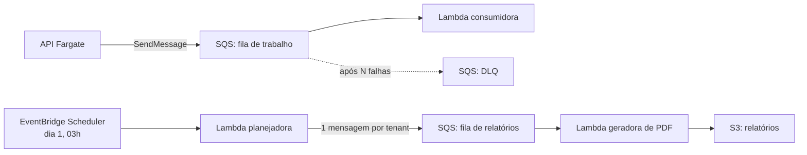
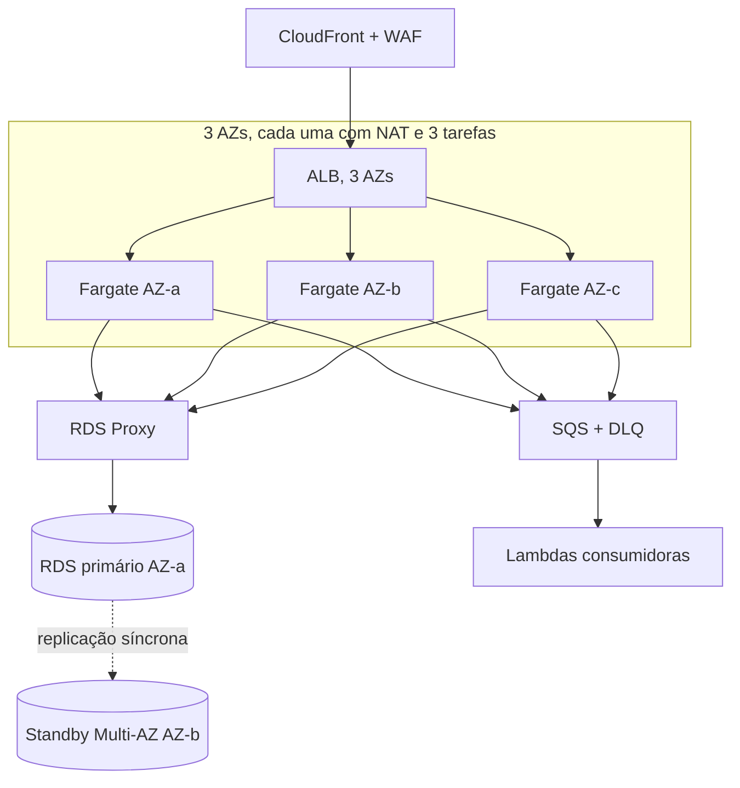

---
aliases:
  - Aula 26.3
modulo: 26
aula: 3
parte: "VIII Custo, projeto e prova"
dominios:
  - 2
lida: false
tags:
  - aula
  - saa-c03
  - modulo-26
---

# Aula 26.3: Iteração 2, resiliência e desacoplamento

[[26 - Projeto Pratico - Arquitetura de Referencia|Voltar ao módulo]]

> [!question] Pergunta que esta aula responde
> Quando cada componente do PropDesk falha (uma tarefa, uma [[Zona de Disponibilidade|AZ]] inteira, o banco, um consumidor da fila), o que acontece com o usuário, e quais mudanças fazem o sistema continuar de pé dentro de 99,9% sem pagar o dobro?

## O método: falhar de propósito no papel

A iteração 1 deixou o PropDesk seguro; ela não o deixou **disponível**. O método de resiliência é uma tabela: para cada componente, escreva "se isto parar, o que o usuário vê?". Em arquitetura de nuvem, a premissa do [[01.01 - Por que a Nuvem Existe|Módulo 1]] é que **tudo falha**: instâncias, discos, e às vezes uma [[Zona de Disponibilidade|AZ]] inteira. Projetar resiliência é garantir que a falha de uma peça não derrube o serviço ([[Ponto Unico de Falha]]).

| Componente | Falha | Efeito na v1 | Correção da v2 |
|---|---|---|---|
| Tarefa [[Fargate]] | Processo morre | Cai uma parcela dos pedidos | Várias tarefas, [[Health Check\|health check]], [[ECS]] recria |
| [[Zona de Disponibilidade\|AZ]] inteira | Energia ou rede da AZ | Metade do serviço some, banco pode parar | 3 AZs, capacidade para N-1 AZ, banco [[Multi-AZ]] |
| [[NAT Gateway]] | Falha da [[Zona de Disponibilidade\|AZ]] do [[NAT]] | Tarefas das outras AZs sem saída | Um NAT por AZ |
| Banco primário | Falha da instância ou da [[Zona de Disponibilidade\|AZ]] | Indisponibilidade até restaurar | [[Multi-AZ]] com [[Failover\|failover automático]] |
| Fila ou consumidor | Lambda com erro | Mensagem perdida ou repetida sem controle | [[Dead-Letter Queue\|DLQ]], [[Idempotencia\|idempotência]], retry com backoff |
| Pico de carga | 300 req/s | Lentidão e erro em cascata | Escala + desacoplar o que é assíncrono |
| Implantação ruim | Versão com bug | Todos os usuários afetados | Deploy gradual com rollback automático |
| Dado apagado ou corrompido | Erro humano ou bug | Perda sem volta | [[Versionamento]], backup com [[Point-in-Time Recovery\|PITR]] |

## A conta da disponibilidade

Componentes **em série** (todos precisam funcionar) multiplicam disponibilidades; **em paralelo** (qualquer um basta) multiplicam as indisponibilidades. Com números ilustrativos de 99,9% por componente: quatro em série dão `0,999^4 = 0,996` (99,6%, cerca de 2,9 horas de falha ao mês), pior do que qualquer um deles. Dois em paralelo dão `1 - (0,001 x 0,001) = 0,999999` (99,9999%). Isso explica o desenho inteiro: o caminho do pedido tem várias camadas em série (borda, balanceador, aplicação, banco), então **cada camada** precisa ser redundante por dentro (paralelo entre [[Zona de Disponibilidade|AZs]]), ou a corrente de camadas arrasta o total para baixo. É o conteúdo da [[20.01 - Disponibilidade em Noves e o Ponto Unico de Falha|aula 20.1]].

## Camada de aplicação: três AZs e capacidade para perder uma

O serviço [[ECS]] roda tarefas distribuídas nas três [[Sub-rede Privada|sub-redes privadas]] de aplicação, e o [[Application Load Balancer]] distribui entre elas, com **[[Health Check|health checks]]** que tiram do rodízio a tarefa que não responde (o [[Elastic Load Balancing]] tem o [[Cross-Zone Load Balancing|balanceamento entre zonas]] sempre ligado no ALB). Se uma tarefa morre, o ECS inicia outra para manter o `desired count`.

A pergunta decisiva é **quantas tarefas manter**. O pico exige 6 tarefas para atender 300 req/s (premissa deste exercício). Para continuar atendendo o pico mesmo **depois de perder uma [[Zona de Disponibilidade|AZ]]**, calcule:

| Número de [[Zona de Disponibilidade\|AZs]] | Tarefas por AZ | Total | Sobrevive à perda de 1 AZ com 6 tarefas? | Capacidade extra paga |
|---|---|---|---|---|
| 2 | 6 | 12 | Sim (6 restam) | 100% |
| 3 | 3 | 9 | Sim (6 restam) | 50% |
| 4 | 2 | 8 | Sim (6 restam) | 33% |

Com **duas** [[Zona de Disponibilidade|AZs]], cada AZ precisa carregar sozinha o pico, o que dobra a capacidade. Com **três**, você paga 50% a mais, e com quatro, 33%. Esse é um raciocínio de prova: **mais AZs reduzem o custo da redundância para tolerar a perda de uma**, e o número "3" é o padrão por esse motivo. A conta só vale se o auto scaling ([[26.04 - Iteracao 3 Desempenho e Elasticidade|aula 26.4]]) reagir rápido o bastante para cobrir o intervalo; no pior dia, a capacidade extra provisionada é o seguro, porque criar tarefas é uma operação de [[Plano de Controle]] que pode atrasar justamente no evento.

> [!info] Estabilidade estática
> Um desenho em que a perda de uma [[Zona de Disponibilidade|AZ]] **não exige** nenhuma ação (nem criar instâncias, nem editar [[DNS]]) tem [[Estabilidade Estatica]]: sobrevive usando só o que já está rodando. É a propriedade que a [[20.04 - As Quatro Estrategias de Recuperacao de Desastres|aula 20.4]] chama de depender só do [[Plano de Dados]]. Os 50% extras são o preço dela.

**Rede.** Cada [[Zona de Disponibilidade|AZ]] ganha seu próprio [[NAT Gateway]], e a [[Route Table|route table]] de cada [[Sub-rede Privada|sub-rede privada]] aponta para o [[NAT]] **da própria AZ**. Com um NAT só, a falha da sua AZ cortaria a saída das tarefas das outras duas (e o tráfego entre AZs ainda seria cobrado). A decisão volta na iteração de custo, porque três NATs custam mais que um.

**Implantações.** Uma versão ruim é uma falha comum e evitável. O [[ECS]] faz **[[Rolling Update|rolling update]]** substituindo tarefas aos poucos, e o **deployment [[Circuit Breaker|circuit breaker]]** do ECS reverte automaticamente a implantação que não estabiliza. A [[Infraestrutura Imutavel]] completa isso: nunca se corrige uma tarefa por dentro, publica-se uma nova revisão da [[Task Definition|task definition]] com a imagem versionada e as antigas são descartadas. Para risco maior, **[[Blue-Green Deployment|blue/green]]** mantém o ambiente antigo vivo até o novo provar saúde, permitindo voltar em segundos (as políticas de deploy estão na [[17.04 - ECS em Producao Balanceador Escala e Deploys|aula 17.4]]).

## Camada de dados: Multi-AZ e backup são coisas diferentes

O banco é o ponto mais delicado, porque guarda estado. Duas ferramentas resolvem problemas distintos, e a confusão entre elas é clássica na prova:

- **[[Multi-AZ]]** protege contra falha de **infraestrutura**. No modo instância do [[RDS]], um standby síncrono em outra [[Zona de Disponibilidade|AZ]] assume por troca de [[DNS]] se o primário falhar, sem perder dado confirmado. O standby **não serve leitura**. O modo cluster (dois standbys legíveis) serve leitura e aceita [[Failover|failover]] mais rápido (aula [[13.03 - RDS Multi-AZ Instancia e Cluster|13.3]]).
- **Backup e [[Point-in-Time Recovery|PITR]]** protegem contra **dado ruim**: o `DELETE` sem `WHERE` é replicado instantaneamente ao standby, então [[Multi-AZ]] não ajuda. O [[Automated Backup|backup automático]] com recuperação em um ponto no tempo (point-in-time recovery) permite voltar para minutos antes do erro.

Decisão do PropDesk: **[[RDS]] PostgreSQL [[Multi-AZ]] (instância)** com retenção de [[Automated Backup|backup automático]] de 14 dias (valor fictício): a retenção define a **janela de volta no tempo**, e o [[Point-in-Time Recovery|PITR]], com seu backup contínuo dos logs de transação, dá granularidade de **minutos** para o [[RPO]] de erro humano e [[RDS Proxy]] na frente. O proxy mantém um [[Pool de Conexoes|pool de conexões]], evita a avalanche de reconexões do Lambda e **encurta o impacto do [[Failover|failover]]** porque preserva as conexões das aplicações enquanto o banco troca de primário (aula [[13.06 - RDS Proxy e Gestao de Conexoes|13.6]]). A alternativa, [[Aurora]] (armazenamento em seis cópias em três [[Zona de Disponibilidade|AZs]]), entra na avaliação de custo e de DR.

> [!example] A diferença na prática
> Segunda-feira, 10h: um deploy com bug apaga 3.000 chamados. O standby [[Multi-AZ]] já refletiu o apagamento, então o [[Failover|failover]] não recupera nada. A equipe usa [[Point-in-Time Recovery|PITR]] para restaurar uma **nova** instância no estado das 09h58 e extrai as linhas. Se a falha fosse da [[Zona de Disponibilidade|AZ]] do primário, o Multi-AZ resolveria em minutos, sem ninguém restaurar nada. São dois mecanismos para dois riscos.

**[[S3]].** Os anexos já têm [[Durabilidade|durabilidade]] de 11 noves e armazenamento em várias [[Zona de Disponibilidade|AZs]] da Região. O que falta contra erro humano é **[[Versionamento|versionamento]]** (um `DELETE` vira um [[Delete Marker|delete marker]]) e, para ataque ou exclusão em massa, o [[Object Lock]] (aula [[11.05 - Criptografia Versionamento e Retencao no S3|11.5]]). A resiliência contra perda da Região vem na [[26.07 - Plano de DR e Estimativa de Custo|aula 26.7]].

## Desacoplar: a fila absorve o que o usuário não precisa esperar

Gerar um PDF por [[Tenant|tenant]], enviar e-mails e importar planilhas são tarefas que **não podem** estar no caminho de um pedido [[HTTP]]: demoram, falham e competem por CPU com a API. O [[Desacoplamento]] muda o desenho para **aceitar e confirmar**: a API grava o pedido, publica uma mensagem e responde "recebido"; um consumidor processa no seu ritmo.

Os pontos de projeto, todos de [[15 - Desacoplamento Filas Eventos e Workflows|Módulo 15]]:

- **Fila [[SQS]] padrão**, porque a ordem não importa e o [[Throughput|throughput]] é praticamente ilimitado. Uma [[Fila FIFO]] só se o requisito disser "ordem estrita" ou "exatamente uma vez no escopo de um grupo".
- **Entrega pelo menos uma vez:** a mesma mensagem pode chegar duas vezes. O consumidor precisa ser **idempotente** ([[Idempotencia]]): gerar o PDF do [[Tenant|tenant]] 17 do mês 10 duas vezes deve produzir o mesmo resultado (grave em uma chave determinística, ou cheque se já existe).
- **[[Dead-Letter Queue]]:** depois de um número de recebimentos sem sucesso (`maxReceiveCount`), a mensagem vai para uma fila de mensagens mortas, onde um alarme avisa e um humano inspeciona, em vez de a mensagem "venenosa" girar para sempre.
- **[[Visibility Timeout|Timeout de visibilidade]]** maior que o tempo máximo da função, ou a mensagem reaparece enquanto ainda está sendo processada.
- **Resposta parcial de [[Processamento em Lote|lote]]:** com `ReportBatchItemFailures`, a função devolve só os IDs que falharam, e o Lambda reprocessa apenas esses, em vez de repetir o lote inteiro (verificado na documentação do Lambda em novembro de 2026).
- **[[Fan-out]] por [[Tenant|tenant]]:** o [[EventBridge]] Scheduler dispara uma função planejadora uma vez por mês, que enfileira uma mensagem por tenant. Cada falha afeta **um** relatório, não o mês inteiro.

Há também ganho de **degradação elegante**: se os consumidores caírem, a API continua aceitando pedidos e a fila acumula (o backlog cresce, e a fila retém as mensagens por dias até o conserto). O usuário vê relatórios atrasados, não um sistema fora do ar. Compare com a v0, em que a falha do envio de e-mail travava a requisição.

## Falhas parciais e como a aplicação reage

Resiliência também mora no código, e a prova trata os padrões pelo nome: **retry com [[Backoff Exponencial|backoff exponencial]] e [[Jitter|jitter]]** (esperas crescentes e aleatórias para não formar uma manada de retentativas), **[[Timeout|timeouts]]** curtos em chamadas externas, **[[Circuit Breaker|circuit breaker]]** (parar de chamar o que está falhando por um tempo) e **[[Load Shedding|load shedding]]** (recusar o excedente em vez de cair). O SDK da AWS já aplica retry com backoff, mas o limite de tentativas e o timeout são seus. Serviços sem estado na API (a sessão fica no [[JWT]] e no banco, não na memória da tarefa) são o que permite matar e recriar tarefas à vontade, e é por isso que a [[12.01 - Escalar Horizontalmente e Aplicacao Stateless|aula 12.1]] vem antes de tudo.

## A v2, resumida

## ADRs desta iteração

Registro curto de cada decisão, no formato prometido na [[26.01 - O Projeto PropDesk e os Requisitos|aula 26.1]].

| Requisito | Decisão | Alternativa descartada | Tensão criada |
|---|---|---|---|
| Sobreviver à perda de uma [[Zona de Disponibilidade\|AZ]] no pico | 3 AZs com 3 tarefas cada (9 no pico) | 2 AZs com 6 tarefas cada (12 no total) | Pagar 50% de capacidade extra; mais [[Sub-rede\|sub-redes]] |
| Saída de rede resiliente | Um [[NAT Gateway]] por [[Zona de Disponibilidade\|AZ]] | [[NAT]] único compartilhado | Três NATs custam mais (revisto na 26.5) |
| Erro humano no banco e falha de infraestrutura | [[RDS]] [[Multi-AZ]] (instância) mais backup com [[Point-in-Time Recovery\|PITR]] de 14 dias | Só Multi-AZ, ou só backups | Standby não serve leitura; custo do segundo nó |
| Absorver picos e falhas do trabalho assíncrono | [[SQS]] padrão com [[Dead-Letter Queue\|DLQ]] e consumidores idempotentes | Chamada síncrona da API à função | Entrega pelo menos uma vez exige [[Idempotencia\|idempotência]]; mensagens atrasadas |
| Conexões estáveis e [[Failover\|failover]] curto | [[RDS Proxy]] na frente do banco | Conexão direta de cada tarefa e função | Custo do proxy; mais um componente |

## Como isso cai na prova

> [!info] Task statements 2.1 e 2.2
> 2.1 (arquiteturas escaláveis e fracamente acopladas: [[SQS]], [[SNS]], [[Microsservicos|microsserviços]] sem estado, [[Container|containers]]); 2.2 ([[Alta Disponibilidade|alta disponibilidade]] e [[Tolerancia a Falhas|tolerância a falhas]]: [[Zona de Disponibilidade|AZs]], [[Multi-AZ]], [[RDS Proxy]], DR, [[Infraestrutura Imutavel|infraestrutura imutável]], melhorar a confiabilidade de aplicações legadas).

**Palavras-chave em inglês:** *[[Alta Disponibilidade|highly available]]*, *[[Tolerancia a Falhas|fault tolerant]]*, *decouple*, *[[Ponto Unico de Falha|single point of failure]]*, *automatic [[Failover|failover]]*, *without data loss*, *spiky*, *handle failed messages*, *retry*, *minimal downtime*, *immutable*, *at-least-once*.

**Armadilhas frequentes:**

- **[[Multi-AZ]] contra [[Read Replica|read replica]]:** o primeiro é para [[Disponibilidade|disponibilidade]] ([[Failover|failover automático]]); a segunda é para escalar leitura (assíncrona, promoção manual).
- [[Multi-AZ]] **não** protege contra `DELETE` acidental: isso é backup e [[Point-in-Time Recovery|PITR]].
- Fila padrão pode duplicar mensagens: exige [[Idempotencia|idempotência]]; só a FIFO deduplica (dentro de uma janela).
- [[SQS]] contra [[SNS]]: fila é ponto a ponto (um consumidor pega a mensagem); tópico é publicar e assinar (todos recebem).
- Uma única [[Zona de Disponibilidade|AZ]], ou um único [[NAT]], é [[Ponto Unico de Falha|ponto único de falha]].
- "[[Alta Disponibilidade|Altamente disponível]]" não significa "multi-Region": normalmente significa [[Multi-AZ]].

| Requisito no enunciado | Resposta provável | Por quê |
|---|---|---|
| Banco relacional com [[Failover\|failover automático]] e sem perda de dados confirmados | [[RDS]] [[Multi-AZ]] | Standby síncrono em outra [[Zona de Disponibilidade\|AZ]] |
| Aplicação sobrevive à falha de uma [[Zona de Disponibilidade\|AZ]] | Instâncias ou tarefas em 2 ou mais AZs atrás de um [[Application Load Balancer\|ALB]], com [[Auto Scaling Group\|Auto Scaling]] | Redundância em paralelo |
| Pico imprevisível sem perder pedidos | Fila [[SQS]] entre produtor e consumidor | Buffer que desacopla velocidades |
| Mensagens que falham repetidamente não podem bloquear a fila | [[Dead-Letter Queue\|Dead-letter queue]] | Isola mensagens problemáticas |
| Lambda com [[RDS]] sofrendo com excesso de conexões | [[RDS Proxy]] | [[Pool de Conexoes\|Pool de conexões]] |
| Voltar o banco para 10 minutos atrás | [[Point-in-Time Recovery\|PITR]] | Backup contínuo de transações |
| Deploy com rollback automático | [[Rolling Update\|Rolling update]] com [[Circuit Breaker\|circuit breaker]], ou [[Blue-Green Deployment\|blue/green]] | Reverte versão não saudável |

## Resumo

> [!abstract] A aula em uma frase
> Resiliência é remover cada [[Ponto Unico de Falha|ponto único de falha]] com redundância em paralelo (três [[Zona de Disponibilidade|AZs]], [[Multi-AZ]], um [[NAT]] por AZ), desacoplar o trabalho assíncrono com filas que toleram falha e separar [[Disponibilidade|disponibilidade]] (Multi-AZ) de recuperação de dado ruim ([[Point-in-Time Recovery|PITR]] e [[Versionamento|versionamento]]).

**A lógica, em 5 passos**

1. Liste cada componente e pergunte "se parar, o que o usuário vê?".
2. Camadas em série multiplicam falhas; redundância em paralelo as divide.
3. Com 3 [[Zona de Disponibilidade|AZs]], tolerar a perda de uma custa 50% de capacidade extra; com 2, custa 100%.
4. [[Multi-AZ]] protege de falha de infraestrutura; [[Point-in-Time Recovery|PITR]] e [[Versionamento|versionamento]] protegem de dado ruim.
5. Filas com [[Dead-Letter Queue|DLQ]] e consumidores idempotentes absorvem picos e falhas sem derrubar a API.

**Números para lembrar**

| O quê | Valor | Por que importa |
|---|---|---|
| Quatro componentes de 99,9% em série | 99,6% | Série piora o total |
| Dois de 99,9% em paralelo | 99,9999% | Paralelo melhora o total |
| Capacidade extra para N-1 [[Zona de Disponibilidade\|AZ]] | 100% (2 AZs), 50% (3), 33% (4) | Mais AZs, redundância mais barata |

**Tabela-síntese: [[Multi-AZ]], réplica e backup**

| Mecanismo | Protege contra | Serve leitura? | Perde dado? |
|---|---|---|---|
| [[Multi-AZ]] (instância) | Falha de [[Zona de Disponibilidade\|AZ]] ou instância | Não | Não (síncrono) |
| [[Read Replica\|Read replica]] | Escalar leitura, DR entre [[Regiao AWS\|Regiões]] | Sim | Pode (assíncrona) |
| [[Point-in-Time Recovery\|PITR]] e [[Snapshot\|snapshots]] | Dado corrompido ou apagado | Restaura outra instância | Até o ponto escolhido |

**Na prática, isso significa**

- Dimensione para perder uma [[Zona de Disponibilidade|AZ]], não para o dia bom.
- Tudo que o usuário não precisa esperar vai para uma fila com [[Dead-Letter Queue|DLQ]] e um alarme.
- Teste o [[Failover|failover]] de verdade: reboot com failover no [[RDS]], matar tarefas, simular a [[Zona de Disponibilidade|AZ]].

> [!tip] Liga com
> Vem do [[20 - Alta Disponibilidade e Recuperacao de Desastres|Módulo 20]], do [[13 - Bancos Relacionais RDS e Aurora|Módulo 13]] e do [[15 - Desacoplamento Filas Eventos e Workflows|Módulo 15]]. Segue para a [[26.04 - Iteracao 3 Desempenho e Elasticidade|iteração de desempenho]].

## Erros comuns

- **Achar que [[Multi-AZ]] é backup.** O standby replica também os erros: um `DROP TABLE` aparece nos dois ao mesmo tempo.
- **Dimensionar com 2 [[Zona de Disponibilidade|AZs]] "porque basta".** Cada AZ precisa carregar sozinha o pico, o que dobra o custo da redundância.
- **Um [[NAT]] só "para economizar".** É [[Ponto Unico de Falha|ponto único de falha]] da saída e gera tráfego entre [[Zona de Disponibilidade|AZs]] cobrado; a economia vira risco.
- **Consumidor não [[Idempotencia|idempotente]] atrás de fila padrão.** A entrega é pelo menos uma vez: sem idempotência, o cliente recebe dois e-mails ou duas cobranças.
- **Esquecer a [[Dead-Letter Queue|DLQ]] e o alarme dela.** Sem alarme, a fila de mensagens mortas vira um cemitério silencioso.
- **Confiar em escalar na hora para o pior dia.** Criar capacidade é [[Plano de Controle|plano de controle]]; em um evento regional ou de [[Zona de Disponibilidade|AZ]], pode demorar.

## Pratique

**1.** Uma aplicação web em [[EC2]] atrás de um [[Application Load Balancer|ALB]] roda em uma única [[Zona de Disponibilidade|AZ]], e a empresa exige tolerância à falha de uma AZ com o menor [[Overhead Operacional|esforço operacional]]. O que fazer?

- [ ] a) Aumentar o tamanho das instâncias para que a AZ única tenha mais folga
- [ ] b) Criar um snapshot diário das instâncias e restaurá-lo em outra AZ quando precisar
- [ ] c) Mover as instâncias para uma Região diferente e usar DNS para apontar para ela
- [ ] d) Distribuir as instâncias em duas ou mais AZs com um grupo de Auto Scaling

**2.** Uma API precisa suportar um pico de 6 tarefas e continuar atendendo esse pico mesmo se uma [[Zona de Disponibilidade|AZ]] falhar, usando 3 AZs com a mesma quantidade em cada uma. Quantas tarefas no total?

- [ ] a) 6 tarefas, duas por AZ
- [ ] b) 9 tarefas, três por AZ
- [ ] c) 12 tarefas, quatro por AZ
- [ ] d) 18 tarefas, seis por AZ

**3.** Um banco [[RDS]] PostgreSQL [[Multi-AZ]] (instância) sofre um `DELETE` sem filtro que apaga milhares de linhas. A equipe quer recuperar os dados. Por que o Multi-AZ não resolve, e o que resolve?

- [ ] a) O standby tem os dados antigos, então basta forçar um failover para a AZ secundária
- [ ] b) O Multi-AZ só replica uma vez por dia, então os dados antigos estão no standby
- [ ] c) A replicação síncrona levou a exclusão ao standby, e o PITR recupera os dados
- [ ] d) O Multi-AZ criptografa o standby, e a chave do KMS impede a leitura das linhas antigas

**4.** Uma aplicação envia e-mails por uma [[Lambda|função Lambda]] acionada por uma [[SQS|fila SQS]] padrão. Alguns clientes receberam o mesmo e-mail duas vezes. Qual é a causa mais provável e a correção?

- [ ] a) A fila padrão entrega pelo menos uma vez, e o consumidor deve ser idempotente
- [ ] b) A fila padrão entrega exatamente uma vez, e o erro vem de um bug no código do Lambda
- [ ] c) A fila padrão ordena as mensagens, e o problema é a falta de uma fila FIFO
- [ ] d) O Lambda não aceita filas como origem e precisa de um tópico SNS no meio

**5.** (Escolha DUAS.) Uma fila de trabalho tem mensagens que sempre falham e atrasam o processamento das demais. Quais ações melhoram a situação?

- [ ] a) Configurar uma dead-letter queue com um número máximo de recebimentos
- [ ] b) Aumentar a retenção da fila para o máximo, mantendo as mensagens ruins
- [ ] c) Criar um alarme na DLQ para investigar as mensagens que falharam
- [ ] d) Excluir a fila e recriá-la a cada hora para limpar as mensagens problemáticas
- [ ] e) Substituir a fila padrão por uma chamada síncrona da API ao consumidor

**6.** Uma [[Lambda|função Lambda]] processa lotes de 10 mensagens de uma [[SQS|fila SQS]]. Quando uma única mensagem falha, o [[Processamento em Lote|lote]] inteiro volta para a fila e as 9 boas são reprocessadas. Qual configuração evita isso?

- [ ] a) Reduzir o tamanho do lote para 1 e desativar o recurso de DLQ
- [ ] b) Aumentar o timeout de visibilidade para um valor menor que o da função
- [ ] c) Trocar a fila padrão por uma fila FIFO sem grupos de mensagens
- [ ] d) Ativar a resposta parcial de lote (ReportBatchItemFailures)

**7.** Uma empresa quer que a falha de uma [[Zona de Disponibilidade|AZ]] não interrompa a saída para a internet das tarefas privadas de nenhuma outra AZ. Qual desenho de [[NAT]] atende?

- [ ] a) Um único NAT Gateway em uma AZ compartilhado por todas as sub-redes privadas
- [ ] b) Um NAT Gateway por AZ, com cada route table privada apontando para o NAT da sua AZ
- [ ] c) Uma NAT instance única, de tamanho grande, em uma sub-rede pública
- [ ] d) Um Internet Gateway associado diretamente às sub-redes privadas

**8.** Um deploy com um bug derrubou o serviço para todos os usuários por 20 minutos. A empresa quer reverter automaticamente implantações que não estabilizam, em [[Container|containers]] [[ECS]]. O que usar?

- [ ] a) Aumentar o desired count para o dobro antes de cada deploy
- [ ] b) Fazer deploys manuais fora do horário comercial com um aviso por e-mail
- [ ] c) Atualização gradual (rolling) com o deployment circuit breaker habilitado
- [ ] d) Editar as tarefas em execução por dentro para corrigir o bug sem nova imagem

**9.** Uma API síncrona gera um relatório pesado que leva minutos, e os usuários recebem [[Timeout|timeouts]] quando vários pedem ao mesmo tempo. Qual mudança resolve com o menor acoplamento?

- [ ] a) Aumentar o timeout do balanceador e da API para vários minutos
- [ ] b) Ter a API chamando diretamente o gerador de relatórios e esperando a resposta
- [ ] c) Aceitar o pedido, publicar em uma fila e avisar que o relatório virá depois
- [ ] d) Guardar o relatório em memória da tarefa até o usuário consultar de novo

**10.** (Escolha DUAS.) Quais afirmações sobre [[Multi-AZ]] no [[RDS]] e backups estão corretas?

- [ ] a) O Multi-AZ em modo instância usa replicação síncrona para o standby
- [ ] b) O standby Multi-AZ em modo instância atende as leituras da aplicação
- [ ] c) A restauração em ponto no tempo cria uma nova instância no estado escolhido
- [ ] d) O Multi-AZ protege contra uma exclusão acidental de dados feita pela aplicação
- [ ] e) O failover Multi-AZ exige que o administrador altere o IP na aplicação

> [!success]- Gabarito
> **1. d)** várias [[Zona de Disponibilidade|AZs]] com [[Auto Scaling Group|Auto Scaling]] mantêm o serviço quando uma AZ cai, com pouco esforço; a) tamanho não elimina a falha da AZ; b) restaurar [[Snapshot|snapshots]] é manual e lento; c) mudar de Região é desproporcional e não é o pedido.
> **2. b)** com 3 [[Zona de Disponibilidade|AZs]] de 3 tarefas, perdendo uma restam 6; a) com 6 no total, perder uma AZ deixa 4; c) 12 sobrevive, mas paga 100% a mais sem necessidade; d) 18 é excessivo.
> **3. c)** a [[Replicacao Sincrona|replicação síncrona]] replica também o erro, e o [[Point-in-Time Recovery|PITR]] restaura uma instância no estado anterior; a) o standby não guarda o estado antigo; b) a replicação é contínua, não diária; d) a criptografia não impede a leitura nem explica o problema.
> **4. a)** a fila padrão é pelo menos uma vez, então duplicatas acontecem e a correção é [[Idempotencia|idempotência]]; b) a fila padrão não garante exatamente uma vez; c) a fila padrão não garante ordem, e FIFO não é o foco; d) o Lambda aceita [[SQS]] diretamente como origem.
> **5. a), c)** a [[Dead-Letter Queue|DLQ]] isola as mensagens ruins e o alarme avisa; b) reter mais não trata a falha; d) recriar a fila perde mensagens válidas; e) chamada síncrona remove o [[Desacoplamento|desacoplamento]].
> **6. d)** o ReportBatchItemFailures devolve só as mensagens com falha; a) [[Processamento em Lote|lote]] de 1 reduz eficiência e desligar a [[Dead-Letter Queue|DLQ]] piora o tratamento; b) visibilidade menor que a função causa duplicidade; c) FIFO não resolve o reprocessamento do lote.
> **7. b)** um [[NAT]] por [[Zona de Disponibilidade|AZ]], usado só pela própria AZ, evita [[Ponto Unico de Falha|ponto único de falha]]; a) NAT único cai com a AZ e afeta as demais; c) uma [[NAT Instance|NAT instance]] é um ponto único de falha e exige manutenção; d) um [[Internet Gateway]] não funciona para [[Sub-rede Privada|sub-rede privada]] com IPs privados.
> **8. c)** o rolling com [[Circuit Breaker|circuit breaker]] reverte o que não estabiliza; a) dobrar o desired count não reverte; b) deploy manual fora do horário não é rollback; d) editar tarefa por dentro quebra a imutabilidade.
> **9. c)** aceitar, enfileirar e processar de forma assíncrona desacopla e absorve picos; a) [[Timeout|timeouts]] maiores só escondem o problema; b) a chamada direta mantém o acoplamento; d) guardar em memória perde o relatório se a tarefa morrer.
> **10. a), c)** o [[Multi-AZ]] instância replica de forma síncrona e o [[Point-in-Time Recovery|PITR]] cria nova instância; b) o standby em modo instância não serve leitura; d) a exclusão acidental é replicada ao standby; e) o [[Failover|failover]] troca o [[DNS]], sem alterar IP na aplicação.

## Para aprofundar

- [ ] [Disaster recovery options in the cloud](https://docs.aws.amazon.com/whitepapers/latest/disaster-recovery-workloads-on-aws/disaster-recovery-options-in-the-cloud.html) (AWS Whitepapers): as estratégias de DR e o aviso sobre [[Plano de Controle|plano de controle]] contra [[Plano de Dados|plano de dados]], que aqui aparece como [[Estabilidade Estatica|estabilidade estática]].
- [ ] [Handling errors for an SQS event source in Lambda](https://docs.aws.amazon.com/lambda/latest/dg/services-sqs-errorhandling.html) (AWS Documentation): backoff, resposta parcial de [[Processamento em Lote|lote]] e métricas para detectar falhas silenciosas.

Próxima aula: [[26.04 - Iteracao 3 Desempenho e Elasticidade|Aula 26.4: Iteração 3, desempenho e elasticidade]].
