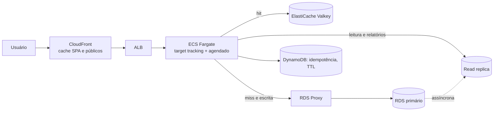

---
aliases:
  - Aula 26.4
modulo: 26
aula: 4
parte: "VIII Custo, projeto e prova"
dominios:
  - 2
  - 3
lida: false
tags:
  - aula
  - saa-c03
  - modulo-26
---

# Aula 26.4: Iteração 3, desempenho e elasticidade

[[26 - Projeto Pratico - Arquitetura de Referencia|Voltar ao módulo]]

> [!question] Pergunta que esta aula responde
> Onde está o gargalo do PropDesk no pico das 8h às 10h, e quais decisões (borda, cache, réplicas, escala, armazenamento) tiram carga do banco e fazem a capacidade acompanhar a demanda sem desperdício?

## O método: achar o gargalo antes de otimizar

Desempenho não se melhora "em geral": melhora-se **o gargalo atual**, que muda a cada correção. O método tem três perguntas por camada: o que mede a lentidão ([[Latencia]] em percentis, não média), onde o tempo é gasto, e qual a menor mudança que o reduz. Para o PropDesk, a meta fictícia é **p95 abaixo de 300 ms** nas leituras da API durante o pico de 300 req/s.

Premissa do exercício: **85% das requisições são leituras** (listar e abrir chamados) e 15% são escritas. Isso já indica o padrão de acesso: **leitura intensa**, o caso em que a prova aponta para cache e réplicas antes de pensar em um banco maior ([[13.09 - Padroes de Arquitetura Escolha e Custo|aula 13.9]]).

Siga o caminho do pedido e procure onde se gasta tempo:

| Trecho | Onde perde tempo | Alavanca |
|---|---|---|
| Navegador até a borda | Distância física, [[TLS]] | [[CloudFront]] com TLS terminado perto do usuário |
| Arquivos da SPA | Baixar JS e imagens | [[Cache]] na borda, compressão, [[TTL]] longo |
| Borda até o [[Application Load Balancer\|ALB]] | Salto até a Região | [[CloudFront]] usa a rede da AWS, conexões reaproveitadas |
| API (CPU e memória) | Pouca capacidade no pico | Escala automática, tamanho da tarefa |
| API até o banco | Consultas repetidas, conexões | [[Cache]], [[Read Replica\|réplicas de leitura]], [[RDS Proxy]] |
| Banco | CPU, [[IOPS]], locks | Réplicas, índices, tipo de armazenamento |
| Trabalho pesado | Compete com a API | Já na fila (iteração 2) |

## Borda: servir o que não muda de perto do usuário

A SPA (arquivos JavaScript, CSS e imagens) muda só quando há um release. O [[CloudFront]] guarda esses arquivos nas [[Edge Location|edge locations]], e o navegador do usuário recebe de um ponto geograficamente próximo, em vez de cruzar o continente até a Região. Duas decisões deixam isso eficiente:

- **Nomes de arquivo com [[Hash|hash]] do conteúdo** (`app.9f3a1c.js`) e **[[TTL]] longo** (um ano). Um release novo gera nomes novos, então não é preciso **invalidar** o cache (a [[Invalidacao de Cache|invalidação]] existe, mas é para exceções, e depois de um certo volume é cobrada). Só o `index.html`, que referencia os nomes novos, tem TTL curto.
- **Compressão** habilitada na distribuição, que reduz bytes de JS e CSS.

Para a API, o [[CloudFront]] fica na frente com o **cache desligado** nas rotas autenticadas e por [[Tenant|tenant]] (a resposta depende de quem pergunta; cachear errado serviria dado do tenant A ao B, um vazamento). Mesmo sem cache, o ganho é o de **encerrar a conexão [[TLS]] perto do usuário** e reaproveitar conexões para a origem pela rede da AWS. Em uma rota pública, que não depende do usuário (por exemplo, o catálogo de tipos de serviço), uma [[Cache Policy|política de cache]] com chave bem definida e [[TTL]] de minutos tira essas requisições da origem.

> [!example] Por que Global Accelerator não entra
> O [[Global Accelerator]] dá dois [[Anycast|IPs anycast]] e roteia [[TCP]] e [[UDP]] pela rede global, útil para protocolos que não são [[HTTP]], para IP fixo ou para [[Failover|failover]] rápido entre [[Regiao AWS|Regiões]]. PropDesk é HTTPS cacheável parcialmente, então o [[CloudFront]] cobre o ganho de [[Latencia|latência]] e ainda **cacheia**. A pegadinha da prova: "conteúdo HTTP estático ou cacheável, mundial" é CloudFront; "IP estático, TCP/UDP não HTTP, failover entre endpoints" é Global Accelerator ([[18.06 - Global Accelerator Anycast e Rede Global da AWS|aula 18.6]]).

## Computação: escalar com a demanda

A capacidade deve seguir a curva do dia. Com o serviço [[ECS]] já em três [[Zona de Disponibilidade|AZs]], o [[Application Auto Scaling]] ajusta o número de tarefas, e a escolha da política é a decisão central. Duas se combinam:

- **[[Target Tracking|Target tracking]]** na [[Metrica|métrica]] `ALBRequestCountPerTarget` (requisições por tarefa). A métrica é a **contagem média de requisições por alvo em um minuto**, então o valor-alvo é por minuto, não por segundo (verificado em novembro de 2026 na documentação de target tracking). Para o PropDesk o alvo é **2.000 requisições por tarefa por minuto** (cerca de 33 por segundo). A conta: 300 req/s são 18.000 por minuto, e `18.000 / 2.000 = 9` tarefas no pico, que é exatamente a capacidade **N-1** da [[26.03 - Iteracao 2 Resiliencia e Desacoplamento|aula 26.3]] (3 [[Zona de Disponibilidade|AZs]] x 3 tarefas). Perder uma AZ no pico deixa 6 tarefas, que ainda atendem 300 req/s, e a [[Estabilidade Estatica|estabilidade estática]] continua valendo. Com 80 req/s (4.800 por minuto), a conta dá 2,4, e o piso de 3 tarefas (uma por AZ) prevalece. Dimensionar o alvo para 6 tarefas no pico (cerca de 50 req/s por tarefa, 3.000 por minuto) economizaria, mas deixaria 4 tarefas depois da perda de uma AZ, abaixo do necessário. Métrica de CPU funciona se a carga for CPU-bound; a de requisições por alvo segue melhor a demanda de uma API.
- **Scaling agendado** antes do pico previsível: como o pico acontece todo dia útil às 8h, aumentar o mínimo para 9 tarefas às 7h50 evita o atraso de reação (cada tarefa nova leva dezenas de segundos para subir e passar no [[Health Check|health check]]). A [[12.07 - Politicas de Escala|aula 12.7]] compara as políticas.

O dimensionamento de cada tarefa ([[vCPU]] e memória) também é desempenho. Em [[Fargate]], o par é discreto; teste com carga e escolha o menor que cumpra a meta de [[Latencia|latência]] sem saturar memória. Dimensionar para baixo depois da medição é a ponte para a iteração de custo.

Nos trabalhadores Lambda, a **memória** controla também a CPU proporcional, então uma função de PDF que leva 40 s com 512 MB pode levar 12 s com 2.048 MB: custo por GB-segundo parecido, tempo muito menor. A escala dos consumidores acompanha o **backlog da fila** automaticamente, e o controle mais direto para não esmagar o banco é o **Maximum concurrency** do *[[Event Source Mapping|event source mapping]]* do [[SQS]] (a [[Concorrencia Reservada|concorrência reservada]] da função também limita, mas causa [[Throttling|throttling]] e devolve as mensagens à fila; [[16.03 - Concorrencia Escala e Cold Start|aula 16.3]]).

## Dados: tirar o banco do caminho das leituras

O banco único é o gargalo natural de um sistema com 85% de leituras. Quatro peças, em ordem de custo-benefício:

**1. [[Cache]] na aplicação com ElastiCache.** O [[ElastiCache]] ([[Valkey]] ou [[Redis|Redis OSS]]) guarda em memória os dados lidos com frequência e que mudam pouco: configurações do [[Tenant|tenant]], permissões, listas de tipos. O padrão é o [[Lazy Loading]] (também chamado *cache-aside*): a aplicação consulta o cache; no *miss*, lê o banco e grava o resultado no cache com **[[TTL]]**. A conta mostra o efeito:

```
Leituras = 85% x 300 req/s = 255 leituras/s; escritas = 45/s
Com cache de 80% de acerto: leituras ao banco = 255 x 0,20 = 51/s
Carga no banco: 45 + 51 = 96 consultas/s, contra 300 antes (queda de 68%)
```

A tensão do cache é **consistência**: depois de um `UPDATE`, o valor antigo pode viver no cache até o [[TTL]]. As defesas são TTL curto, invalidar a chave ao escrever ([[Write-Through]] atualiza o cache junto com o banco) e não cachear o que exige leitura fresca. E a pegadinha de projeto: **sessão** não precisa de cache nesta arquitetura, porque o estado do login vive no [[JWT]]; só se usaria o [[ElastiCache]] para sessão se a aplicação guardasse sessão no servidor (aula [[12.01 - Escalar Horizontalmente e Aplicacao Stateless|12.1]]).

**2. Read replicas.** Uma [[Read Replica]] do [[RDS]] PostgreSQL recebe replicação **assíncrona** do primário e atende consultas de leitura. A aplicação passa a ter dois destinos: escrita no endpoint do primário, leitura no da réplica. Os relatórios pesados e as telas de busca vão para a réplica, e o primário só cuida de transações. Duas consequências que a prova explora: a réplica tem **[[Replica Lag|atraso de replicação]]** (lag), então uma tela que acabou de gravar e precisa se ver refletida deve ler do **primário** (*read your writes*), e a réplica **não** substitui o [[Multi-AZ]] (aula [[13.04 - RDS Read Replicas e Escala de Leitura|13.4]]).

**3. RDS Proxy.** Cada tarefa e cada Lambda abrem conexões; o PostgreSQL tem custo por conexão. O [[RDS Proxy]] compartilha poucas conexões reais entre milhares de clientes e estabiliza o banco em picos de funções (o ganho de [[Failover|failover]] já foi tema da iteração 2).

**4. Armazenamento e instância.** O [[RDS]] usa volumes SSD [[gp3]], em que [[IOPS]] e [[Throughput|throughput]] podem ser provisionados separadamente do tamanho (aula [[10.03 - EBS SSD gp3 gp2 e Provisioned IOPS|10.3]]); só se justifica IOPS provisionado ([[io2]]) com [[Latencia|latência]] de IO crítica comprovada. O **armazenamento com escala automática** cobre o crescimento de 400 GB sem ação manual. Quando o número de réplicas ou o [[Replica Lag|atraso de replicação]] virarem o limite, a evolução natural é o **[[Aurora]] PostgreSQL**, com armazenamento compartilhado e réplicas que leem o mesmo volume, o que reduz o lag (a comparação está na [[13.07 - Aurora Arquitetura Endpoints e Replicas|aula 13.7]]).

**Um banco para um caso específico.** A tabela de **chaves de [[Idempotencia|idempotência]]** das Lambdas (a iteração 2 exigiu consumidores idempotentes) é pares chave-valor com expiração: um caso clássico de [[DynamoDB]] em modo on-demand com [[DynamoDB TTL|TTL]], sem carregar o PostgreSQL. É "usar o serviço de propósito específico", princípio do [[02.08 - Principios das Respostas Certas e Plano de Estudo|aula 2.8]].

> [!warning] O TTL do DynamoDB não é exato
> O [[TTL]] apaga itens em **segundo plano**, normalmente em até alguns dias depois do vencimento, e os itens vencidos ainda aparecem em leituras até serem apagados. Para uma janela de [[Idempotencia|idempotência]] de exatamente 24 horas, a aplicação deve **conferir o atributo de expiração** na leitura (filtrar itens vencidos) ou usar uma *condition expression* com o timestamp atual na escrita (verificado na [documentação de TTL](https://docs.aws.amazon.com/amazondynamodb/latest/developerguide/TTL.html) em novembro de 2026).

> [!info] Ligando os pontos
> Relatórios históricos e análise de logs ([[Application Load Balancer|ALB]], [[CloudTrail]]) não devem consultar o banco transacional. Os logs vão para o [[S3]] em [[Armazenamento Colunar|formato colunar]] e particionado e são consultados com o [[Athena]], que cobra pelos dados lidos: [[Parquet]] e partições reduzem o custo (tema do [[22 - Dados Analytics e Ingestao|Módulo 22]]). É a separação entre **[[OLTP|carga transacional]]** e **[[OLAP|carga analítica]]**.

## Armazenamento de objetos e transferência

O [[S3]] escala por **prefixo**: a documentação indica pelo menos 3.500 requisições de escrita (PUT, COPY, POST, DELETE) ou 11.000 de leitura (GET, HEAD) por segundo por prefixo particionado (verificado em novembro de 2026), e como os anexos usam o prefixo por [[Tenant|tenant]] (`anexos/<tenant>/...`), a carga se distribui sozinha (aula [[11.07 - Desempenho e Transferencia de Dados no S3|11.7]]). Para arquivos grandes, o upload por partes (**[[Multipart Upload|multipart upload]]**) em paralelo ganha velocidade e permite retomar. Para usuários muito distantes da Região, o **[[Transfer Acceleration]]** usa as [[Edge Location|edge locations]] para acelerar o envio, mas só vale a pena com [[Latencia|latência]] intercontinental comprovada, porque é cobrado por GB (aula [[11.07 - Desempenho e Transferencia de Dados no S3|11.7]]). Leituras de anexos populares podem passar pelo [[CloudFront]] (com URLs assinadas), aliviando o S3 e acelerando o download.



## ADRs desta iteração

Registro curto de cada decisão, no formato prometido na [[26.01 - O Projeto PropDesk e os Requisitos|aula 26.1]].

| Requisito | Decisão | Alternativa descartada | Tensão criada |
|---|---|---|---|
| [[Latencia\|Latência]] baixa e origem aliviada | [[CloudFront]] com [[TTL]] longo para a SPA e cache desligado nas rotas por [[Tenant\|tenant]] | Servir tudo direto do [[Application Load Balancer\|ALB]]; ou cachear a API autenticada | [[Cache]] errado vaza dado entre tenants; [[Cache Policy\|política de cache]] a manter |
| Capacidade segue a curva do dia | [[Target Tracking\|Target tracking]] (2.000 req/tarefa/min) mais mínimo agendado de 9 às 7h50 | Capacidade fixa no pico | Reação leva dezenas de segundos; o agendado depende de horário previsível |
| 85% de leituras aliviam o banco | [[ElastiCache]] ([[Lazy Loading\|lazy loading]] com [[TTL]]) e [[Read Replica\|read replica]] | Banco maior (escala vertical) | Dado possivelmente desatualizado; lag da réplica |
| Conexões demais no pico | [[RDS Proxy]] | Aumentar max_connections do banco | Mais um componente a operar |
| [[Idempotencia\|Idempotência]] barata e expirável | [[DynamoDB]] on-demand com [[TTL]] (conferindo o vencimento na leitura) | Tabela no PostgreSQL com rotina de limpeza | O TTL não é exato; mais um banco para operar |

## Como isso cai na prova

> [!info] Task statements 3.1 a 3.5 e 2.1
> 3.1 (armazenamento que atende desempenho e escala), 3.2 (computação elástica, métricas de escala, tamanho de memória do Lambda), 3.3 (cache, réplicas, proxies, escolha de banco), 3.4 ([[CloudFront]] e [[Global Accelerator]]), 3.5 (ingestão e análise). E 2.1 (cache, [[Desacoplamento|desacoplamento]]).

**Palavras-chave em inglês:** *read-heavy*, *offload read traffic*, *reduce [[Latencia|latency]] for global users*, *cache frequently accessed data*, *in-memory*, *scale to meet demand*, *predictable peak*, *[[Pool de Conexoes|connection pooling]]*, *minimal [[Overhead Operacional|operational overhead]]*.

**Armadilhas frequentes:**

- [[Read Replica|Réplica de leitura]] contra [[Multi-AZ]]: a réplica escala leitura (assíncrona); o Multi-AZ dá [[Failover|failover]] (síncrono, não lê).
- [[CloudFront]] contra [[Global Accelerator]]: cache e [[HTTP]], contra [[Anycast|IP anycast]] e protocolos genéricos.
- [[Cache]] de dado por usuário na borda sem separar a [[Cache Key|chave de cache]]: vaza dado entre [[Tenant|tenants]].
- Escalar **verticalmente** (instância maior) quando o padrão pede **horizontal** (mais tarefas e réplicas).
- Achar que cache elimina o banco: escritas e *misses* continuam indo a ele.
- Provisionar [[IOPS]] ([[io2]]) antes de medir: [[gp3]] atende a grande maioria dos casos.

| Requisito no enunciado | Resposta provável | Por quê |
|---|---|---|
| Banco com 90% de leituras e CPU alta | Read replicas e cache ([[ElastiCache]]) | Tiram leitura do primário |
| Usuários no mundo todo, conteúdo estático | [[CloudFront]] | [[Cache]] em [[Edge Location\|edge locations]] |
| Pico previsível diário | Scaling agendado e [[Target Tracking\|target tracking]] | Capacidade antecipada e ajuste fino |
| Muitas conexões de [[Lambda\|funções Lambda]] ao banco | [[RDS Proxy]] | [[Pool de Conexoes\|Pool de conexões]] |
| Dado chave-valor com expiração automática | [[DynamoDB]] com [[TTL]] | Propósito específico, [[Serverless\|sem servidor]] |
| Função Lambda lenta e limitada por CPU | Aumentar a memória | CPU proporcional à memória |
| Consultas analíticas sobre logs no [[S3]] | Athena com [[Parquet]] e partições | Paga pelo dado lido |
| Upload de arquivos grandes mais rápido | [[Multipart Upload\|Multipart upload]] em paralelo | Partes em paralelo, retomável |

## Resumo

> [!abstract] A aula em uma frase
> Desempenho vem de achar o gargalo de cada camada e atacá-lo com a alavanca certa: borda para o que não muda, escala automática para a demanda, e cache mais read replicas para tirar as leituras do banco transacional.

**A lógica, em 5 passos**

1. Meça por percentil e descubra onde o tempo é gasto, da borda ao banco.
2. Borda: arquivos versionados com [[TTL]] longo no [[CloudFront]]; não cacheie resposta por usuário.
3. Computação: [[Target Tracking|target tracking]] pela [[Metrica|métrica]] de requisições por tarefa, mais agendamento antes do pico previsível.
4. Dados: cache [[Lazy Loading|lazy loading]] para leituras repetidas, [[Read Replica|read replica]] para leitura e relatórios, [[RDS Proxy]] para conexões.
5. Cada ganho cria uma tensão (consistência do cache, lag da réplica): registre-a.

**Números para lembrar**

| O quê | Valor | Por que importa |
|---|---|---|
| Leituras do exemplo | 85% de 300 req/s = 255/s | Define o padrão leitura intensa |
| [[Cache]] com 80% de acerto | Carga no banco cai de 300 para 96/s | O efeito do cache em números |
| Pico previsível | Capacidade sobe antes dele | Evita o atraso de reação |

**Tabela-síntese: cada peça de dados**

| Peça | Resolve | Custo ou risco |
|---|---|---|
| [[ElastiCache]] | Leituras repetidas e baixa [[Latencia\|latência]] | Consistência, [[Invalidacao de Cache\|invalidação]] |
| [[Read Replica\|Read replica]] | Escalar leitura e relatórios | Lag, promoção manual |
| [[RDS Proxy]] | Excesso de conexões, [[Failover\|failover]] | Custo do proxy |
| [[Aurora]] | Mais réplicas, lag menor | Migração, custo diferente |
| [[DynamoDB]] | Chave-valor com [[TTL]] | Outro modelo de acesso |

**Na prática, isso significa**

- Pergunte primeiro "é leitura ou escrita?" antes de escolher serviço.
- Nunca cacheie na borda algo que depende do usuário sem [[Cache Key|chave de cache]] correta.
- Leia do primário o que precisa refletir a escrita que acabou de acontecer.

> [!tip] Liga com
> Vem do [[12 - Balanceamento de Carga e Auto Scaling|Módulo 12]], do [[14 - DynamoDB Cache e Bancos de Proposito Especifico|Módulo 14]] e do [[18 - Borda e DNS CloudFront Global Accelerator e Route 53|Módulo 18]]. Segue para a [[26.05 - Iteracao 4 Custo Otimizado|iteração de custo]].

## Erros comuns

- **Cachear resposta por usuário sem incluir o [[Tenant|tenant]] na chave.** O cache serve a resposta do tenant A ao B, um vazamento de dados por desempenho.
- **Usar a média de [[Latencia|latência]].** Ela esconde a cauda: 1 em 20 usuários pode estar esperando segundos com média "boa".
- **Escalar por CPU uma API que espera I/O.** A CPU fica baixa enquanto as tarefas saturam; a [[Metrica|métrica]] de requisições por alvo segue melhor.
- **Ler tudo da réplica.** Uma tela que acabou de gravar pode mostrar o valor antigo por causa do lag.
- **Trocar para uma instância maior antes de medir.** Pode atacar o gargalo errado e custar mais.
- **Achar que [[Transfer Acceleration]] é sempre mais rápido.** Só ajuda quando a distância é grande; fora disso, só cobra a mais.

## Pratique

**1.** Um banco PostgreSQL no [[RDS]] recebe 90% de leituras e fica com CPU alta no pico. A empresa quer reduzir a carga sem alterar o esquema. Qual combinação é a mais adequada?

- [ ] a) Uma read replica para leituras e um cache ElastiCache para dados repetidos
- [ ] b) Trocar a instância por uma classe maior e desativar o Multi-AZ para liberar recursos
- [ ] c) Migrar todos os dados para um bucket S3 e consultá-los diretamente da aplicação
- [ ] d) Aumentar o TTL do DNS do endpoint do banco para reduzir as consultas

**2.** Uma API em [[ECS]] tem um pico previsível todos os dias às 8h e a escala reativa chega atrasada, causando lentidão nos primeiros minutos. O que melhora isso?

- [ ] a) Reduzir o health check para que as tarefas novas entrem mais rápido no balanceador
- [ ] b) Trocar o ALB por um Network Load Balancer, que escala mais rápido que o ALB
- [ ] c) Combinar target tracking com uma ação de scaling agendada antes das 8h
- [ ] d) Fixar o número de tarefas no valor mínimo e aceitar a lentidão inicial

**3.** Uma aplicação global serve imagens e arquivos JavaScript que mudam raramente, e usuários distantes reclamam de lentidão. Qual serviço melhora a [[Latencia|latência]] com o menor esforço?

- [ ] a) AWS Global Accelerator, apontando para o balanceador na Região de origem
- [ ] b) Uma Região adicional com replicação de todo o banco de dados
- [ ] c) Mover o front-end para instâncias EC2 maiores na mesma Região
- [ ] d) Amazon CloudFront com a origem no S3 ou no balanceador

**4.** Uma [[CloudFront Distribution|distribuição do CloudFront]] está na frente de uma API que devolve dados por [[Tenant|tenant]]. Um desenvolvedor ativou o cache com uma chave que ignora o cabeçalho de autorização. Qual é o risco?

- [ ] a) O CloudFront deixa de usar TLS entre o viewer e a borda
- [ ] b) Um tenant pode receber, do cache, a resposta de outro tenant
- [ ] c) O CloudFront passa a cobrar apenas pelo tráfego de saída
- [ ] d) A API deixa de aceitar requisições vindas do CloudFront

**5.** (Escolha DUAS.) Uma [[Lambda|função Lambda]] consumidora de fila processa PDFs e atinge o [[Timeout|timeout]] em 40 segundos com 512 MB, sendo limitada por CPU. Quais ações podem reduzir o tempo de execução?

- [ ] a) Aumentar a memória da função, o que aumenta também a CPU alocada
- [ ] b) Reduzir a memória da função para economizar custo
- [ ] c) Revisar o tamanho do lote e o código do processamento para evitar trabalho repetido
- [ ] d) Trocar o consumidor por uma chamada síncrona da API
- [ ] e) Desativar a concorrência para a função rodar em uma única instância

**6.** Uma aplicação grava um chamado e, em seguida, redireciona o usuário para a tela do chamado, que lê de uma [[Read Replica|read replica]]. Às vezes a tela mostra o chamado sem a última alteração. Qual é a causa e o ajuste?

- [ ] a) A replicação assíncrona atrasa, então leituras logo após a escrita vão ao primário
- [ ] b) O Multi-AZ é síncrono e bloqueia a escrita, então basta desativá-lo
- [ ] c) O cache do navegador sempre atrasa as respostas, e a réplica não influencia
- [ ] d) A read replica usa um banco diferente, então precisa de um conversor de esquema e de credenciais próprias

**7.** Milhares de [[Lambda|funções Lambda]] abrem conexões simultâneas a um banco [[RDS]], que esgota as conexões no pico. Qual solução reduz o problema sem trocar o banco?

- [ ] a) Aumentar o tamanho da função para que abra mais conexões por segundo
- [ ] b) Desativar o Multi-AZ para liberar memória do banco para conexões
- [ ] c) Reduzir o timeout das funções para que elas terminem antes de conectar
- [ ] d) Colocar um RDS Proxy entre as funções e o banco

**8.** Uma empresa precisa guardar chaves de [[Idempotencia|idempotência]] por 24 horas, com leitura e escrita por chave e expiração automática, sem gerenciar servidores. Qual serviço atende?

- [ ] a) RDS PostgreSQL, com uma rotina agendada que apague as linhas antigas
- [ ] b) Amazon S3, com uma lista de objetos e uma consulta por varredura
- [ ] c) DynamoDB em modo on-demand com TTL habilitado no atributo de expiração
- [ ] d) Amazon Redshift, com uma tabela particionada por data

**9.** Uma empresa quer consultar, de forma ocasional e barata, grandes volumes de logs armazenados no [[S3]] em CSV, sem manter servidores. O que reduz o custo da consulta?

- [ ] a) Carregar os logs em um cluster Redshift de tamanho fixo ligado o tempo todo
- [ ] b) Usar Athena sobre dados convertidos para Parquet e particionados
- [ ] c) Copiar os logs para o banco transacional e indexar todas as colunas
- [ ] d) Consultar os arquivos CSV com uma função Lambda que lê o bucket inteiro

**10.** (Escolha DUAS.) Quais afirmações sobre cache e [[Read Replica|réplicas de leitura]] estão corretas?

- [ ] a) Um cache lazy loading consulta o banco apenas em caso de miss
- [ ] b) Um cache elimina a necessidade de qualquer escrita no banco
- [ ] c) Uma read replica do RDS é alimentada por replicação assíncrona
- [ ] d) Uma read replica substitui o Multi-AZ para failover automático
- [ ] e) Um TTL maior no cache sempre reduz o risco de dados desatualizados

> [!success]- Gabarito
> **1. a)** réplica e cache atacam diretamente a leitura; b) classe maior e sem [[Multi-AZ]] compromete a [[Disponibilidade|disponibilidade]]; c) o [[S3]] não substitui um banco transacional; d) o [[TTL]] do [[DNS]] não afeta consultas.
> **2. c)** o agendamento antecipa o pico e o [[Target Tracking|target tracking]] ajusta o resto; a) [[Health Check|health check]] mais curto compromete a validação; b) trocar de balanceador não resolve o atraso da escala; d) fixar no mínimo mantém a lentidão.
> **3. d)** o [[CloudFront]] faz cache em [[Edge Location|edge locations]] para conteúdo estático; a) o [[Global Accelerator]] roteia mas não cacheia; b) uma Região extra com banco replicado é desproporcional; c) instâncias maiores não reduzem a distância.
> **4. b)** ignorar o cabeçalho de autorização na chave faz respostas de um [[Tenant|tenant]] serem servidas a outro; a) o [[TLS]] não depende da [[Cache Key|chave de cache]]; c) a cobrança não muda assim; d) a API continua aceitando requisições.
> **5. a), c)** mais memória traz mais CPU e revisar o processamento corta trabalho; b) menos memória deixa mais lento; d) chamada síncrona piora o acoplamento; e) sem concorrência não acelera cada execução.
> **6. a)** a replicação é assíncrona, e leituras pós-escrita devem ir ao primário; b) o [[Multi-AZ]] não bloqueia a leitura da réplica; c) o cache do navegador não explica a diferença; d) a réplica usa o mesmo engine e esquema.
> **7. d)** o [[RDS Proxy]] agrupa conexões; a) mais memória na função não reduz conexões; b) desativar o [[Multi-AZ]] não dá conexões; c) [[Timeout|timeout]] menor não reduz as conexões abertas no pico.
> **8. c)** o [[DynamoDB]] on-demand com [[TTL]] é chave-valor, sem servidores e com expiração automática (que não é exata, então a aplicação confere o atributo de expiração na leitura); a) exige rotina e carrega o banco transacional; b) o [[S3]] não é ideal para consulta por chave de baixa [[Latencia|latência]]; d) o [[Redshift]] é analítico, não para chaves temporárias.
> **9. b)** o Athena com [[Parquet]] e partições reduz os dados lidos e o custo; a) cluster fixo ligado o tempo todo é caro para uso ocasional; c) indexar tudo no banco transacional encarece e o sobrecarrega; d) ler o [[Bucket|bucket]] inteiro por Lambda é lento e custoso.
> **10. a), c)** o [[Lazy Loading|lazy loading]] só vai ao banco no miss, e a [[Read Replica|read replica]] é assíncrona; b) as escritas continuam indo ao banco; d) a réplica não dá [[Failover|failover automático]] equivalente ao [[Multi-AZ]]; e) um [[TTL]] maior aumenta o risco de dado desatualizado.

## Para aprofundar

- [ ] [Automatically scale your Amazon ECS service](https://docs.aws.amazon.com/AmazonECS/latest/developerguide/service-auto-scaling.html) (AWS Documentation): [[Target Tracking|target tracking]], scaling agendado e as métricas predefinidas do [[ECS]].
- [ ] [Caching strategies](https://docs.aws.amazon.com/AmazonElastiCache/latest/dg/Strategies.html) (AWS Documentation, [[ElastiCache]]): [[Lazy Loading|lazy loading]], [[Write-Through|write-through]] e [[TTL]], com a compensação de cada um.
- [ ] [Amazon RDS Proxy](https://docs.aws.amazon.com/AmazonRDS/latest/UserGuide/rds-proxy.html) (AWS Documentation): [[Pool de Conexoes|pool de conexões]] e [[Failover|failover]] mais rápido.
- [ ] [Best practices design patterns: optimizing Amazon S3 performance](https://docs.aws.amazon.com/AmazonS3/latest/userguide/optimizing-performance.html) (AWS Documentation): taxas por prefixo e [[Multipart Upload|multipart upload]].

Próxima aula: [[26.05 - Iteracao 4 Custo Otimizado|Aula 26.5: Iteração 4, custo otimizado]].
