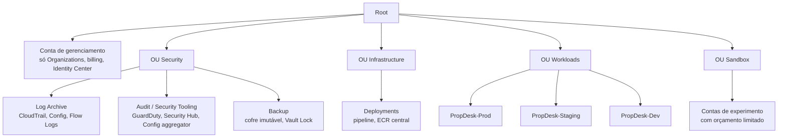

---
aliases:
  - Aula 26.6
modulo: 26
aula: 6
parte: "VIII Custo, projeto e prova"
dominios:
  - 1
  - 4
lida: false
tags:
  - aula
  - saa-c03
  - modulo-26
---

# Aula 26.6: Multiconta, governança e auditoria

[[26 - Projeto Pratico - Arquitetura de Referencia|Voltar ao módulo]]

> [!question] Pergunta que esta aula responde
> Por que o PropDesk deixa de viver em uma única conta, como dividir produção, não produção, segurança e logs em contas e OUs, e quais guardrails ([[SCP|SCPs]], [[IAM Identity Center|Identity Center]], trilha de auditoria, detecção) fazem a governança valer para todas elas por padrão?

## Por que uma conta só não escala

Nas iterações 1 a 4, tudo morava em uma conta. Isso funciona para um protótipo e falha por quatro razões que o [[05.01 - Por que Varias Contas e Como o Organizations Organiza|Módulo 5]] ensinou, e que agora têm números do projeto:

| Razão | Em uma conta só | Com várias contas |
|---|---|---|
| [[Raio de Impacto\|Raio de impacto]] | Um erro de [[IAM]] ou um script em desenvolvimento afeta a produção | A conta é a fronteira de segurança mais forte: um erro fica nela |
| Isolamento de acesso | Desenvolvedores e produção compartilham permissões e quotas | Cada conta tem suas próprias permissões e [[Service Quotas]] |
| Cobrança | Custo de produção e de teste misturados; difícil de atribuir | Custo por conta, direto, com [[Consolidated Billing\|cobrança consolidada]] |
| Auditoria | Quem tem acesso à conta pode apagar a própria trilha | Os logs vão para uma conta que a produção não administra |

Esses quatro pontos vêm da documentação de multiconta da AWS e são a razão pela qual a prova trata a conta como **o** limite de isolamento. A consequência prática para PropDesk: a conta de produção deve ter o **mínimo de pessoas e processos**, e ninguém testa nada ali.

## O desenho: Organization, OUs e contas

O [[Organizations]] agrupa as contas em **[[Organizational Unit|OUs]]**, e a estrutura segue o princípio de agrupar por **necessidade de controle** (as mesmas políticas), não por organograma. O [[Backup Vault|cofre de backup]] ganha uma conta própria na OU Security (e não divide a conta Deployments) porque a esteira tem roles de escrita assumidas e recebe mudanças frequentes: misturar os dois enfraqueceria a separação que esta aula defende. A estrutura abaixo é inspirada nas OUs recomendadas pela AWS (a Security OU com as contas de [[Conta Log Archive|Log Archive]] e Audit é a mais fixa; os nomes das outras são convenção).



| Conta | Para quê | Quem acessa |
|---|---|---|
| Gerenciamento | Criar contas, políticas, [[Consolidated Billing\|cobrança consolidada]], [[IAM Identity Center\|Identity Center]]; **nenhuma carga de trabalho** | Pouquíssimas pessoas, com [[MFA]] |
| [[Conta Log Archive\|Log Archive]] | Guarda logs imutáveis ([[CloudTrail]], Config, [[VPC Flow Logs]], logs de acesso) | Auditores, somente leitura; escrita só pelos serviços |
| Audit (Security Tooling) | Console central de [[GuardDuty]], [[Security Hub]], Config [[Aggregator\|aggregator]], Inspector, Detective | Time de segurança |
| Backup | Cofre de backup imutável ([[Vault Lock]]), cópias vindas de Prod e da Região de DR; **nenhuma carga e nenhuma role de escrita assumida por esteira** | Time de segurança, poucas pessoas |
| Deployments | Esteira de CI/CD e repositório central de imagens ([[ECR]]) | Pipeline e time de plataforma |
| PropDesk-Prod | Carga de produção | Quase ninguém em escrita; pipeline por role |
| PropDesk-Staging e Dev | Ensaio e desenvolvimento | Desenvolvedores |
| Sandbox | Experimento livre, com **Budgets** e [[SCP]] de teto | Qualquer engenheiro |

A [[Management Account|conta de gerenciamento]] é especial por um motivo de segurança: as **[[SCP|SCPs]] não se aplicam a ela**. Por isso ela não hospeda nada, só administra. Detalhe da prova: o que a protege é não ter carga de trabalho e ter [[MFA]] no usuário [[Usuario Root]], não uma SCP.

### Control Tower: o caminho curto para o desenho

Montar isso à mão é trabalho. O [[Control Tower]] cria uma **[[Landing Zone]]** (ambiente multiconta com baseline): estrutura as OUs de segurança, cria as contas de [[Conta Log Archive|Log Archive]] e Audit, ativa [[CloudTrail]] e Config em todas as contas, configura o [[IAM Identity Center|Identity Center]] e oferece **controles** (preventivos por [[SCP]], detectivos por Config, proativos antes da implantação de [[CloudFormation]]). Novas contas nascem pelo **[[Account Factory]]**, já com o baseline aplicado. A escolha da prova é clara: "organização com muitas contas, governança padronizada, o **menor esforço**" aponta para Control Tower; "só preciso agrupar contas e aplicar SCPs que eu mesmo escrevo" aponta para Organizations puro ([[05.04 - Control Tower e Landing Zone|aula 5.4]]). O Control Tower em si não tem cobrança adicional, mas os serviços que ele ativa (Config, CloudTrail, [[S3]] e outros) são cobrados normalmente (verificado em novembro de 2026).

## Guardrails: SCPs que valem para tudo

Uma [[SCP]] define o **teto** de permissões das contas: ela **limita, nunca concede**, e se aplica inclusive ao root das contas-membro (não à [[Management Account|conta de gerenciamento]]). Uma ação só é permitida se o [[IAM]] **e** a SCP a permitirem. As SCPs do PropDesk, anexadas à OU, não à conta:

1. **Negar [[Regiao AWS|Regiões]] fora do conjunto aprovado.** Obrigatória por [[Residencia de Dados|residência de dados]] e por reduzir superfície. A documentação oficial traz o exemplo com `aws:RequestedRegion` e uma lista `NotAction` com os serviços **globais** ([[IAM]], [[Route 53]], [[CloudFront]], Organizations, Support etc.), que não pertencem a uma Região e quebrariam se fossem negados.
2. **Impedir sair da organização** (`organizations:LeaveOrganization`).
3. **Proteger a trilha e a detecção:** negar `cloudtrail:StopLogging`, `cloudtrail:DeleteTrail`, e desligar [[GuardDuty]] ou Config. Sem isso, um invasor com acesso administrativo apagaria os rastros.
4. **Bloquear ações do root** das contas-membro (ele só é necessário para poucas tarefas).
5. **Proteger as roles de segurança** do baseline contra edição.

```json
{
  "Version": "2012-10-17",
  "Statement": [
    {
      "Sid": "DenyOutsideApprovedRegions",
      "Effect": "Deny",
      "NotAction": ["iam:*", "sts:*", "organizations:*", "route53:*", "cloudfront:*",
                    "support:*", "budgets:*", "ce:*", "wafv2:*", "shield:*"],
      "Resource": "*",
      "Condition": {
        "StringNotEquals": { "aws:RequestedRegion": ["us-east-1", "us-west-2"] }
      }
    },
    {
      "Sid": "ProtectAuditTrail",
      "Effect": "Deny",
      "Action": ["cloudtrail:StopLogging", "cloudtrail:DeleteTrail",
                 "guardduty:DeleteDetector", "config:StopConfigurationRecorder"],
      "Resource": "*"
    }
  ]
}
```

Os valores de [[Regiao AWS|Regiões]] e a lista de serviços globais são um **exemplo de exercício**, a lista real deve partir da documentação de exemplos de [[SCP]] (a lista de serviços globais varia e a AWS a atualiza). O que o código ensina: `Deny` com `NotAction` e `aws:RequestedRegion` é o padrão de prova para "restringir Regiões".

> [!example] A diferença entre limitar e conceder
> Uma [[SCP]] que **permite** `s3:*` não dá acesso a ninguém: só **mantém** possível o que o [[IAM]] conceder. Em uma conta, se a SCP nega `ec2:*` e a role de um desenvolvedor concede `ec2:*`, o resultado é **negado**. É por isso que SCP é guardrail (cerca), e a role é o que realmente dá a permissão ([[05.02 - SCPs e Politicas de Organizacao|aula 5.2]]).

## Identidade humana: Identity Center, nunca usuário IAM

Em uma organização com várias contas, [[IAM User|usuários IAM]] por conta seriam multiplicação de senhas e de chaves de longo prazo. O [[IAM Identity Center]] centraliza: o [[Identity Provider|provedor de identidade]] da empresa (via [[SAML]] e [[SCIM]]) alimenta usuários e grupos, e **[[Permission Set|permission sets]]** (conjuntos de permissões) são atribuídos a **grupos por conta**. O desenvolvedor entra por um portal, escolhe a conta e a role, e recebe **[[Credencial Temporaria|credenciais temporárias]]**.

Para PropDesk: o grupo `devs` recebe o [[Permission Set|permission set]] `Developer` em Dev e Staging, `ReadOnly` em Prod; só o grupo `plataforma` recebe `ProdOperator` em Prod, com **[[MFA]]** obrigatório. Uma role de **emergência** (break-glass) existe em Prod com alerta quando usada. A [[IAM Role]] de implantação é outra coisa: o pipeline, na conta Deployments, **assume uma role** na conta de destino (a *[[Trust Policy|trust policy]]* da role de destino confia na conta da esteira), por isso nunca há chave fixa de CI com acesso a produção ([[04.07 - Acesso entre Contas Resource Policies e Confused Deputy|aula 4.7]]).

Recursos que precisam cruzar contas seguem a regra "permissão **dos dois lados**": o repositório de imagens central ([[ECR]]) na conta Deployments tem uma **repository policy** que permite o pull às contas de workload, e a role de execução das tarefas, na conta de produção, tem permissão de pull na própria política. Chaves [[KMS]] compartilhadas entre contas exigem a **[[Key Policy|key policy]]** autorizando a outra conta, mais a política [[IAM]] na conta de uso (aula [[08.03 - KMS Key Policy IAM e Grants|8.3]]).

## Auditoria e detecção: logs em uma conta que a produção não controla

Os controles abaixo respondem ao requisito de PropDesk de **trilha de 7 anos**, e todos seguem a mesma lógica: coleta em todas as contas, guarda em uma conta separada, protegida contra apagamento.

| Serviço | O que registra | Configuração no PropDesk |
|---|---|---|
| [[CloudTrail]] | **Quem** fez qual chamada de API | **Trilha da organização** (todas as contas, todas as [[Regiao AWS\|Regiões]]) para um [[Bucket\|bucket]] [[S3]] na [[Conta Log Archive\|conta Log Archive]], com **[[Log File Validation\|validação de integridade]]** dos arquivos, [[SSE-KMS]] e [[Object Lock]] em **[[Modo Compliance\|modo compliance]]** (exige **[[Versionamento\|versionamento]]** no bucket; o CloudTrail só escreve se a **[[Bucket Policy\|bucket policy]]** permitir o serviço) |
| [[Config]] | **Como** cada recurso estava configurado e como mudou | Gravador em todas as contas e [[Regiao AWS\|Regiões]]; **[[Aggregator\|aggregator]]** na conta Audit; [[Managed Rule Group\|regras gerenciadas]] e [[Conformance Pack\|conformance packs]]; [[Remediacao Automatica\|remediação automática]] por [[Automation\|SSM Automation]] |
| [[VPC Flow Logs]] | Metadados do tráfego de rede | Para o [[Bucket\|bucket]] de logs, [[Parquet\|formato Parquet]] se for consultar com Athena |
| [[GuardDuty]] | Comportamento suspeito (credenciais exfiltradas, comunicação com IPs maliciosos) | Administrador **delegado** na conta Audit, habilitado na organização |
| [[Security Hub]] | Agregação de achados e verificações de padrões de segurança | [[Delegated Administrator\|Administrador delegado]] na Audit, agrega [[GuardDuty]], Inspector e Config |
| [[Inspector]] | Vulnerabilidades em imagens do [[ECR]], [[EC2]] e Lambda | Escaneamento contínuo das imagens |
| [[Macie]] | [[PII\|Dados pessoais]] nos anexos do [[S3]] | Só nas buckets de anexos, por [[Sampling\|amostragem]] (custo) |
| [[Detective]] | Investigação de causa de um achado | Sob demanda, quando um achado exige análise |

**[[Object Lock]], governance contra compliance:** em **governance**, quem tem a permissão especial `s3:BypassGovernanceRetention` (ou o root) ainda remove ou encurta a retenção; em **compliance**, **ninguém**, nem o root, altera ou apaga o objeto durante o prazo. Para "imutável por 7 anos", a resposta é compliance (verificado na documentação do [[S3]] Object Lock em novembro de 2026).

Duas distinções clássicas de prova se resolvem aqui. **[[CloudTrail]] contra Config**: o primeiro diz **quem fez o quê** (eventos de API); o segundo diz **como o recurso estava** e se está em conformidade (estado de configuração). E **[[Management Event|eventos de gerenciamento]] contra [[Data Event|eventos de dados]]**: o CloudTrail registra por padrão os eventos de gerenciamento (criar um [[Bucket|bucket]]); os **eventos de dados** (cada `GetObject`) são opt-in e cobrados por volume, então se habilitam só para o bucket de anexos sensível, não para tudo (aula [[05.08 - CloudTrail e a Trilha de Auditoria|5.8]]).

> [!tip] Retenção de 7 anos sem custo absurdo
> A trilha vai para o [[S3]] com **[[Object Lock]] em [[Modo Compliance|modo compliance]]** pelo período exigido (ninguém, nem o root, apaga antes) e uma **[[Lifecycle Policy|lifecycle policy]]** que move os arquivos antigos para uma classe de arquivamento ([[S3 Glacier Deep Archive|Glacier Deep Archive]] no fim). Consulta ocasional é feita com o Athena. Guardar 7 anos de logs no [[CloudWatch Logs]] seria caro: o CloudWatch Logs é para alarme e busca recente, o S3 para retenção.

Alarmes de operação se apoiam nisso: um **[[Metric Filter|metric filter]]** do [[CloudWatch Logs]] sobre a trilha (enviada também ao CloudWatch Logs) gera alarmes para login do root, mudanças em policies do [[IAM]] e falha de autenticação em massa, que notificam por [[SNS]] (módulo 21).

## Rede e compartilhamento entre contas

PropDesk tem **uma [[VPC]] por conta de workload** e não precisa de conectividade entre elas hoje, então **não há [[Transit Gateway]]** (cobrado por anexo e por GB, aula [[07.03 - Transit Gateway|7.3]]). A decisão é registrada com seu gatilho: se surgirem VPCs que precisam se falar, um segundo ambiente híbrido ou serviços compartilhados, o Transit Gateway entra e é compartilhado com as outras contas via [[RAM]] (Resource Access Manager). O RAM também compartilha **[[Sub-rede|sub-redes]]** ([[VPC Sharing|compartilhamento de VPC]], para centralizar a rede), **regras do [[Route 53 Resolver]]** e outros recursos sem duplicá-los. Para expor um serviço a outra conta sem rotear redes inteiras, o [[PrivateLink]] resolve (aula [[07.04 - PrivateLink e Endpoint Services|7.4]]).

## O custo e a complexidade da multiconta

Mais contas trazem mais coordenação: cada uma tem suas próprias quotas (cotas são por conta e por Região, e a de produção precisa de pedidos de aumento planejados), roles cross-account para manter e baseline para atualizar. A contrapartida econômica é a [[Consolidated Billing|cobrança consolidada]]: uma fatura, com **descontos por volume somados** entre contas e **compartilhamento de [[Savings Plans]] e [[Reserved Instance|Reserved Instances]]** entre elas (configurável), além de custo atribuído por conta sem tags (aula [[05.03 - Cobranca Consolidada e Custos Multiconta|5.3]]). Para um SaaS pequeno, o desenho acima é o mínimo defensável; um setor regulado acrescentaria contas por [[Tenant|tenant]] enterprise (o silo da aula 26.1 pode ser uma **conta dedicada** por cliente).

## Como isso cai na prova

> [!info] Task statements 1.1, 1.2, 1.3 e 4.1
> 1.1 (acesso entre várias contas, [[Control Tower]], [[SCP|SCPs]], [[Federacao|federação]], [[IAM Identity Center|Identity Center]], roles e [[STS]]); 1.2 (segurança de rede e Shield/WAF); 1.3 (retenção, backups, chaves); 4.1 (cobrança multiconta e tags).

**Palavras-chave em inglês:** *multiple [[Conta AWS|AWS accounts]]*, *centrally manage*, *guardrails*, *prevent [[Member Account|member accounts]] from*, *restrict [[Regiao AWS|Regions]]*, *least [[Overhead Operacional|operational overhead]]*, *audit trail across all accounts*, *tamper-proof logs*, *single sign-on*, *[[Delegated Administrator|delegated administrator]]*.

**Armadilhas frequentes:**

- [[SCP]] **concede** permissão: não, só limita. E **não** afeta a [[Management Account|conta de gerenciamento]].
- Organizations contra [[Control Tower]]: o segundo monta [[Landing Zone|landing zone]] e baseline com menor esforço.
- [[CloudTrail]] (**quem fez**) contra Config (**como estava**).
- [[IAM Identity Center|Identity Center]] para pessoas; [[IAM Role|IAM roles]] com [[Credencial Temporaria|credenciais temporárias]] para serviços e para acesso cross-account.
- [[Data Event|Eventos de dados]] do [[CloudTrail]] não vêm ligados por padrão.
- [[VPC Sharing|Compartilhar sub-redes]] e [[Transit Gateway]] entre contas é [[RAM]], não [[VPC Peering|VPC peering]].

| Requisito no enunciado | Resposta provável | Por quê |
|---|---|---|
| Impedir que contas-membro usem [[Regiao AWS\|Regiões]] fora da UE | [[SCP]] de negação com `aws:RequestedRegion` | Guardrail preventivo |
| Montar ambiente multiconta com baseline, menor esforço | [[Control Tower]] | [[Landing Zone\|Landing zone]] automatizada |
| Login único para dezenas de contas com o [[Active Directory\|AD]] da empresa | [[IAM Identity Center]] | [[Federacao\|Federação]] e [[Permission Set\|permission sets]] |
| Auditar todas as chamadas de API de todas as contas | Trilha da organização do [[CloudTrail]] | Uma trilha, todas as contas |
| Detectar recursos fora de conformidade e remediar | Config com regras e [[Remediacao Automatica\|remediação]] | Estado de configuração |
| Logs que um administrador de produção não possa apagar | [[Conta Log Archive\|Conta de Log Archive]] separada, [[Object Lock]] | Imutabilidade e separação |
| [[VPC Sharing\|Compartilhar sub-redes]] entre contas sem duplicar | [[RAM]] | [[Resource Share\|Compartilhamento de recursos]] |
| Pipeline implanta em várias contas sem chaves fixas | Role assumida cross-account | [[Credencial Temporaria\|Credencial temporária]] |

## Resumo

> [!abstract] A aula em uma frase
> A conta é a fronteira de isolamento mais forte: o PropDesk separa produção, não produção, segurança e logs em contas dentro de OUs, aplica [[SCP|SCPs]] como teto de permissões, usa [[IAM Identity Center|Identity Center]] para pessoas e roles cross-account para esteiras, e mantém trilha e detecção em contas que a produção não controla.

**A lógica, em 5 passos**

1. A conta limita [[Raio de Impacto|raio de impacto]], acesso, quota e cobrança; produção fica quase sem gente.
2. Estruture em OUs por necessidade de controle: Security, Infrastructure, Workloads, Sandbox.
3. Use [[Control Tower]] para o baseline e as [[SCP|SCPs]] como cerca (limitam, nunca concedem).
4. Pessoas entram por [[IAM Identity Center|Identity Center]]; serviços e esteiras assumem roles com [[Credencial Temporaria|credencial temporária]].
5. Trilha da organização, Config e detecção centralizadas em [[Conta Log Archive|Log Archive]] e Audit, protegidas contra apagamento.

**Tabela-síntese: quem responde a quê**

| Pergunta | Serviço |
|---|---|
| Quem chamou esta API? | [[CloudTrail]] |
| Como estava o recurso e está em conformidade? | Config |
| Há comportamento suspeito na conta? | [[GuardDuty]] |
| Há vulnerabilidade na imagem ou instância? | Inspector |
| Há dado pessoal no [[Bucket\|bucket]]? | [[Macie]] |
| Qual a causa deste achado? | Detective |
| Todos os achados em um só lugar? | [[Security Hub]] |

**Na prática, isso significa**

- A produção é uma conta quase sem acesso humano de escrita: mudanças vêm da esteira.
- Todo guardrail vai na OU, não na conta, para valer para as contas futuras.
- Os logs de auditoria ficam onde quem opera a produção não consegue alterá-los.

> [!tip] Liga com
> Vem do [[05 - Multiconta Governanca e Federacao|Módulo 5]], do [[04 - IAM Identidade e Acesso|Módulo 4]] e do [[19 - Seguranca de Aplicacoes e Deteccao de Ameacas|Módulo 19]]. Segue para o [[26.07 - Plano de DR e Estimativa de Custo|plano de DR]], que usa a conta Backup e a separação por conta.

## Erros comuns

- **Achar que a [[SCP]] dá permissão.** Sem uma [[IAM Policy|policy IAM]] que conceda, a SCP permissiva não libera nada.
- **Rodar carga na [[Management Account|conta de gerenciamento]].** Ela não é limitada por [[SCP]], então o risco aumenta e o [[Raio de Impacto|raio de impacto]] é a organização inteira.
- **Anexar a [[SCP]] a uma conta em vez de à OU.** A conta nova escapa do guardrail.
- **Negar [[Regiao AWS|Regiões]] sem excluir os serviços globais.** [[IAM]], [[Route 53]] e [[CloudFront]] deixam de funcionar.
- **Guardar a trilha de auditoria na própria conta de produção.** Quem a administra pode apagá-la.
- **Habilitar [[Data Event|eventos de dados]] do [[CloudTrail]] em tudo.** O custo explode; ligue só onde o requisito pede.

## Pratique

**1.** Uma empresa com 40 contas precisa impedir que qualquer conta-membro use [[Regiao AWS|Regiões]] fora da União Europeia, aplicando a regra a todas as contas atuais e futuras. Qual solução atende com o menor esforço contínuo?

- [ ] a) Uma policy IAM de negação anexada a cada usuário em cada conta
- [ ] b) Um alarme do CloudWatch em cada conta que avise quando uma Região proibida for usada
- [ ] c) Uma SCP que nega as ações fora das Regiões aprovadas, anexada à OU das contas
- [ ] d) Uma revisão mensal manual dos recursos criados em cada Região

**2.** A [[Management Account|conta de gerenciamento]] de uma organização tem uma [[SCP]] que nega a criação de recursos [[EC2]]. Um administrador dessa conta tenta criar uma instância. Qual é o resultado?

- [ ] a) A criação é permitida, porque as SCPs não se aplicam à conta de gerenciamento
- [ ] b) A criação é negada, porque a SCP se aplica a todas as contas da organização
- [ ] c) A criação é permitida apenas se o administrador usar o usuário root
- [ ] d) A criação é negada apenas durante o horário comercial da Região

**3.** Uma empresa quer que desenvolvedores acessem dezenas de [[Conta AWS|contas AWS]] com as credenciais do diretório corporativo, sem criar [[IAM User|usuários IAM]] em cada conta. Qual serviço atende com o menor esforço?

- [ ] a) Um usuário IAM por desenvolvedor em cada conta, com a mesma senha
- [ ] b) Federação SAML configurada manualmente, com um provedor de identidade e uma role em cada conta
- [ ] c) AWS Directory Service Simple AD configurado em cada conta
- [ ] d) AWS IAM Identity Center integrado ao provedor de identidade da empresa

**4.** Uma equipe precisa de um registro de quem criou, alterou ou excluiu recursos em todas as contas e [[Regiao AWS|Regiões]] de uma organização, em um único local. O que usar?

- [ ] a) AWS Config com uma regra gerenciada em cada conta
- [ ] b) Uma trilha da organização no AWS CloudTrail entregando a um bucket central
- [ ] c) VPC Flow Logs habilitados em todas as VPCs
- [ ] d) Amazon GuardDuty com os achados enviados ao Security Hub

**5.** (Escolha DUAS.) Uma empresa quer garantir que os logs de auditoria não possam ser apagados nem por administradores das contas de produção. Quais medidas atendem?

- [ ] a) Entregar os logs a um bucket em uma conta separada de Log Archive
- [ ] b) Guardar os logs em um bucket da própria conta de produção com versionamento
- [ ] c) Habilitar o Object Lock em modo compliance no bucket de logs
- [ ] d) Habilitar o Object Lock em modo governance e conceder a bypass aos administradores da produção
- [ ] e) Replicar os logs para um segundo bucket na própria conta de produção

**6.** Uma organização quer detectar recursos que estejam fora das regras de segurança (por exemplo, volumes sem criptografia) e corrigir automaticamente. Qual serviço fornece o estado de configuração e as regras?

- [ ] a) AWS CloudTrail, que avalia as regras de configuração dos recursos
- [ ] b) Amazon Macie, que verifica a criptografia dos volumes EBS
- [ ] c) AWS Shield, que remedia recursos desconfigurados
- [ ] d) AWS Config com regras gerenciadas e ações de remediação

**7.** Uma empresa precisa criar com rapidez um ambiente multiconta com contas de log e auditoria, [[Controle Preventivo|controles preventivos]] e detectivos e criação padronizada de novas contas, com o menor esforço de configuração. O que usar?

- [ ] a) Criar cada conta manualmente e configurar CloudTrail e Config um a um
- [ ] b) Apenas o AWS Organizations, escrevendo todas as SCPs do zero
- [ ] c) AWS Control Tower com uma landing zone e o Account Factory
- [ ] d) Um único Amazon VPC compartilhado com tags para separar os ambientes

**8.** Uma esteira de CI/CD em uma conta de ferramentas precisa implantar a aplicação em uma conta de produção sem guardar chaves fixas. Qual abordagem atende?

- [ ] a) A esteira assume uma role na produção que confia na conta da esteira
- [ ] b) Criar um usuário IAM na produção e salvar a access key como segredo na esteira
- [ ] c) Tornar o bucket de artefatos público para que a produção o leia
- [ ] d) Compartilhar a senha do usuário root entre as duas contas

**9.** Uma empresa quer separar custos por ambiente (produção, homologação e desenvolvimento) sem depender de tags em todos os recursos e manter um único pagamento. O que facilita isso?

- [ ] a) Rodar todos os ambientes em uma conta e comparar as faturas por mês
- [ ] b) Contas separadas por ambiente em uma organização com cobrança consolidada
- [ ] c) Um Budget com ação que apague os recursos quando o limite de custo do mês for atingido
- [ ] d) Um único bucket para todos os ambientes, com prefixos por ambiente

**10.** (Escolha DUAS.) Quais afirmações sobre [[SCP|SCPs]] estão corretas?

- [ ] a) Uma SCP pode conceder permissões que a policy IAM não concede
- [ ] b) Uma SCP limita as permissões máximas de contas-membro da OU em que está anexada
- [ ] c) Uma SCP afeta o usuário root das contas-membro
- [ ] d) Uma SCP se aplica à conta de gerenciamento da organização
- [ ] e) Uma SCP substitui a necessidade de policies IAM nas contas

> [!success]- Gabarito
> **1. c)** a [[SCP]] na OU cobre contas atuais e futuras sem esforço contínuo; a) policies por usuário não cobrem contas e usuários futuros e são trabalhosas; b) um alarme avisa depois do fato, não impede; d) uma revisão manual não é preventiva.
> **2. a)** as [[SCP|SCPs]] não se aplicam à [[Management Account|conta de gerenciamento]], então a criação é permitida; b) a SCP não atinge essa conta; c) o root não é o fator; d) SCPs não têm horário.
> **3. d)** o [[IAM Identity Center|Identity Center]] integra o [[Identity Provider|provedor de identidade]] e dá acesso a várias contas com [[Credencial Temporaria|credenciais temporárias]]; a) usuários e senhas por conta multiplicam o risco; b) funciona, mas exige configurar o provedor e as roles conta a conta, bem mais trabalho que o Identity Center; c) o [[Simple AD]] não resolve [[Federacao|acesso federado]] a várias contas.
> **4. b)** a trilha da organização do [[CloudTrail]] registra as chamadas de API de todas as contas e [[Regiao AWS|Regiões]] em um local; a) o Config registra estado de configuração, não quem agiu; c) o [[VPC Flow Logs|Flow Logs]] registra metadados de rede; d) o [[GuardDuty]] detecta ameaças, não é um registro completo de ações.
> **5. a), c)** a conta separada e o [[Object Lock]] compliance impedem o apagamento mesmo por administradores; b) o [[Bucket|bucket]] na própria produção pode ser alterado por quem a administra; d) o governance com bypass permite que administradores removam a retenção; e) outra cópia na mesma conta continua ao alcance de quem a administra.
> **6. d)** o Config avalia a configuração por regras e remedia; a) o [[CloudTrail]] registra chamadas de API, não avalia regras; b) o [[Macie]] descobre dados sensíveis no [[S3]]; c) o Shield protege contra [[DDoS]].
> **7. c)** o [[Control Tower]] cria a [[Landing Zone|landing zone]] com contas de log e auditoria, controles e o [[Account Factory]]; a) manual é trabalhoso; b) só o Organizations exige escrever tudo; d) uma [[VPC]] e tags não isolam contas.
> **8. a)** a role assumida dá [[Credencial Temporaria|credencial temporária]] sem chave fixa; b) a [[Access Key|access key]] salva é credencial permanente; c) [[Bucket|bucket]] público é exposição; d) compartilhar o root é a pior prática.
> **9. b)** contas por ambiente com [[Consolidated Billing|cobrança consolidada]] separam custo por conta e unificam o pagamento; a) uma conta mistura custos; c) o Budgets alerta, não apaga recursos por padrão; d) prefixos não separam custo de computação e rede.
> **10. b), c)** a [[SCP]] define o teto das contas-membro e atinge o root delas; a) a SCP só limita; d) a [[Management Account|conta de gerenciamento]] não é afetada; e) a SCP não concede permissões, as [[IAM Policy|policies IAM]] continuam necessárias.

## Para aprofundar

- [ ] [Organizing your AWS environment using multiple accounts: recommended OUs and accounts](https://docs.aws.amazon.com/whitepapers/latest/organizing-your-aws-environment/recommended-ous-and-accounts.html) (AWS Whitepapers): OUs recomendadas e a razão de cada uma.
- [ ] [AWS Security Reference Architecture: Log Archive account](https://docs.aws.amazon.com/prescriptive-guidance/latest/security-reference-architecture/log-archive.html) (AWS Prescriptive Guidance): por que os logs ficam em uma conta separada, com controles que impedem adulteração.
- [ ] [Locking objects with Object Lock](https://docs.aws.amazon.com/AmazonS3/latest/userguide/object-lock.html) (AWS Documentation): modos governance e compliance, [[Versionamento|versionamento]] e permissões.
- [ ] [IAM policy example: deny requests outside specified Regions](https://docs.aws.amazon.com/IAM/latest/UserGuide/reference_policies_examples_aws_deny-requested-region.html) (AWS Documentation): o exemplo oficial de negação por Região com `NotAction` para serviços globais.

Próxima aula: [[26.07 - Plano de DR e Estimativa de Custo|Aula 26.7: plano de DR e estimativa de custo]].
