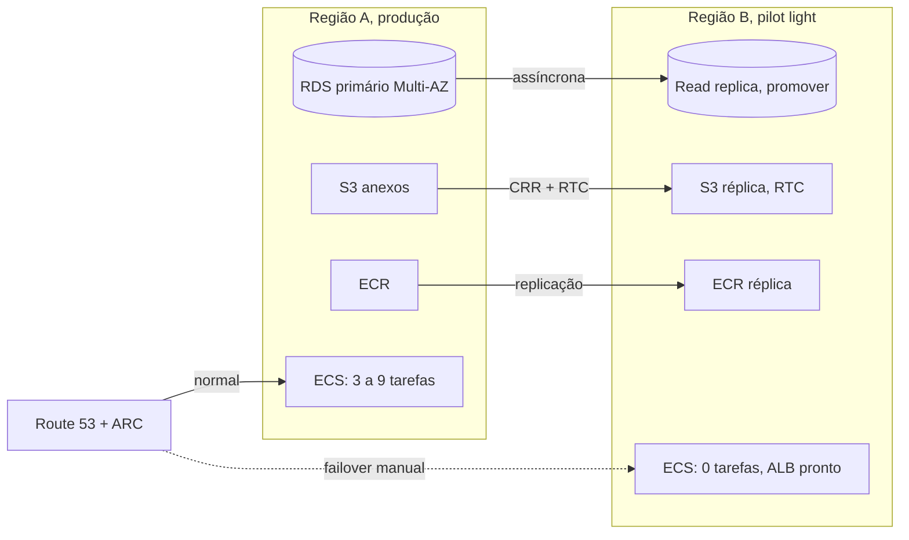

---
aliases:
  - Aula 26.7
modulo: 26
aula: 7
parte: "VIII Custo, projeto e prova"
dominios:
  - 2
  - 4
lida: false
tags:
  - aula
  - saa-c03
  - modulo-26
---

# Aula 26.7: Plano de DR e estimativa de custo

[[26 - Projeto Pratico - Arquitetura de Referencia|Voltar ao módulo]]

> [!question] Pergunta que esta aula responde
> Qual estratégia de [[Recuperacao de Desastres|recuperação de desastres]] atende ao [[RPO]] de 15 minutos e ao [[RTO]] de 1 hora do PropDesk pelo menor custo, como cada componente chega à Região de recuperação, e quanto custa o sistema inteiro (produção, não produção e DR) contra o teto do projeto?

## DR começa na pergunta "o que perder e por quanto tempo"

Até aqui, a resiliência do PropDesk cobre falhas **dentro** de uma [[Regiao AWS|Região]] (instâncias, [[Zona de Disponibilidade|AZs]], mensagens). Um **desastre regional** (a Região fica indisponível, ou um erro de configuração destrói o ambiente) é outro problema, e a resposta depende de números do negócio, não de preferência técnica: o [[RPO]] (quanta perda de dados é tolerável, medida em tempo) e o [[RTO]] (em quanto tempo o serviço volta). Os do PropDesk, definidos na [[26.01 - O Projeto PropDesk e os Requisitos|aula 26.1]]: **RPO de 15 minutos e RTO de 1 hora** para API e banco.

Nem tudo precisa do mesmo nível. Classificar por **camadas de criticidade** evita pagar DR de produção para o que tolera horas de espera:

| Camada | Componentes | [[RPO]] | [[RTO]] | Estratégia |
|---|---|---|---|---|
| 1, crítica | API, banco, autenticação, anexos | 15 min | 1 h | [[Pilot Light]] (decisão abaixo) |
| 2, importante | Relatórios mensais, importações em [[Processamento em Lote\|lote]], e-mails | 24 h | 8 h | [[Backup and Restore]] |
| 3, descartável | Desenvolvimento e homologação | Não aplicável | Não aplicável | Reimplantar do código |

As quatro estratégias e o seu custo crescente estão na [[20.04 - As Quatro Estrategias de Recuperacao de Desastres|aula 20.4]]; aqui o trabalho é **escolher e detalhar**.

## Por que Pilot Light, e quando mudaria

A lógica de eliminação pelos requisitos:

- **[[Backup and Restore|Backup and restore]]** ([[RPO]] de horas, [[RTO]] de até um dia): com backups periódicos e [[Snapshot|snapshots]] diários, viola o RPO de 15 minutos da camada 1. Há um refinamento: a **[[Cross-Region Automated Backups|replicação de backups automáticos]] do [[RDS]] entre [[Regiao AWS|Regiões]]** (cópia dos logs de transação a cada poucos minutos) dá RPO de minutos (verificado em novembro de 2026), mas restaurar 400 GB e subir toda a aplicação em B dificilmente cabe em 1 hora. Ou seja, o que realmente descarta o backup and restore aqui é o **RTO**, e não só o RPO; o requisito de recuperação rápida pede o núcleo de dados já vivo.
- **[[Pilot Light|Pilot light]]:** os dados são replicados continuamente ([[RPO]] de minutos) e o núcleo mínimo existe, com a camada de aplicação desligada; ligar e escalar leva dezenas de minutos. **Atende** ao RPO e, se a recuperação for ensaiada, ao [[RTO]].
- **[[Warm Standby|Warm standby]]:** um ambiente reduzido já atendendo; [[RTO]] de minutos. Atende, mas paga computação 24x7 que o RTO de 1 hora **não exige**.
- **[[Multi-Site Active-Active|Multi-site ativo-ativo]]:** [[RTO]] e [[RPO]] perto de zero; custo próximo ao dobro e escrita multi-Região complexa. **Excede** o pedido.

Entre as que atendem, a mais barata vence: **[[Pilot Light|pilot light]]**. A decisão tem um **gatilho de revisão**: se o ensaio mostrar que o [[RTO]] real passa de uns 45 minutos (deixando pouca folga), a camada de aplicação sobe para **[[Warm Standby|warm standby]]** com poucas tarefas já em execução, o que também reduz a dependência do [[Plano de Controle|plano de controle]]. Uma mudança de requisito para "RTO de 5 minutos" empurraria para warm standby ou [[Multi-Site Active-Active|ativo-ativo]]; é um dos exercícios da [[26.09 - Mudancas de Requisito no Estilo da Prova|aula 26.9]].

> [!example] Estimando o RTO do pilot light
> Uma estimativa de exercício (a ser validada em teste, nunca aceita como verdade): detectar e decidir, 15 min; promover a réplica do banco, 5 a 10 min (a documentação do whitepaper de DR indica "alguns minutos" para uma réplica [[RDS]] que não seja [[Aurora]], com reinício); aumentar o serviço [[ECS]] de zero para a capacidade de produção, 10 min; redirecionar o tráfego, 2 min ([[TTL]] curto); aquecer o cache e validar, 5 min. Soma: cerca de 40 minutos, folga de 20 contra o [[RTO]] de 1 hora.

## Componente por componente: como cada peça chega à Região B

A tabela é o coração do plano. A Região de recuperação é chamada B, a de produção A.

| Componente | Mecanismo de recuperação | O que fica ligado em B | Observação |
|---|---|---|---|
| Banco [[RDS]] PostgreSQL | **Cross-Region [[Read Replica\|read replica]]** (assíncrona); no desastre, **promover** | A réplica, sempre ligada | Monitore o `ReplicaLag` com alarme (precisa ficar abaixo de 15 min, na prática segundos); a promoção leva alguns minutos e inclui reinício, que entra no [[RTO]] |
| Alternativa de banco | **[[Aurora Global Database]]**: secundário com [[Latencia\|latência]] típica abaixo de 1 s e promoção em menos de 1 minuto (verificado na documentação em novembro de 2026) | O cluster secundário | Custa mais e exige estar em [[Aurora]]; é a escolha se o [[RTO]] apertar |
| Anexos no [[S3]] | **Replicação entre Regiões** (CRR) com **[[Replication Time Control\|RTC]]** (Replication Time Control, prazo de 15 minutos; veja [[Replicacao do S3|replicação do S3]]) | O [[Bucket\|bucket]] de destino | O RTC é o que dá o número para o [[RPO]]; o [[Versionamento\|versionamento]] é requisito da replicação |
| Imagens dos [[Container\|containers]] | **Replicação do [[ECR]]** entre [[Regiao AWS\|Regiões]] | Repositório B com as imagens | Sem imagem em B, o serviço não sobe |
| Segredos | **Replicação do [[Secrets Manager]]** para a Região B | Segredos replicados | Inclui a senha do banco; no [[Failover\|failover]] a aplicação lê o segredo local |
| Chaves | **Uma chave [[KMS]] em B**: a réplica do [[RDS]] e o [[Replicacao do S3\|CRR]] do [[S3]] recriptografam os dados com a chave de destino que você informa; multi-Region apenas onde o serviço exige ([[Cognito]]) | Uma chave regional em B (multi-Region só para o Cognito) | Chaves KMS comuns são regionais; sem chave em B, a réplica criptografada não é criada |
| Autenticação | **[[Cognito]]: replicação multi-Region** do [[User Pool\|user pool]] (secundário em outra Região) | O pool secundário (inicia INACTIVE) | Exige plano Essentials ou Plus, custo adicional e chave [[KMS]] multi-Region; limitações abaixo |
| API ([[ECS]] [[Fargate]]) | Serviço **pré-criado com 0 tarefas**, [[Application Load Balancer\|ALB]] e [[Task Definition\|task definition]] prontos | ALB, serviço, [[VPC]], [[Sub-rede\|sub-redes]] | O serviço é escalado no desastre (operação de [[Plano de Controle\|plano de controle]]) |
| [[Cache]] | Criado no [[Failover\|failover]] ou vazio, aquecido sob carga | Nada, ou um nó pequeno | É descartável; a aplicação funciona sem ele, só mais devagar |
| Filas [[SQS]] | Filas **recriadas vazias** por código | As filas (sem custo parado) | Mensagens em trânsito na Região A se perdem; o padrão de **reenfileirar a partir do banco** ([[Outbox\|outbox]], explicado abaixo) recupera o trabalho |
| Chaves de [[Idempotencia\|idempotência]] | [[Global Tables]] do [[DynamoDB]], ou aceitar reprocessamento seguro | A réplica da tabela | A idempotência do consumidor limita o dano de um reprocessamento |
| SPA e [[CDN]] | [[CloudFront]] é **global**; origem [[S3]] com **[[Origin Group\|grupo de origens]]** apontando para o [[Bucket\|bucket]] replicado | Bucket B | O [[Failover\|failover]] por requisição do CloudFront vale para métodos de leitura |
| [[DNS]] e tráfego | **[[Route 53]]** com registros de [[Failover\|failover]] e [[Health Check\|health checks]]; disparo manual por [[Application Recovery Controller]] (**[[Routing Control\|routing controls]]**: chaves liga/desliga que direcionam o tráfego pelo [[Plano de Dados\|plano de dados]]) | Registros e controles | Usa o plano de dados, a parte confiável no desastre |

> [!example] O padrão outbox em 2 linhas
> Ao gravar um pedido no banco, o serviço grava na mesma transação uma linha numa tabela `outbox` com a mensagem a enviar; um processo lê as linhas pendentes, publica na fila e as marca como enviadas. Se a fila for recriada vazia em B, basta republicar as linhas ainda pendentes (os consumidores idempotentes toleram a repetição).

**Limitações do [[Cognito]] replicado** (verificadas na documentação em novembro de 2026): o pool secundário **não cria usuários** (nem por cadastro nem por administrador) e usuários **não redefinem senha nem alteram perfil** nele; **[[MFA]] por TOTP não é suportado** nas réplicas; usuários federados só entram no secundário se já tiverem entrado no primário; e a replicação é **[[Consistencia Eventual|eventualmente consistente]]**. A consequência de projeto: durante o [[Failover|failover]], o PropDesk **desativa cadastro e recuperação de senha na interface**, e quem usa TOTP precisa que o primário volte. É uma limitação que o plano de DR precisa **assumir por escrito** (o requisito é continuar autenticando quem já existe).

> [!info] Por que chaves e segredos dão errado em DR
> Os esquecimentos clássicos de DR não são o banco: são a **chave [[KMS]]** que não existe em B (a réplica ou a cópia criptografada precisa de uma chave da Região de destino para ser recriptografada; chaves comuns são regionais), o **segredo** que só vive em A, a **imagem** que ficou no [[ECR]] de A e a **cota** de B baixa demais para escalar. Revise cada componente com a pergunta: "se A sumisse agora, B tem isso?". As cotas ([[Fargate]], [[ENI|ENIs]], [[Elastic IP|Elastic IPs]], [[NAT]]) precisam estar em B **no valor de produção** ([[Service Quotas]]).

## Backup: o que o DR não resolve

Replicar propaga **também o erro**: um `DROP TABLE` ou um ransomware chega a B em segundos. Por isso o plano separa dois problemas: **desastre de infraestrutura** (resolvido por replicação) e **desastre de dados** (resolvido por backup com pontos no tempo). O [[Backup]] (AWS Backup) do PropDesk:

- **Plano diário** para o [[RDS]] (com backup contínuo para [[Point-in-Time Recovery|PITR]]), [[EFS]] se houver, e o [[Bucket|bucket]] de anexos, com retenção por requisito.
- **Cópia automática** para a Região B **e** para uma **conta de backup** separada (a conta **Backup**, da OU Security, da [[26.06 - Multiconta Governanca e Auditoria|aula 26.6]]), em um [[Backup Vault]] com [[Backup Vault Lock|Vault Lock]] em **[[Modo Compliance|modo compliance]]**, que ninguém, nem o root, desfaz antes do prazo ([[20.05 - AWS Backup Snapshots e Cofres Imutaveis|aula 20.5]]). A separação por conta protege contra credencial de produção comprometida: o invasor não alcança o cofre.
- **Tempos típicos de [[Failover|failover]]** (para a tabela de comparação que aparece em questões): [[RDS]] [[Multi-AZ]] de instância, cerca de 60 a 120 segundos; [[Aurora]], em geral abaixo de 60 segundos quando há réplicas; [[Multi-AZ DB Cluster|Multi-AZ DB cluster]] do RDS, abaixo de 35 segundos; [[Aurora Global Database]], promoção do secundário abaixo de 1 minuto (todos verificados na documentação em novembro de 2026). A réplica cross-Region promovida do RDS soma a promoção e o reinício, por isso fica acima desses valores.
- **[[Restore Testing|Teste de restauração]] agendado:** a restauração de backup é uma operação de [[Plano de Controle|plano de controle]]; o whitepaper de DR recomenda restaurar periodicamente para saber que funciona, e para ter, se o plano de controle falhar, repositórios criados de um backup recente.

## O roteiro de failover e o failback

Um plano que ninguém consegue executar às 3 da manhã não é um plano. O roteiro do PropDesk, resumido:

1. **Declarar** o desastre: um humano decide, com critérios escritos (Região A com alarmes de saúde críticos por mais de 15 minutos). Falha automática por falso alarme custa dado e tempo, e a AWS recomenda disparo manual com **passos automatizados**, "como apertar um botão".
2. **Promover** a réplica do banco em B e confirmar a perda real de dados (o `ReplicaLag` no instante da falha é o [[RPO]] real).
3. **Escalar** o serviço [[ECS]] em B para a capacidade de produção.
4. **Alternar o tráfego** pelo [[Application Recovery Controller]] ([[Routing Control|routing controls]], [[Plano de Dados|plano de dados]]) ou pelos registros de [[Failover|failover]] do [[Route 53]].
5. **Validar** com teste de fumaça (login, abrir chamado, gerar upload) e comunicar o status.
6. **[[Failback]]:** depois da recuperação de A, **reconstrua a replicação no sentido inverso** (nova réplica de B para A), espere sincronizar e faça uma troca **planejada**. É a parte mais esquecida; sem ela, B vira a nova produção sem DR.

O plano só vale se **testado**. Um *[[Game Day|game day]]* semestral mede o [[RTO]] real, o [[RPO]] real e revela os esquecimentos. O ensaio pode usar o ambiente de homologação como alvo (aula [[20.10 - Metricas de Negocio SLO e Teste de Recuperacao|20.10]]).

## A estimativa de custo

Estimar custo é um **método**: liste os componentes, a unidade de cobrança de cada um, a quantidade e o preço; some; compare com o teto; identifique o que mais pesa. A ferramenta é o [[Pricing Calculator]] (estima arquiteturas que ainda não existem). Aqui o cálculo é feito à mão para você ver a estrutura.

> [!warning] Preços fictícios
> **Todos os preços abaixo são inventados para o exercício** (ordem de grandeza, arredondados para facilitar a conta). Não são tabela da AWS. Para uma decisão real, monte a estimativa no [[Pricing Calculator]] com os preços da sua Região e da data. O que a aula treina é a **estrutura da conta** e as proporções.

**Premissas de uso:** tarefa de 2 [[vCPU]] e 4 GB a US$ 0,10 por hora; banco de classe grande a US$ 0,90 por hora (Single-AZ) e o dobro em [[Multi-AZ]]; 730 horas por mês; 3 tarefas de base 24x7, 6 no horário comercial (10 h, 22 dias) e 9 no pico (3 h, 22 dias).

**Horas de tarefa:** `3 x 730 + 3 x 10 x 22 + 3 x 3 x 22 = 2.190 + 660 + 198 = 3.048`.

| Item (produção) | Cálculo | US$ por mês |
|---|---|---|
| [[Fargate]] da API | 3.048 x 0,10 | 305 |
| [[RDS]] primário [[Multi-AZ]] | 0,90 x 2 x 730 | 1.314 |
| [[RDS]] [[Read Replica\|read replica]] | 0,90 x 730 | 657 |
| [[RDS]] armazenamento e backup extra | 400 GB, estimativa | 130 |
| [[ElastiCache]], 2 nós | 0,20 x 2 x 730 | 292 |
| [[NAT Gateway\|NAT Gateways]] (3) mais 1.500 GB processados | 3 x 0,045 x 730 + 1.500 x 0,045 (arredondado) | 167 |
| [[Interface Endpoint\|Interface endpoints]] ([[ECR]] api, ECR dkr, Logs) | 3 endpoints x 3 [[Zona de Disponibilidade\|AZs]] x 0,01 x 730 | 66 |
| [[Application Load Balancer\|ALB]] | Hora mais capacidade usada | 46 |
| [[CloudFront]] | Saída e requisições, estimativa | 500 |
| [[WAF]] | 5 + 10 de regras + 207 milhões de requisições x 0,60 por milhão | 139 |
| [[S3]] de anexos (20 TB com ciclo de vida) | 271 + 50 de requisições | 321 |
| [[KMS]] e [[Secrets Manager]] | Chaves, requisições, segredos | 67 |
| Lambda, [[SQS]], [[EventBridge]], [[DynamoDB]] | Estimativa | 80 |
| [[CloudWatch Logs]] | 500 GB x 0,50 | 250 |
| Segurança ([[GuardDuty]], Config, [[CloudTrail]], [[Security Hub]], Inspector, [[Macie]] por [[Sampling\|amostragem]]) | Estimativa | 600 |
| **Subtotal sob demanda** | | **4.934** |
| [[Cognito]] | Depende do plano e da faixa de usuários ativos | Não estimado |

**Compromissos** (aula 26.5): [[Reserved Instance|instâncias reservadas]] de 1 ano para o [[RDS]] e réplica (desconto ilustrativo de 30%, `0,30 x 1.971 = 591`), nós reservados do [[ElastiCache]] (30% de 292, 88) e [[Savings Plans]] de computação sobre a base do [[Fargate]] (20% de 219, 44). Economia total de **723**, e a **produção cai para cerca de US$ 4.210 por mês**.

| Ambiente | Hipótese | US$ por mês |
|---|---|---|
| Produção com compromissos | Tabela acima menos 723 | 4.211 |
| Homologação | Desligada fora do expediente (220 de 730 horas), 1 [[NAT]], sem [[Multi-AZ]] | 412 |
| Desenvolvimento | Idem, menor ainda | 181 |
| DR ([[Pilot Light\|pilot light]], Região B) | Réplica, armazenamento, [[S3]] replicado, [[Application Load Balancer\|ALB]] e NATs (custo fixo de rede), backups | 1.235 |
| **Total** | | **6.039** |

Contra o teto de **US$ 8.000**, sobram cerca de 25% de margem para o que não foi estimado ([[Cognito]], suporte, transferência extra, crescimento). O que mais pesa: o banco (cerca de 40% da produção), a borda e a segurança. Isso orienta a próxima otimização: o banco é o alvo (classe, [[Aurora]], réplicas) antes de qualquer centavo em Lambda.

### O preço de cada estratégia de DR

Para a mesma carga, o custo mensal do DR varia muito entre estratégias, e é por isso que a escolha por requisito importa:

| Estratégia | O que paga em B | US$ por mês (ilustrativo) | Em relação à produção |
|---|---|---|---|
| [[Backup and Restore\|Backup and restore]] | Cópias de backup e [[S3]] replicado | 360 | cerca de 9% |
| **[[Pilot Light\|Pilot light]] (escolhida)** | Réplica de banco, [[S3]], rede pré-criada | 1.235 | cerca de 29% |
| [[Warm Standby\|Warm standby]] | [[Pilot Light\|Pilot light]] mais 3 tarefas e cache 24x7 (219 + 292) | 1.746 | cerca de 41% |
| [[Multi-Site Active-Active\|Ativo-ativo]] | Segundo ambiente completo | cerca de 4.900 | cerca de 100% ou mais |

A diferença entre [[Pilot Light|pilot light]] e [[Warm Standby|warm standby]] (US$ 511 por mês) é o preço de baixar o [[RTO]] de dezenas de minutos para poucos minutos. O requisito de 1 hora não o justifica, e esse é o argumento do [[ADR]].

> [!info] Ligando os pontos
> O DR [[Pilot Light|pilot light]] cobra o banco réplica 24x7 mesmo sem uso: é a **única** computação de aplicação ou banco ligada que a estratégia exige ([[Application Load Balancer|ALB]] e [[NAT Gateway|NAT Gateways]] em B entram na conta como custo fixo de rede, e criá-los só no [[Failover|failover]] pouparia dinheiro à custa de [[RTO]]), e a razão de ela custar mais que o [[Backup and Restore|backup and restore]]. A economia possível está em reservar a réplica ([[Reserved Instance|instância reservada]]) e em manter o **resto** desligado. Veja também os custos de transferência entre [[Regiao AWS|Regiões]] (a replicação paga por GB), no [[25.10 - Rede e Transferencia de Dados|Módulo 25]].

## Como isso cai na prova

> [!info] Task statements 2.2 e 4.x
> 2.2 (estratégia de DR, quotas na Região de standby, [[Failover|failover]], [[RPO]] e [[RTO]]) e as decisões de custo dos Domínios 4.1 a 4.4 ([[Replicacao do S3|replicação entre Regiões]], backup, transferência).

**Palavras-chave em inglês:** *[[RPO]] of X minutes*, *[[RTO]] of X hours*, *[[Recuperacao de Desastres|disaster recovery]]*, *recovery [[Regiao AWS|Region]]*, *most cost-effective DR*, *[[Replicacao do S3|cross-Region replication]]*, *[[Failover|failover]]*, *standby environment*, *immutable backups*, *[[Service Quotas|service quotas]] in the DR Region*.

**Armadilhas frequentes:**

- Escolher a estratégia mais cara "por segurança" quando o enunciado dá [[RTO]] e [[RPO]] que uma mais barata cumpre.
- [[Pilot Light|Pilot light]] **não** atende sem ação (aplicação desligada); [[Warm Standby|warm standby]] atende em escala reduzida.
- Replicação **não é** backup: ela propaga o erro; para dado ruim, [[Point-in-Time Recovery|PITR]] e cofres imutáveis.
- Esquecer chave [[KMS]], segredo, imagem e cotas na Região de recuperação.
- Basear o [[Failover|failover]] em operações de **[[Plano de Controle|plano de controle]]** (criar, escalar, editar pesos) em vez de [[Plano de Dados|plano de dados]].
- Cross-Region [[Read Replica|read replica]] (assíncrona, promoção manual) contra [[Aurora Global Database]] (menor atraso, promoção rápida).

| Requisito no enunciado | Resposta provável | Por quê |
|---|---|---|
| [[RPO]] de horas e [[RTO]] de um dia, menor custo | [[Backup and Restore\|Backup and restore]] | Só armazena cópias |
| Banco replicado, aplicação desligada, [[RTO]] de dezenas de minutos | [[Pilot Light\|Pilot light]] | Núcleo de dados vivo |
| [[RPO]] de segundos, [[RTO]] de minutos, ambiente reduzido servindo | [[Warm Standby\|Warm standby]] | Só escalar |
| [[RTO]] e [[RPO]] perto de zero, duas [[Regiao AWS\|Regiões]] servindo | [[Multi-Site Active-Active\|Multi-site ativo-ativo]] | Sem [[Failover\|failover]] real |
| Banco relacional com DR entre [[Regiao AWS\|Regiões]] e atraso menor que 1 s | [[Aurora Global Database]] | Replicação de armazenamento |
| Objetos replicados com prazo de 15 minutos | [[S3]] [[Replicacao do S3\|CRR]] com [[Replication Time Control\|RTC]] | [[SLA]] de replicação |
| Proteger backups contra credencial comprometida | Cópia para outra conta com [[Vault Lock]] | Imutabilidade e separação |
| Estimar o custo de uma arquitetura que ainda não existe | [[Pricing Calculator]] | Estimativa por componente |

## Resumo

> [!abstract] A aula em uma frase
> A estratégia de DR é a **mais barata que ainda cumpre [[RPO]] e [[RTO]]**: para o PropDesk, [[Pilot Light|pilot light]] (banco, [[S3]], imagens, segredos e chaves replicados; aplicação desligada em B), com backup imutável em outra conta para dado ruim, um roteiro de [[Failover|failover]] e [[Failback|failback]] testado e uma estimativa de custo que mostra o preço de cada degrau.

**A lógica, em 5 passos**

1. Classifique por criticidade e atribua [[RPO]] e [[RTO]] a cada camada.
2. Elimine estratégias que violam o [[RPO]] ou o [[RTO]]; entre as restantes, escolha a mais barata.
3. Para cada componente, garanta que existe em B (dados, imagens, chaves, segredos, cotas).
4. Separe replicação (desastre de infraestrutura) de backup imutável (dado ruim).
5. Escreva, teste e meça o roteiro, inclusive o [[Failback|failback]].

**Números para lembrar**

| O quê | Valor | Por que importa |
|---|---|---|
| [[RPO]] e [[RTO]] da camada 1 | 15 min e 1 h | [[Pilot Light\|Pilot light]] atende, [[Multi-Site Active-Active\|ativo-ativo]] excede |
| [[RTO]] estimado do [[Pilot Light\|pilot light]] | Cerca de 40 min | Folga de 20 min a validar em teste |
| Custo do DR relativo | 9%, 29%, 41%, 100% | Sobe a cada degrau |
| [[Replication Time Control\|RTC]] do [[S3]] | 15 min | Fecha a conta do [[RPO]] dos anexos |

**Tabela-síntese: o que fica ligado em B**

| Estratégia | Dados | Aplicação | [[RTO]] |
|---|---|---|---|
| [[Backup and Restore\|Backup and restore]] | Só cópias | Nada | Horas |
| [[Pilot Light\|Pilot light]] | Replicados ao vivo | Desligada | Dezenas de min |
| [[Warm Standby\|Warm standby]] | Replicados ao vivo | Reduzida e atendendo | Minutos |
| [[Multi-Site Active-Active\|Ativo-ativo]] | Replicados ao vivo | Completa e atendendo | Perto de zero |

**Na prática, isso significa**

- A pergunta de revisão: "se A sumisse agora, B tem a chave, o segredo, a imagem e a cota?".
- DR sem teste é hipótese; o [[Game Day|game day]] mede o [[RTO]] real.
- A estimativa de custo é uma tabela por componente: unidade, quantidade, preço.

> [!tip] Liga com
> Vem do [[20 - Alta Disponibilidade e Recuperacao de Desastres|Módulo 20]], da [[26.03 - Iteracao 2 Resiliencia e Desacoplamento|aula 26.3]] e da [[26.05 - Iteracao 4 Custo Otimizado|aula 26.5]]. Segue para a [[26.08 - Revisao Well-Architected e Trade-offs|revisão Well-Architected]].

## Erros comuns

- **Confundir replicação com backup.** O erro humano replica em segundos; sem [[Point-in-Time Recovery|PITR]] e cofre imutável, não há volta.
- **Esquecer a chave [[KMS]] ou o segredo na Região B.** A réplica criptografada existe e não abre.
- **Contar com escalar na hora sem cota.** A cota de B costuma ser menor; o escalonamento falha no pior momento.
- **Disparar o [[Failover|failover]] automaticamente por alarme.** Um falso alarme causa perda de dados e de [[Disponibilidade|disponibilidade]]; prefira botão manual com passos automatizados.
- **Não planejar o [[Failback|failback]].** Depois do desastre, B vira produção sem proteção até a replicação inversa ser refeita.
- **Tratar o preço de exercício como real.** A tabela ensina estrutura; o [[Pricing Calculator]] dá o número.

## Pratique

**1.** Uma empresa precisa de [[RPO]] de 15 minutos e [[RTO]] de 1 hora para o banco de produção, e quer o menor custo de DR que atenda. Qual estratégia escolher?

- [ ] a) Backup and restore, com a replicação de backups automáticos do RDS entre Regiões e restauração do banco quando o desastre ocorrer
- [ ] b) Multi-site ativo-ativo, com a aplicação servindo em duas Regiões
- [ ] c) Apenas Multi-AZ no RDS, porque ele protege contra desastres regionais e de zona
- [ ] d) Pilot light, com o banco replicado e a aplicação desligada na recuperação

**2.** Uma empresa usa [[RDS]] PostgreSQL e quer recuperar o serviço em outra Região após um desastre, com replicação contínua e custo moderado. Qual recurso do RDS atende?

- [ ] a) Um standby Multi-AZ configurado em outra Região
- [ ] b) Uma cross-Region read replica que pode ser promovida a primária
- [ ] c) Backups automáticos mantidos na mesma Região
- [ ] d) Um snapshot manual feito uma vez por mês

**3.** Uma equipe quis criar, na Região de recuperação, uma réplica entre [[Regiao AWS|Regiões]] de um banco [[RDS]] criptografado, e a criação falhou. Qual item provavelmente faltou?

- [ ] a) Um segundo balanceador de carga na Região de origem, com mais capacidade
- [ ] b) Um aumento do TTL do DNS para 24 horas
- [ ] c) Uma chave KMS na Região de recuperação, informada para recriptografar a réplica
- [ ] d) A desativação do versionamento no bucket de destino

**4.** Um sistema de [[Pilot Light|pilot light]] precisa ligar e escalar a camada de aplicação durante um desastre regional. Qual é o risco que o whitepaper de DR da AWS aponta ao depender de criar e escalar capacidade nesse momento?

- [ ] a) Criar e escalar capacidade é plano de controle, que pode estar menos confiável no evento
- [ ] b) O Auto Scaling cobra uma taxa extra durante desastres regionais
- [ ] c) O Auto Scaling não funciona em uma Região diferente da principal, só na de origem do grupo
- [ ] d) Novas instâncias sempre nascem sem acesso à rede da VPC

**5.** (Escolha DUAS.) Uma empresa quer proteger os backups contra uma credencial comprometida da conta de produção e contra exclusão antes de 7 anos. Quais ações atendem?

- [ ] a) Copiar os backups para um cofre em uma conta separada
- [ ] b) Guardar os backups no mesmo cofre da conta de produção, com versionamento
- [ ] c) Habilitar o Vault Lock em modo compliance com retenção mínima de 7 anos
- [ ] d) Conceder aos administradores da produção permissão total sobre o cofre
- [ ] e) Reduzir a retenção para 30 dias para diminuir o custo

**6.** Uma aplicação grava anexos em um [[Bucket|bucket]] [[S3]] e a empresa exige que os objetos estejam replicados em outra Região em até 15 minutos, com métricas de acompanhamento. O que usar?

- [ ] a) Replicação do S3 padrão, sem recursos adicionais
- [ ] b) Replicação do S3 com o Replication Time Control
- [ ] c) Uma função Lambda agendada que copie os objetos de hora em hora
- [ ] d) Transfer Acceleration entre os dois buckets

**7.** Uma empresa quer estimar, antes de implantar, o custo mensal de uma arquitetura nova com várias dezenas de componentes. Qual ferramenta atende?

- [ ] a) AWS Cost Explorer, que mostra o histórico de custos já incorridos
- [ ] b) AWS Compute Optimizer, que recomenda tamanhos para recursos existentes
- [ ] c) AWS Budgets, que alerta sobre gastos reais acima do orçamento
- [ ] d) AWS Pricing Calculator, que estima o custo de arquiteturas planejadas

**8.** Um plano de DR dispara o [[Failover|failover]] automaticamente por um alarme de [[Latencia|latência]]. Em um incidente de rede curto e local, o tráfego foi desviado para a Região de recuperação sem necessidade. Qual prática reduz esse risco?

- [ ] a) Eliminar todos os alarmes de saúde para evitar disparos
- [ ] b) Aumentar a sensibilidade do alarme para disparar mais rápido
- [ ] c) Usar disparo manual do failover, com os passos automatizados em um script
- [ ] d) Fixar o tráfego sempre na Região de recuperação

**9.** Uma empresa de SaaS usa o [[Cognito]] e precisa que usuários já cadastrados continuem a se autenticar se a Região principal falhar. Qual recurso atende, com qual limitação?

- [ ] a) Replicação multi-Region, sem criar usuários nem redefinir senhas no secundário
- [ ] b) Replicação multi-Region do user pool, que cria novos usuários normalmente no secundário
- [ ] c) Um segundo user pool vazio em outra Região, sincronizado em tempo real pelo cliente
- [ ] d) O Cognito já é global, e nenhuma configuração extra é necessária

**10.** (Escolha DUAS.) Quais afirmações sobre as estratégias de DR estão corretas?

- [ ] a) No pilot light, a camada de aplicação fica desligada e não atende tráfego até uma ação
- [ ] b) O warm standby mantém um ambiente reduzido que já atende tráfego
- [ ] c) O backup and restore atende RPO de segundos sem replicação
- [ ] d) O ativo-ativo tem o menor custo entre as estratégias
- [ ] e) A replicação contínua dispensa backups com pontos no tempo

> [!success]- Gabarito
> **1. d)** o [[Pilot Light|pilot light]] cumpre [[RPO]] de 15 minutos com replicação contínua e [[RTO]] de 1 hora pelo menor custo; a) a replicação de backups dá RPO de minutos, mas restaurar o banco e recriar a aplicação em outra Região não cabe em 1 hora, então o RTO o elimina; b) o [[Multi-Site Active-Active|ativo-ativo]] excede o requisito e custa muito mais; c) o [[Multi-AZ]] protege falha de [[Zona de Disponibilidade|AZ]], não de Região.
> **2. b)** a cross-Region [[Read Replica|read replica]] replica de forma assíncrona e pode ser promovida; a) o [[Multi-AZ]] é dentro da Região; c) backups na mesma Região não sobrevivem ao desastre regional; d) um [[Snapshot|snapshot]] mensal viola qualquer [[RPO]] curto.
> **3. c)** chaves [[KMS]] comuns são regionais, então a réplica usa uma chave da Região de destino, que recriptografa os dados (multi-Region só é obrigatória em casos como o [[Cognito]] replicado); a) um balanceador na origem não influencia a leitura da réplica; b) o [[TTL]] do [[DNS]] não afeta a criptografia; d) desativar o [[Versionamento|versionamento]] não ajuda e quebra a replicação.
> **4. a)** criar e escalar são operações de [[Plano de Controle|plano de controle]], menos confiáveis no evento; b) não há taxa extra por desastre; c) o [[Auto Scaling Group|Auto Scaling]] funciona em qualquer Região; d) as instâncias recebem rede normalmente.
> **5. a), c)** a conta separada e o [[Vault Lock]] compliance protegem contra credencial comprometida e exclusão antecipada; b) o mesmo cofre da produção fica ao alcance da credencial comprometida; d) dar permissão total reabre o risco; e) 30 dias viola o prazo de 7 anos.
> **6. b)** o [[Replication Time Control|RTC]] dá o prazo de 15 minutos e as métricas; a) a replicação padrão não tem [[SLA]]; c) uma função de hora em hora viola o prazo; d) o [[Transfer Acceleration]] acelera envio, não replica entre buckets.
> **7. d)** o [[Pricing Calculator]] estima arquiteturas planejadas por componente; a) o [[Cost Explorer]] mostra custos incorridos; b) o [[Compute Optimizer]] recomenda para recursos existentes; c) o Budgets alerta sobre gasto real.
> **8. c)** o disparo manual com passos automatizados evita desvios por falso alarme; a) remover alarmes elimina a detecção; b) maior sensibilidade aumenta os falsos disparos; d) fixar o tráfego na recuperação anula a produção.
> **9. a)** a replicação multi-Region do [[User Pool|user pool]] mantém a autenticação de usuários existentes, com limitações no secundário; b) o secundário não cria usuários; c) não existe sincronização em tempo real por conta do cliente nesse formato; d) o [[Cognito]] é regional.
> **10. a), b)** [[Pilot Light|pilot light]] não atende sem ação e o [[Warm Standby|warm standby]] atende em escala reduzida; c) [[Backup and Restore|backup and restore]] não entrega [[RPO]] de segundos; d) o [[Multi-Site Active-Active|ativo-ativo]] é o mais caro; e) replicação propaga erros, sendo necessário backup com pontos no tempo.

## Para aprofundar

- [ ] [Disaster recovery options in the cloud](https://docs.aws.amazon.com/whitepapers/latest/disaster-recovery-workloads-on-aws/disaster-recovery-options-in-the-cloud.html) (AWS Whitepapers): o texto oficial das quatro estratégias, com serviços de dados, tráfego e o aviso sobre [[Plano de Controle|plano de controle]].
- [ ] [Multi-Region replication for user pools](https://docs.aws.amazon.com/cognito/latest/developerguide/user-pool-multi-region.html) (AWS Documentation): pré-requisitos, limitações e [[Failover|failover]] do [[Cognito]] entre [[Regiao AWS|Regiões]].
- [ ] [Using switchover or failover in Amazon Aurora Global Database](https://docs.aws.amazon.com/AmazonRDS/latest/AuroraUserGuide/aurora-global-database-disaster-recovery.html) (AWS Documentation): [[Switchover|switchover]] e [[Failover|failover]] do [[Aurora Global Database]], com a seção sobre gerenciamento de [[RPO]].
- [ ] [Replicating automated backups to another AWS Region](https://docs.aws.amazon.com/AmazonRDS/latest/UserGuide/USER_ReplicateBackups.html) (AWS Documentation): [[Cross-Region Automated Backups|replicação de backups automáticos]] do [[RDS]] entre [[Regiao AWS|Regiões]].

Próxima aula: [[26.08 - Revisao Well-Architected e Trade-offs|Aula 26.8: revisão Well-Architected e trade-offs]].
