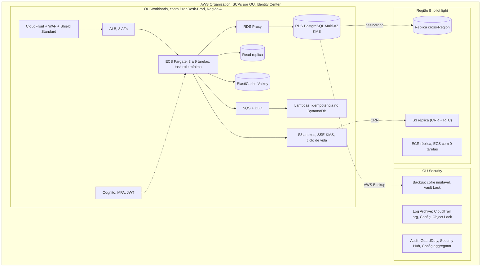

---
aliases:
  - Aula 26.8
modulo: 26
aula: 8
parte: "VIII Custo, projeto e prova"
dominios:
  - 1
  - 2
  - 3
  - 4
lida: false
tags:
  - aula
  - saa-c03
  - modulo-26
---

# Aula 26.8: Revisão Well-Architected e trade-offs

[[26 - Projeto Pratico - Arquitetura de Referencia|Voltar ao módulo]]

> [!question] Pergunta que esta aula responde
> Com a arquitetura do PropDesk pronta, como revisá-la pelos seis pilares do [[Well-Architected Framework|Well-Architected]], que riscos ainda restam, e quais [[Trade-off|trade-offs]] (e serviços descartados) ela carrega, para você reconhecer os mesmos pares de alternativas em uma questão de prova?

## Revisar é encontrar o risco que sobrou

O [[Well-Architected Framework]] organiza a revisão em **seis pilares** (excelência operacional, segurança, confiabilidade, eficiência de desempenho, otimização de custos e sustentabilidade), cada um com perguntas e boas práticas. A revisão não dá nota: ela produz uma lista de **riscos** classificados por gravidade (alto e médio), cada um com um plano de melhoria. A [[Well-Architected Tool]] do console guarda as respostas e gera esse plano. O ritmo certo é revisar **no projeto**, **antes do lançamento** e **depois de mudanças grandes**. O framework também tem **[[Well-Architected Lens|lenses]]**, extensões por tipo de carga: para o PropDesk, o **SaaS Lens** (que já forneceu os modelos silo, pool e bridge na [[26.01 - O Projeto PropDesk e os Requisitos|aula 26.1]]) seria a lente mais útil ([[02.01 - Por que um Framework e Como Revisar uma Arquitetura|aula 2.1]]).

## A arquitetura final, consolidada

Depois de oito aulas, o desenho completo cabe em uma figura. Leia da borda para os dados e das contas para as [[Regiao AWS|Regiões]].

## Pilar por pilar: o que decidimos e o que ainda é risco

| Pilar | Decisão central do PropDesk | Onde apareceu | Risco que restou |
|---|---|---|---|
| Excelência operacional | [[Infraestrutura como Codigo\|Infraestrutura como código]], esteira com role assumida, alarmes, [[Runbook\|runbook]] de [[Failover\|failover]] | 26.6, 26.7, 26.8 (IaC e alarmes) | Runbooks não ensaiados; falta um painel de saúde por [[Tenant\|tenant]] |
| Segurança | Camadas ([[WAF]], rede, [[IAM]], [[KMS]], trilha); [[Menor Privilegio\|menor privilégio]]; logs em conta separada | 26.2, 26.6 | [[Cognito]] sem [[MFA]] obrigatório para todos; [[Macie]] por [[Sampling\|amostragem]] deixa lacunas |
| Confiabilidade | 3 [[Zona de Disponibilidade\|AZs]], [[Multi-AZ]], filas com [[Dead-Letter Queue\|DLQ]], DR [[Pilot Light\|pilot light]], backup imutável | 26.3, 26.7 | [[RTO]] do pilot light ainda estimado, não medido; limitações do [[Cognito]] replicado |
| Eficiência de desempenho | [[CloudFront]], cache, réplicas, auto scaling, [[Graviton]] | 26.4 | Dependência de lag da réplica; cache sem estratégia de [[Invalidacao de Cache\|invalidação]] por evento |
| Otimização de custos | Compromisso no piso, [[Spot Instance\|Spot]] onde tolera, ciclo de vida, endpoints seletivos, ambientes por classe | 26.5, 26.7 | Banco é 40% do custo; sem custo por [[Tenant\|tenant]] medido |
| Sustentabilidade | Escala sob demanda, [[Graviton]], dados frios em classes eficientes, sem recursos ociosos | 26.4, 26.5 | Não medida; DR com réplica ociosa |

Sustentabilidade é o pilar que a revisão menos mede em exercícios, mas ele se **alinha ao custo**: reduzir recursos ociosos, dimensionar para a carga real e mover dado frio para armazenamento mais eficiente corta gasto e consumo de energia ao mesmo tempo (aula [[02.04 - Custos Sustentabilidade e Tensoes entre Pilares|2.4]]).

### Excelência operacional: o que falta para operar de verdade

A arquitetura estática não basta; é preciso **ver** o sistema. O [[21 - Observabilidade Automacao e Operacoes|Módulo 21]] dá os blocos; para PropDesk, os alarmes essenciais, cada um com a razão de existir:

| Camada | Métrica | Por quê |
|---|---|---|
| Borda e [[Application Load Balancer\|ALB]] | Taxa de erros 5xx; `TargetResponseTime` no p95 | O que o usuário sente |
| [[ECS]] | CPU, memória, tarefas em execução contra desejadas | Saturação e falha de implantação |
| [[RDS]] | CPU, conexões, `FreeStorageSpace`, `ReplicaLag` | Gargalo do banco; o `ReplicaLag` **é** o [[RPO]] do DR |
| [[SQS]] | `ApproximateAgeOfOldestMessage`; profundidade da [[Dead-Letter Queue\|DLQ]] maior que 0 | Consumidor parado ou [[Poison Message\|mensagem venenosa]] |
| Lambda | Erros, throttles, duração | Falha de consumidor |
| Custo | Alerta do Budgets e [[Cost Anomaly Detection]] | Surpresa na fatura |

O [[X-Ray]] adiciona **[[Trace|rastreamento distribuído]]**: o [[Service Map|mapa de serviços]] mostra qual dependência (banco, cache, outra API) faz o p95 subir, o que a [[Metrica|métrica]] agregada não revela. A **[[Infraestrutura como Codigo|infraestrutura como código]]** ([[CloudFormation]], com **[[StackSets]]** para várias contas e [[Regiao AWS|Regiões]], **[[Change Set|change sets]]** para ver o efeito antes de aplicar e **[[Drift Detection|drift detection]]** para detectar mudança manual) garante que Região B e produção sejam **a mesma** infraestrutura. Você já usa OpenTofu para o mesmo fim; os conceitos se equivalem, e a prova fala em CloudFormation ([[21.05 - CloudFormation Stacks Templates e Change Sets|aula 21.5]]).

## Os trade-offs que o projeto enfrentou

Quase toda questão de prova é uma tensão entre dois pilares com um [[Qualificador|qualificador]] que desempata. As sete tensões do PropDesk, com a decisão e o gatilho para revertê-la:

| Tensão | Decisão do PropDesk | Alternativa descartada | Reverter quando |
|---|---|---|---|
| Segurança contra custo (endpoints) | [[Interface Endpoint\|Interface endpoints]] só para [[ECR]] e Logs; Secrets e [[KMS]] pelo [[NAT]] | Todos os endpoints | Surgir requisito de "nenhuma saída pela internet" |
| Resiliência contra custo ([[NAT]]) | 3 NATs em produção, 1 em não produção | NAT único em tudo | Nunca em produção; sim em dev |
| [[Disponibilidade]] contra custo ([[Zona de Disponibilidade\|AZs]]) | 3 AZs, 9 tarefas no pico | 2 AZs (12 tarefas para o mesmo N-1) | Requisito de uma única AZ |
| Desempenho contra consistência | [[Cache]] com [[TTL]] e réplica para leitura | Tudo no primário | Dado que exige leitura fresca |
| Custo contra interrupção | [[Spot Instance\|Spot]] só para trabalhadores idempotentes | Spot na API | Nunca para o caminho do usuário |
| DR: custo contra [[RTO]] | [[Pilot Light\|Pilot light]] | [[Warm Standby\|Warm standby]] | RTO medido acima de 45 min |
| Agilidade contra governança | [[SCP\|SCPs]] na OU, sandbox livre com teto | Sem guardrails | Time pequeno sem requisito regulatório |

> [!example] Como a prova esconde a tensão
> "Uma empresa quer reduzir o custo da saída para a internet de instâncias em [[Sub-rede Privada|sub-redes privadas]], mantendo a [[Alta Disponibilidade|alta disponibilidade]]." As alternativas misturam **um [[NAT]] por [[Zona de Disponibilidade|AZ]]**, **um NAT único**, **[[Gateway Endpoint|gateway endpoint]]** e **[[Interface Endpoint|interface endpoint]]**. A saída exige separar: se o tráfego é para [[S3]] ou [[DynamoDB]], gateway endpoint (grátis); se é para a internet, NAT, e "alta disponibilidade" empurra para um por AZ. Cada [[Qualificador|qualificador]] elimina uma alternativa.

## O que o projeto não usou, e por quê

Saber **por que não** é metade da preparação, porque os [[Distrator|distratores]] da prova são justamente esses serviços aplicados fora de lugar.

| Serviço | Por que não entrou | Entraria se |
|---|---|---|
| [[API Gateway]] | O [[Application Load Balancer\|ALB]] já atende a API em [[Container\|containers]], com menos peças | Fosse necessário [[Throttling\|throttling]] por [[Usage Plan\|chave de API]], cache de API gerenciado ou autorizadores de Lambda |
| [[EKS]] | [[ECS]] cobre a necessidade com menor overhead para uma equipe pequena | Houvesse requisito de [[Kubernetes]] ou portabilidade |
| [[Aurora]] | [[RDS]] PostgreSQL atende, e o custo é menor | O [[Replica Lag\|lag de réplica]], o [[RTO]] de DR ou o número de réplicas virassem limite |
| Kinesis ou [[MSK]] | O volume é de mensagens de trabalho, não de fluxo contínuo com replay | Houvesse ingestão em tempo real de grandes volumes por vários consumidores |
| [[Step Functions]] | Os fluxos são curtos (planejar e gerar) e cabem em fila e função | Houvesse fluxo longo com aprovação humana, ramificações e compensação |
| [[Global Accelerator]] | O tráfego é [[HTTP]] cacheável, e o [[CloudFront]] cobre | Houvesse protocolo não HTTP, IP fixo ou [[Failover\|failover]] regional rápido |
| [[Transit Gateway]] e [[Direct Connect]] | Há uma [[VPC]] por conta e nenhum ambiente híbrido | Surgisse VPC múltiplas conectadas ou datacenter |
| [[Network Firewall]] | [[WAF]] e [[Security Group\|security groups]] cobrem as ameaças declaradas | Houvesse inspeção profunda ou filtro de domínios de saída |
| Shield Advanced | Sem requisito de resposta dedicada e proteção de custo | Houvesse alvo recorrente de [[DDoS]] e custo de resposta |
| Serviços de IA | Nenhum requisito pede | Um requisito de leitura de documentos ou de voz (verbo certo no enunciado) |

## Pegadinhas que o projeto não exercitou

O PropDesk nunca precisou de cinco pares de alternativas que a prova adora. Cada linha traz o requisito, a resposta, o [[Distrator|distrator]] típico e a aula de origem.

| Requisito no enunciado | Resposta | [[Distrator]] típico | Aula de origem |
|---|---|---|---|
| Tráfego súbito e volátil em [[TCP]] ou [[UDP]], milhões de requisições por segundo, IP estático ou [[Latencia\|latência]] ultrabaixa | [[Network Load Balancer]] | [[Application Load Balancer\|ALB]] (cobre [[HTTP]] e HTTPS com roteamento [[Modelo OSI\|L7]]) ou [[Gateway Load Balancer\|GWLB]] (appliances de terceiros, não é balanceador de aplicação) | [[12.04 - Network Load Balancer e Gateway Load Balancer\|12.4]] |
| Usuários de um país devem ver o conteúdo do seu país | [[Routing Policy\|Política de roteamento]] por **geolocalização** do [[Route 53]] | [[Latencia\|Latência]] (escolhe a Região mais rápida, não a do país) ou [[Failover\|failover]] | [[18.08 - Route 53 Politicas de Roteamento\|18.8]] |
| [[Container\|Containers]] da API compartilham arquivos POSIX entre tarefas | [[EFS]] (ou [[FSx for Windows File Server]] se o requisito for [[SMB]] e [[Active Directory]]) | [[EBS]] (volume zonal, anexo a uma instância, [[Multi-Attach]] limitado) | [[10.06 - EFS Arquivos NFS Compartilhados\|10.6]], [[10.08 - FSx for Windows File Server e FSx for Lustre\|10.8]] |
| Voltar a um estado anterior depois de sobrescrita ou corrupção de objetos | [[Backup]] (pontos no tempo, cofre imutável) e [[Versionamento\|versionamento]] | [[Replicacao do S3\|Replicação do S3]] (propaga a sobrescrita para o destino; serve a DR e [[Latencia\|latência]], não a erro de dados) | [[11.06 - Replicacao do S3\|11.6]], [[20.05 - AWS Backup Snapshots e Cofres Imutaveis\|20.5]] |
| Senha do banco com rotação automática pelo menor esforço | [[Secrets Manager]] (rotação por [[Lambda\|função Lambda]], integração com [[RDS]]; cobrado por segredo e por chamada) | [[Parameter Store]] [[SecureString]] (criptografa, mas sem rotação nativa; o tier standard não tem custo de armazenamento, verificado em novembro de 2026) | [[08.08 - Secrets Manager e Parameter Store\|8.8]] |

> [!tip] Como usar o quadro
> Antes de uma prova, cubra as colunas da direita e tente recitar a resposta e o [[Distrator|distrator]] de cada linha. Se o requisito traz um **protocolo**, um **país** ou uma **rotação**, a palavra já elimina metade das alternativas.

## O método de revisão para a prova

Transforme esta aula em um roteiro de cinco passos para qualquer cenário de arquitetura:

1. **Extraia** os números e as restrições ([[RPO]], [[RTO]], pico, residência, orçamento).
2. **Risque** as alternativas que violam um requisito explícito.
3. **Procure** o [[Ponto Unico de Falha|ponto único de falha]], a porta aberta e o segredo exposto nas que sobraram.
4. **Aplique o [[Qualificador|qualificador]]** (menor custo, menor overhead, mais seguro, mais resiliente) entre as que restam.
5. **Confirme** que a escolhida não cria um risco novo (por exemplo, um cache que serve dado de outro [[Tenant|tenant]]).

## Como isso cai na prova

> [!info] Todos os domínios
> A revisão cobre as tarefas 1.1 a 4.4. O que ela treina é o raciocínio transversal: saber qual pilar uma questão está pedindo e qual alternativa o viola.

**Palavras-chave em inglês:** *[[Well-Architected Framework|well-architected]]*, *operational excellence*, *reliability*, *performance efficiency*, *cost optimization*, *sustainability*, *[[Trade-off|trade-off]]*, *least [[Overhead Operacional|operational overhead]]*, *most secure*, *most cost-effective*.

**Armadilhas frequentes:**

- Pilar de **segurança** puxa para "mais controle"; **custo** puxa para "menos recursos". A palavra do [[Qualificador|qualificador]] decide.
- "[[Alta Disponibilidade|Altamente disponível]]" não é automaticamente "multi-Region"; costuma ser [[Multi-AZ]].
- Serviço mais sofisticado não é resposta melhor; o gerenciado mais simples que atende costuma ganhar em "menor overhead".
- Revisão do [[Well-Architected Framework|Well-Architected]] **identifica** riscos; quem corrige é o time (a Tool não altera a conta).
- Sustentabilidade é um pilar real da prova, tratado quase sempre como "eliminar desperdício e dimensionar para a carga".

| Requisito no enunciado | Resposta provável | Por quê |
|---|---|---|
| Avaliar uma carga contra boas práticas e obter um plano de melhoria | [[Well-Architected Tool]] | Revisão por pilares com riscos priorizados |
| Revisão específica para SaaS [[Multi-Tenant\|multi-tenant]] | SaaS Lens | Lente para o tipo de carga |
| Rastrear qual serviço torna uma requisição lenta | [[X-Ray]] | [[Service Map\|Mapa de serviços]] e traces |
| Mesma infraestrutura em várias contas e [[Regiao AWS\|Regiões]] | [[StackSets\|CloudFormation StackSets]] | Implantação consistente |
| Detectar alteração manual fora do código | [[Drift Detection\|Drift detection]] do [[CloudFormation]] | Compara real com declarado |
| Menor [[Overhead Operacional\|overhead operacional]] entre alternativas que atendem | Serviço gerenciado ou [[Serverless\|serverless]] | Princípio do [[Well-Architected Framework\|Well-Architected]] |

## Resumo

> [!abstract] A aula em uma frase
> A revisão pelos seis pilares transforma a arquitetura em uma lista de riscos restantes, e cada decisão do projeto é uma tensão entre pilares resolvida por um [[Qualificador|qualificador]], o que a prova repete ao pedir "o mais barato", "o mais seguro" ou "o de menor overhead".

**A lógica, em 5 passos**

1. Revise por pilar e registre [[High Risk Issue|risco alto]] e médio, com plano de melhoria.
2. Garanta visibilidade: alarmes por camada, tracing e [[Infraestrutura como Codigo|infraestrutura como código]] com [[Drift Detection|detecção de drift]].
3. Escreva cada [[Trade-off|trade-off]] com a decisão, a alternativa descartada e o gatilho para reverter.
4. Documente os serviços que **não** usou e sob que condição os usaria.
5. Use o roteiro de cinco passos para qualquer cenário: extrair, riscar, procurar falhas, aplicar o [[Qualificador|qualificador]], conferir riscos novos.

**Números para lembrar**

| O quê | Valor | Por que importa |
|---|---|---|
| Tensões do projeto | 7 | Cada uma tem decisão, alternativa descartada e gatilho |
| Pilares do [[Well-Architected Framework\|Well-Architected]] | 6 | A revisão cobre todos, não só segurança e custo |
| Peso do banco no custo de produção | Cerca de 40% | Alvo da próxima otimização |
| [[RTO]] estimado do [[Pilot Light\|pilot light]] | 40 min contra 1 h | Folga de 20 min a validar em teste |

**Tabela-síntese: pilar e pergunta**

| Pilar | Pergunta | Exemplo no PropDesk |
|---|---|---|
| Excelência operacional | Como opero e evoluo? | [[Infraestrutura como Codigo\|IaC]], [[Runbook\|runbooks]], [[Game Day\|game days]] |
| Segurança | Como protejo dados e acesso? | [[WAF]], [[IAM]] mínimo, [[KMS]] |
| Confiabilidade | Como me recupero de falhas? | [[Multi-AZ]], [[Dead-Letter Queue\|DLQ]], DR |
| Desempenho | Como uso recursos com eficiência? | [[Cache]], réplicas, scaling |
| Custo | Como evito gasto sem valor? | Compromisso no piso, ciclo de vida |
| Sustentabilidade | Como reduzo o impacto ambiental? | Dimensionar e escalar sob demanda |

**Na prática, isso significa**

- Toda decisão boa tem uma alternativa descartada com motivo.
- Um serviço fora da arquitetura é conhecimento útil: é o [[Distrator|distrator]] da prova.
- Revisar de novo depois de cada mudança relevante é parte do ciclo, não um evento único.

> [!tip] Liga com
> Fecha o ciclo aberto no [[02 - Well-Architected e o Formato da Prova|Módulo 2]] e usa o [[21 - Observabilidade Automacao e Operacoes|Módulo 21]]. Segue para os [[26.09 - Mudancas de Requisito no Estilo da Prova|exercícios de mudança de requisito]].

## Erros comuns

- **Revisar só segurança e custo.** Excelência operacional e sustentabilidade também geram risco e questões de prova.
- **Tratar a revisão como aprovação.** Ela lista riscos; o valor está no plano de melhoria que o time executa.
- **Esquecer o alarme que vira o requisito.** O `ReplicaLag` é o [[RPO]] real do DR; sem alarme, o requisito é ficção.
- **Usar um serviço "porque é moderno".** [[EKS]], Kinesis ou [[API Gateway]] sem requisito aumentam overhead e custo.
- **Confundir a lente com o pilar.** Lens é uma extensão por tipo de carga (SaaS, [[Serverless|serverless]]); pilar é a dimensão da revisão.

## Pratique

**1.** Uma empresa quer avaliar uma carga de trabalho existente contra as boas práticas da AWS e obter uma lista priorizada de riscos com um plano de melhoria. O que usar?

- [ ] a) AWS Trusted Advisor, que verifica configurações da conta e recomenda ajustes pontuais por categoria
- [ ] b) AWS Well-Architected Tool, com uma revisão por pilares
- [ ] c) AWS Config, que avalia somente regras de configuração
- [ ] d) AWS Cost Explorer, que mostra o histórico de gastos

**2.** Uma equipe quer identificar qual dependência (banco, cache ou outra API) torna lentas algumas requisições de uma aplicação distribuída. Qual serviço atende?

- [ ] a) Amazon CloudWatch Logs, com uma busca por palavra "slow" nos logs
- [ ] b) AWS Config, que registra a configuração dos recursos
- [ ] c) AWS CloudTrail, que registra as chamadas de API
- [ ] d) AWS X-Ray, com o mapa de serviços e os traces de cada requisição

**3.** Uma empresa precisa implantar o mesmo conjunto de recursos em várias contas e [[Regiao AWS|Regiões]], de forma consistente, a partir de um único template. Qual recurso atende?

- [ ] a) CloudFormation StackSets, a partir de um template
- [ ] b) AWS Systems Manager Session Manager
- [ ] c) Amazon Route 53 com registros de failover
- [ ] d) AWS Cost and Usage Report

**4.** Uma equipe suspeita que alguém alterou manualmente um [[Security Group|security group]] criado por um template [[CloudFormation]]. Como detectar essa divergência?

- [ ] a) Reimplantando a stack, o que sempre corrige qualquer mudança manual
- [ ] b) Consultando o Cost Explorer para ver o gasto do security group
- [ ] c) Executando a detecção de drift da stack do CloudFormation no console
- [ ] d) Pedindo ao Macie que compare o template com a configuração

**5.** (Escolha DUAS.) Em uma revisão pelo [[Well-Architected Framework|Well-Architected]], quais itens pertencem ao pilar de confiabilidade?

- [ ] a) Distribuir a aplicação em mais de uma AZ com failover automático
- [ ] b) Testar periodicamente a restauração de backups e o failover
- [ ] c) Aplicar o princípio do menor privilégio às roles de serviço
- [ ] d) Escolher a classe de armazenamento mais barata para dados frios
- [ ] e) Usar instâncias Graviton para reduzir consumo de energia

**6.** Uma empresa avalia dois desenhos: um com [[NAT Gateway]] único, mais barato, e outro com um [[NAT]] por [[Zona de Disponibilidade|AZ]]. O requisito é [[Alta Disponibilidade|alta disponibilidade]] da saída das [[Sub-rede Privada|sub-redes privadas]] em produção. Qual escolher e qual pilar decide?

- [ ] a) O NAT único, porque o pilar de custo sempre vence o de confiabilidade
- [ ] b) O NAT único, com um alarme que recrie o NAT em outra AZ se a AZ dele falhar
- [ ] c) Um NAT por AZ, porque o requisito de alta disponibilidade se sobrepõe à economia
- [ ] d) Nenhum NAT, colocando as instâncias em sub-redes públicas

**7.** Uma empresa expõe uma API [[HTTP]] em [[Container|containers]] [[Fargate]] para clientes e já usa um [[Application Load Balancer|ALB]]; a equipe é pequena e não há requisito de [[Throttling|throttling]] por [[Usage Plan|chave de API]] nem de cache de API gerenciado. Qual opção atende com o MENOR [[Overhead Operacional|overhead operacional]]?

- [ ] a) Manter o ALB na frente do serviço de containers, que já atende o caso
- [ ] b) Adicionar um API Gateway na frente do ALB para toda requisição
- [ ] c) Migrar a API para um cluster EKS com um Ingress dedicado
- [ ] d) Mover a API para instâncias EC2 com um proxy reverso instalado manualmente

**8.** Uma empresa de SaaS com milhares de clientes pequenos e poucos clientes exigentes quer reduzir custo sem perder isolamento onde o contrato exige. Qual abordagem do SaaS Lens se encaixa?

- [ ] a) Silo completo, com recursos dedicados para todos os clientes
- [ ] b) Bridge, combinando pool para a maioria e silo para os exigentes
- [ ] c) Pool completo, ignorando os contratos que exigem isolamento
- [ ] d) Uma Região diferente para cada cliente, independentemente do contrato

**9.** Uma equipe quer reduzir recursos ociosos, dimensionar para a carga real e mover dados frios para armazenamento mais eficiente, para reduzir custo e impacto ambiental. Qual pilar do [[Well-Architected Framework|Well-Architected]] tem essa preocupação como foco específico?

- [ ] a) Segurança
- [ ] b) Excelência operacional
- [ ] c) Confiabilidade
- [ ] d) Sustentabilidade

**10.** (Escolha DUAS.) Qual conjunto de alarmes ajuda a detectar problemas de um fluxo assíncrono baseado em fila e a proteger o [[RPO]] de um banco com réplica entre [[Regiao AWS|Regiões]]?

- [ ] a) Profundidade da DLQ maior que zero e idade da mensagem mais antiga da fila
- [ ] b) A utilização média de CPU das tarefas do ECS
- [ ] c) O atraso de replicação (`ReplicaLag`) da réplica entre Regiões
- [ ] d) O custo diário por serviço no Cost Explorer
- [ ] e) O número de conexões abertas no RDS Proxy

> [!success]- Gabarito
> **1. b)** a [[Well-Architected Tool]] faz a revisão por pilares e gera o plano de melhoria; a) o [[Trusted Advisor]] verifica configurações e recomenda ajustes pontuais, mas não faz a revisão por pilares com plano de melhoria nem usa [[Well-Architected Lens|lenses]]; c) o Config avalia regras de configuração; d) o [[Cost Explorer]] mostra gastos.
> **2. d)** o [[X-Ray]] mostra o [[Service Map|mapa de serviços]] e os traces das requisições; a) busca por palavras nos logs não mostra o caminho entre dependências; b) o Config é estado de configuração; c) o [[CloudTrail]] registra chamadas de API.
> **3. a)** o [[StackSets]] implanta [[Stack|stacks]] em várias contas e [[Regiao AWS|Regiões]] a partir de um template; b) o [[Session Manager]] é acesso remoto; c) o [[Route 53]] gerencia [[DNS]]; d) o [[Cost and Usage Report|CUR]] é relatório de custo.
> **4. c)** a [[Drift Detection|detecção de drift]] compara a stack com a configuração real; a) reimplantar pode não detectar nem mostrar a divergência; b) o [[Cost Explorer]] não compara configuração; d) o [[Macie]] descobre dados sensíveis no [[S3]].
> **5. a), b)** múltiplas [[Zona de Disponibilidade|AZs]] com [[Failover|failover]] e testes de restauração e failover são confiabilidade; c) o [[Menor Privilegio|menor privilégio]] é segurança; d) a classe mais barata é custo; e) [[Graviton]] para reduzir energia é sustentabilidade ou desempenho.
> **6. c)** o requisito explícito de [[Alta Disponibilidade|alta disponibilidade]] em produção exige um [[NAT]] por [[Zona de Disponibilidade|AZ]]; a) o custo não vence um requisito explícito; b) recriar o NAT depois da falha leva minutos e depende de ação no [[Plano de Controle|plano de controle]], enquanto o requisito pede a saída já redundante; d) [[Sub-rede Publica|sub-redes públicas]] expõem as instâncias.
> **7. a)** sem requisitos de [[API Gateway]], o [[Application Load Balancer|ALB]] atende com menos peças; b) adiciona um serviço sem requisito; c) o [[EKS]] aumenta o overhead; d) [[EC2]] com proxy manual aumenta o trabalho operacional.
> **8. b)** o bridge usa pool para os clientes baratos e silo onde o contrato exige; a) silo para todos eleva o custo; c) ignora os contratos de isolamento; d) Região por cliente é desproporcional.
> **9. d)** o pilar de sustentabilidade tem como foco reduzir ociosidade e impacto; a) segurança trata de proteção; b) excelência operacional trata de operar e evoluir; c) confiabilidade trata de recuperação de falhas.
> **10. a), c)** a [[Dead-Letter Queue|DLQ]] e a idade da mensagem mostram falhas do fluxo assíncrono, e o [[Replica Lag|ReplicaLag]] mede o [[RPO]] real; b) a CPU das tarefas mede saturação da API, não a falha do fluxo da fila nem o RPO; d) o custo diário é visibilidade financeira; e) as conexões do proxy medem o banco, não a fila nem a defasagem da réplica.

## Para aprofundar

- [ ] [AWS Well-Architected Framework: pillars](https://docs.aws.amazon.com/wellarchitected/latest/framework/definitions.html) (AWS Documentation): a definição oficial dos seis pilares.
- [ ] [SaaS Lens: Silo, Pool and Bridge Models](https://docs.aws.amazon.com/wellarchitected/latest/saas-lens/definitions.html) (AWS Documentation): a lente para cargas SaaS usada na [[Arquitetura de Referencia|arquitetura de referência]].

Próxima aula: [[26.09 - Mudancas de Requisito no Estilo da Prova|Aula 26.9: mudanças de requisito no estilo da prova]].
