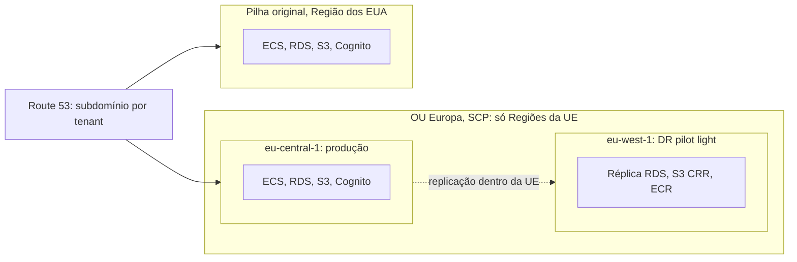

---
aliases:
  - Aula 26.9
modulo: 26
aula: 9
parte: "VIII Custo, projeto e prova"
dominios:
  - 1
  - 2
  - 3
  - 4
lida: false
tags:
  - aula
  - saa-c03
  - modulo-26
---

# Aula 26.9: Mudanças de requisito no estilo da prova

[[26 - Projeto Pratico - Arquitetura de Referencia|Voltar ao módulo]]

> [!question] Pergunta que esta aula responde
> Quando um requisito novo chega ao PropDesk (clientes europeus com [[Residencia de Dados|soberania de dados]], pico de 10 vezes, auditoria, migração de um sistema legado), quais camadas da arquitetura mudam, quais continuam como estão, e como a prova disfarça cada um desses cenários?

## Como usar os exercícios

A prova raramente pede para desenhar do zero. Ela entrega uma arquitetura existente e **muda uma restrição**: "agora a empresa precisa de X". O trabalho é achar **quais camadas o novo requisito toca** e deixar o resto em paz. Cada exercício abaixo tem o mesmo formato: o requisito, o que muda (e o que não), a solução comentada, e a versão em que a prova o disfarça. Tente resolver antes de ler a solução, usando o roteiro da [[26.08 - Revisao Well-Architected e Trade-offs|aula 26.8]]: extrair, riscar, procurar falhas, aplicar o [[Qualificador|qualificador]], conferir riscos novos.

---

## Exercício 1: clientes na Europa e soberania de dados

> [!example] O requisito
> Uma administradora europeia vai contratar o PropDesk. Por contrato e por lei, os **[[PII|dados pessoais]] dos moradores não podem sair da União Europeia**, os usuários europeus precisam de boa [[Latencia|latência]], e o DR deles também tem de ficar na UE.

**O que o requisito toca.** Quase tudo que guarda ou processa dado pessoal: Região, banco, [[S3]], chaves, backups, réplicas, identidade e logs. **O que não toca:** o código da aplicação, a estrutura de contas e as [[SCP|SCPs]] (só ganham um parâmetro novo).

**Solução comentada.**

1. **Uma pilha regional para a UE.** A estrutura vira um [[Modelo Bridge|modelo bridge]] com isolamento por **Região**: [[Tenant|tenants]] europeus têm a pilha completa ([[VPC]], [[ECS]], [[RDS]], [[ElastiCache]], [[S3]], [[Cognito]]) em uma Região da UE, por exemplo `eu-central-1` (Frankfurt), com DR em outra Região **também da UE** (`eu-west-1`, Irlanda). Replicar o DR para os Estados Unidos violaria o requisito, mesmo que fosse "só backup".
2. **Conta dedicada em uma OU da UE.** Uma conta `PropDesk-EU-Prod` em uma OU com uma **[[SCP]]** que nega qualquer Região fora do conjunto aprovado, no padrão `aws:RequestedRegion` com `NotAction` para serviços globais (a documentação oficial traz exatamente este exemplo, com [[Regiao AWS|Regiões]] europeias). A SCP é o **guardrail preventivo**: mesmo um administrador não cria um recurso fora da UE. **Cuidado com a pegadinha:** o exemplo oficial isenta só `cloudfront`, `iam`, `organizations`, `route53` e `support`. Se o desenho usa o certificado [[ACM]] do [[CloudFront]] e o [[Web ACL|web ACL]] do [[WAF]] de escopo CLOUDFRONT, que **só existem em us-east-1**, uma SCP restrita à UE **nega** criá-los. A lista `NotAction` precisa isentar também `acm:*` e `wafv2:*` (ou permitir us-east-1 apenas para esses serviços); essas chamadas guardam configuração, não dado pessoal, então a exceção não fere o requisito.
3. **Todo mecanismo de cópia respeita a fronteira.** Réplica do [[RDS]] e do [[S3]] apenas dentro da UE; backups do [[Backup|AWS Backup]] e o cofre em contas e [[Regiao AWS|Regiões]] da UE; [[Global Tables]], se houver, só com réplicas europeias; [[Multi-Region Key|chaves multi-Region]] apenas entre Regiões europeias; o [[Cognito]] multi-Region com secundário também na UE. Os logs de auditoria dessas contas ficam em uma [[Conta Log Archive|conta de Log Archive]] **na UE**.
4. **Identidade e roteamento por [[Tenant|tenant]].** O [[User Pool|user pool]] dos europeus fica na Região da UE (o [[Cognito]] é regional), e cada tenant tem um **subdomínio do seu "home"** (por exemplo, um domínio por Região) resolvido pelo [[Route 53]]. O roteamento por **geolocalização** do usuário seria um erro **aqui**, porque um gestor europeu em viagem seria enviado para a pilha dos EUA; o critério correto é **o tenant**, não o lugar onde a pessoa está. Atenção ao contraste: quando o enunciado da prova diz "usuários de um país devem ver o conteúdo do seu país" (ou precisam ser bloqueados fora dele), a resposta clássica **é** a política de **geolocalização** do Route 53 ([[18.08 - Route 53 Politicas de Roteamento|aula 18.8]]). O exercício a rejeita só porque o critério do PropDesk é o contrato do tenant.
5. **A borda merece cuidado.** O [[CloudFront]] é global: as respostas dinâmicas com dado pessoal passam pelas [[Edge Location|edge locations]]. Mantenha essas rotas **sem cache** e confirme com o jurídico se o trânsito por borda satisfaz o contrato: a resposta depende do texto do contrato e da interpretação legal, e este curso não a decide. O certificado do CloudFront vive em us-east-1 e a configuração do [[WAF]] de escopo CLOUDFRONT também, mas nenhum guarda dado pessoal, só configuração.

**Quando a soberania exige mais.** [[Residencia de Dados|Residência de dados]] (onde o dado **fica**) não é o mesmo que **soberania** (quem opera a infraestrutura e sob que jurisdição). A AWS anunciou o **[[AWS European Sovereign Cloud]]**, uma nuvem **independente**, inteiramente na UE, com equipe operacional da UE e uma **partição própria** (`aws-eusc`; a primeira Região, `eusc-de-east-1`, em Brandenburg, na Alemanha, foi anunciada como disponível em janeiro de 2026). A documentação oficial a descreve em um whitepaper; os identificadores da Região e a data vêm de comunicados da AWS e **não estão no exam guide**, então trate como contexto, não como assunto de prova, e confirme a situação atual no anúncio oficial antes de usar em um projeto.

**Como a prova disfarça.** "Uma empresa precisa garantir que os dados de clientes da UE não saiam da UE. Qual combinação atende?" As alternativas misturam Região da UE, **[[Replicacao do S3|CRR]] para os EUA**, "usar [[Transfer Acceleration]]", **[[SCP]] de negação por Região** e **[[Bucket Policy|política de bucket]]**. As certas: Região da UE e uma SCP; as erradas violam a fronteira ou não impedem criação de recursos fora dela.

---

## Exercício 2: pico de 10 vezes

> [!example] O requisito
> O PropDesk fechou uma parceria, e um e-mail para 20.000 usuários será enviado em uma segunda de manhã. A estimativa é um pico de **3.000 requisições por segundo por cerca de duas horas** (10 vezes os 300 atuais), com abertura em minutos, não em horas.

**Análise camada por camada**, do que recebe o pedido ao que o guarda:

| Camada | O que acontece a 10x | Medida |
|---|---|---|
| [[CloudFront]] e [[WAF]] | Absorve o que é estático e escala sozinho | Garantir que SPA e públicos estejam em cache; revisar a regra de taxa do WAF para não bloquear tráfego legítimo |
| [[Application Load Balancer\|ALB]] | Escala automaticamente, mas **um salto muito rápido** pode superar a capacidade em andamento | Caminho clássico: escala gradual e aviso prévio ao suporte da AWS (pré-aquecimento). Recurso recente, provavelmente fora do exam guide: a **[[Capacity Reservation\|reserva de capacidade]]** ([[LCU]] reservation, de *Load Balancer Capacity Unit*), mínimo de 100 LCU (confirmado na documentação do [[Elastic Load Balancing\|ELB]] em novembro de 2026) |
| [[ECS]] [[Fargate]] | Precisa de 90 tarefas, não 9; novas tarefas levam dezenas de segundos | **Scaling agendado** antes do evento; verificar as cotas de tarefas do Fargate e os IPs livres das [[Sub-rede\|sub-redes]] (a `/20` tem 4.091, folgado) |
| [[Cognito]] | Login em massa às 8h | O API de autenticação tem **cota de taxa por Região**: a categoria UserAuthentication tem padrão de 120 requisições por segundo (verificado em novembro de 2026, [página de cotas do Cognito](https://docs.aws.amazon.com/cognito/latest/developerguide/quotas.html)); peça aumento **antes**. O [[JWT]] é validado **localmente** pela API, então o tráfego comum da API **não** chama o Cognito |
| [[ElastiCache]] | Mais leituras servidas do cache | Subir o tamanho do nó antes do evento |
| [[RDS]] | Escritas: 15% de 3.000 = 450/s no primário; leituras via cache e réplicas | Réplicas adicionais; reduzir escritas síncronas; classe maior **antes** (a modificação causa [[Failover\|failover]] no [[Multi-AZ]], então faça em janela) |
| [[SQS]] e Lambda | Absorvem o assíncrono | Limitar a escala dos consumidores com o **Maximum concurrency** do [[Event Source Mapping\|event source mapping]] do SQS (a [[Concorrencia Reservada\|concorrência reservada]] também limita, mas devolve mensagens à fila por [[Throttling\|throttling]]), para não afogar o banco |
| [[NAT]], [[KMS]], Secrets | Chamadas por requisição | [[Cache]] de segredos na aplicação; [[S3 Bucket Keys]]; checar cotas de KMS |

**Solução comentada.** O que a prova valoriza aqui é uma **ordem de defesa**: (1) **cache e [[CDN]]** primeiro, porque tirar carga custa menos que atender carga; (2) **desacoplar** as escritas que o usuário não precisa ver imediatamente (fila entre API e banco: a fila absorve o excesso e o consumidor drena no ritmo do banco); (3) **[[Escalabilidade Horizontal|escalar horizontalmente]]** o que é sem estado (tarefas, réplicas); (4) **solicitar aumentos de cota com antecedência**, porque eles não são instantâneos; e (5) **proteger o que não escala rápido** com [[Rate-Based Rule|limite de taxa]] e *[[Load Shedding|load shedding]]* (recusar o excedente com 429 em vez de cair). O banco único de escrita é o que não escala horizontalmente, então ele recebe o tratamento de (2) e (5).

> [!warning] Pegadinha: ALB ou NLB para tráfego súbito?
> Tráfego **súbito e volátil**, **[[TCP]] ou [[UDP]]**, milhões de requisições por segundo, **IP estático** ou [[Latencia|latência]] ultrabaixa aponta para o [[Network Load Balancer]], que escala sem pré-aquecimento. O [[Application Load Balancer|ALB]] cobre [[HTTP]] e HTTPS com roteamento [[Modelo OSI|L7]] e pode usar a reserva de [[LCU]]. Na prova, o protocolo e o IP fixo decidem; a reserva de LCU é detalhe recente.

**O custo.** O pico dura 2 horas: use capacidade **On-Demand** e **desfaça** depois (scaling agendado de volta). Comprometer capacidade para 10x seria o erro da [[26.05 - Iteracao 4 Custo Otimizado|aula 26.5]]. Se os picos virarem regra (todo mês), reavalie [[Aurora]] e escala de leitura ([[26.04 - Iteracao 3 Desempenho e Elasticidade|aula 26.4]]).

**Como a prova disfarça.** "Tráfego sobe 10x durante uma campanha. Qual solução garante que a aplicação continue disponível com o menor custo?" Respostas certas combinam **[[CloudFront]]**, **auto scaling** (ou agendado, se previsível) e **fila** para desacoplar; erradas: provisionar para o pico o ano inteiro, ou migrar para uma instância maior (escala vertical, ponto único).

---

## Exercício 3: auditoria

> [!example] O requisito
> Um grande cliente pede um relatório de conformidade: quem acessou dados de produção, que mudanças de configuração ocorreram nos últimos 12 meses, comprovação de criptografia em todo lugar, e revisão periódica de permissões. A trilha precisa ser guardada por 7 anos e não pode ser adulterada.

**Quase tudo já existe**, e esse é o ponto: a arquitetura das iterações e da [[26.06 - Multiconta Governanca e Auditoria|aula 26.6]] já foi desenhada para auditoria. O exercício é **mapear cada pergunta do auditor a uma fonte de evidência**:

| Pergunta do auditor | Fonte de evidência | Já configurada? |
|---|---|---|
| Quem chamou a API de quê, e quando? | Trilha da organização do [[CloudTrail]], com [[Log File Validation\|validação de integridade]] | Sim (26.6) |
| Quem leu objetos sensíveis? | [[Data Event\|Eventos de dados]] do [[CloudTrail]] no [[Bucket\|bucket]] de anexos | **Novo:** habilitar só nesse bucket (custo) |
| Como estava cada recurso, e quando mudou? | Histórico do [[Config\|AWS Config]] | Sim |
| Tudo está criptografado? | [[Config Rule\|Regras do Config]] (`rds-storage-encrypted` e equivalentes) e padrões do [[Security Hub]] | Ativar o conjunto de regras |
| Quem acessou o banco, uma máquina ou um shell? | Logs de sessão do [[Session Manager]] em [[S3]] ou [[CloudWatch Logs]]; logs de auditoria do banco | **Novo:** habilitar o log de sessões |
| Quem usou a chave e para quê? | O uso do [[KMS]] aparece no [[CloudTrail]] | Sim |
| Quais permissões existem e quais não são usadas? | **[[IAM Access Analyzer]]** (acesso externo e permissões não usadas), [[Credential Report\|credential report]], revisão de [[Permission Set\|permission sets]] | **Novo:** ativar e agendar revisão |
| Logs podem ser adulterados? | [[Conta Log Archive]], [[Object Lock]] em [[Modo Compliance\|modo compliance]], 7 anos | Sim |
| Quais certificações a AWS tem? | **[[Artifact\|AWS Artifact]]** (relatórios de conformidade da AWS, como SOC e ISO) | Disponível sob demanda |

Duas lições de prova. **Primeira:** o **[[Modelo de Responsabilidade Compartilhada|modelo de responsabilidade compartilhada]]**. O Artifact entrega o relatório da AWS (a segurança **da** nuvem); o auditor ainda exigirá a evidência da **sua** parte (segurança **na** nuvem): configuração, acesso, criptografia. **Segunda:** o custo da evidência. [[Data Event|Eventos de dados]] em tudo, ou retenção indefinida no [[CloudWatch Logs]], explodem a conta; a retenção longa e barata é [[S3]] com ciclo de vida (aula 26.6).

**Como a prova disfarça.** "A empresa precisa auditar todas as ações de API realizadas por usuários e roles, em todas as contas, e armazená-las de forma imutável por 7 anos. Qual solução?" Trilha da organização do [[CloudTrail]] para um [[Bucket|bucket]] em conta separada, com [[Object Lock]] e ciclo de vida; as armadilhas são **Config** (configuração, não ações), **[[VPC Flow Logs]]** (tráfego) e **[[CloudWatch Logs]] com retenção infinita** (caro).

---

## Exercício 4: migração de um sistema legado

> [!example] O requisito
> O PropDesk adquiriu uma concorrente. O sistema dela roda em um datacenter: um monólito Windows em máquinas virtuais VMware, banco **Oracle**, **5 TB** de compartilhamentos de arquivos acessados por **[[SMB]]**, um processo noturno que recebe arquivos por **FTP**, e uma conexão de internet de 100 Mbps. A diretoria quer sair do datacenter em 6 meses, com **o mínimo de mudança no código**.

**Raciocínio: migrar antes de modernizar.** A estratégia "[[7 Rs da Migracao|7 Rs]]" ([[23 - Migracao e Transferencia de Dados|Módulo 23]]) manda escolher o R mais barato que cumpre o prazo: o **[[Lift and Shift|rehost]]** (lift and shift) primeiro, **replatform** depois. Cada peça tem um serviço:

| Peça legada | Caminho de menor mudança | Serviço |
|---|---|---|
| VMs do monólito | Replicar os discos continuamente e iniciar [[EC2\|instâncias EC2]] | **[[Application Migration Service]]** (MGN), [[Lift and Shift\|rehost]] ([[23.02 - Rehost com MGN e Relocate com VMware\|aula 23.2]]) |
| Banco Oracle | Manter Oracle ([[RDS]] for Oracle, com licença) para mudar menos, **ou** migrar para PostgreSQL com conversão de esquema | **[[DMS]]** com [[Full Load\|carga completa]] mais replicação contínua ([[Change Data Capture\|CDC]]); **Schema Conversion** para a conversão heterogênea ([[23.03 - Migracao de Bancos com o DMS\|23.3]] e [[23.04 - Conversao de Esquemas e Escolha do Caminho para Bancos\|23.4]]) |
| 5 TB de arquivos por [[SMB]] | Sincronizar para um sistema SMB gerenciado | **[[DataSync]]** para o **[[FSx for Windows File Server]]**, que fala SMB e integra com o [[Active Directory]] ([[23.05 - DataSync e a Transferencia Online de Arquivos\|23.5]]) |
| Recebimento por FTP | Manter o protocolo, [[Serverless\|sem servidor]] próprio | **[[Transfer Family]]** (SFTP, FTPS ou FTP) com destino [[S3]] ou [[EFS]] ([[23.06 - Transfer Family Transfer Acceleration e Direct Connect na Migracao\|23.6]]) |
| Ligação ao datacenter | Rápida de contratar; depois, mais estável | **[[Site-to-Site VPN]]** agora, **[[Direct Connect]]** depois (prazo de provisionamento maior) |

**A conta da rede.** 5 TB = `5 x 8 x 1.000 Gb = 40.000 Gb`. Em 100 Mbps, no limite teórico da linha: `40.000 / 0,1 = 400.000 s`, cerca de **4,6 dias**, e com 70% de aproveitamento, cerca de **6,6 dias** de linha **inteira** dedicada. Em 1 Gbps, cerca de **11 horas** (16 horas com 70%). A decisão da [[23.07 - Transferencia Offline e a Conta da Rede|aula 23.7]]: com prazo de 6 meses, 6,6 dias de transferência online é aceitável **se** o link não for compartilhado com a produção; dispositivos físicos (família Snow) só compensam quando o tempo de rede passa de semanas. A família Snow aparece no exam guide como transferência offline, mas a documentação atual informa que a AWS não oferece mais dispositivos Snow a novos clientes (verificado em novembro de 2026, [página de disponibilidade](https://docs.aws.amazon.com/snowball/latest/developer-guide/whatisedge.html), e a [[23.07 - Transferencia Offline e a Conta da Rede|aula 23.7]]), então confirme a [[Disponibilidade|disponibilidade]] antes de planejar com eles. O [[DataSync]] também limita e agenda a banda para não sufocar a operação.

**E a confiabilidade do legado depois de migrado?** O monólito não é sem estado e o código não muda. A [[20.09 - Tornar Aplicacao Legada Resiliente sem Mudar o Codigo|aula 20.9]] ensina o repertório: [[Application Load Balancer|ALB]] com **[[Sticky Sessions|sticky sessions]]** (se a sessão está na memória), grupo de **[[Auto Scaling Group|Auto Scaling]]** para recuperar instâncias, **[[Multi-AZ]]** no banco, armazenamento compartilhado ([[FSx]]) em vez de disco local, e [[Failover|failover]] por [[DNS]]. Cada medida melhora a confiabilidade **sem tocar no código**, que é exatamente a restrição.

**Depois da migração.** Só então o replatform: Oracle para PostgreSQL (licença e custo), monólito para [[Container|containers]] ([[17.07 - Migrar para Containers e Elastic Beanstalk|aula 17.7]]), e o ambiente passa a ser uma conta de workload na organização da [[26.06 - Multiconta Governanca e Auditoria|aula 26.6]], com os mesmos guardrails.

**Como a prova disfarça.** "Migrar VMs e um banco Oracle para a AWS com o **mínimo de mudanças**." As certas: [[Application Migration Service|MGN]] para as VMs, e para o banco, **[[DMS]] com [[Schema Conversion Tool|SCT]]** se o destino for outro engine, ou [[RDS]] for Oracle (homogêneo) se o objetivo é não mudar; as erradas: reescrever a aplicação, ou usar [[Snowball Edge|Snowball]] quando a rede dá conta.

---

## Como isso cai na prova

> [!info] Todos os domínios
> Os quatro exercícios cruzam as tarefas 1.1 e 1.3 (soberania, auditoria), 2.1 e 2.2 (pico, legado, DR), 3.1 a 3.5 (desempenho e dados) e 4.1 a 4.4 (custo do pico e da migração). Este é o formato mais próximo da prova: um requisito novo sobre uma arquitetura existente.

**Palavras-chave em inglês:** *[[Residencia de Dados|data residency]]*, *must not leave the [[Regiao AWS|Region]]/EU*, *sudden 10x increase*, *unpredictable spike*, *audit all API calls*, *immutable for 7 years*, *migrate with minimal changes*, *[[Lift and Shift|lift and shift]]*, *heterogeneous migration*, *least [[Overhead Operacional|operational overhead]]*.

**Armadilhas frequentes:**

- [[Residencia de Dados|Residência de dados]]: réplica ou backup **fora** da região permitida viola o requisito; só vale entre [[Regiao AWS|Regiões]] permitidas.
- Roteamento por **geolocalização do usuário** para soberania: o critério deve ser o **[[Tenant|tenant]]**.
- Pico súbito: escalar **verticalmente** o banco único é limitado; cache, fila e réplicas primeiro.
- [[Service Quotas|Cota de serviço]] ignorada: [[Cognito]], [[Fargate]] e [[KMS]] têm cotas por Região que não sobem na hora.
- Auditoria: Config (estado) não substitui [[CloudTrail]] (ações), e o contrário.
- Migração: **[[Lift and Shift|rehost]]** antes de **replatform** quando o enunciado diz "mínimo de mudança"; Snow só quando a rede não dá conta.

| Requisito no enunciado | Resposta provável | Por quê |
|---|---|---|
| Dados de clientes da UE devem ficar na UE | Região da UE, [[SCP]] de negação por Região, réplicas só na UE | Residência e guardrail |
| Tráfego sobe 10x em uma campanha previsível | [[CloudFront]], scaling agendado, fila, pedido de cotas | Absorver, escalar e desacoplar |
| Tráfego súbito e volátil, [[TCP]] ou [[UDP]], IP estático ou [[Latencia\|latência]] ultrabaixa | [[Network Load Balancer]] | [[Modelo OSI\|L4]], escala sem rampa, IP por [[Zona de Disponibilidade\|AZ]] |
| Pico previsível em hora marcada no [[Application Load Balancer\|ALB]] ([[HTTP]]) | Escala gradual e pré-aquecimento; [[LCU]] reservation (recente, contexto) | Capacidade antes do pico |
| Auditar chamadas de API de todas as contas por 7 anos | Trilha da organização, [[Object Lock]], ciclo de vida | Imutável e barato |
| Relatórios de conformidade da própria AWS | [[Artifact\|AWS Artifact]] | Relatórios SOC, ISO e outros |
| Migrar VMs com o mínimo de mudanças | [[Application Migration Service]] | [[Lift and Shift\|Rehost]] com replicação contínua |
| Migrar Oracle para PostgreSQL | [[DMS]] com Schema Conversion | [[Migracao Heterogenea\|Migração heterogênea]] |
| [[SMB\|Compartilhamento SMB]] para a nuvem com [[Active Directory\|AD]] | [[FSx for Windows File Server]], com [[DataSync]] | SMB e Active Directory |
| Receber arquivos por FTP sem manter servidor | [[Transfer Family]] | Protocolo gerenciado |

## Resumo

> [!abstract] A aula em uma frase
> Diante de um requisito novo, descubra quais camadas ele toca e mexa só nelas: soberania muda Região, chaves, cópias e roteamento por [[Tenant|tenant]]; pico de 10x pede cache, fila, escala e cotas antecipadas; auditoria pede evidência de uma arquitetura que já foi desenhada para isso; migração legada segue "[[Lift and Shift|rehost]] primeiro, modernize depois".

**A lógica, em 5 passos**

1. Leia o requisito novo e liste as camadas que guardam ou processam o que ele restringe.
2. Mantenha o que não é tocado (código, estrutura de contas, a maior parte das camadas).
3. Para residência: Região, [[SCP]], e **toda** cópia dentro da fronteira; roteie por [[Tenant|tenant]].
4. Para pico: cache e [[CDN]], desacople, escale o sem estado, reserve capacidade e cotas, proteja o que não escala.
5. Para auditoria e migração: mapeie cada pergunta a uma evidência; migre pelo R de menor mudança.

**Números para lembrar**

| O quê | Valor | Por que importa |
|---|---|---|
| 5 TB em 100 Mbps | 4,6 dias no limite, cerca de 6,6 com 70% | Decide online contra offline |
| Pico de 3.000 req/s | 450 escritas por segundo no banco | O banco é o limite |
| Trilha de auditoria | 7 anos, [[Object Lock]] compliance | Imutabilidade e retenção |
| Mínimo da reserva de [[LCU]] do [[Application Load Balancer\|ALB]] | 100 LCU (contexto, fora do exam guide) | Pico conhecido no balanceador |

**Tabela-síntese: o que cada requisito novo toca**

| Requisito | Camadas tocadas | Camadas intactas |
|---|---|---|
| Soberania na UE | Região, dados, chaves, backups, identidade, [[DNS]] | Código da aplicação |
| Pico de 10x | [[Cache]], escala, cotas, capacidade do banco | Segurança, estrutura de contas |
| Auditoria | Log de [[Data Event\|eventos de dados]], sessões, revisão de acesso | Arquitetura de aplicação |
| Migração legada | Rede, migração de VMs, bancos e arquivos | Plataforma PropDesk existente |

**Na prática, isso significa**

- Antes de redesenhar, pergunte "qual camada este requisito toca?".
- [[Service Quotas|Cotas de serviço]] são um requisito invisível de todo pico.
- A melhor migração é a que cumpre o prazo com a menor mudança.

> [!tip] Liga com
> Fecha o módulo usando tudo dos [[26.02 - Iteracao 1 Seguranca em Camadas|exercícios de segurança]] ao [[26.08 - Revisao Well-Architected e Trade-offs|método de revisão]]. Segue para o [[27 - Estrategia de Prova e Simulados|módulo final de estratégia de prova]].

## Erros comuns

- **Replicar o DR da UE para fora dela "só como backup".** Dado pessoal em outra jurisdição viola o requisito, qualquer que seja o motivo.
- **Rotear por país do usuário.** O gestor europeu viajando cai na pilha errada; o [[Tenant|tenant]] define o destino.
- **Pedir aumento de cota no dia do evento.** Aumentos levam tempo; planeje antes.
- **Reescrever a aplicação legada "para fazer direito".** Fora do prazo e do requisito de mínima mudança; modernize depois do [[Lift and Shift|rehost]].
- **Habilitar [[Data Event|eventos de dados]] do [[CloudTrail]] em todos os buckets.** A conta explode; escolha onde a evidência é exigida.
- **Achar que o Artifact comprova a sua parte.** Ele prova a da AWS; a sua você demonstra com Config, [[CloudTrail]] e acessos.

## Pratique

**1.** Uma empresa precisa garantir que os dados de clientes europeus fiquem na UE e que nenhum administrador crie recursos fora dela nas contas desses clientes. Qual solução atende com maior garantia preventiva?

- [ ] a) Uma regra de alarme do CloudWatch avisando sobre recursos em outras Regiões
- [ ] b) Uma SCP, na OU das contas europeias, que nega ações fora das Regiões da UE
- [ ] c) Uma revisão trimestral manual dos recursos criados em cada Região
- [ ] d) Uma tag `Region=EU` obrigatória em todos os recursos

**2.** Uma plataforma SaaS replica o banco de produção de `eu-central-1` para uma réplica de DR e precisa manter os dados na UE. Qual é a Região adequada para a réplica?

- [ ] a) `us-east-1`, por ter mais zonas de disponibilidade
- [ ] b) `us-west-2`, por ter menor custo de transferência
- [ ] c) `eu-west-1`, que também está na União Europeia
- [ ] d) Qualquer Região, pois a criptografia dispensa a fronteira

**3.** Clientes europeus de um SaaS devem ser atendidos pela pilha da UE independentemente de onde estejam fisicamente quando acessam. Qual critério de roteamento atende melhor?

- [ ] a) Roteamento por geolocalização baseado no país do endereço IP do usuário
- [ ] b) Roteamento por latência para a Região mais próxima do usuário
- [ ] c) Roteamento aleatório ponderado entre as duas pilhas
- [ ] d) Roteamento por tenant, com um subdomínio ligado à pilha da Região de origem do cliente

**4.** Uma campanha de marketing deve elevar o tráfego de uma API de 300 para 3.000 requisições por segundo por duas horas, em horário conhecido. Qual combinação atende ao requisito com o menor custo?

- [ ] a) Scaling agendado, cache na borda, fila para escritas assíncronas e cotas aumentadas com antecedência
- [ ] b) Capacidade fixa para 3.000 requisições por segundo durante todo o ano
- [ ] c) Uma instância de banco maior fixa e sem réplicas, para simplificar a operação
- [ ] d) Esperar o pico acontecer e solicitar aumento de cotas durante o evento

**5.** (Escolha DUAS.) Em um pico muito acima do normal, o banco relacional único de escrita é o gargalo. Quais medidas ajudam sem trocar de engine?

- [ ] a) Colocar uma fila SQS entre a API e o banco para as escritas assíncronas
- [ ] b) Aumentar o cache e os read replicas para tirar leituras do primário
- [ ] c) Migrar o banco para o Redshift, para absorver as escritas transacionais
- [ ] d) Usar um Multi-AZ DB cluster, cujos standbys legíveis também aceitam escritas
- [ ] e) Adicionar uma segunda instância primária em outra AZ para dividir as escritas

**6.** Uma empresa de jogos online recebe tráfego [[TCP]] e [[UDP]] que sobe de forma súbita e imprevisível, precisa de endereços IP estáticos e de [[Latencia|latência]] ultrabaixa, com o MENOR [[Overhead Operacional|overhead operacional]]. Qual [[Elastic Load Balancing|balanceador de carga]] atende?

- [ ] a) Application Load Balancer, com a reserva de capacidade (LCU reservation) ativada
- [ ] b) Gateway Load Balancer, com appliances de terceiros atrás dele
- [ ] c) Network Load Balancer, com um endereço IP estático por AZ
- [ ] d) Dois Application Load Balancers com roteamento ponderado no Route 53

**7.** Uma empresa precisa de evidência de que todas as ações de API em todas as contas foram registradas e não podem ser adulteradas por 7 anos. Qual combinação atende?

- [ ] a) Config em cada conta, com retenção de 7 anos no CloudWatch Logs e regras gerenciadas de conformidade
- [ ] b) Trilha da organização do CloudTrail em bucket de outra conta, com Object Lock compliance
- [ ] c) VPC Flow Logs em todas as VPCs guardados no mesmo bucket da produção
- [ ] d) GuardDuty com os achados retidos por 7 anos

**8.** Um auditor pede os relatórios de conformidade da própria AWS (por exemplo, SOC e ISO) sobre a infraestrutura de nuvem. Onde obtê-los?

- [ ] a) AWS Artifact
- [ ] b) AWS Config
- [ ] c) AWS Security Hub
- [ ] d) AWS Trusted Advisor

**9.** Uma empresa precisa migrar VMs VMware de um datacenter para a AWS com o mínimo de mudanças no software. Qual serviço atende?

- [ ] a) AWS DataSync, que sincroniza arquivos entre sistemas de armazenamento
- [ ] b) AWS Transfer Family, que expõe SFTP para o S3
- [ ] c) AWS Application Migration Service, com replicação contínua dos discos
- [ ] d) AWS Snowball Edge, que substitui a replicação de servidores

**10.** (Escolha DUAS.) Uma empresa migra um banco Oracle local para o PostgreSQL no [[RDS]], mantendo o banco de origem em operação até a virada. Quais serviços fazem parte da solução?

- [ ] a) AWS Database Migration Service, com carga completa e replicação contínua
- [ ] b) AWS Schema Conversion, para converter o esquema entre engines
- [ ] c) AWS Application Migration Service, para replicar as tabelas do banco
- [ ] d) AWS Glue, para replicar continuamente as transações do Oracle
- [ ] e) AWS DataSync, para converter o esquema do banco

**11.** Uma empresa aplica, na OU das contas europeias, uma [[SCP]] que nega todas as ações fora de `eu-central-1` e `eu-west-1`, isentando apenas `iam`, `organizations`, `route53`, `cloudfront` e `support`. Uma equipe, nessas contas, tenta criar o certificado [[ACM]] e o [[Web ACL|web ACL]] do [[WAF]] (escopo [[CloudFront|CLOUDFRONT]]) para uma [[CloudFront Distribution|distribuição do CloudFront]], e ambos falham. Qual ajuste resolve sem violar a [[Residencia de Dados|residência de dados]]?

- [ ] a) Remover a SCP da OU, porque ela impede o uso do CloudFront
- [ ] b) Permitir `acm:*` e `wafv2:*` em us-east-1 na lista de exceções da SCP, pois guardam só configuração
- [ ] c) Replicar o certificado e o web ACL a partir de uma conta nos Estados Unidos, sem mudar a SCP
- [ ] d) Criar o certificado e o web ACL em `eu-west-1`, porque o CloudFront os aceita em qualquer Região

> [!success]- Gabarito
> **1. b)** a [[SCP]] na OU nega ações fora das [[Regiao AWS|Regiões]] da UE e impede a criação; a) o alarme avisa depois do fato; c) a revisão manual não é preventiva; d) a tag não impede nada.
> **2. c)** `eu-west-1` fica na UE; a) e b) ficam fora da UE e violam o requisito; d) a criptografia não substitui a [[Residencia de Dados|residência de dados]].
> **3. d)** o roteamento por [[Tenant|tenant]] respeita a pilha de origem do cliente independentemente do local de acesso; a) a geolocalização erra quando o usuário viaja; b) o [[Latency-Based Routing|roteamento por latência]] pode enviar a pilha errada; c) o aleatório ignora o requisito.
> **4. a)** o agendamento, o cache, a fila e as cotas antecipadas atendem o pico conhecido com custo menor; b) capacidade fixa para o pico o ano todo custa muito; c) o banco fixo e sem réplicas continua o gargalo; d) pedir cota durante o evento é tarde.
> **5. a), b)** a fila desacopla escritas e o cache e as réplicas tiram leituras do primário; c) o [[Redshift]] é analítico e [[Armazenamento Colunar|colunar]], não serve a escritas transacionais de alta frequência; d) os standbys do [[Multi-AZ DB Cluster|Multi-AZ DB cluster]] são somente leitura; e) o [[RDS]] PostgreSQL tem um único primário que aceita escrita.
> **6. c)** o [[Network Load Balancer|NLB]] opera em [[Modelo OSI|L4]] para [[TCP]] e [[UDP]], escala com tráfego súbito e oferece IP estático por [[Zona de Disponibilidade|AZ]]; a) o [[Application Load Balancer|ALB]] atende [[HTTP]], HTTPS e gRPC, não UDP, e a reserva de [[LCU]] não muda o protocolo; b) o [[Gateway Load Balancer|GWLB]] serve a appliances de inspeção, não é balanceador de aplicação; d) dois ALBs também não falam UDP e o peso do [[Route 53]] adiciona trabalho sem resolver o requisito.
> **7. b)** a trilha da organização registra as chamadas de API e o [[Object Lock]] compliance em conta separada impede a adulteração; a) o Config registra configuração, não ações; c) o [[VPC Flow Logs|Flow Logs]] registra tráfego e no mesmo [[Bucket|bucket]] da produção não é imutável; d) o [[GuardDuty]] detecta ameaças.
> **8. a)** o [[Artifact|AWS Artifact]] entrega os relatórios de conformidade da AWS; b) o Config registra configuração dos seus recursos; c) o [[Security Hub]] agrega achados; d) o [[Trusted Advisor]] traz recomendações.
> **9. c)** o [[Application Migration Service|MGN]] replica os discos continuamente e inicia instâncias; a) o [[DataSync]] move arquivos; b) o [[Transfer Family]] expõe protocolos de transferência; d) o [[Snowball Edge|Snowball]] move dados offline, não substitui a replicação de servidores.
> **10. a), b)** o [[DMS]] migra os dados com replicação contínua e o Schema Conversion converte o esquema; c) o [[Application Migration Service|MGN]] replica discos de servidores, não tabelas de um banco para outro engine; d) o Glue faz [[ETL]] em [[Processamento em Lote|lote]] e catálogo, não replicação contínua de transações ([[Change Data Capture|CDC]]) de um banco operacional; e) o [[DataSync]] move arquivos, não converte esquemas.
> **11. b)** o certificado [[ACM]] do [[CloudFront]] e o [[Web ACL|web ACL]] de escopo CLOUDFRONT só existem em us-east-1, então a [[SCP]] precisa isentá-los, e eles não guardam dado pessoal; a) remover a SCP elimina o guardrail inteiro; c) a SCP continua negando a criação nas contas europeias, e não há replicação desses recursos a partir de outra conta; d) o CloudFront só aceita o certificado ACM de us-east-1, e o [[WAF]] de escopo CLOUDFRONT também fica lá.

## Para aprofundar

- [ ] [IAM policy example: deny requests outside specified Regions](https://docs.aws.amazon.com/IAM/latest/UserGuide/reference_policies_examples_aws_deny-requested-region.html) (AWS Documentation): exemplo oficial com [[Regiao AWS|Regiões]] europeias e `NotAction` para serviços globais.
- [ ] [AWS European Sovereign Cloud: introduction](https://docs.aws.amazon.com/whitepapers/latest/overview-aws-european-sovereign-cloud/introduction.html) (AWS Whitepapers): o que é a nuvem soberana e como se diferencia das [[Regiao AWS|Regiões]] comuns.
- [ ] [Capacity reservations for your Application Load Balancer](https://docs.aws.amazon.com/elasticloadbalancing/latest/application/capacity-unit-reservation.html) (AWS Documentation): como reservar capacidade para picos conhecidos (recurso recente, contexto fora do exam guide).

Fim das aulas do módulo: siga para o [[27 - Estrategia de Prova e Simulados|Módulo 27]], depois de fazer o [[26 - Projeto Pratico - Arquitetura de Referencia#Teste-se|teste do módulo]].
