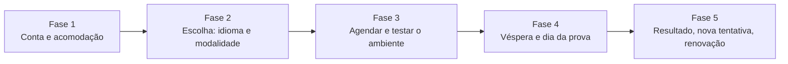

---
aliases:
  - Aula 27.1
modulo: 27
aula: 1
parte: "VIII Custo, projeto e prova"
dominios:
  - 1
  - 2
  - 3
  - 4
lida: false
tags:
  - aula
  - saa-c03
  - modulo-27
---

# Aula 27.1: Logística da prova de ponta a ponta

[[27 - Estrategia de Prova e Simulados|Voltar ao módulo]]

> [!question] Pergunta que esta aula responde
> O que fazer, em que ordem e com quanta antecedência, para que nada além do seu conhecimento decida o resultado: conta, [[Acomodacao ESL|acomodação ESL]] +30, modalidade, agendamento, véspera, dia, resultado, nova tentativa e renovação?

> [!warning] Dados que mudam
> Tudo o que é número, prazo e regra nesta aula foi conferido nas páginas oficiais da AWS em **novembro de 2026**: página da certificação, políticas "antes", "durante" e "depois" do teste, FAQ de certificação e exam guide v1.1 (29 de outubro de 2026). O que não aparece nessas páginas está marcado **não confirmado**. A [[02.05 - A Prova por Dentro|aula 2.5]] já apresentou o formato e as regras; esta aula transforma esses fatos em um **roteiro de execução** e acrescenta o que falta para o dia D. Reconfira as páginas da seção "Para aprofundar" antes de pagar.

## Por que logística merece uma aula

Dois tipos de erro derrubam candidatos preparados: **erro de conhecimento** (tratado nos outros 26 módulos) e **erro de processo**: chegar 20 minutos atrasado ao check-in online, descobrir na hora que a webcam falha, pedir o tempo extra tarde demais, sair do campo da câmera para ir ao banheiro. O erro de processo custa a taxa de **150 dólares americanos** (preço da página da certificação; impostos locais **não confirmados**) e pelo menos 14 dias. Ele também é o mais barato de evitar: basta um roteiro.

## O roteiro em cinco fases

### Fase 1: conta e acomodação (faça cedo)

1. **Conta de certificação:** a AWS exige a sua conta de certificação (o mesmo cadastro onde ficam o histórico de exames, os benefícios e os vouchers). Seu nome nela deve coincidir **exatamente** com o do documento de identidade, porque a verificação de identidade compara os dois (a regra do nome aparece nas políticas para o centro de testes; para o online, confira a mensagem de confirmação da [[Pearson VUE]]).
2. **[[Acomodacao ESL|ESL +30]] minutos:** é a acomodação para quem não tem o inglês como língua nativa e faz a prova **em inglês**. A página oficial de políticas informa: "A 30-minute exam extension is available upon request". O caminho informado é entrar na conta de certificação, abrir **Request Exam Accommodations**, escolher **ESL +30 MINUTES** e criar o pedido. O pedido é feito **uma vez, antes de registrar qualquer prova**, e vale para os registros futuros em todos os provedores; as demais acomodações precisam ser pedidas **antes de agendar cada prova**.
3. **Tempo que a AWS leva para aprovar o pedido:** não consta nas páginas consultadas (**não confirmado**). Por isso, peça no dia em que decidir fazer a prova, **não** na semana do agendamento.

> [!tip] Faça já
> Se você pretende fazer em inglês, o pedido de [[Acomodacao ESL|ESL +30]] é o único item desta aula que vale a pena fazer **hoje**, antes de terminar o curso. Custa zero e remove uma dependência da fase de agendamento.

Com o [[Acomodacao ESL|ESL]], o relógio sobe de 130 para **160 minutos** (130 mais 30). A conta por questão: 130 minutos por 65 questões dão 2,0 minutos por questão; 160 dão cerca de 2,5.

### Fase 2: duas decisões, idioma e modalidade

**Idioma.** A prova existe em inglês, francês (França), italiano, japonês, coreano, português (Brasil), espanhol (América Latina), espanhol (Espanha), chinês simplificado e chinês tradicional (a versão em italiano será descontinuada após 31 de dezembro de 2026). O [[Acomodacao ESL|ESL +30]] só vale para quem faz **em inglês**. A recomendação do curso (que não é regra da AWS) é fazer em inglês: a documentação, os simulados do curso e o vocabulário dos [[Qualificador|qualificadores]] ("MOST cost-effective", "LEAST [[Overhead Operacional|operational overhead]]") estão em inglês, e o tempo extra compensa o esforço de leitura.

**Modalidade.** Duas opções, ambas pela [[Pearson VUE]]: **centro de testes** ou **online com supervisão** (proctoring remoto). A tabela abaixo reúne só o que as páginas oficiais da AWS dizem (verificado em novembro de 2026):

| Aspecto | Online com supervisão | Centro de testes |
|---|---|---|
| Início | Pode iniciar até **30 minutos antes**; com **mais de 15 minutos de atraso** ou teste de sistema reprovado, não inicia e a taxa é perdida | Regras do centro; belongings guardados fora da sala |
| Pausas | **Não permitidas**; não se pode levantar nem sair do campo da câmera por nenhum motivo | **Permitidas sem agendamento**, mas **o relógio não para**; não se pode sair do prédio |
| Identificação | **Um documento de identidade primário** é exigido para qualquer prova online (OnVUE); sem ID governamental do país de teste, vale passaporte como primário, **mais** um ID secundário. Detalhes do documento: nota abaixo | Regras de documento do centro (a aula 2.5 resume); nome idêntico ao da conta |
| Comunicação | Exigida com o supervisor (o **proctor**, a pessoa que fiscaliza a prova à distância) | Presencial |
| Concordar com o código de conduta | Dentro de **5 minutos**, ou a prova termina sem reembolso | Idem |

O que **não** aparece nas páginas da AWS e vem da [[Pearson VUE]] (visto em resultado de busca na página de requisitos de testes online da Pearson; as exigências variam por programa, **confirme a do programa AWS**): o documento deve ser original, não expirado, emitido pelo governo, com nome em caracteres romanos, foto recente e assinatura (digital, fotocópia, plastificado ou de papel não servem), sistema operacional recente, uma webcam, microfone e alto-falante, **um único monitor**, rede sem VPN nem rede corporativa ou pública e mesa limpa. Falhar nos requisitos no dia pode cancelar a prova com perda da taxa.

> [!example] Qual modalidade para quem?
> A Ana mora em casa com crianças pequenas e tem uma conexão que cai de vez em quando. O custo de a internet cair no minuto 70 de uma prova online é a prova encerrada. Ela escolhe o **centro de testes**: sem risco de rede, e ela sabe que pode fazer uma pausa não agendada se precisar (com o relógio correndo). O Bruno mora sozinho, tem um quarto silencioso, fibra e um notebook dedicado. Ele escolhe o **online**, porque economiza duas horas de deslocamento. Nenhuma das duas escolhas é mais correta; a decisão é sobre **o risco que você controla melhor**.

### Fase 3: agendar e testar o ambiente

- **Quando agendar:** a recomendação do curso (não é da AWS) é agendar quando seus simulados completos, cronometrados, em inglês e com questões inéditas ficarem consistentemente acima da sua meta (os dois simulados do Módulo 27 existem para isso) e **marcar uma data real** para criar compromisso. O reagendamento permite flexibilidade (abaixo).
- **Reagendar e cancelar:** reagende até **24 horas antes**; cada agendamento aceita **duas** mudanças, e a terceira exige cancelar e agendar de novo. Cancelar com **mais de 24 horas** de antecedência devolve a taxa paga. **Dentro das 24 horas não é possível cancelar nem reagendar**: a taxa é perdida (o mesmo vale para quem falta), salvo **ausência justificada com documentação** de doença ou emergência, pedida à [[Pearson VUE]]. Um **voucher** é um código, emitido pela AWS ou por parceiros, que paga ou abate a taxa do exame (por exemplo, o desconto de 50% da Fase 5); ele tem prazo de validade que **não pode ser estendido**.
- **Teste de sistema (online):** rode o teste da Pearson **no mesmo computador, na mesma rede e no mesmo cômodo** que usará no dia, e repita-o. Reinicie o computador antes. O resultado de um teste feito em outro lugar não prova nada sobre o lugar onde você vai fazer a prova.

### Fase 4: véspera e dia

**Na véspera:**

- Revise **o seu caderno de erros** (tabela de pares que confundem, [[27.03 - Revisao Final Mapa Requisito Servico e Pares que Confundem|aula 27.3]]), não conteúdo novo. Aprender serviço novo na véspera aumenta a confusão entre pares parecidos.
- Confira o documento (validade, nome igual ao da conta), o horário no fuso certo e o endereço (centro) ou a mesa limpa e o campo da câmera (online).
- Durma. A prova é de leitura atenta por mais de duas horas: sono vale mais que uma última leitura.

**No dia, online:** abra a sala com folga (a janela libera **30 minutos antes**), faça o auto check-in (documento e ambiente), espere o supervisor e vá ao banheiro **antes** de iniciar, porque depois não há pausa.

**No dia, centro de testes:** chegue cedo, guarde os pertences, leve o documento exigido, e lembre que o aviso de pausa não para o relógio.

**Dentro da prova (vale para as duas modalidades):** o botão **[[Flag for Review]]** fica no canto superior direito, e as questões marcadas aparecem na tela de revisão antes de encerrar a seção. O botão de **comentário** fica no canto superior esquerdo, e **o tempo gasto escrevendo comentários conta no seu relógio**: a AWS recomenda marcar e comentar **depois** de terminar. Os comentários são revisados em conjunto, sem resposta individual. O recurso **Help** lista os nomes curtos dos serviços e seus nomes completos (detalhe na aula 2.5).

### Fase 5: depois da prova

| Evento | O que a AWS informa (novembro de 2026) |
|---|---|
| Resultado | Em até **5 dias úteis**, na sua conta de certificação, em **Exam History** (pode demorar mais se estiver em revisão por segurança ou razões técnicas). A FAQ afirma que a maioria das provas **não** mostra aprovado ou reprovado ao final |
| Relatório | Nota **escalonada** (100 a 1.000); mínimo de **720** para a Associate; PDF para baixar em Exam History. A conversão de 720 em número de acertos **não é publicada**. O relatório pode trazer uma tabela de classificação por seção (exam guide); como cada seção tem pesos diferentes, interprete com cautela |
| Reprovou | Espere **14 dias corridos**; **não há limite de tentativas**, mas cada tentativa exige a **taxa cheia** |
| Aprovou | A mesma prova **não pode ser refeita por dois anos**. A certificação vale **3 anos** |
| Renovação | Faça a versão mais recente da prova **ou** conquiste a **Solutions Architect - Professional**, que recertifica automaticamente a Associate |
| Desconto | A página da certificação diz que, após conquistar uma certificação AWS, há **50% de desconto** na próxima; a FAQ descreve o benefício para recertificar ou fazer upgrade e o voucher para qualquer prova futura. O benefício aparece em **Benefits** na conta de certificação; as condições detalhadas estão na FAQ |
| Badge | Emitido pela plataforma Credly (Acclaim), serviço de credenciais digitais; qualquer pessoa pode verificar |

> [!example] Cancelamento e voucher na prática
> A Carla agendou a prova para sexta às 9h e, na quinta às 15h (18 horas antes), um imprevisto de trabalho aparece. A política bloqueia cancelar e reagendar dentro das 24 horas: a taxa de 150 dólares está perdida. Se fosse segunda às 15h (mais de 24 horas), ela cancelaria e receberia a taxa de volta, ou reagendaria sem custo. Se o imprevisto fosse uma internação com atestado, o caminho é pedir à [[Pearson VUE]] uma ausência justificada, com documentação.

> [!example] Plano para a segunda tentativa
> Você fez 690 e quer tentar de novo. Em vez de "estudar tudo outra vez", faça três coisas no primeiro dia depois do resultado: anote os **temas** (não o texto das questões) em que hesitou, refaça um simulado do curso e classifique **cada erro** em uma de quatro causas (não sabia o serviço, confundi dois serviços, li mal o [[Qualificador|qualificador]], estourei o tempo). Quase sempre a causa dominante muda o plano: erro de leitura se corrige com a [[27.02 - Tecnica de Resolucao Tempo e Eliminacao|técnica da próxima aula]], não com mais conteúdo. A espera de 14 dias é tempo suficiente para isso e pouco demais para decorar o curso inteiro.

## Como isso cai na prova

Logística não é cobrada em questão de cenário, mas ela decide **o quanto de você chega à prova**. O que se repete no mundo real e vale lembrar:

- **Palavras-chave que aparecem nos materiais oficiais:** "[[Pearson VUE]]", "online proctored", "[[Acomodacao ESL|ESL +30 MINUTES]]", "[[Nota Escalonada|scaled score]]", "compensatory", "unscored", "[[Flag for Review]]", "Exam History".
- **Pegadinhas de planejamento:** pedir [[Acomodacao ESL|ESL]] depois de agendar; fazer o teste de sistema em outro lugar; planejar pausa no online; escrever comentários durante a prova; esperar resultado imediato; achar que 720 é 72%.
- **Task statements:** esta aula não cobre nenhum task statement técnico do exam guide; ela apoia **todos** ao proteger a execução. O exam guide também informa que o candidato-alvo tem pelo menos 1 ano de experiência prática projetando soluções na AWS, e que questão sem resposta conta como errada (sem penalidade por chute).

| Situação | Ação provável | Por quê |
|---|---|---|
| Vai fazer em inglês e quer mais tempo | Pedir **[[Acomodacao ESL\|ESL +30]]** na conta, uma vez, antes de agendar | A acomodação precisa ser pedida antes do registro |
| Vai fazer online e tem rede instável | Considerar o **centro de testes** | No online, queda de rede é risco que você não controla |
| Chegou 20 minutos atrasado ao check-in online | Perde a taxa | Mais de 15 minutos de atraso impede o início |
| Precisa cancelar com 10 horas de antecedência | Não dá para cancelar nem reagendar; taxa perdida, salvo ausência justificada com documentação via [[Pearson VUE]] | Dentro das 24 horas a política bloqueia a mudança |
| Reprovou | Esperar 14 dias, estudar pela causa do erro | A regra de nova tentativa é de 14 dias corridos |
| Passou | Aguardar 2 anos para repetir a mesma prova; planejar renovação em 3 anos | Regras de repetição e de validade |

## Resumo

> [!abstract] A aula em uma frase
> Erros de processo (acomodação pedida tarde, ambiente não testado, pausa não planejada) custam taxa e semanas, e se evitam com um roteiro de cinco fases feito em ordem.

**A lógica, em 5 passos**

1. Peça o [[Acomodacao ESL|ESL +30]] na conta de certificação **uma vez, antes de agendar**: sem isso, o tempo extra não existe.
2. Escolha idioma (inglês, para usar o [[Acomodacao ESL|ESL]] e treinar com o vocabulário da prova) e modalidade (centro ou online), pelo risco que você controla melhor.
3. Agende com data real; reagende até 24 horas antes (duas mudanças por agendamento).
4. Teste o ambiente no mesmo lugar e na mesma rede; na véspera, revise erros, não conteúdo novo.
5. Depois: resultado em até 5 dias úteis, nova tentativa após 14 dias, validade de 3 anos.

**Números para lembrar** (verificado em novembro de 2026)

| O quê | Valor | Por que importa |
|---|---|---|
| Duração | 130 min (160 com [[Acomodacao ESL\|ESL +30]]) | Define o ritmo por questão |
| Questões | 65 (50 pontuadas) | Trate todas como pontuadas |
| Preço | 150 dólares americanos | Cada tentativa custa a taxa cheia |
| Nota mínima | 720 (escala de 100 a 1.000) | Não equivale a 72% |
| Check-in online | 30 min antes; 15 min de atraso máximo | Atraso perde a taxa |
| Reagendar ou cancelar | 24 h antes | Dentro disso, perde a taxa |
| Nova tentativa | 14 dias corridos | Sem limite de tentativas |
| Repetir após passar | 2 anos | Evita refazer a mesma prova |
| Validade | 3 anos | Renovar passando a nova versão ou a Professional |

**Na prática, isso significa**

- O pedido de [[Acomodacao ESL|ESL +30]] é o primeiro item do roteiro, antes de qualquer agendamento.
- No online, não há pausa e o campo da câmera é inegociável: resolva tudo antes de iniciar.
- Marque questões com [[Flag for Review]] e comente só no final.
- Meça o resultado do simulado pela **causa do erro**, não só pela nota.

> [!tip] Liga com
> Vem da [[02.05 - A Prova por Dentro|aula 2.5]] (formato e regras) e da [[02.08 - Principios das Respostas Certas e Plano de Estudo|aula 2.8]] (plano de estudo). Segue para a [[27.02 - Tecnica de Resolucao Tempo e Eliminacao|aula 27.2]], sobre o que fazer **dentro** da prova.

## Erros comuns

- **Pedir o [[Acomodacao ESL|ESL +30]] depois de agendar.** A acomodação precisa existir antes do registro.
- **Presumir pausa no online.** Não há; sair da câmera encerra a possibilidade de concluir a prova sob as regras da AWS.
- **Fazer o teste de sistema em outro computador ou rede.** Ele só vale para o ambiente em que foi feito.
- **Conversão mental de 720 para 72%.** A escala é estatística, e não existe tabela publicada.
- **Escrever comentários durante a prova.** O tempo conta no relógio; marque e comente no fim.
- **Estudar serviço novo na véspera.** Raramente soma; frequentemente embaralha pares parecidos.
- **Cancelar em cima da hora.** Dentro de 24 horas, a taxa já está perdida.

## Pratique

**1.** O João vai fazer a prova em inglês e quer os 30 minutos adicionais. Qual é a sequência correta?

- [ ] a) Pedir ESL +30 na conta de certificação, depois agendar a prova
- [ ] b) Agendar a prova, e no dia pedir ao supervisor a extensão
- [ ] c) Agendar a prova e solicitar a acomodação ao suporte do centro de testes
- [ ] d) Fazer a prova em português e ativar o tempo extra pela Pearson VUE

**2.** Uma candidata fará a prova online e sabe que costuma precisar ir ao banheiro depois de duas horas sentada. Qual é a melhor preparação?

- [ ] a) Fazer a pausa no meio e avisar o supervisor pelo chat, já que o relógio da prova fica parado nesse intervalo
- [ ] b) Planejar uma pausa curta, pois o tempo da pausa não conta no relógio
- [ ] c) Considerar o centro de testes, onde há pausa não agendada (com o relógio correndo)
- [ ] d) Pedir ao supervisor, no dia, que o relógio seja pausado durante o banheiro

**3.** Um candidato inicia o check-in online 20 minutos depois do horário marcado. Qual é a consequência?

- [ ] a) Ele inicia normalmente, com 20 minutos a menos
- [ ] b) A prova é reagendada gratuitamente para o dia seguinte
- [ ] c) O supervisor decide caso a caso e devolve metade da taxa
- [ ] d) Ele não consegue iniciar e perde a taxa de exame

**4.** Uma candidata percebe, 10 horas antes da prova, que está doente e quer cancelar. O que a política oficial prevê?

- [ ] a) A taxa é perdida, com dispensa possível mediante documentação de doença ou emergência
- [ ] b) A taxa é devolvida integralmente, pois o cancelamento por doença é sempre aceito sem documentação
- [ ] c) A taxa vira crédito de 50% para a próxima prova, aplicado automaticamente na conta de certificação
- [ ] d) O voucher é estendido por 30 dias automaticamente e a prova é reagendada sem custo

**5.** O João reprovou em uma tentativa. Qual afirmação descreve corretamente a nova tentativa?

- [ ] a) É preciso esperar 30 dias, com no máximo 3 tentativas por ano, pagando a taxa cheia em cada uma
- [ ] b) É preciso esperar 14 dias corridos, e a taxa cheia é cobrada a cada tentativa
- [ ] c) É possível repetir no dia seguinte, pagando apenas metade da taxa por ser a segunda tentativa
- [ ] d) É preciso esperar 14 dias e a segunda tentativa é gratuita para quem reprovou

**6.** (Escolha DUAS.) Quais afirmações sobre a certificação estão corretas?

- [ ] a) Após passar, a mesma prova pode ser refeita imediatamente para melhorar a nota
- [ ] b) A certificação vale 3 anos
- [ ] c) O relatório mostra o número exato de acertos por questão
- [ ] d) Conquistar a Solutions Architect - Professional recertifica a Associate
- [ ] e) A acomodação ESL +30 vale também para a prova feita em português

**7.** Um candidato fará a prova em um centro de testes e, no minuto 60, precisa levantar para beber água. O que ocorre?

- [ ] a) Não pode: nenhuma pausa é permitida em prova da AWS, nem em centro de testes
- [ ] b) Pode fazer uma pausa não agendada, mas o relógio da prova continua correndo
- [ ] c) Pode, e o relógio é pausado pelo supervisor enquanto ele estiver fora da sala
- [ ] d) Pode sair do prédio por até 10 minutos, desde que avise o administrador antes

**8.** Um candidato com [[Acomodacao ESL|ESL +30]] planeja fazer a primeira passada na prova a uma média de 100 segundos por questão (65 questões). Quantos minutos, aproximadamente, sobram para a revisão das marcadas, dentro dos 160 minutos?

- [ ] a) cerca de 20 minutos
- [ ] b) cerca de 28 minutos
- [ ] c) cerca de 52 minutos
- [ ] d) cerca de 70 minutos

**9.** Durante a prova, uma questão parece ambígua e o candidato quer registrar um comentário para a AWS. Qual é a conduta recomendada?

- [ ] a) Escrever o comentário na hora, pois o tempo do comentário não é descontado da prova
- [ ] b) Escrever na hora e depois continuar, porque a AWS responde aos comentários rapidamente
- [ ] c) Marcar com Flag for Review e comentar só ao terminar
- [ ] d) Não comentar nunca, pois o botão de comentário foi removido da prova

**10.** (Escolha DUAS.) Uma candidata fará a prova online. Quais ações reduzem o risco de perder a taxa?

- [ ] a) Rodar o teste de sistema no mesmo computador e na mesma rede do dia da prova
- [ ] b) Usar a VPN da empresa para garantir uma conexão estável
- [ ] c) Preparar um documento original, não expirado, emitido pelo governo, com nome igual ao da conta
- [ ] d) Conectar um segundo monitor para ler a prova em tela maior
- [ ] e) Rodar o teste de sistema em outro computador, mais potente, da casa de um amigo

**11.** O nome na conta de certificação da Marina é "Marina S. Costa", mas o documento de identidade traz "Marina Souza Costa". Ela fará a prova online amanhã. Qual é a melhor conduta?

- [ ] a) Seguir em frente, pois o supervisor costuma aceitar diferenças de abreviação no nome do meio
- [ ] b) Corrigir o nome na conta para coincidir exatamente com o documento antes de iniciar a prova
- [ ] c) Levar um segundo documento, pois dois documentos distintos resolvem qualquer divergência de nome
- [ ] d) Pedir ao supervisor, durante o check-in, que ele corrija o nome diretamente no sistema da prova

**12.** Uma candidata passou na prova. Qual é a informação correta sobre o desconto e a renovação?

- [ ] a) O desconto de 50% vale só para repetir a mesma prova, e a certificação nunca expira nem precisa renovar
- [ ] b) O desconto é de 100% e a certificação vale 5 anos
- [ ] c) Não há desconto e a certificação vale 1 ano
- [ ] d) Há 50% de desconto na próxima prova (em Benefits na conta), e a certificação vale 3 anos

> [!success]- Gabarito
> **1. a)** o pedido de [[Acomodacao ESL|ESL +30]] na conta de certificação vem antes do agendamento. B pede ao supervisor tarde demais, quando o registro já foi feito; C usa um canal (suporte do centro) que não é o da acomodação; D mistura o idioma (o ESL só vale para quem faz em inglês) com um canal errado.
> **2. c)** o online não permite pausa nem sair da câmera; o centro de testes permite pausa não agendada (o relógio segue). A inventa uma pausa com relógio parado; B afirma que a pausa não conta no relógio, o que é falso; D pede algo que o supervisor não faz: o relógio não é pausado. (Acomodações por condição documentada existem, mas exigem pedido prévio via [[Pearson VUE]] e não são tema desta questão.)
> **3. d)** mais de 15 minutos de atraso impede o início e a taxa é perdida. A inventa uma tolerância que não existe; B inventa reagendamento gratuito; C inventa decisão caso a caso e devolução parcial.
> **4. a)** dentro das 24 horas não dá para cancelar nem reagendar: a taxa é perdida, com dispensa possível mediante documentação de doença ou emergência (ausência justificada, via [[Pearson VUE]]). B vale só para cancelamento com mais de 24 horas e sem exigir documentação é falso; C inventa conversão em crédito de 50%; D inventa extensão automática de voucher.
> **5. b)** 14 dias corridos, sem limite de tentativas, taxa cheia a cada tentativa. A inventa 30 dias e um teto anual; C e D inventam desconto ou gratuidade.
> **6. b, d)** a validade é de 3 anos e a Professional recertifica a Associate. A erra: a mesma prova não pode ser refeita por dois anos; C erra: o relatório informa [[Nota Escalonada|nota escalonada]], sem acertos por questão (a classificação por seção é opcional e genérica); E erra: o [[Acomodacao ESL|ESL]] só vale para quem faz a prova em inglês.
> **7. b)** o centro permite pausa não agendada, mas o relógio continua. A confunde com o online; C erra porque o relógio não para; D erra porque não é permitido sair do prédio.
> **8. c)** 65 x 100 s = 6.500 s, cerca de 108 min; 160 - 108 = cerca de 52 min. A, B e D vêm de contas erradas (por exemplo, usar 130 min no lugar de 160, ou 100 min por questão).
> **9. c)** comentário consome o relógio, e a AWS recomenda marcar a questão e comentar no fim. A afirma que o tempo do comentário não é descontado, o que é falso; B repete essa premissa e acrescenta que a AWS responde rápido, mas os comentários são revisados em conjunto, sem resposta individual; D inventa uma remoção do recurso.
> **10. a, c)** testar no mesmo ambiente e preparar o documento correto reduzem o risco. B contraria a orientação da Pearson (sem VPN ou rede corporativa); D contraria a regra de monitor único; E testa um ambiente que não é o da prova.
> **11. b)** a verificação de identidade compara o nome da conta com o do documento, então a conta deve ser corrigida antes (e com antecedência, já que a mudança pode levar tempo). A confia numa tolerância que não está nas políticas; C não resolve: o problema é o nome da conta, não a quantidade de documentos; D pede ao supervisor algo que ele não faz (ele não edita dados da conta).
> **12. d)** 50% de desconto na próxima prova (o benefício aparece em Benefits na conta; as condições detalhadas estão na FAQ) e validade de 3 anos. A erra nas duas partes (o desconto não se restringe à mesma prova e a certificação expira); B inventa desconto de 100% e validade de 5 anos; C inventa ausência de desconto e validade de 1 ano.

## Para aprofundar

- [ ] [AWS Certified Solutions Architect - Associate](https://aws.amazon.com/certification/certified-solutions-architect-associate/) (AWS): página oficial com duração, preço, idiomas, validade, recertificação e desconto de 50%.
- [ ] [Políticas de certificação antes do teste](https://aws.amazon.com/certification/policies/before-testing/) (AWS): [[Acomodacao ESL|ESL +30]], acomodações, reagendar e cancelar, identificação.
- [ ] [Políticas de certificação durante o teste](https://aws.amazon.com/certification/policies/during-testing/) (AWS): regras do online e do centro, [[Flag for Review]], comentários.
- [ ] [Políticas de certificação depois do teste](https://aws.amazon.com/certification/policies/after-testing/) (AWS): resultados, relatório e nova tentativa.
- [ ] [Online testing requirements](https://www.pearsonvue.com/us/en/onvue/requirements.html) ([[Pearson VUE]]): requisitos técnicos e de ambiente do teste online; as regras podem variar por programa.

Próxima aula: [[27.02 - Tecnica de Resolucao Tempo e Eliminacao|Aula 27.2: Técnica de resolução, tempo e eliminação]].
