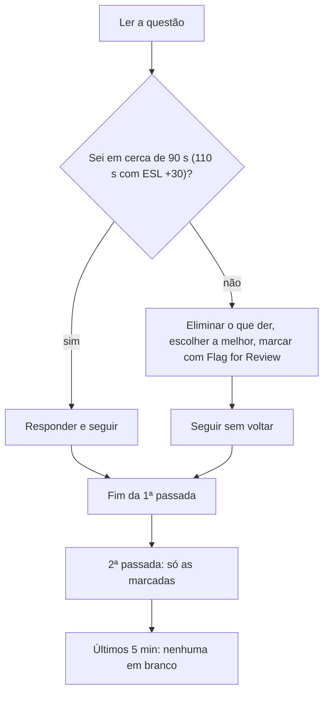

---
aliases:
  - Aula 27.2
modulo: 27
aula: 2
parte: "VIII Custo, projeto e prova"
dominios:
  - 1
  - 2
  - 3
  - 4
lida: false
tags:
  - aula
  - saa-c03
  - modulo-27
---

# Aula 27.2: Técnica de resolução, tempo e eliminação

[[27 - Estrategia de Prova e Simulados|Voltar ao módulo]]

> [!question] Pergunta que esta aula responde
> Dado o que você já sabe, como transformar conhecimento em acertos sob pressão de tempo: em que ordem ler, quanto tempo gastar, como eliminar alternativas, como tratar múltipla resposta e o que fazer quando a questão cita algo que você não conhece?

> [!info] Ligando os pontos
> A [[02.07 - Anatomia de uma Questao|aula 2.7]] ensinou a **anatomia** de uma questão (cenário, requisito, restrição, [[Qualificador|qualificador]], [[Distrator|distratores]]) e a [[02.08 - Principios das Respostas Certas e Plano de Estudo|aula 2.8]] os princípios que se repetem nas respostas certas. Esta aula assume as duas e acrescenta o que falta: **orçamento de tempo**, **hierarquia de decisão**, **tipos de alternativa errada** e um **dicionário de palavras-chave** que agora você consegue preencher, porque estudou os 25 módulos de conteúdo.

## Por que técnica importa mesmo sabendo o conteúdo

A prova tem 65 questões em 130 minutos (160 com [[Acomodacao ESL|ESL +30]]), e o exam guide diz que ela mede a capacidade de **projetar soluções** conforme o [[Well-Architected Framework]], não de recitar serviços. Quase toda questão tem duas ou três alternativas que **funcionam**; o enunciado pede a que funciona **melhor segundo um critério** (o [[Qualificador|qualificador]]). Quem sabe o conteúdo e erra, quase sempre errou por um destes motivos: leu o qualificador tarde demais, escolheu a primeira alternativa que funcionava, ou gastou quatro minutos numa questão e correu nas últimas. Os três são corrigíveis com procedimento.

## Orçamento de tempo: três passadas

Os números abaixo são uma **recomendação** deste curso, não uma regra da AWS.

| Item | 130 min (sem [[Acomodacao ESL\|ESL]]) | 160 min (ESL +30) |
|---|---|---|
| Tempo médio por questão (total ÷ 65) | 2,0 min | cerca de 2,5 min |
| Meta da 1ª passada (todas as questões) | cerca de 90 s por questão, ou cerca de 98 min | cerca de 110 s por questão, ou cerca de 119 min |
| Reserva para a 2ª passada, **já incluindo os 5 min finais** | cerca de 32 min (27 + 5) | cerca de 41 min (36 + 5) |
| Dentro dessa reserva: conferência final (marcadas e em branco) | os últimos 5 min | os últimos 5 min |

Três regras sustentam o esquema:

1. **Nunca deixe em branco.** Questão sem resposta conta como errada e **não há penalidade por chute** (exam guide). Toda questão tem uma resposta registrada antes de você seguir, ainda que provisória.
2. **Não troque de resposta por insegurança.** Troque só se, ao rereler, encontrar um requisito que você ignorou.
3. **Comentário e anotação consomem relógio.** A AWS orienta marcar com [[Flag for Review]] e comentar depois de terminar (aula 27.1). Se a prova oferecer um espaço de anotação (**não confirmado** nas páginas oficiais consultadas), use-o apenas para tabelas curtas, não para rascunhar a arquitetura inteira.

> [!example] Uma questão que come tempo
> Você chega à questão 14: um cenário de 9 linhas sobre migração híbrida, com quatro alternativas longas. Aos 90 segundos você eliminou duas e hesita entre as outras. O erro clássico é investir mais 3 minutos "para ter certeza". O procedimento: escolher a melhor das duas (um desempate plausível pelo [[Qualificador|qualificador]]), marcar com [[Flag for Review]] e seguir. Na segunda passada, com a cabeça fria e o resto da prova já respondido, você volta com 2 minutos de folga e quase sempre vê o que não viu. Os 3 minutos poupados pagam a dúvida de **outras** duas questões.

## A hierarquia de decisão

O método de leitura da aula 2.7 tem seis passos. Aqui está o mesmo método reduzido a uma **hierarquia**, que organiza a eliminação:

1. **Restrições duras** (obrigatórias, expressas por "must", "requires", "cannot", números e conformidade): eliminam alternativas que as violam, independentemente de custo ou elegância. Exemplos: "dados não podem sair da Região", "sem alterar o código", "[[RPO]] de 5 minutos", "protocolo [[SMB]]".
2. **Requisitos funcionais:** o que a solução precisa fazer (processar, armazenar, entregar).
3. **[[Qualificador]]:** entre as que sobraram, escolha pelo critério do enunciado (menor custo, menor [[Overhead Operacional|overhead operacional]], mais seguro, mais disponível, melhor desempenho).
4. **Princípios de desempate** (aula 2.8): serviço gerenciado em vez de autogerenciado, desacoplar, [[Escalabilidade Horizontal|escalar horizontalmente]], [[Menor Privilegio|menor privilégio]], o serviço de propósito específico.

Ela corresponde ao método "filtrar, depois escolher o mais barato" da [[25.11 - Decisao de Custo na Prova e Revisao|aula 25.11]], só que generalizada para todos os [[Qualificador|qualificadores]]. A ordem importa porque a alternativa mais barata (ou mais simples) quase sempre **viola uma restrição dura**: ela está lá justamente para quem pulou a etapa 1.

## Os sete tipos de alternativa errada

Conhecer o formato do erro acelera a eliminação. Quase todo [[Distrator|distrator]] cai em um destes tipos:

| Tipo | Como se reconhece | Exemplo |
|---|---|---|
| 1. **Serviço real, problema errado** | O serviço existe e é bom, mas resolve outra coisa | Oferecer [[Shield]] Standard para "bloquear [[SQL Injection\|SQL injection]]" (isso é do [[WAF]]) |
| 2. **Camada ou escopo errado** | Funciona em outro nível | Pedir [[Alta Disponibilidade\|alta disponibilidade]] e propor um volume [[EBS]] (zonal) sem réplica |
| 3. **Mais trabalho que o pedido** | Atende, mas exige instalar, manter ou escrever mais | [[EC2]] com banco instalado quando o [[Qualificador\|qualificador]] é menor overhead |
| 4. **Mais caro que o pedido** | Atende, com recurso ou redundância além do necessário | [[Multi-Site Active-Active]] para um [[RTO]] de 24 horas |
| 5. **Viola a restrição dura** | Contradiz um número, protocolo ou regra | Alternativa que exige reescrever o código quando o enunciado proíbe |
| 6. **Meio certa** | Certa em metade; a outra metade é falsa ou omitida | "Habilitar [[Multi-AZ]] para escalar leituras" (Multi-AZ de instância não atende leitura) |
| 7. **Desatualizada ou legado** | Era a resposta de uma versão antiga do assunto | [[Origin Access Identity]] no lugar de [[Origin Access Control]]; Classic [[Elastic Load Balancing\|Load Balancer]] |

> [!tip] Como usar a tabela
> Para cada alternativa que você descarta, nomeie o tipo mentalmente ("tipo 3, mais trabalho"). O hábito de **nomear** impede o descarte por "achismo" e faz você notar que duas alternativas descartadas pelo mesmo tipo provavelmente ensinam o que a questão testa.

## Múltipla resposta

O enunciado pede "Choose TWO" (ou THREE) e traz cinco ou mais alternativas. O exam guide define o formato (2 ou mais corretas entre 5 ou mais opções) e não menciona crédito parcial nas páginas consultadas (**não confirmado**; trate como tudo ou nada). Procedimento:

1. **Leia o enunciado como uma lista de requisitos**, não como uma só pergunta. Muitas vezes cada resposta correta cobre um requisito diferente (por exemplo, "criptografar" e "controlar acesso").
2. **Avalie cada alternativa isoladamente** contra o enunciado: ela é verdadeira e atende a algum requisito? Marque as que passam.
3. **Se sobraram mais do que o pedido**, aplique o [[Qualificador|qualificador]] entre as aprovadas.
4. **Se sobraram menos**, releia as descartadas por tipo 6 (meio certa): às vezes a metade verdadeira é a que o enunciado pede.
5. **Marque exatamente o número pedido;** se a interface avisar, corrija. Como a interface se comporta com número diferente **não está confirmado** nas páginas oficiais consultadas; na dúvida, marque o número pedido.

## Dicionário de palavras-chave

Este quadro condensa o que o curso ensinou: a **palavra no enunciado**, o que ela **puxa** e o que **elimina**. Ele não substitui entender a aula citada; serve para que a palavra dispare a lembrança certa.

| Palavra ou frase (em inglês) | Puxa | Elimina | Aula de origem |
|---|---|---|---|
| LEAST [[Overhead Operacional\|operational overhead]] | Serviço gerenciado ou [[Serverless\|serverless]] ([[Lambda]], [[Fargate]], [[Aurora]] Serverless) | [[EC2]] autogerenciado, software instalado à mão | [[17.08 - Escolhendo a Computacao Tabela de Decisao\|17.8]] |
| MOST cost-effective | Classe, modelo ou rota mais barata que ainda atenda ([[Spot Instance\|Spot]], [[Savings Plans]], [[S3 Intelligent-Tiering]], [[Gateway Endpoint]]) | Superdimensionar, redundância sem requisito | [[25.11 - Decisao de Custo na Prova e Revisao\|25.11]] |
| MOST secure | [[Menor Privilegio\|Menor privilégio]], criptografia, sem credencial fixa, [[Defesa em Profundidade\|defesa em profundidade]] | Acesso público, chave em código | [[04.08 - Guardrails e Menor Privilegio na Pratica\|4.8]] |
| [[Alta Disponibilidade\|highly available]] | [[Multi-AZ]], balanceador, sem [[Ponto Unico de Falha\|ponto único de falha]] | Instância única, volume zonal sem réplica | [[20.02 - Multi-AZ e Multi-Region Servico por Servico\|20.2]] |
| [[Regiao AWS\|Region]] failure, [[Recuperacao de Desastres\|disaster recovery]] | Multi-Region, estratégia de DR conforme [[RPO]] e [[RTO]] | [[Multi-AZ]] apenas | [[20.04 - As Quatro Estrategias de Recuperacao de Desastres\|20.4]] |
| near real-time, [[Streaming de Dados\|streaming]] | [[Kinesis Data Streams]], [[Data Firehose]] | Lote noturno, polling de [[S3]] | [[22.01 - Por Que um Pipeline de Dados e o Mapa de Servicos\|22.1]] |
| without changing the application code | Compatibilidade: [[RDS Proxy]], [[EFS]] ([[NFS]]), [[Amazon MQ]], [[Application Migration Service]] | Reescrever para [[Serverless\|serverless]] ou para outro banco | [[20.09 - Tornar Aplicacao Legada Resiliente sem Mudar o Codigo\|20.9]] |
| decouple, buffer, absorb spikes | [[SQS]], [[SNS]], [[EventBridge]] | Chamada síncrona direta | [[15.01 - Por Que Desacoplar e os Padroes de Mensageria\|15.1]] |
| unpredictable or spiky traffic | Auto scaling, [[Serverless\|serverless]], on-demand | Capacidade fixa dimensionada para o pico | [[12.07 - Politicas de Escala\|12.7]] |
| steady-state, 1 or 3 years | [[Savings Plans]], [[Reserved Instance]] | On-Demand puro | [[25.05 - Computacao Modelos de Compra e a Decisao\|25.5]] |
| interruptible, fault-tolerant, batch | [[Spot Instance]] | Spot para banco ou carga que não tolera interrupção | [[09.06 - Spot Dedicated e Capacity Reservations\|9.6]] |
| shared file system, Linux, [[NFS]] | [[EFS]] | [[EBS]] (um volume por instância, zonal) | [[10.10 - Escolhendo o Armazenamento\|10.10]] |
| Windows, [[SMB]], [[Active Directory]] | [[FSx for Windows File Server]] | [[EFS]] (Linux only) | [[10.08 - FSx for Windows File Server e FSx for Lustre\|10.8]] |
| static IP address | [[Network Load Balancer]], [[Global Accelerator]]; [[Application Load Balancer\|ALB]] com IP estático = Global Accelerator ou NLB com alvo ALB | ALB sozinho ([[DNS]], sem IP fixo por padrão) | [[12.04 - Network Load Balancer e Gateway Load Balancer\|12.4]] |
| global users, [[TCP]] or [[UDP]], fast [[Failover\|failover]] | [[Global Accelerator]] | [[CloudFront]] (conteúdo [[HTTP]] em cache) | [[18.06 - Global Accelerator Anycast e Rede Global da AWS\|18.6]] |
| cacheable content, edge | [[CloudFront]] | [[Global Accelerator]] (não faz cache) | [[18.01 - Por que a Borda e como o CloudFront Entrega Conteudo\|18.1]] |
| who did what, API audit | [[CloudTrail]] | [[Config]] (estado dos recursos) | [[05.08 - CloudTrail e a Trilha de Auditoria\|5.8]] |
| resource configuration history, compliance | Config | [[CloudTrail]] | [[05.09 - AWS Config e Conformidade Continua\|5.9]] |
| [[SQL Injection\|SQL injection]], [[Cross-Site Scripting\|XSS]], bad bots | [[WAF]] | Shield Standard, [[Security Group\|security group]] | [[19.03 - WAF Web ACLs Regras e Onde Associar\|19.3]] |
| ordered, no duplicates | [[Fila FIFO]] | Fila padrão (at-least-once, ordem best-effort) | [[15.03 - SQS FIFO e Padroes de Consumo\|15.3]] |
| workflow, retry, human approval | [[Step Functions]] | Encadear Lambda com Lambda | [[15.06 - Step Functions Orquestracao de Workflows\|15.6]] |
| rotate credentials automatically | [[Secrets Manager]] | [[Parameter Store]] (sem rotação nativa) | [[08.08 - Secrets Manager e Parameter Store\|8.8]] |
| ad hoc SQL on [[S3]], pay per query | [[Athena]] | Cluster [[Redshift]] ligado 24 h | [[22.07 - Amazon Athena Consultas SQL no Lago\|22.7]] |
| convert CSV to [[Parquet]], [[ETL]] | [[Glue]] | Escrever [[EC2]] com script manual | [[22.06 - AWS Glue Catalogo Crawlers e Jobs de ETL\|22.6]] |
| single-digit millisecond, key-value, any scale | [[DynamoDB]] | [[RDS]] com [[Particao de Dados\|particionamento]] manual | [[14.01 - Por que NoSQL e Escolha pelo Padrao de Acesso\|14.1]] |
| relational, cross-Region [[Failover\|failover]] in seconds | [[Aurora Global Database]] | Réplica entre [[Regiao AWS\|Regiões]] de [[RDS]] comum (promoção manual) | [[13.08 - Aurora Global Database Serverless v2 e Recursos\|13.8]] |
| dedicated private connection, consistent | [[Direct Connect]] | [[Site-to-Site VPN]] (pela internet) | [[07.06 - Direct Connect\|7.6]] |
| quickly, encrypted, over the internet | [[Site-to-Site VPN]] | [[Direct Connect]] (semanas de provisionamento) | [[07.05 - Site-to-Site VPN e Client VPN\|7.5]] |

## Quando duas alternativas parecem igualmente certas

Isto acontece com frequência, e é o desenho da prova, não um defeito do seu raciocínio. Em ordem:

1. **Releia o [[Qualificador|qualificador]]** e escolha a que o satisfaz mais **diretamente** ("menor overhead" favorece a que tem menos peças).
2. **Procure a restrição que você deixou passar** (um número, "existing", "without downtime", "compliance"): quase sempre derruba uma das duas.
3. **Conte as peças.** Entre duas soluções que atendem, a que usa menos componentes e mais serviços gerenciados costuma ser a da prova.
4. **Procure o sinal de legado ou meia-verdade** (tipos 6 e 7).
5. **Se ainda empatar, escolha o serviço de propósito específico** em vez do serviço genérico.

## Quando a questão cita algo desconhecido

Vai acontecer: o exam guide é "não exaustivo" na lista de serviços, e há 15 questões não pontuadas em teste. Em vez de travar:

- **Descubra o verbo.** "[[Transcribe]]", "extract", "convert", "route", "orchestrate": o verbo do requisito aponta para uma categoria (aula [[24.01 - Por Que Servicos de IA Prontos e Como Escolher pelo Verbo|24.1]]).
- **Elimine pelo que você conhece.** Com duas das quatro alternativas descartadas por restrição, o chute vale 50%.
- **Evite escolher só porque o nome é familiar.** O serviço conhecido que não resolve o problema é o tipo 1 de [[Distrator|distrator]].
- **Não gaste mais que cerca de 90 segundos (110 com [[Acomodacao ESL|ESL +30]]):** marque, escolha a melhor, siga.

## Como erros viram melhoria: a tabela do simulado

Os simulados 1 e 2 (aulas 27.4 e 27.5) só servem se cada erro for classificado. Use quatro causas e anote uma linha por erro:

| Causa | Sintoma | Correção |
|---|---|---|
| **Conhecimento** | Não sabia o limite, o serviço ou a propriedade | Reler a aula de origem e escrever a regra em uma frase |
| **Confusão de par** | Misturou dois serviços parecidos | Reler a seção correspondente da [[27.03 - Revisao Final Mapa Requisito Servico e Pares que Confundem\|aula 27.3]] |
| **Leitura** | Ignorou o [[Qualificador\|qualificador]], a restrição ou o número de respostas | Treinar o método (último parágrafo primeiro, qualificador em voz mental) |
| **Tempo** | Respondeu no chute no fim ou deixou em branco | Reforçar as três passadas e o limite de cerca de 90 segundos |

Se a causa **leitura** é a maior, mais conteúdo não ajuda. Se **confusão de par**, o treino é comparar lado a lado. Se **conhecimento**, volte à aula.

## Como isso cai na prova

Esta aula não cobre um task statement técnico; ela suporta todos eles. O que a prova faz com quem não tem técnica:

- **Palavras-chave que aparecem:** MOST cost-effective, LEAST [[Overhead Operacional|operational overhead]], MOST secure, [[Alta Disponibilidade|highly available]], near real-time, without changing the application code, minimal changes, Choose TWO.
- **Pegadinhas:** escolher a primeira alternativa que funciona; ignorar o número de respostas; trocar a resposta por ansiedade; gastar o dobro do tempo na questão difícil; escolher o serviço conhecido em vez do adequado.

| Requisito no enunciado | Resposta provável | Por quê |
|---|---|---|
| Duas soluções atendem; uma exige gerenciar servidores | A gerenciada ou [[Serverless\|serverless]] | O [[Qualificador\|qualificador]] de overhead desempata |
| Nenhuma restrição fica clara à primeira leitura | Reler o enunciado procurando números e "must" | Restrição dura elimina antes do custo |
| "Choose TWO" com cinco alternativas | Duas que atendam requisitos distintos | Cada resposta cobre uma parte do enunciado |
| Questão desconhecida | Verbo do requisito, eliminar, marcar e seguir | Tempo vale mais que certeza em uma única questão |

## Resumo

> [!abstract] A aula em uma frase
> Conhecimento vira acerto com procedimento: um orçamento de três passadas, uma hierarquia (restrição dura, requisito, [[Qualificador|qualificador]], princípio), eliminação por tipo de erro e nenhuma questão em branco.

**A lógica, em 5 passos**

1. A prova mede decisão entre alternativas que funcionam; o [[Qualificador|qualificador]] decide.
2. Passada 1 a cerca de 90 s por questão (110 s com [[Acomodacao ESL|ESL +30]]); marque o que travar e siga.
3. Passada 2 com as marcadas; últimos 5 minutos para zerar os brancos.
4. Elimine por hierarquia: restrição dura, requisito funcional, [[Qualificador|qualificador]], princípio de desempate.
5. Classifique cada erro do simulado em conhecimento, par, leitura ou tempo.

**Números para lembrar**

| O quê | Valor | Por que importa |
|---|---|---|
| Tempo por questão | 2,0 min (130 min) ou cerca de 2,5 min (160 min) | Base do ritmo |
| Meta da 1ª passada | cerca de 90 s (130 min) ou 110 s (160 min) | Deixa folga para revisão |
| Reserva final (dentro da reserva da 2ª passada) | 5 min | Nenhuma em branco |
| Múltipla resposta | 2 ou mais corretas em 5 ou mais alternativas | Marque o número pedido |

**Tabela-síntese: tipos de alternativa errada**

| Tipo | Pergunta que denuncia |
|---|---|
| Serviço real, problema errado | Esse serviço resolve o que foi pedido? |
| Camada ou escopo errado | Cobre a [[Zona de Disponibilidade\|AZ]], a Região ou a conta pedida? |
| Mais trabalho | Quanto gerenciamento exige? |
| Mais caro | Há requisito que justifique essa redundância? |
| Viola restrição | Contradiz algum número ou "must"? |
| Meio certa | A segunda metade da frase é verdadeira? |
| Legado | É a resposta de um assunto que mudou? |

**Na hora H**

1. Leia o último parágrafo primeiro; localize o [[Qualificador|qualificador]] e o número de respostas.
2. Formule sua resposta em uma frase antes de ler as alternativas.
3. Elimine por tipo; se travou em cerca de 90 s, marque, escolha e siga.
4. Critério de "fiz certo": nenhuma questão em branco ao final e as marcadas revisitadas.

> [!tip] Liga com
> Vem das aulas [[02.07 - Anatomia de uma Questao|2.7]] e [[02.08 - Principios das Respostas Certas e Plano de Estudo|2.8]]. Segue para a [[27.03 - Revisao Final Mapa Requisito Servico e Pares que Confundem|aula 27.3]], que reúne o mapa final e os pares que confundem.

## Erros comuns

- **Ler as alternativas antes do enunciado.** O [[Distrator|distrator]] mais bem escrito passa a definir sua resposta.
- **Aceitar a primeira alternativa que funciona.** Funcionar é o mínimo; a prova pede a melhor pelo critério.
- **Ignorar o "Choose TWO".** Marcar uma só ou três só rende erro garantido.
- **Gastar 4 minutos em uma questão.** O custo recai sobre as outras.
- **Trocar resposta por ansiedade.** Mudar só vale com requisito novo identificado.
- **Estudar só pela nota do simulado.** Sem classificar a causa do erro, a nota não diz o que corrigir.

## Pratique

**1.** Uma empresa precisa executar uma aplicação em [[Container|contêineres]], com picos imprevisíveis, e quer o MENOR [[Overhead Operacional|overhead operacional]], sem gerenciar servidores nem atualizar nós. Qual solução atende?

- [ ] a) ECS com tipo de lançamento EC2 e um Auto Scaling Group próprio
- [ ] b) EKS com nós autogerenciados e Cluster Autoscaler configurado
- [ ] c) ECS com Fargate e service auto scaling, sem instâncias nem nós para manter
- [ ] d) Contêineres em EC2 com Docker e scripts de implantação próprios

**2.** Um [[Bucket|bucket]] do [[S3]] recebe objetos com padrão de acesso imprevisível e desconhecido. A empresa quer a solução MAIS econômica, sem criar [[Lifecycle Policy|regras de ciclo de vida]] por padrão de acesso e sem [[Latencia|latência]] extra de recuperação. Qual opção atende?

- [ ] a) S3 Intelligent-Tiering, que move objetos entre camadas conforme o acesso, sem taxa de recuperação
- [ ] b) S3 Glacier Flexible Retrieval para os objetos novos
- [ ] c) S3 One Zone-IA para tudo, aceitando o risco de perder uma AZ
- [ ] d) S3 Standard com regra de ciclo de vida para Deep Archive após 7 dias

**3.** Uma aplicação legada em Linux compartilha arquivos entre dois servidores por [[NFS]] em um servidor local. A empresa migra para a AWS e exige [[Alta Disponibilidade|alta disponibilidade]] entre [[Zona de Disponibilidade|AZs]] e nenhuma alteração no código. Qual solução atende?

- [ ] a) Volume EBS io2 com Multi-Attach entre as duas instâncias em AZs diferentes
- [ ] b) Bucket do S3 montado nas instâncias com uma biblioteca de FUSE
- [ ] c) FSx for Windows File Server em duas AZs, com compartilhamento SMB
- [ ] d) Amazon EFS com mount targets em duas AZs, acessado pelo protocolo NFS

**4.** (Escolha DUAS.) Instâncias em um [[Auto Scaling Group]] precisam ler objetos de um [[Bucket|bucket]] do [[S3]] com a MAIOR segurança, sem credenciais fixas no código. Quais ações atendem?

- [ ] a) Criar um usuário IAM com chaves de acesso e gravar as chaves no user data
- [ ] b) Associar às instâncias uma IAM role (instance profile) com permissão de leitura apenas no bucket necessário
- [ ] c) Tornar o bucket público e confiar em um nome de objeto difícil de adivinhar
- [ ] d) Guardar as chaves de um usuário IAM em um arquivo de configuração versionado
- [ ] e) Manter Block Public Access ativo e restringir a bucket policy ao acesso pela role

**5.** Uma empresa de logística recebe eventos de GPS de milhares de veículos e precisa processá-los em tempo quase real por três aplicações independentes, mantendo os dados por 7 dias para reprocessamento. Qual serviço de ingestão atende?

- [ ] a) SQS standard, com uma fila separada para cada uma das aplicações
- [ ] b) SNS com assinaturas de SQS, retendo as mensagens no tópico por 7 dias
- [ ] c) Kinesis Data Streams, com retenção de 7 dias e três consumidores
- [ ] d) Step Functions Express com uma execução separada para cada evento recebido

**6.** Uma loja online sofre ataques de [[SQL Injection|SQL injection]] no [[Application Load Balancer|ALB]] e quer bloqueá-los com o MENOR esforço de manutenção. Qual solução atende?

- [ ] a) Shield Standard, que já protege o ALB contra injeção de SQL por padrão
- [ ] b) Network ACLs bloqueando as sequências de caracteres dos ataques
- [ ] c) Security group com regra de negação para as strings maliciosas
- [ ] d) AWS WAF associado ao ALB, com o managed rule group de SQL injection mantido pela AWS

**7.** Um sistema de pedidos recebe picos de 10 vezes o volume normal. Cada pedido precisa ser processado ao menos uma vez e sem perda, a ordem não importa e o tempo de processamento é de 30 segundos. Qual arquitetura atende com o MENOR custo e acoplamento?

- [ ] a) API Gateway invocando diretamente uma instância EC2 diferente para cada pedido recebido
- [ ] b) API que grava pedidos em SQS, com consumidores em um ASG escalado pelo backlog
- [ ] c) Tópico SNS entregando cada pedido a uma função Lambda com concorrência reservada baixa
- [ ] d) Kinesis Data Streams com um shard por pedido e consumidores em um ASG

**8.** Na prova, a questão 22 leva 4 minutos e você ainda hesita entre duas alternativas, com 43 questões ainda por responder. Qual é a melhor conduta?

- [ ] a) Continuar até ter certeza, pois cada questão vale o mesmo
- [ ] b) Deixar em branco para ganhar tempo, já que não há como acertar
- [ ] c) Escolher a melhor alternativa, marcar com Flag for Review e seguir
- [ ] d) Deixar um comentário detalhado para a AWS e depois seguir sem marcar

**9.** (Escolha DUAS.) Quais práticas de leitura melhoram a precisão na prova?

- [ ] a) Ler a pergunta final e localizar o qualificador antes de ler as alternativas
- [ ] b) Escolher a alternativa mais longa, pois costuma ser a mais completa
- [ ] c) Escolher a alternativa que cita o maior número de serviços
- [ ] d) Eliminar as alternativas que violam alguma restrição dura do enunciado
- [ ] e) Trocar a resposta sempre que sentir dúvida na revisão final

**10.** Uma empresa em Linux executa Java com um banco PostgreSQL relacional e precisa que a aplicação sobreviva à falha de uma Região inteira, com [[RPO]] de segundos, mudando o mínimo de código. Qual banco atende?

- [ ] a) RDS PostgreSQL Multi-AZ DB cluster, com dois standbys legíveis em três AZs
- [ ] b) Aurora PostgreSQL com Aurora Global Database
- [ ] c) DynamoDB com tabelas locais em cada Região
- [ ] d) RDS PostgreSQL com backups automáticos copiados para outra Região a cada hora

**11.** Uma empresa precisa que arquivos enviados ao [[S3]] sejam processados em até 2 minutos, de forma esporádica (algumas dezenas por dia), com o MENOR [[Overhead Operacional|overhead operacional]]. Qual solução atende?

- [ ] a) Instâncias EC2 em um Auto Scaling Group verificando o bucket
- [ ] b) Um cluster EMR permanente executando um job de Spark em loop
- [ ] c) Uma tarefa do AWS Batch agendada a cada minuto em Spot
- [ ] d) Uma notificação de evento do S3 acionando uma função Lambda, que só roda quando há arquivo

**12.** Uma seguradora recebe formulários digitalizados (imagens e PDFs) em um [[Bucket|bucket]] do [[S3]] e quer extrair automaticamente os campos preenchidos, com o MENOR [[Overhead Operacional|overhead operacional]] e sem treinar modelo. Qual solução atende?

- [ ] a) Amazon Rekognition para detectar rótulos nas imagens e gravar o texto no bucket
- [ ] b) Amazon Textract chamado por uma função Lambda acionada pelo evento do S3
- [ ] c) Amazon Comprehend para extrair os campos diretamente dos arquivos de imagem
- [ ] d) Amazon SageMaker AI com um modelo de OCR treinado e mantido pela equipe

> [!success]- Gabarito
> **1. c)** [[Fargate]] remove a gestão de servidores e nós, com o menor overhead. A e D mantêm instâncias para gerenciar; B é a mais trabalhosa (nós autogerenciados e autoscaler).
> **2. a)** [[S3 Intelligent-Tiering|Intelligent-Tiering]] move objetos entre camadas conforme o acesso, sem taxa de recuperação e sem regras. B tem recuperação em minutos a horas; C perde resiliência (uma [[Zona de Disponibilidade|AZ]]); D arquiva cedo demais, com taxa e [[Latencia|latência]] de recuperação.
> **3. d)** [[EFS]] é [[NFS]], regional ([[Multi-AZ|multi-AZ]]) e não exige mudar o código. A erra: [[Multi-Attach|Multi-Attach do EBS]] é restrito a uma [[Zona de Disponibilidade|AZ]] e exige sistema de arquivos de cluster; B mudaria o comportamento ([[S3]] não é um sistema de arquivos POSIX); C é [[SMB]] e Windows.
> **4. b, e)** role com [[Menor Privilegio|menor privilégio]] mais [[Bucket|bucket]] sem acesso público. A grava chaves fixas no [[User Data|user data]]; C abre o bucket ao público e confia em obscuridade; D versiona as chaves em arquivo, expondo-as.
> **5. c)** [[Kinesis Data Streams]] tem retenção configurável e vários consumidores independentes. A: filas separadas exigiriam um [[Fan-out|fan-out]] que o enunciado não traz, e o [[SQS]] apaga a mensagem ao consumir, sem reprocessar 7 dias; B não retém no tópico para reprocessamento; D orquestra fluxos curtos, não ingere eventos em massa.
> **6. d)** [[WAF]] com [[Managed Rule Group|managed rule group]] de [[SQL Injection|SQL injection]] resolve na [[Modelo OSI|camada 7]] com manutenção mínima. A: Shield Standard cobre [[DDoS]] de camadas 3 e 4; B e C não inspecionam o conteúdo de requisições [[HTTP]].
> **7. b)** [[SQS|fila SQS]] absorve o pico, entrega ao menos uma vez e o [[Auto Scaling Group|ASG]] escala pelo backlog. A acopla a API à capacidade de instâncias avulsas; C: [[SNS]] para Lambda é assíncrono, mas com concorrência baixa há [[Throttling|throttling]] e pedidos descartados após as tentativas, sem fila durável; D: um shard por pedido é inviável e caro, e a ordem não é requisito.
> **8. c)** escolher, marcar e seguir preserva o tempo; a revisão vem depois. A gasta o relógio de outras questões; B perde pontos garantidos (sem penalidade por chute); D consome tempo sem ajudar a pontuação.
> **9. a, d)** [[Qualificador|qualificador]] primeiro e eliminação por restrição são técnicas confiáveis. B: o tamanho da alternativa não indica correção (a prova equilibra comprimentos); C: mais serviços costuma ser mais trabalho, não mais acerto; E: trocar por insegurança, sem requisito novo, tende a piorar.
> **10. b)** [[Aurora Global Database]] tem [[Replicacao do S3|replicação entre Regiões]] em geral abaixo de 1 segundo, compatível com PostgreSQL. A erra: o [[Multi-AZ DB Cluster|Multi-AZ DB cluster]] tem standbys legíveis, mas todos na mesma Região, então não sobrevive à falha dela; C exige reescrever para NoSQL; D tem [[RPO]] de até uma hora.
> **11. d)** evento do [[S3]] mais Lambda é [[Serverless|serverless]] e dimensionado para volume esporádico. A, B e C mantêm instâncias, cluster ou execuções agendadas rodando sem necessidade.
> **12. b)** o verbo "extrair campos de formulários" aponta para o [[Textract]] (aula 24.4), acionado por evento do [[S3]] e Lambda, [[Serverless|sem servidor]] nem modelo. A: o [[Rekognition]] detecta rótulos e texto em cena, não campos de formulário estruturados; C: o [[Comprehend]] analisa texto já extraído, não imagens; D funciona, mas exige treinar e manter modelo, mais trabalho que o pedido (tipo 3).

## Para aprofundar

- [ ] [Exam guide da SAA-C03](https://docs.aws.amazon.com/aws-certification/latest/solutions-architect-associate-03/solutions-architect-associate-03.html) (AWS): formato, tipos de questão e task statements.
- [ ] [Pilar Cost Optimization do Well-Architected Framework](https://docs.aws.amazon.com/wellarchitected/latest/framework/cost-optimization.html) (AWS): um dos pilares que ancoram os [[Qualificador|qualificadores]] como MOST cost-effective.
- [ ] [Políticas de certificação durante o teste](https://aws.amazon.com/certification/policies/during-testing/) (AWS): [[Flag for Review]] e comentários.

Próxima aula: [[27.03 - Revisao Final Mapa Requisito Servico e Pares que Confundem|Aula 27.3: Revisão final, mapa requisito para serviço e pares que confundem]].
