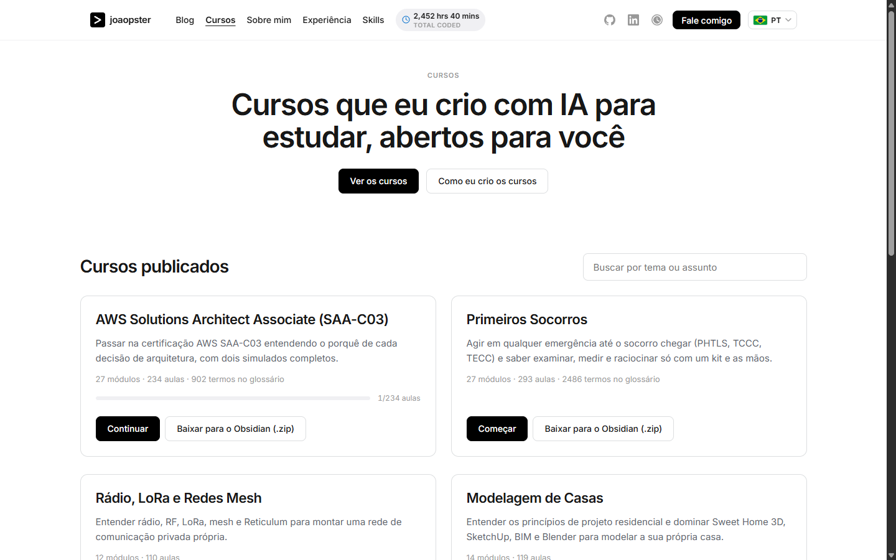
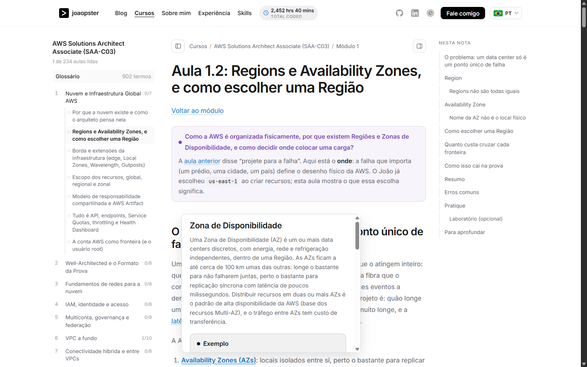

In early November Brazil's civil defense agency put out a recommendation that every family keep a kit to get by on their own for 72 hours, with water, food and medicine, and it landed right when everyone was talking about El Niño. I read it and thought, man, I should know first aid. I went looking and the material was all over the place, hard to find in one spot, and nothing took me from start to finish. So I asked AI to build a course for me.

What came out was a course with 27 modules and 293 lessons, plus a glossary with 2,486 terms, based on PHTLS, TCCC and TECC, which are the reference standards for trauma care. That course and three others I made are open for free in the [courses section of my site](/cursos/), and in this post I explain what's there and why I think asking AI to build a course the way you like to learn is one of the best ways to study anything today.

## What's in the courses section

Each course is a path of modules in order, with written lessons, a glossary, quizzes with answer keys and a final project tied to a concrete goal (in the AWS one, for example, the goal is passing the exam). Right now there are four, all in Portuguese:

| Course | Modules | Lessons | Glossary terms |
|---|---|---|---|
| [AWS Solutions Architect Associate (SAA-C03)](/cursos/aws-saa-c03/) | 27 | 234 | 902 |
| [First Aid](/cursos/primeiros-socorros/) | 27 | 293 | 2,486 |
| [Radio, LoRa and Mesh Networks](/cursos/radio/) | 12 | 110 | none |
| [House Modeling](/cursos/modelagem-de-casas/) | 14 | 119 | none |



You can read them two ways. On the site, each lesson has the module list on the left and the lesson outline on the right, and when you hover over a term its definition pops up right there, without leaving the page. Your progress is saved in your browser, so you can see how many lessons you've read in each module. And if you'd rather read offline, every course has a button that downloads the whole course as a .zip.



The interface is in Portuguese, English and Spanish, but every course I've made so far is in Portuguese, and each course only shows up on the page for the language it was written in.

## Why a course built for you teaches better

I only learn by starting from the base. First I need to understand the fundamentals, and only then I build up, because if I don't understand why something is the way it is, I just don't accept that information. A ready-made course follows the way its author thinks, and when I ask AI for a course I tell it how I learn and it builds around that.

The rule I wrote down is that the first module is always the deepest foundation of the subject, every lesson answers "why is it like this?" before "how do you do it?", and no module uses anything that hasn't been taught yet. You can see it in the order of the courses. The first aid one opens with "How the body keeps itself alive", and tourniquets only show up in module 5, after four modules of groundwork. The AWS one opens with "Why the cloud exists".

In one AWS lesson the text says "João already picked `us-east-1` when creating resources", so the course talks to me by name, and no recorded course is ever going to do that.

AWS is the one I've studied the most so far. I study one or two hours a day, I've finished 2 modules and haven't done a practice exam yet, but I want to, just to see what it's like, and I plan to take the real exam in the next few months, maybe weeks. One thing I think makes a big difference is studying a course built for the exact certification you want, because it teaches you how the exam works. The course's start page already explains that there are 65 questions, that you pass with 720 out of 1,000 and how much each domain weighs, and the material is sized to match those weights.

## How the AI builds a course

I only use Claude Code, with Opus 5.5 and a skill I wrote called `criar-curso`. A skill is an instruction file that Claude loads when your request matches its description, and mine spells out the whole process:

1. Understand the topic and where I want to get to.
2. Design the curriculum, with modules ordered by dependency, and show it to me for approval before researching anything.
3. Research and write, with one agent per module, up to 5 in parallel, all reading the same writing guide.
4. Put it all together, check that facts match across modules and link every term to the glossary.
5. Verify with scripts, no broken links, no unlinked terms and answer keys without bias (the right answer can't always be the longest one).

I run this with Claude Code's `/workflow`, which launches several subagents (other Claude instances, each with its own task) and collects what they return, and I wrote more about it in the [post about the Claude Code harness](/en/blog/claude-code-harness-made-my-workflow-obsolete/). The AWS course alone used around 483 agents, spread across several workflows.

A course takes 2 to 3 hours to finish, depending on its size, and it's basically one shot, because the workflows themselves research, write and review, so the AI handles the back and forth on its own without me touching anything. I'm on the Ultra plan, and each course eats about 1 to 2% of my weekly usage, which is very little.

The first two I made, House Modeling and then Radio, back in September, came from a very early version of the skill, which is why they don't even have a glossary. It has grown a lot since then.

## Does the AI get things wrong?

It does, for sure, it's just how AI is and there's not much way around it. What you can do is make it research and analyze a lot online before it writes anything, which is what the skill does, and check the critical points yourself.

What I see most is the AI drifting into generic stuff. Once I asked for some first aid quick reference cards and it gave me huge, messy explanations, which is awful for a card you need to read in two seconds during an emergency. I had to refine the request until I got what I wanted, and the skill is basically that, a prompt I've already refined so it doesn't go generic.

Now, to anyone who says AI teaches wrong things so it's useless for learning, I'd point out that books get things wrong, teachers get things wrong and YouTube videos get things wrong, and nobody stopped reading books because of it. Whoever throws AI out entirely because it can make mistakes is throwing away the most patient teacher that has ever shown up.

## How to build your own course

I opened up the courses because I think knowledge is something we have to pass on. It's part of who I am, teaching makes me really happy, and I want everyone to grow. And they're in text because you read text at your own pace, come back whenever you want and don't need headphones.

The skill is open too, on the [How I make the courses](/en/courses/how-i-make-them/) page (the skill files are in Portuguese, but you can ask for the course in any language). To use it:

1. Download the skill .zip.
2. In Claude Code, unzip it and copy the `criar-curso` folder to `~/.claude/skills/`. On claude.ai or the app, upload the .zip in Settings, Capabilities, Skills. In another AI, paste the content of `SKILL.md` and `guia-de-escrita.md` as instructions.
3. Ask by saying the topic and where you want to get to, like this:

```text
Learning photography, I want to be able to shoot a wedding on my own. Write the course in English.
```

It shows you the curriculum to approve, writes the modules and checks everything at the end, and then you just open the `Aprendendo <Topic>` folder and start studying.

If you make a course, send it to me at joao@joaopster.com. I'll read it, review it and, if it's good, publish it on the site with credit to you, so more people can learn too.
