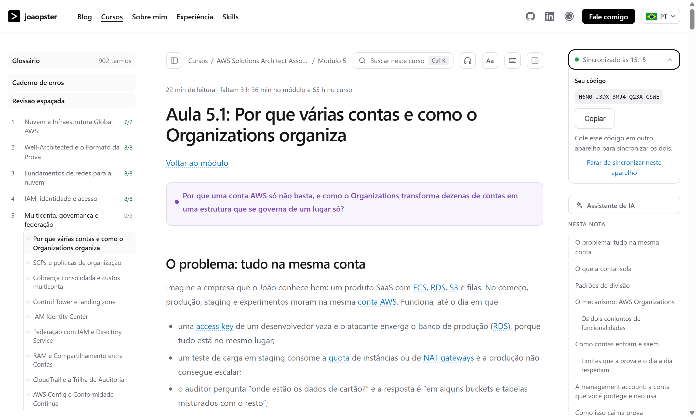
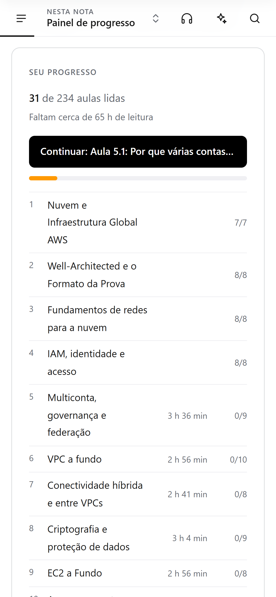
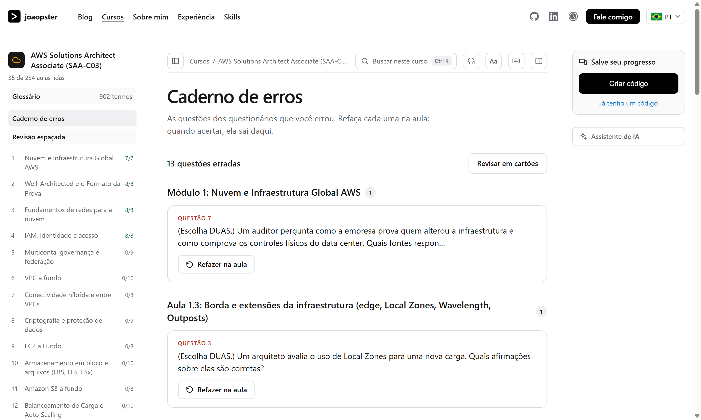
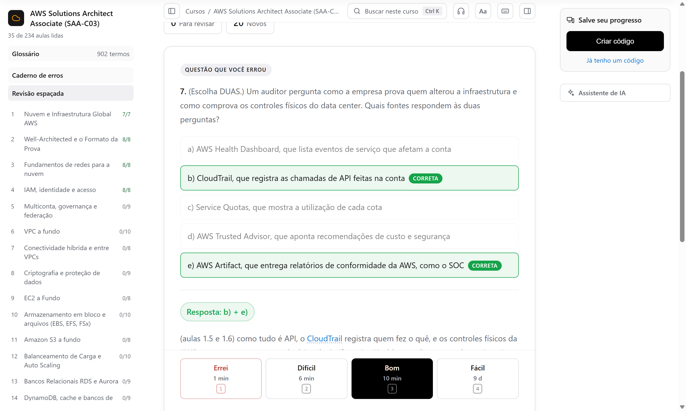
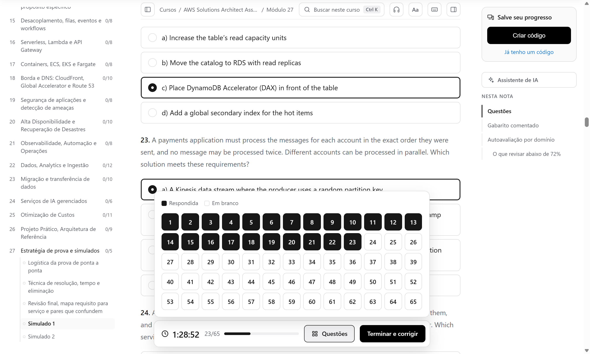
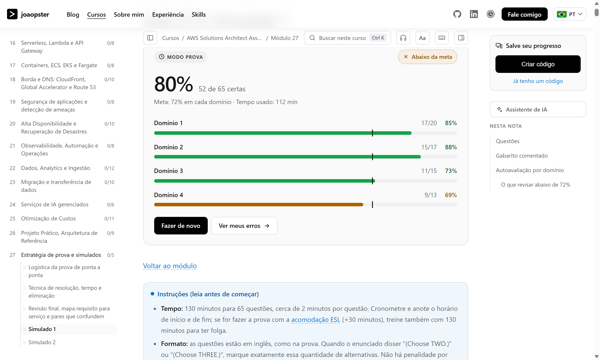
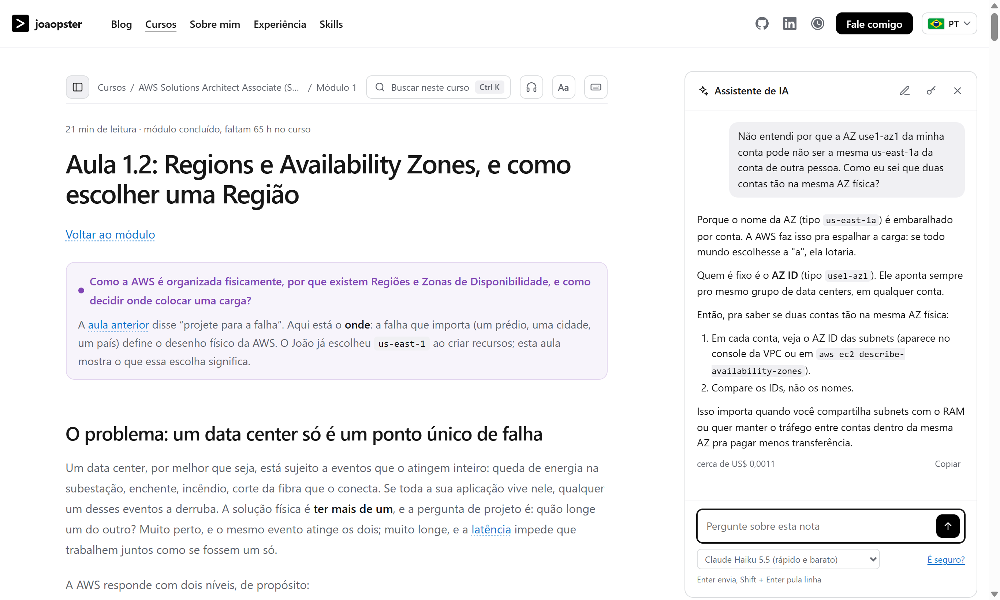
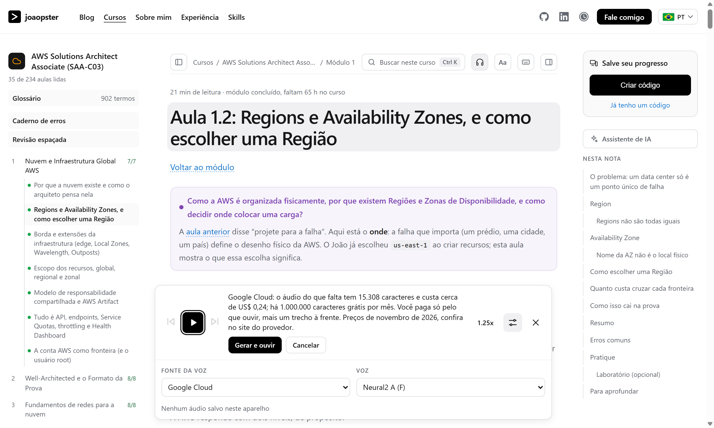
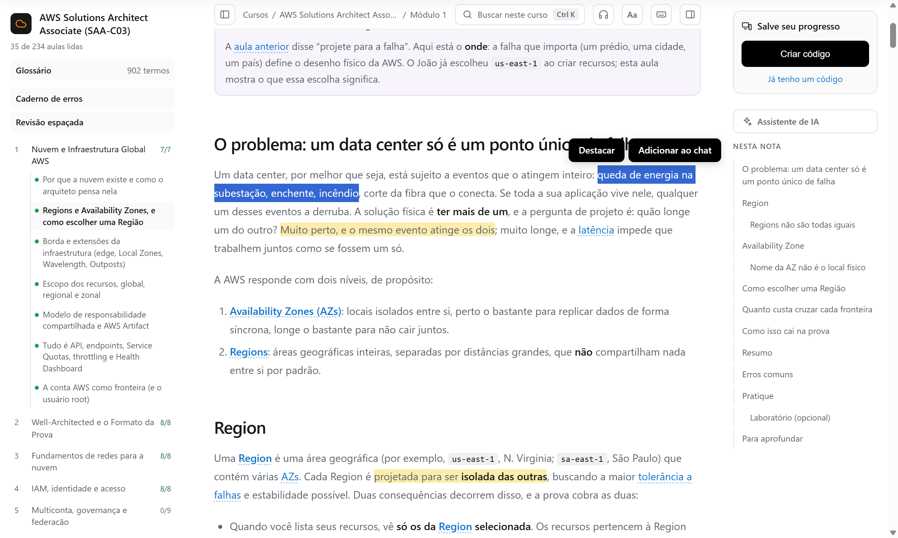
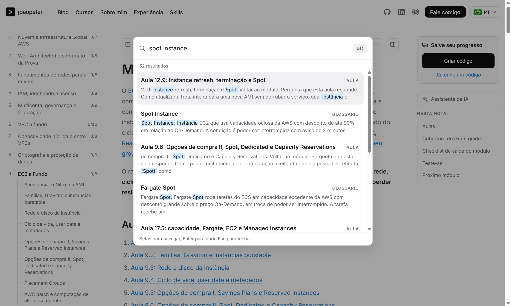

I built four courses with AI and at first I studied everything in Obsidian, which is great for reading, but it doesn't track progress, doesn't grade quizzes and doesn't remind you of what you're forgetting. I wanted a tool like that for myself, and then I thought, why not open it up to everyone, for free? That's how the [courses section](/cursos/) of my site turned into a study platform.

To show everything it does I used the [AWS Solutions Architect Associate course](/cursos/aws-saa-c03/), which is the one I'm studying right now. I've finished 4 of the 27 modules and I'm doing really well. The courses are in Portuguese, so the screenshots are too, and they come from a local server with sample data, so the scores you see aren't mine.

I already wrote about how the AI builds the courses in the [post on building courses with AI](/en/blog/how-i-use-ai-to-build-courses/), this one is only about what you do with a course once it exists.

## Sync without an account, just a code

This is the part I think is the most amazing. You study on the computer, stop, grab your phone and everything is there, the lessons you read, the questions you answered, your highlights. Stop again, grab the tablet, same thing. I study on all three, the computer when I want real focus, the phone when I'm moving around and the tablet more at night, and without this I'd have three different progress records and none of them right.

And there's no account. You click "Criar código" (create code), the site generates a 20-character code and you paste it on the other device. It doesn't ask for an email, a name, a password, nothing, and that was my decision, because I didn't want anyone handing over personal data just to study. The code works like a password, so the server only stores its hash and not the code itself.

If two devices studied separately, offline for example, the progress merges on its own when they talk again, and each item keeps its most recent version.

## Mistakes notebook

Every lesson ends with exam-style questions and the answer shows up right away, and any question you get wrong goes into the mistakes notebook, grouped by module and lesson, with a button to redo it back in the lesson. Get it right and it leaves the notebook.

I've already gotten some questions wrong in the AWS course and the notebook helped me a lot to review them. And it doesn't let me pretend I understood, because if a question is in there it means I still don't know that thing.

## Spaced repetition with FSRS

Spaced repetition means reviewing each thing right before you forget it. What you know well comes back in weeks, what you get wrong comes back in minutes. FSRS (Free Spaced Repetition Scheduler) is the algorithm that works out that moment for each card from your answers, and Anki has offered it too since 2023.

I learned about this using AnkiDroid when I was preparing for my Amazon interviews, to work at AWS. It worked. So much that I wanted the same thing here, without having to export anything to Anki.

The cards come from two places, the glossary terms of the lessons you've already marked as read and the questions you got wrong. You see the card, try to remember, reveal the answer and say how it went, and in the screenshot you can see that "Bom" (good) brings the card back in 10 minutes and "Fácil" (easy) in 9 days. At most 20 new cards come in per day, so the reviews don't turn into a pile you never finish.

## Timed practice exam with a score per domain

The AWS course has two 65-question practice exams, just like the real one, with 130 minutes (2 minutes per question), and while one is running the site hides the answers, shows a timer and a map of the questions you've answered and the ones you left blank.

When you finish, you get the overall score and the score for each of the exam's four domains, against a 72% target per domain. In the example below the overall score was 80%, but domain 4, cost-optimized architectures, came in at 69%, so even passing overall you know you have to go back to the cost modules before the exam.

I haven't taken the practice exam for real yet, I'm studying a bit more first, but I tested the whole feature and it turned out really good. To me a practice exam with a score per domain is the bare minimum for anyone studying for a certification, and still it's something I've missed on paid platforms.

## AI assistant with your own key

Next to the lesson there's a chat that already gets the whole lesson text as context. I use it a lot, when I didn't quite get something, when the text didn't explain it well, or when I have a more specific question the lesson doesn't even cover. You can also select a passage and send it to the chat.

The assistant runs on a key you provide yourself, from Anthropic, OpenAI or Google, and you pick the model. That's called BYOK (bring your own key), and I did it this way because I wanted you to be free to choose whatever AI you like and not be stuck paying me anything. I want this to be useful and truly free, and to be free I couldn't charge anything.

The key stays in your browser only and goes straight to the provider, without passing through my server, and under each answer you see how much it cost. For me it's a fraction of a cent per answer, and so far I've spent about US$ 1 of API on this at most.

## Listen to the lesson while you read

This and the assistant are the two things I use the most. I really like reading while listening, I put the lesson on and follow the text with my eyes, and the passage being read gets highlighted on screen. You can use the browser's own voice, which is free, or a paid voice from Google Cloud, OpenAI or ElevenLabs with your key. Before generating, the site shows how much the audio will cost, and the generated audio is saved on the device so you don't pay twice.

## Highlights, offline mode, search and the rest

I use highlights to mark the terms I have a hard time understanding, and they sync along with the progress. You select the passage and choose between highlighting it or sending it to the assistant.

Offline mode saves the whole course on the device and it opens without internet. On my phone this saves me all the time, the connection gets flaky, drops a bit, and I keep reading as if nothing happened.

Search opens with Ctrl+K and looks for any term inside the course, in the lessons and in the glossary, I use it a lot.

And each lesson shows the reading time and how much is left in the module and in the course, which helps me know if I can finish the lesson before going off to do something else at home.

There's also font size control and a focus mode that hides the menus. I barely use that one because I like seeing where I am in the course, but I left it in for whoever likes it.

## How I think it compares to Udemy and Coursera

Considering it's free, I think the platform delivers a lot more than Udemy, Coursera and the like, and with a much nicer interface. A lot of paid platforms fail at the basics of studying for an exam, which is seeing where you went wrong, reviewing at the right time and practicing in the exam format. The big difference is that there's no video here, it's all text (the why is in the other post).

The four courses are open at [/cursos](/cursos/). If you're studying for the SAA-C03 and you read Portuguese, start with the AWS one, create a sync code on day one and tell me in the comments what's missing.
