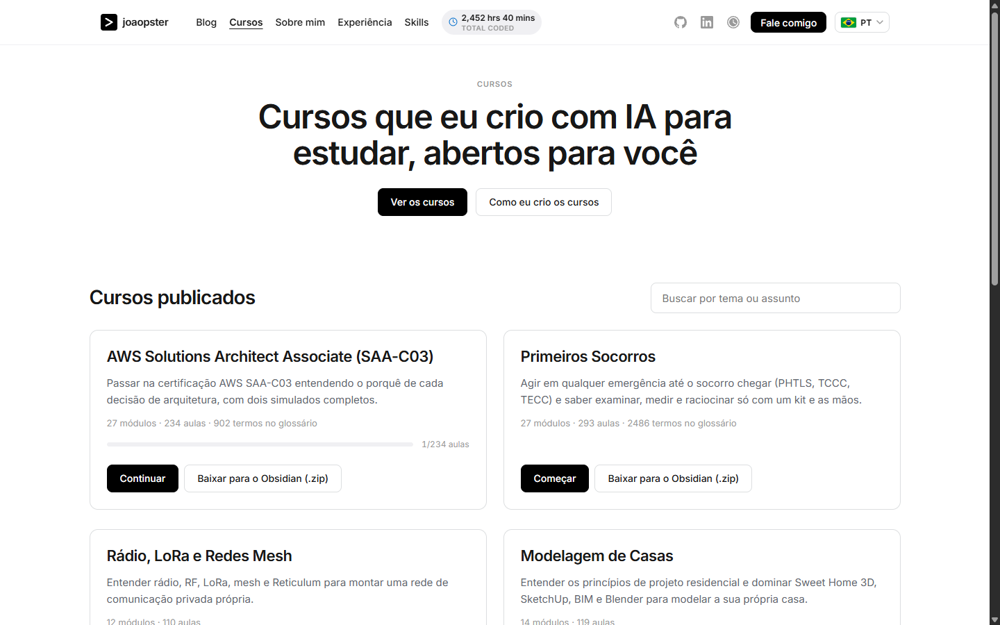
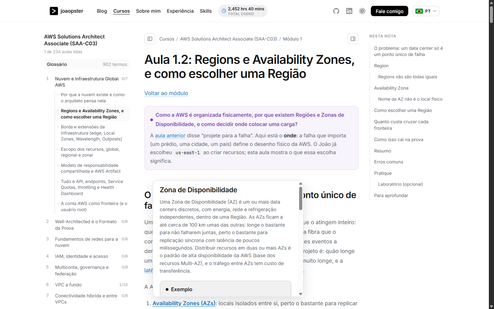

A principios de noviembre la Defensa Civil de Brasil sacó una recomendación para que cada familia tenga un kit para arreglárselas sola durante 72 horas, con agua, comida y medicamentos, y eso cayó justo cuando todo el mundo hablaba de El Niño. Lo leí y pensé, oye, yo debería saber primeros auxilios. Me puse a buscar y el contenido estaba muy disperso, difícil de encontrar en un solo lugar, y nada me llevaba de principio a fin. Así que le pedí a la IA que me armara un curso.

Salió un curso de 27 módulos y 293 clases, con un glosario de 2.486 términos, basado en PHTLS, TCCC y TECC, que son las referencias de atención al trauma. Ese curso y otros tres que hice están abiertos y gratis en la [sección de cursos de mi sitio](/cursos/), y en este post explico qué hay ahí y por qué creo que pedirle a la IA un curso a tu manera de aprender es una de las mejores formas de estudiar cualquier cosa hoy.

## Qué hay en la sección de cursos

Cada curso es un recorrido de módulos en orden, con clases escritas en texto, glosario, cuestionarios con respuestas y un proyecto final ligado a un objetivo concreto (en el de AWS, por ejemplo, el objetivo es aprobar el examen). Hoy son cuatro, todos en portugués:

| Curso | Módulos | Clases | Términos en el glosario |
|---|---|---|---|
| [AWS Solutions Architect Associate (SAA-C03)](/cursos/aws-saa-c03/) | 27 | 234 | 902 |
| [Primeros Auxilios](/cursos/primeiros-socorros/) | 27 | 293 | 2.486 |
| [Radio, LoRa y Redes Mesh](/cursos/radio/) | 12 | 110 | no tiene |
| [Modelado de Casas](/cursos/modelagem-de-casas/) | 14 | 119 | no tiene |



Se pueden leer de dos maneras. En el sitio, la clase tiene la lista de módulos a la izquierda y el índice de la clase a la derecha, y cuando pasas el mouse sobre un término aparece su definición ahí mismo, sin salir de la página. El progreso queda guardado en tu navegador, así ves cuántas clases ya leíste en cada módulo. Y si prefieres leer sin conexión, cada curso tiene un botón que descarga el curso completo en un .zip.



La interfaz está en portugués, inglés y español, pero todos los cursos que hice hasta ahora son en portugués, y cada curso aparece solo en la página del idioma en que fue escrito.

## Por qué un curso hecho para ti enseña mejor

Yo solo aprendo empezando por la base. Primero necesito entender los fundamentos, y solo después voy avanzando, porque si no entiendo el porqué de algo no acepto esa información. Un curso ya hecho sigue la manera de quien lo armó, y cuando le pido el curso a la IA le digo cómo aprendo y ella lo arma alrededor de eso.

La regla que dejé escrita es que el primer módulo siempre es el fundamento más profundo del tema, toda clase responde "¿por qué es así?" antes de "¿cómo se hace?", y ningún módulo usa algo que todavía no se enseñó. Se ve en el orden de los cursos. El de primeros auxilios arranca con "Cómo el cuerpo se mantiene vivo", y el torniquete solo aparece en el módulo 5, después de cuatro módulos de base. El de AWS arranca con "Por qué existe la nube".

En una clase de AWS el texto dice "João ya eligió `us-east-1` al crear recursos", o sea que el curso me habla por mi nombre, y eso ningún curso grabado lo va a hacer.

El de AWS es el que más estudié hasta ahora. Estudio una o dos horas por día, ya terminé 2 módulos y todavía no hice ningún simulacro, pero quiero hacerlo para ver cómo es, y el examen pienso darlo en los próximos meses, quizás semanas. Algo que creo que hace mucha diferencia es estudiar con un curso hecho para la certificación específica que quieres, porque te enseña cómo funciona el examen. La nota de inicio del curso ya explica que son 65 preguntas, que apruebas con 720 de 1.000 y cuánto pesa cada dominio, y el contenido va en proporción a ese peso.

## Cómo arma un curso la IA

Uso solo Claude Code, con Opus 5.5 y una skill que escribí, `criar-curso`. Una skill es un archivo de instrucciones que Claude carga cuando el pedido coincide con su descripción, y la mía define todo el proceso:

1. Entender el tema y adónde quiero llegar.
2. Diseñar el plan de estudios, con los módulos en orden de dependencia, y mostrármelo para que lo apruebe antes de investigar nada.
3. Investigar y escribir, con un agente por módulo, hasta 5 en paralelo, todos leyendo la misma guía de escritura.
4. Juntar todo, revisar que los datos coincidan entre módulos y enlazar cada término al glosario.
5. Verificar con scripts, sin enlaces rotos, sin términos sin enlace y con respuestas sin sesgo (la respuesta correcta no puede ser siempre la más larga).

Lo corro con el `/workflow` de Claude Code, que lanza varios subagentes (otras instancias de Claude, cada una con su tarea) y junta lo que devuelven, y hablé más de eso en el [post sobre el harness de Claude Code](/es/blog/claude-code-harness-workflows-obsoletos/). Solo el curso de AWS usó unos 483 agentes, repartidos en varios workflows.

Un curso tarda de 2 a 3 horas en estar listo, depende del tamaño, y es básicamente one shot, porque los propios workflows investigan, escriben y revisan, así que las idas y vueltas la IA las hace sola, sin que yo toque nada. Uso el plan Ultra, y cada curso se come más o menos del 1 al 2% de mi uso semanal, es muy poco.

Los dos primeros que hice, Modelado de Casas y después Radio, en septiembre, salieron de una versión muy temprana de la skill, y por eso ni siquiera tienen glosario. La skill fue creciendo desde entonces.

## ¿La IA se equivoca?

Sí, seguro, es algo natural de la IA y no hay mucha forma de escaparle. Lo que se puede hacer es obligarla a investigar y analizar bastante en internet antes de escribir cualquier cosa, que es lo que hace la skill, y revisar tú mismo los puntos críticos.

Lo que más veo es la IA yéndose a lo genérico. Una vez pedí unas tarjetas de referencia rápida de primeros auxilios y me devolvió unas explicaciones enormes y desordenadas, que para una tarjeta que tienes que leer en dos segundos en una emergencia era horrible. Tuve que afinar el pedido hasta que salió lo que quería, y la skill en el fondo es eso, un prompt que ya afiné para que no caiga en lo genérico.

Ahora, a quien dice que la IA enseña mal y que por eso no sirve para aprender, le recuerdo que los libros se equivocan, los profesores se equivocan y los videos de YouTube se equivocan, y nadie dejó de leer libros por eso. Quien descarta la IA entera porque puede equivocarse está tirando a la basura el profesor más paciente que apareció jamás.

## Cómo crear tu propio curso

Abrí los cursos porque creo que el conocimiento es algo que hay que pasar adelante. Es parte de mí, me pone muy feliz enseñar, y quiero que todo el mundo crezca. Y son en texto porque el texto lo lees a tu ritmo, vuelves cuando quieras y no necesitas auriculares.

La skill también está abierta, en la página [Cómo creo los cursos](/es/cursos/como-los-creo/) (los archivos de la skill están en portugués, pero puedes pedir el curso en cualquier idioma). Para usarla:

1. Descarga el .zip de la skill.
2. En Claude Code, descomprímela y copia la carpeta `criar-curso` a `~/.claude/skills/`. En claude.ai o en la app, sube el .zip en Configuración, Capacidades, Skills. En otra IA, pega el contenido de `SKILL.md` y de `guia-de-escrita.md` como instrucciones.
3. Pide diciendo el tema y adónde quieres llegar, así:

```text
Aprendiendo fotografía, quiero llegar a fotografiar una boda yo solo. Escribe el curso en español.
```

Te muestra el plan de estudios para que lo apruebes, escribe los módulos y verifica todo al final, y después solo abres la carpeta `Aprendendo <Tema>` y empiezas a estudiar.

Si creas un curso, mándamelo a joao@joaopster.com. Lo leo, lo reviso y, si está bueno, lo publico en el sitio con los créditos para ti, para que más gente pueda aprender también.
