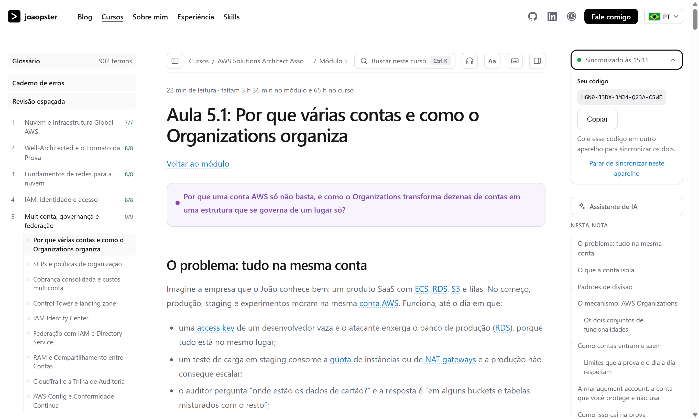
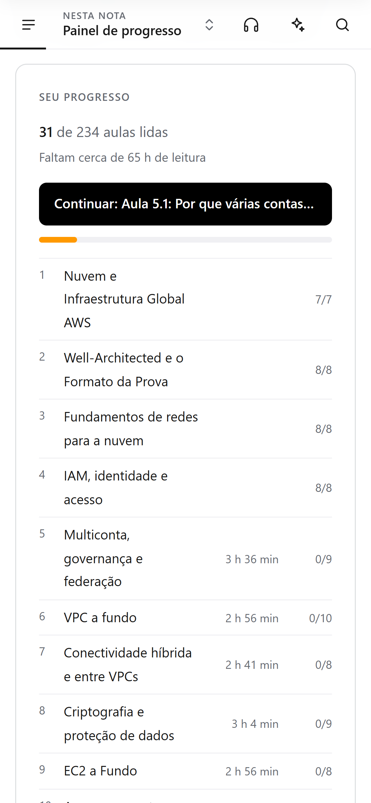
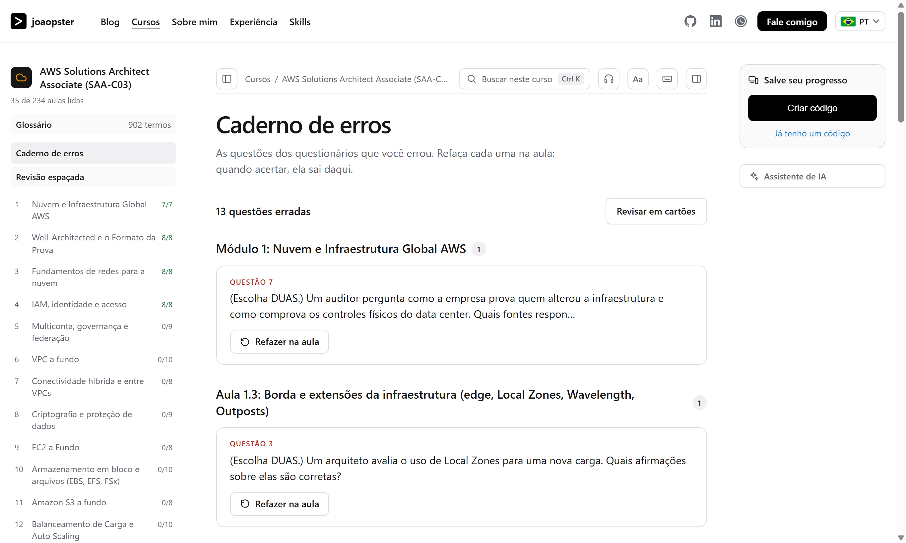
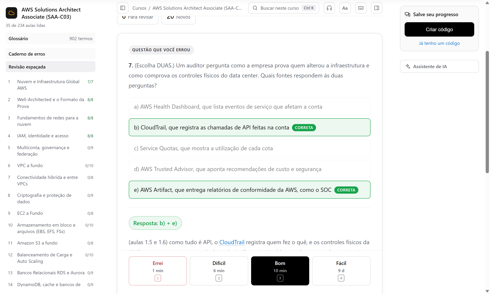
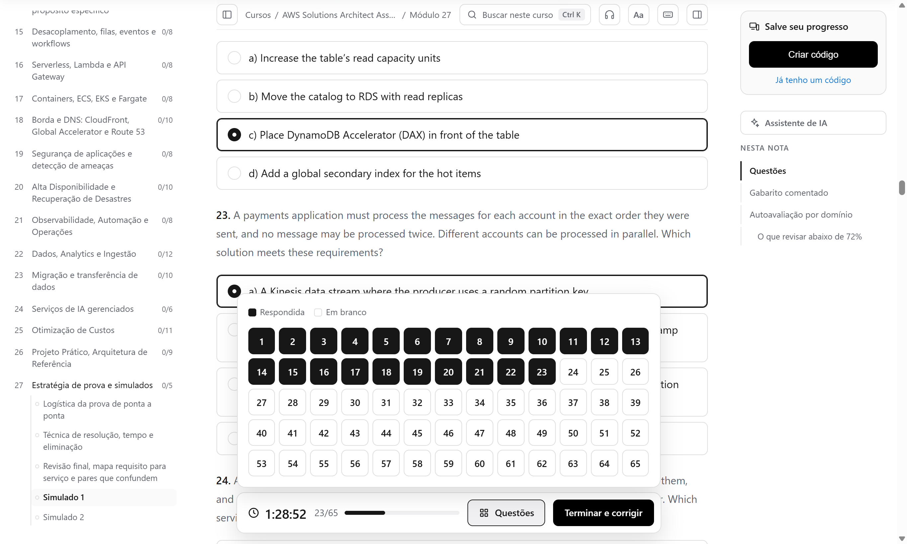
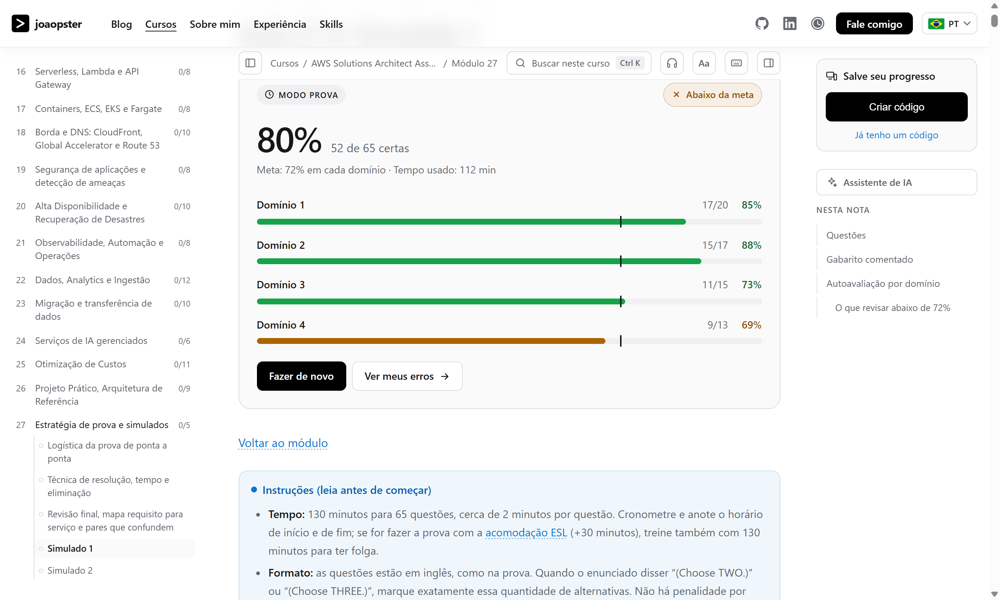
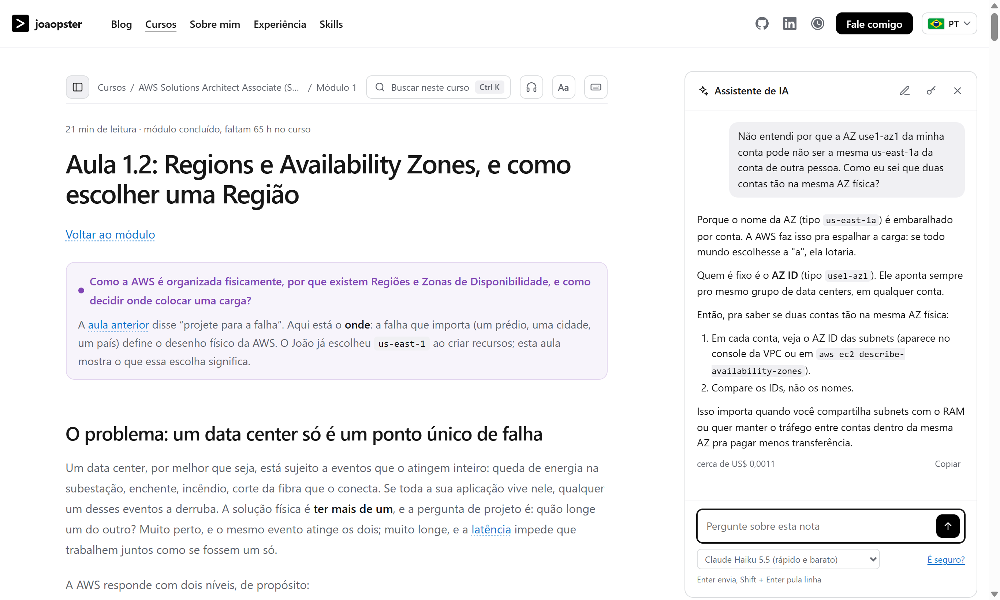
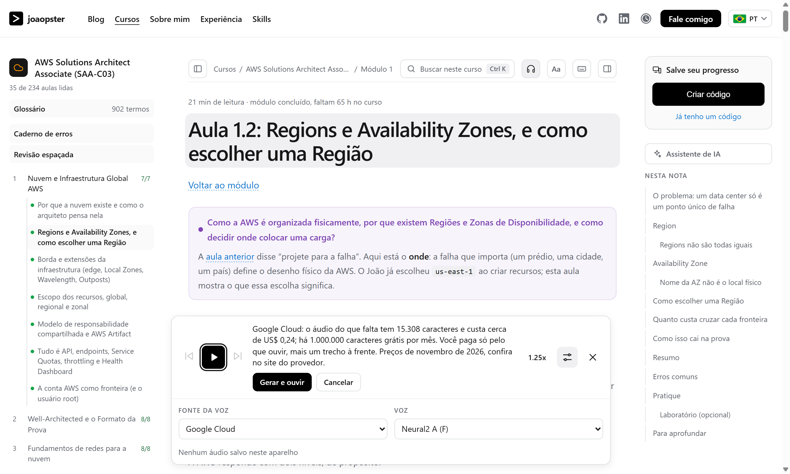
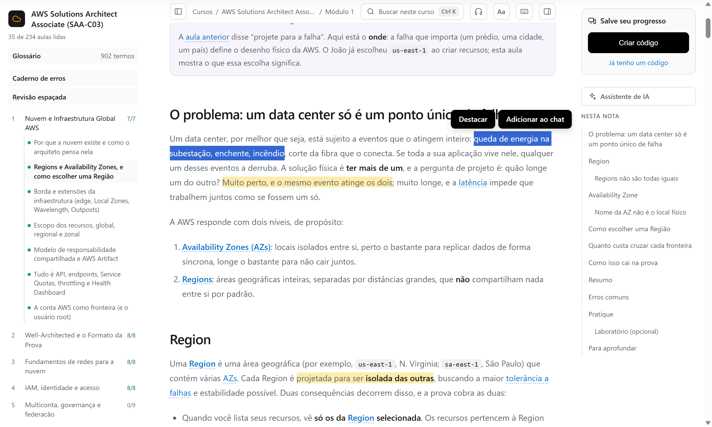
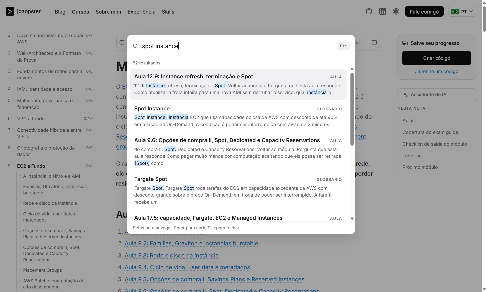

Hice cuatro cursos con IA y al principio estudiaba todo en Obsidian, que es genial para leer, pero no lleva el progreso, no corrige cuestionarios y no te recuerda lo que estás olvidando. Yo quería una herramienta así para mí, y entonces pensé, ¿por qué no la dejo abierta para todo el mundo, gratis? Así la [sección de cursos](/cursos/) de mi sitio se convirtió en una plataforma de estudio.

Para mostrar todo lo que hace usé el [curso de AWS Solutions Architect Associate](/cursos/aws-saa-c03/), que es el que estoy estudiando ahora, ya terminé 4 de los 27 módulos y me está yendo muy bien. Los cursos están en portugués, así que las capturas también, y salen de un servidor local con datos de ejemplo, así que los aciertos que aparecen no son los míos.

Cómo la IA arma los cursos ya lo conté en el [post sobre crear cursos con IA](/es/blog/como-uso-la-ia-para-crear-cursos/), este es solo sobre lo que haces con el curso una vez que existe.

## Sincronización sin cuenta, solo con un código

Esta es la parte que me parece más increíble. Estudias en la computadora, paras, agarras el celular y está todo ahí, las clases leídas, las preguntas respondidas, los resaltados. Paras otra vez, agarras la tablet, lo mismo. Yo estudio en los tres, la computadora cuando quiero concentrarme de verdad, el celular cuando ando de un lado a otro y la tablet más de noche, y sin esto tendría tres progresos distintos y ninguno correcto.

Y no hay cuenta. Haces clic en "Criar código" (crear código), el sitio genera un código de 20 caracteres y lo pegas en el otro dispositivo. No pide correo, nombre, contraseña, nada, y eso fue decisión mía, porque no quería que nadie tuviera que dar datos personales solo para estudiar. El código funciona como una contraseña, así que el servidor guarda solo su hash y no el código en sí.

Si dos dispositivos estudiaron por separado, sin conexión por ejemplo, el progreso se junta solo cuando vuelven a hablar, y cada elemento se queda con la versión más reciente.

## Cuaderno de errores

Cada clase termina con preguntas al estilo del examen y la corrección aparece al momento, y la pregunta que fallas va al cuaderno de errores, separada por módulo y por clase, con un botón para rehacerla en la clase. Si la aciertas, sale del cuaderno.

Ya fallé algunas preguntas en el curso de AWS y el cuaderno me ayudó mucho a repasarlas. Y no me deja fingir que entendí, porque si la pregunta está ahí es que todavía no sé eso.

## Repaso espaciado con FSRS

El repaso espaciado es repasar cada cosa justo antes de que la olvides. Lo que sabes bien vuelve en semanas, lo que fallas vuelve en minutos. FSRS (Free Spaced Repetition Scheduler) es el algoritmo que calcula ese momento para cada tarjeta a partir de tus respuestas, y Anki también lo ofrece desde 2023.

Lo conocí usando AnkiDroid cuando me estaba preparando para las entrevistas de Amazon, para trabajar en AWS. Funcionó. Tanto que quise lo mismo aquí, sin tener que exportar nada a Anki.

Las tarjetas salen de dos lugares, de los términos del glosario de las clases que ya marcaste como leídas y de las preguntas que fallaste. Ves la tarjeta, intentas recordar, abres la respuesta y dices cómo te fue, y en la captura se ve que "Bom" (bien) trae la tarjeta de vuelta en 10 minutos y "Fácil" en 9 días. Entran como máximo 20 tarjetas nuevas por día, para que el repaso no se vuelva una pila que nunca terminas.

## Simulacro cronometrado con nota por dominio

El curso de AWS tiene dos simulacros de 65 preguntas, igual que el examen real, con 130 minutos (2 minutos por pregunta), y mientras corre el sitio esconde la corrección, muestra un cronómetro y un mapa de las preguntas que ya respondiste y de las que quedaron en blanco.

Cuando terminas, sale la nota general y la nota de los cuatro dominios del examen, contra la meta de 72% en cada dominio. En el ejemplo de abajo la nota general fue 80%, pero el dominio 4, de arquitecturas con costos optimizados, quedó en 69%, así que aun aprobando en general sabes que tienes que volver a los módulos de costos antes del examen.

Todavía no hice el simulacro en serio, estoy estudiando un poco más antes, pero probé toda la funcionalidad y quedó muy bien. Para mí un simulacro con nota por dominio es lo básico para quien estudia para un examen, y aun así es algo que ya eché de menos en plataformas de pago.

## Asistente de IA con tu propia clave

Al lado de la clase hay un chat que ya recibe el texto de la clase entera como contexto. Lo uso mucho, cuando no entendí algo bien, cuando el texto no lo explicó bien, o cuando tengo una duda más específica que la clase ni cubre. También puedes seleccionar un fragmento y mandarlo al chat.

El asistente funciona con la clave que tú mismo pones, de Anthropic, OpenAI o Google, y tú eliges el modelo. Eso se llama BYOK (bring your own key), y lo hice así porque quería que tuvieras la libertad de elegir la IA que quieras y no quedaras atado a pagarme nada. Quiero que esto sea útil y gratis de verdad, y para ser gratis no podía cobrar nada.

La clave se queda solo en tu navegador y va directo al proveedor, sin pasar por mi servidor, y debajo de cada respuesta aparece cuánto costó. En mi caso es una fracción de centavo por respuesta, y hasta hoy gasté como mucho unos US$ 1 de API con esto.

## Escuchar la clase mientras lees

Esto y el asistente son las dos cosas que más uso. Me gusta mucho leer escuchando, pongo la clase a sonar y voy siguiendo el texto con los ojos, y el fragmento que se está leyendo queda marcado en la pantalla. Puedes usar la voz del propio navegador, que es gratis, o una voz de pago de Google Cloud, OpenAI o ElevenLabs con tu clave. Antes de generar, el sitio muestra cuánto va a costar el audio, y el audio generado queda guardado en el dispositivo para que no pagues dos veces.

## Resaltados, modo sin conexión, búsqueda y lo demás

Uso los resaltados para marcar los términos que me cuesta entender, y se sincronizan junto con el progreso. Seleccionas el fragmento y eliges entre resaltarlo o mandarlo al asistente.

El modo sin conexión guarda el curso entero en el dispositivo y abre sin internet. En el celular esto me salva todo el tiempo, la conexión se pone inestable, se cae un poco, y sigo leyendo como si nada.

La búsqueda se abre con Ctrl+K y busca cualquier término dentro del curso, en las clases y en el glosario, la uso mucho.

Y cada clase muestra el tiempo de lectura y cuánto falta en el módulo y en el curso, lo que me ayuda a saber si me da tiempo de terminar la clase antes de ir a hacer otra cosa en casa.

También hay ajuste de tamaño de letra y un modo de concentración que esconde los menús. Ese casi no lo uso porque me gusta ver dónde estoy en el curso, pero lo dejé para quien le guste.

## Lo que pienso comparándola con Udemy y Coursera

Considerando que es gratis, creo que la plataforma da mucho más que Udemy, Coursera y similares, y con una interfaz mucho más bonita. Muchas plataformas de pago fallan en lo básico de quien estudia para un examen, que es ver dónde fallaste, repasar en el momento justo y practicar en el formato del examen. La gran diferencia es que aquí no hay video, es todo texto (el porqué está en el otro post).

Los cuatro cursos están abiertos en [/cursos](/cursos/). Si estás estudiando para el SAA-C03 y lees portugués, empieza por el de AWS, crea un código de sincronización el primer día y cuéntame en los comentarios qué faltó.
