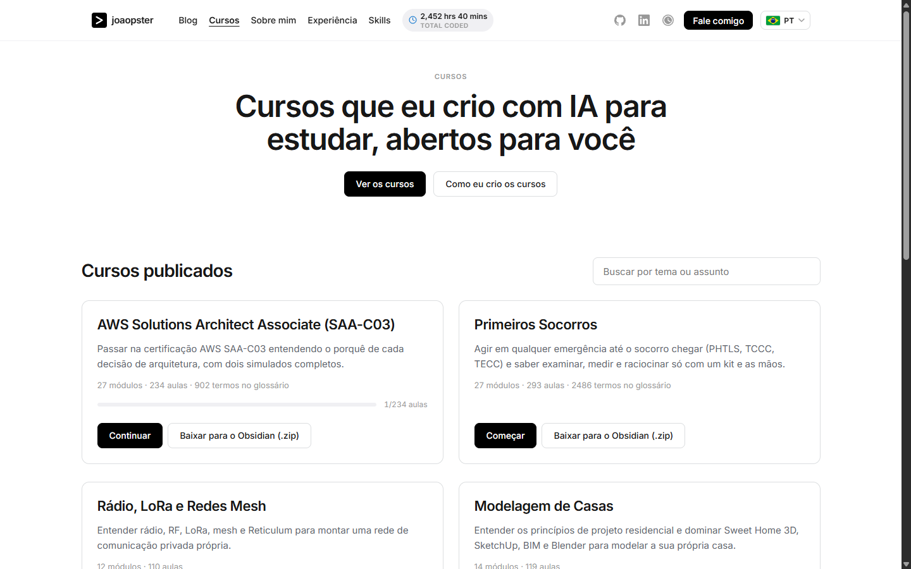
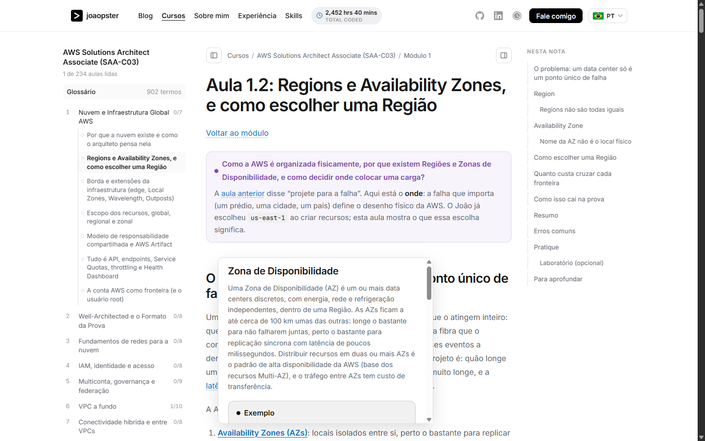

No começo de novembro a Defesa Civil soltou aquela orientação pra cada família ter um kit pra se virar sozinha por 72 horas, com água, comida e remédio, e isso caiu bem na época em que todo mundo tava falando do El Niño. Eu li aquilo e pensei, cara, eu devia saber primeiros socorros. Fui procurar e o conteúdo tava muito espalhado, difícil de achar num lugar só, e nada me levava do começo ao fim. Então eu pedi pra IA montar um curso pra mim.

Saiu um curso de 27 módulos e 293 aulas, com um glossário de 2.486 termos, baseado no PHTLS, no TCCC e no TECC, que são as referências de atendimento ao trauma. Ele e mais três cursos que eu fiz tão abertos de graça na [área de cursos do site](/cursos/), e neste post eu explico o que tem lá e por que eu acho que pedir pra IA criar um curso do jeito que você gosta de aprender é uma das melhores formas de estudar qualquer coisa hoje.

## O que tem na área de cursos

Cada curso é uma trilha de módulos em ordem, com aulas escritas em texto, glossário, questionários com gabarito e um projeto no fim ligado a um objetivo concreto (no de AWS, por exemplo, o objetivo é passar na prova). Hoje são quatro, todos em português:

| Curso | Módulos | Aulas | Termos no glossário |
|---|---|---|---|
| [AWS Solutions Architect Associate (SAA-C03)](/cursos/aws-saa-c03/) | 27 | 234 | 902 |
| [Primeiros Socorros](/cursos/primeiros-socorros/) | 27 | 293 | 2.486 |
| [Rádio, LoRa e Redes Mesh](/cursos/radio/) | 12 | 110 | não tem |
| [Modelagem de Casas](/cursos/modelagem-de-casas/) | 14 | 119 | não tem |



Dá pra ler de dois jeitos. No site, a aula tem a lista de módulos na esquerda e o índice da aula na direita, e quando você passa o mouse num termo aparece a definição dele ali mesmo, sem sair da página. O progresso fica salvo no seu navegador, então você vê quantas aulas já leu em cada módulo. E se você preferir ler offline, cada curso tem um botão que baixa o curso inteiro num .zip.



A interface tá em português, inglês e espanhol, mas os cursos que eu fiz até agora são todos em português, e cada curso aparece só na página do idioma em que ele foi escrito.

## Por que um curso feito pra você ensina melhor

Eu só aprendo começando pela base. Primeiro eu preciso entender os fundamentos, e só depois eu vou evoluindo, porque se eu não entendo o porquê de uma coisa eu não aceito aquela informação. Um curso pronto segue o jeito de quem fez ele, e quando eu peço o curso pra IA eu digo como eu aprendo e ela monta em volta disso.

A regra que eu deixei escrita é que o primeiro módulo é sempre o fundamento mais profundo do assunto, toda aula responde "por que é assim?" antes de "como se faz?", e nenhum módulo usa algo que ainda não foi ensinado. Dá pra ver isso na ordem dos cursos. O de primeiros socorros abre com "Como o corpo mantém a vida", e torniquete só aparece no módulo 5, depois de quatro módulos de base. O de AWS abre com "Por que a nuvem existe".

Numa aula de AWS o texto diz "O João já escolheu `us-east-1` ao criar recursos", o curso fala comigo pelo nome, e isso nenhum curso gravado vai fazer.

O de AWS é o que eu mais estudei até agora. Eu estudo uma ou duas horas por dia, já terminei 2 módulos e ainda não fiz nenhum simulado, mas quero fazer pra entender como é, e a prova eu pretendo fazer nos próximos meses, talvez semanas. Uma coisa que eu acho que faz muita diferença é estudar um curso feito pra certificação específica que você quer, porque ele te ensina como a prova funciona. A nota de início do curso já explica que são 65 questões, que você passa com 720 de 1.000 e quanto pesa cada domínio, e a matéria vai na proporção desse peso.

## Como a IA monta um curso

Eu uso só o Claude Code, com o Opus 5.5 e uma skill que eu escrevi, a `criar-curso`. Skill é um arquivo de instruções que o Claude carrega quando o pedido bate com a descrição dela, e a minha diz o processo inteiro:

1. Entender o tema e aonde eu quero chegar.
2. Desenhar o currículo, com os módulos em ordem de dependência, e me mostrar pra eu aprovar antes de pesquisar qualquer coisa.
3. Pesquisar e escrever, com um agente por módulo, até 5 em paralelo, todos lendo o mesmo guia de escrita.
4. Juntar tudo, conferir se os fatos batem entre os módulos e ligar cada termo ao glossário.
5. Verificar por script, sem link quebrado, sem termo sem link e com gabarito sem viés (a resposta certa não pode ser sempre a mais longa).

Eu rodo isso com o `/workflow` do Claude Code, que lança vários subagentes (outras instâncias do Claude, cada uma com a sua tarefa) e junta o que eles devolvem, e eu falei mais dele no [post sobre o harness do Claude Code](/blog/claude-code-harness-workflows-obsoletos/). Só o curso de AWS usou uns 483 agentes, espalhados em vários workflows.

Um curso leva de 2 a 3 horas pra ficar pronto, depende do tamanho, e é basicamente one shot, porque os próprios workflows pesquisam, escrevem e revisam, então as idas e voltas a IA faz sozinha, sem eu encostar em nada. Eu uso o plano Ultra, e cada curso come uns 1 a 2% do meu uso semanal, é bem pouco.

Os dois primeiros que eu fiz, Modelagem de Casas e depois Rádio, em setembro, saíram de uma versão bem embrionária da skill, e é por isso que eles nem têm glossário. Ela foi crescendo de lá pra cá.

## A IA erra?

Erra, com certeza, é natural de IA e não tem muito como fugir disso. O que dá pra fazer é obrigar ela a pesquisar e analisar bastante na internet antes de escrever qualquer coisa, que é o que a skill faz, e conferir você mesmo os pontos que são críticos.

O que eu mais vejo é a IA indo pro genérico. Uma vez eu pedi uns cartões de referência rápida de primeiros socorros e ela me devolveu umas explicações enormes e bagunçadas, que pra um cartão que você precisa ler em dois segundos numa emergência era horrível. Eu tive que refinar o pedido até sair o que eu queria, e a skill no fundo é isso, um prompt que eu já refinei pra não cair no genérico.

Agora, pra quem fala que IA ensina errado e por isso não serve pra aprender, eu lembro que livro erra, professor erra e vídeo do YouTube erra, e ninguém parou de ler livro por causa disso. Quem descarta a IA inteira porque ela pode errar tá jogando fora o professor mais paciente que já apareceu.

## Como criar o seu curso

Eu abri os cursos porque eu acho que conhecimento é uma coisa que a gente tem que passar adiante. Isso faz parte de mim, eu fico muito feliz ensinando, e eu quero que todo mundo evolua. E eles são em texto porque texto você lê no seu tempo, volta quando quiser e não precisa de fone.

E a skill tá aberta junto, na página [Como eu crio os cursos](/cursos/como-criar/). Pra usar:

1. Baixe o .zip da skill.
2. No Claude Code, descompacte e copie a pasta `criar-curso` pra `~/.claude/skills/`. No claude.ai ou no app, envie o .zip em Configurações, Capacidades, Skills. Em outra IA, cole o conteúdo do `SKILL.md` e do `guia-de-escrita.md` como instrução.
3. Peça dizendo o tema e aonde você quer chegar, assim:

```text
Aprendendo fotografia, quero chegar em fotografar um casamento sozinho.
```

Ela te mostra o currículo pra aprovar, escreve os módulos e verifica tudo no fim, e aí é só abrir a pasta `Aprendendo Fotografia` e começar a estudar.

Se você criar um curso, me manda no joao@joaopster.com. Eu leio, reviso e, se estiver bom, publico no site com os créditos pra você, pra mais gente aprender também.
