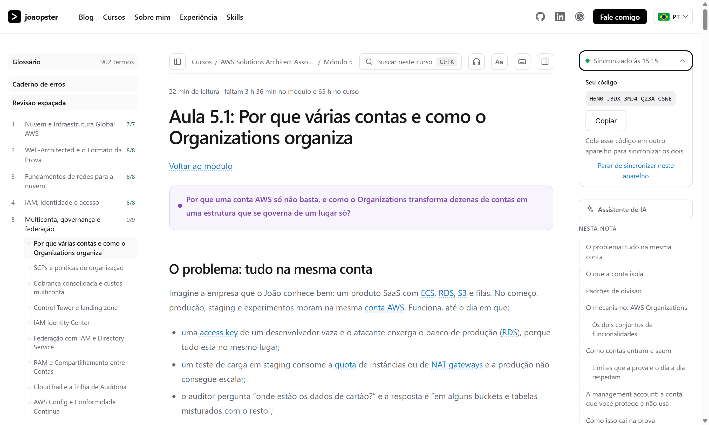
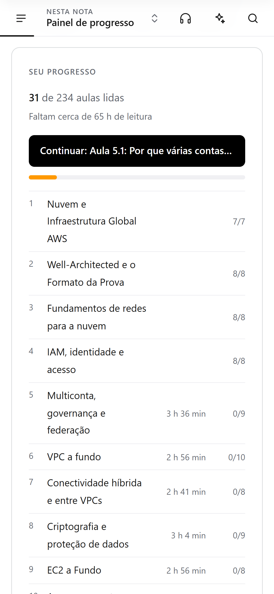
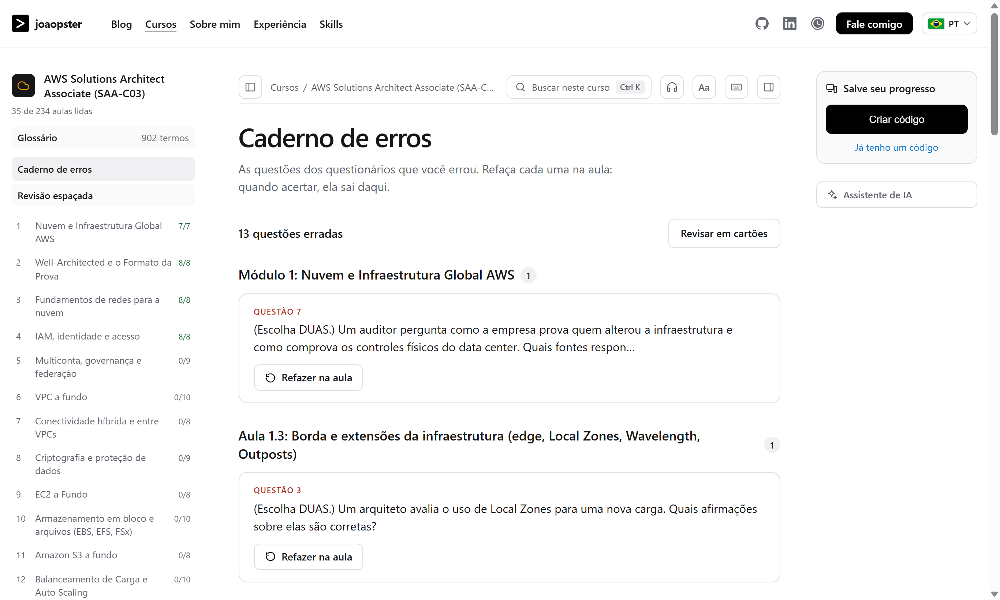
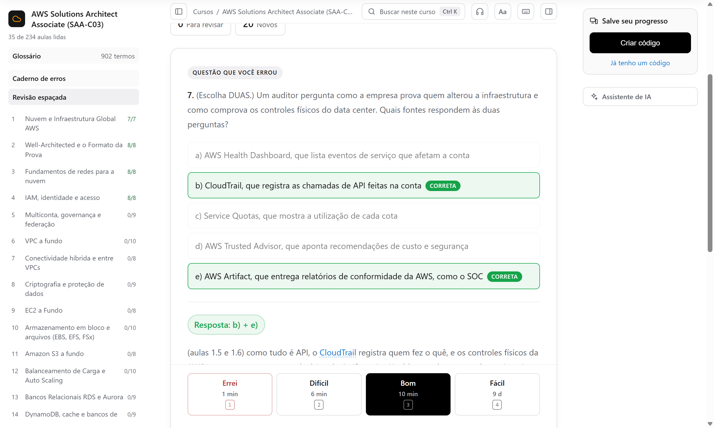
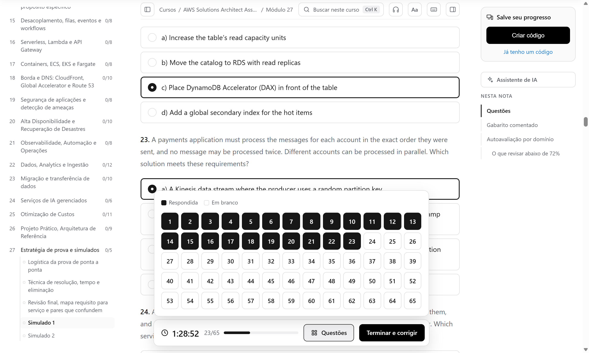
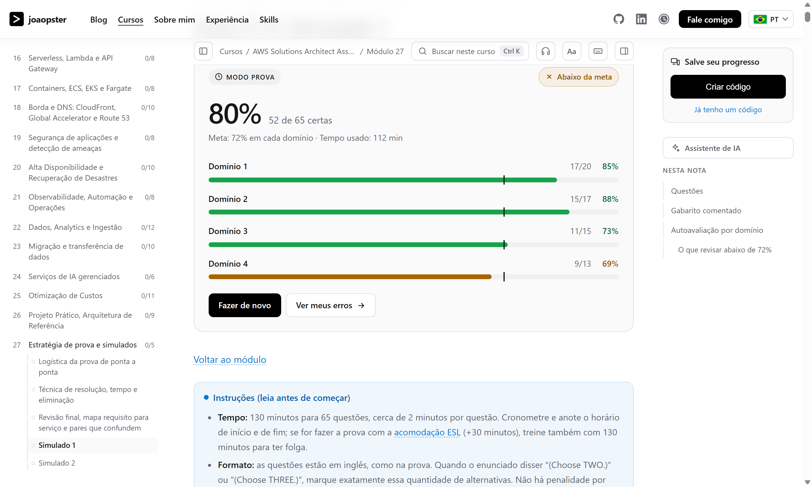
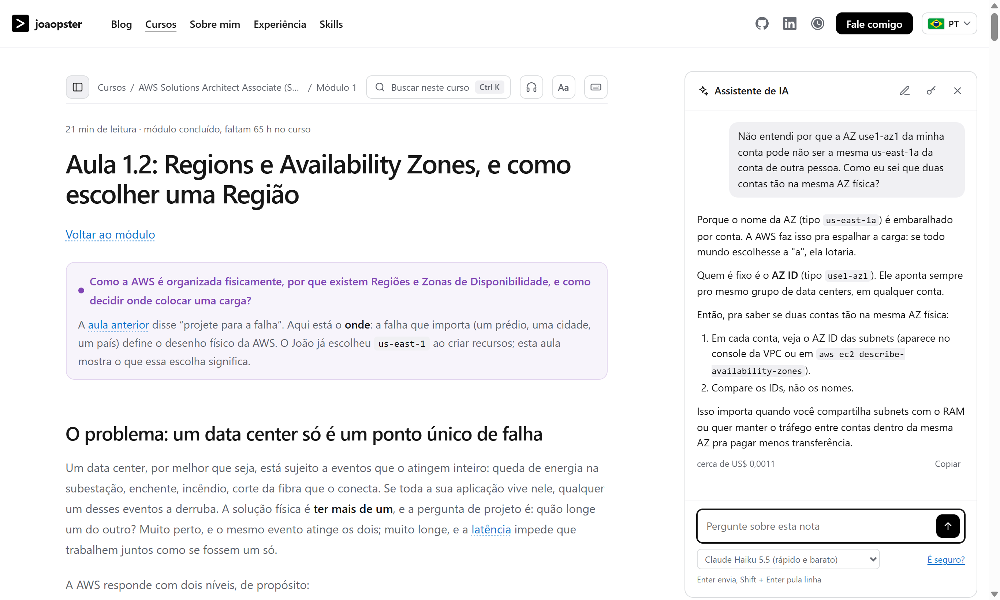
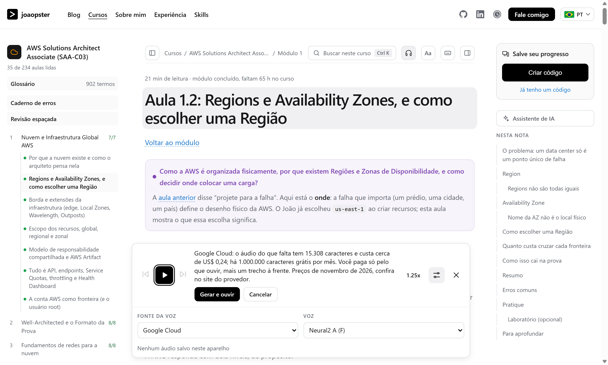
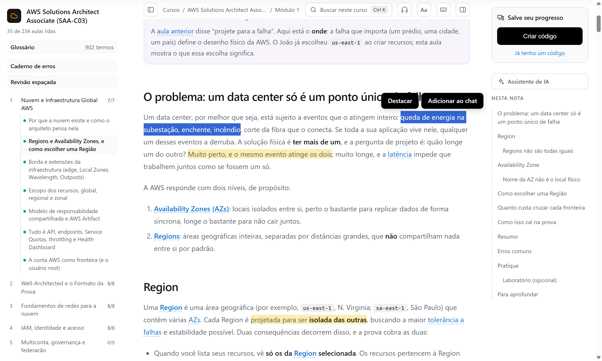
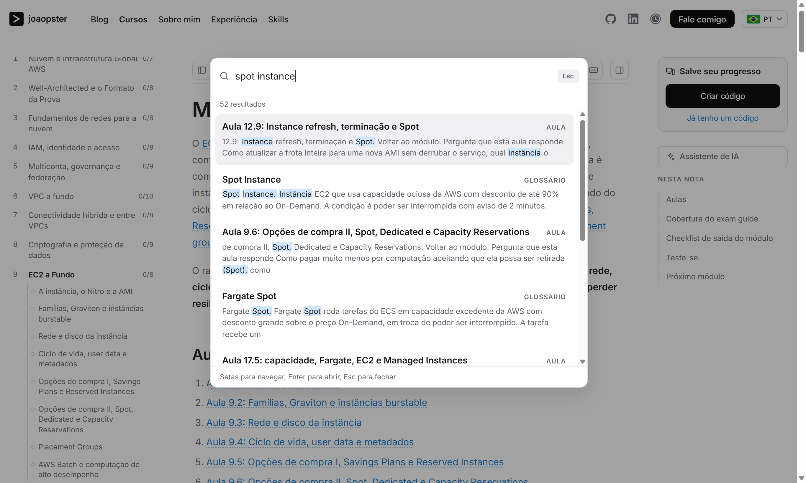

Eu fiz quatro cursos com IA e no começo estudava tudo no Obsidian, que é ótimo pra ler, só que ele não tem rastreador de progresso, não corrige questionário e não te lembra do que você tá esquecendo. Eu queria uma ferramenta assim pra mim, e aí pensei, pô, por que eu não deixo isso aberto pra todo mundo, de graça? Foi assim que a [área de cursos](/cursos/) do site virou uma plataforma de estudos.

Pra mostrar cada coisa que ela faz eu usei o [curso de AWS Solutions Architect Associate](/cursos/aws-saa-c03/), que é o que eu tô estudando agora, já terminei 4 dos 27 módulos e tô indo muito bem. Os prints são de um servidor local com dados de exemplo, então os números de acerto que aparecem não são os meus.

Como a IA monta os cursos eu já contei no [post sobre criar cursos com IA](/blog/cursos-criados-com-ia/), aqui é só sobre o que você faz com o curso depois que ele existe.

## Sincronização sem login, só com um código

Essa é a parte que eu acho mais sensacional. Você estuda no computador, para, pega o celular e tá tudo lá, as aulas lidas, as questões respondidas, os destaques. Para de novo, pega o tablet, mesma coisa. Eu estudo nos três, o computador quando eu quero foco de verdade, o celular quando eu tô me movendo pra lá e pra cá e o tablet mais de noite, e sem isso eu ia ter três progressos diferentes e nenhum certo.

E não tem conta. Você clica em "Criar código", o site gera um código de 20 caracteres e você cola ele no outro aparelho. Não pede e-mail, nome, senha, nada, e isso foi decisão minha, porque eu não queria ninguém informando dado pessoal só pra estudar. O código funciona como uma senha, então o servidor guarda só o hash dele e não o código em si.

Se dois aparelhos estudaram separados, offline por exemplo, o progresso junta sozinho quando eles conversam de novo, e cada item fica com a versão mais recente.

## Caderno de erros

Toda aula termina com questões no estilo da prova e a correção aparece na hora, e a questão que você erra vai pro caderno de erros, separada por módulo e por aula, com um botão pra refazer ela lá na aula. Acertou, ela sai do caderno.

Eu já errei algumas questões no curso de AWS e o caderno me ajudou muito a revisar elas. E ele não me deixa fingir que entendi, porque se a questão tá ali é porque eu ainda não sei aquilo.

## Revisão espaçada com FSRS

Revisão espaçada é revisar cada coisa logo antes de você esquecer ela. O que você sabe bem volta daqui a semanas, o que você erra volta daqui a minutos. O FSRS (Free Spaced Repetition Scheduler) é o algoritmo que calcula esse momento pra cada cartão a partir das suas respostas, e o Anki também oferece ele desde 2023.

Eu conheci isso usando o AnkiDroid quando eu tava me preparando pras entrevistas da Amazon, pra trabalhar na AWS. Funcionou. Tanto que eu quis o mesmo aqui, sem precisar exportar nada pro Anki.

Os cartões saem de dois lugares, dos termos do glossário das aulas que você já marcou como lidas e das questões que você errou. Você vê o cartão, tenta lembrar, abre a resposta e diz como foi, e no print dá pra ver que "Bom" traz o cartão de volta em 10 minutos e "Fácil" em 9 dias. Entram no máximo 20 cartões novos por dia, pra revisão não virar uma pilha que você nunca termina.

## Simulado cronometrado com nota por domínio

O curso de AWS tem dois simulados de 65 questões, igual à prova de verdade, com 130 minutos (2 minutos por questão), e enquanto ele roda o site esconde a correção, mostra um cronômetro e um mapa das questões que você já respondeu e das que ficaram em branco.

Quando você termina, sai a nota geral e a nota dos quatro domínios da prova, contra a meta de 72% em cada domínio. No exemplo abaixo a nota geral foi 80%, só que o domínio 4, de arquitetura com custo otimizado, ficou em 69%, então mesmo passando no geral dá pra saber que tem que voltar nos módulos de custo antes da prova.

Eu ainda não fiz o simulado pra valer, tô estudando mais um pouco antes, mas testei a funcionalidade inteira e ficou muito bom. Pra mim simulado com nota por domínio é o básico de quem estuda pra prova, e mesmo assim é coisa que eu já senti falta em plataforma paga.

## Assistente de IA com a sua chave

Do lado da aula tem um chat que já recebe o texto da aula inteira como contexto. Eu uso muito, quando eu não entendi alguma coisa direito, quando o texto não explicou bem, ou quando eu tenho uma dúvida mais específica que a aula nem cobre. Dá pra selecionar um trecho e mandar ele pro chat também.

O assistente funciona com a chave que você mesmo informa, da Anthropic, da OpenAI ou do Google, e você escolhe o modelo. Isso se chama BYOK (bring your own key), e eu fiz assim porque eu queria que você tivesse liberdade de escolher a IA que quiser e não ficasse preso a pagar nada pra mim. Eu quero que isso seja útil e gratuito de verdade, e pra ser gratuito eu não podia cobrar nada.

A chave fica só no seu navegador e vai direto pro provedor, sem passar pelo meu servidor, e embaixo de cada resposta aparece quanto ela custou. No meu caso é fração de centavo por resposta, e até hoje eu gastei no máximo uns US$ 1 de API com isso.

## Ouvir a aula enquanto lê

Isso e o assistente são as duas coisas que eu mais uso. Eu gosto muito de ler ouvindo, coloco a aula pra tocar e vou acompanhando o texto com os olhos, e o trecho que tá sendo lido fica marcado na tela. Dá pra usar a voz do próprio navegador, que é grátis, ou uma voz paga do Google Cloud, da OpenAI ou da ElevenLabs com a sua chave. Antes de gerar, o site mostra quanto o áudio vai custar, e o áudio gerado fica salvo no aparelho pra você não pagar duas vezes.

## Destaques, modo offline, busca e o resto

Eu uso os destaques pra marcar os termos que eu tenho dificuldade de entender, e eles sincronizam junto com o progresso. Você seleciona o trecho e escolhe entre destacar ou mandar ele pro assistente.

O modo offline salva o curso inteiro no aparelho e ele abre sem internet. No celular isso me salva direto, a conexão fica instável, cai um pouco, e eu continuo lendo como se nada tivesse acontecido.

A busca abre com Ctrl+K e procura qualquer termo dentro do curso, nas aulas e no glossário, eu uso muito.

E cada aula mostra o tempo de leitura e quanto falta no módulo e no curso, que me ajuda a saber se dá pra terminar a aula antes de ir fazer outra coisa em casa.

Tem também ajuste de fonte e modo foco, que esconde os menus. Esse eu quase não uso porque eu gosto de ver onde eu tô no curso, mas deixei pra quem gosta.

## O que eu acho comparando com Udemy e Coursera

Considerando que é de graça, eu acho que a plataforma entrega muito mais do que Udemy, Coursera e afins entregam, e com uma interface bem mais bonita. Muita plataforma paga falha no básico de quem estuda pra uma prova, que é ver onde errou, revisar no tempo certo e treinar no formato da prova. A diferença grande é que aqui não tem vídeo, é tudo texto (o porquê disso tá no outro post).

Os quatro cursos tão abertos em [/cursos](/cursos/). Se você tá estudando pra SAA-C03, começa pelo de AWS, cria um código de sincronização no primeiro dia e me conta nos comentários o que faltou.
